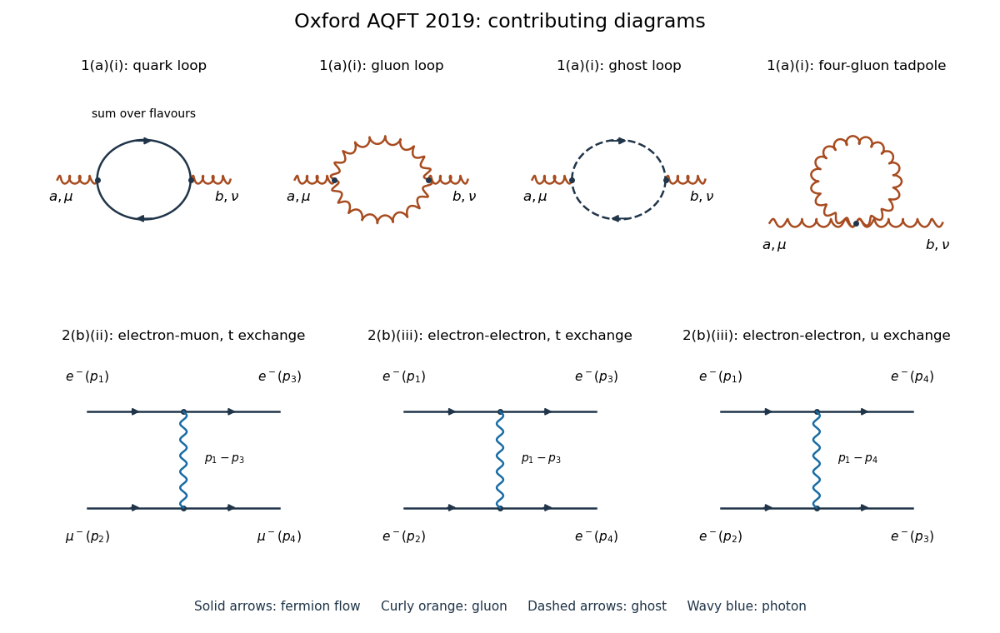

# 2019

↑ **Parent:** [Past exam of the advanced quantum field theory for particle physics course of the University of Oxford](split.md)

Source paper: [https://www.whatdotheyknow.com/request/oxford_physics_past_papers_2/response/2340696/attach/7/Physics%20Papers%202018.pdf?cookie_passthrough=1](https://www.whatdotheyknow.com/request/oxford_physics_past_papers_2/response/2340696/attach/7/Physics%20Papers%202018.pdf?cookie_passthrough=1)

The bundle filename says 2018, but the paper's cover establishes Trinity Term 2019, 24 April 2019, and formal code A15272W1. These are solutions to that 2019 paper. Use [natural units](../natural-units.md), the [Minkowski metric](../minkowski-metric.md) $g=\operatorname{diag}(1,-1,-1,-1)$, and the [Feynman i-epsilon prescription](../feynman-i-epsilon-prescription.md). Write $\not p=\gamma^\mu p_\mu$. In question 1, $D=4-\epsilon$, $g_D=\mu^{\epsilon/2}g$, and the amputated [gluon self-energy](../gluon-self-energy.md) insertion is **$i\Pi^{\mu\nu,ab}$**. This fixes the overall sign and factor of $i$ in the results below; defining the insertion as $-i\Pi$ instead reverses all corresponding definitions of $\Pi$. The [quadratic Casimir operator](../quadratic-casimir-operator.md) in the [Adjoint representation](../adjoint-representation-of-a-lie-algebra.md) is $C_A=N_c$ for $SU(N_c)$, hence $C_A=3$ in [QCD](../quantum-chromodynamics.md).

**[Figure 1](#image-one-loop-gluon-self-energy-and-tree-level-charged-lepton-scattering). One-loop gluon self-energy and tree-level charged-lepton scattering**. Original [Feynman diagrams](../feynman-diagram.md). The upper row gives the [quark](../quark.md) loop, two-three-gluon-vertex loop, [Faddeev-Popov ghost field](../faddeev-popov-ghost.md) loop, and four-gluon [tadpole diagram](../tadpole-diagram.md). The lower row gives the single [electron](../electron.md)-[muon](../muon.md) exchange graph and the two exchange graphs for [Møller scattering](../moller-scattering.md). Solid arrows indicate [fermion flow](../fermion-flow.md), curly orange lines denote [gluons](../gluon.md), dashed arrows denote [Faddeev-Popov ghost fields](../faddeev-popov-ghost.md), and wavy blue lines denote [photons](../photon.md). A crossing without a dot is not a [Feynman vertex](../interaction-vertex.md).

**Table of contents**

- [1](2019/1.md)
  - [a](2019/1/a.md)
    - [i](2019/1/a/i.md)
      - [Solution](2019/1/a/i/solution.md)
    - [ii](2019/1/a/ii.md)
      - [Solution](2019/1/a/ii/solution.md)
    - [iii](2019/1/a/iii.md)
      - [Solution](2019/1/a/iii/solution.md)
    - [iv](2019/1/a/iv.md)
      - [Solution](2019/1/a/iv/solution.md)
  - [b](2019/1/b.md)
    - [Solution](2019/1/b/solution.md)
- [2](2019/2.md)
  - [a](2019/2/a.md)
    - [i](2019/2/a/i.md)
      - [Solution](2019/2/a/i/solution.md)
    - [ii](2019/2/a/ii.md)
      - [Solution](2019/2/a/ii/solution.md)
  - [b](2019/2/b.md)
    - [i](2019/2/b/i.md)
      - [Solution](2019/2/b/i/solution.md)
    - [ii](2019/2/b/ii.md)
      - [Solution](2019/2/b/ii/solution.md)
    - [iii](2019/2/b/iii.md)
      - [Solution](2019/2/b/iii/solution.md)
- [3](2019/3.md)
  - [a](2019/3/a.md)
    - [Solution](2019/3/a/solution.md)
  - [b](2019/3/b.md)
    - [i](2019/3/b/i.md)
      - [Solution](2019/3/b/i/solution.md)
    - [ii](2019/3/b/ii.md)
      - [Solution](2019/3/b/ii/solution.md)
    - [iii](2019/3/b/iii.md)
      - [Solution](2019/3/b/iii/solution.md)
    - [iv](2019/3/b/iv.md)
      - [Solution](2019/3/b/iv/solution.md)

## ↑ Ancestors (9)

1. [Past exam of the advanced quantum field theory for particle physics course of the University of Oxford](split.md)
2. [Advanced quantum field theory for particle physics course of the University of Oxford](../advanced-quantum-field-theory-for-particle-physics-course-of-the-university-of-oxford.md)
3. [Year 4 of the mathematical and theoretical physics course of the University of Oxford](../year-4-of-the-mathematical-and-theoretical-physics-course-of-the-university-of-oxford.md)
4. [Mathematical and theoretical physics course of the University of Oxford](../mathematical-and-theoretical-physics-course-of-the-university-of-oxford.md)
5. [Undergraduate course of the University of Oxford](../undergraduate-course-of-the-university-of-oxford.md)
6. [Course of the University of Oxford](../course-of-the-university-of-oxford.md)
7. [University of Oxford](../university-of-oxford-split.md)
8. [List of universities](../list-of-universities.md)
9. [Codex Wiki](../split.md)
