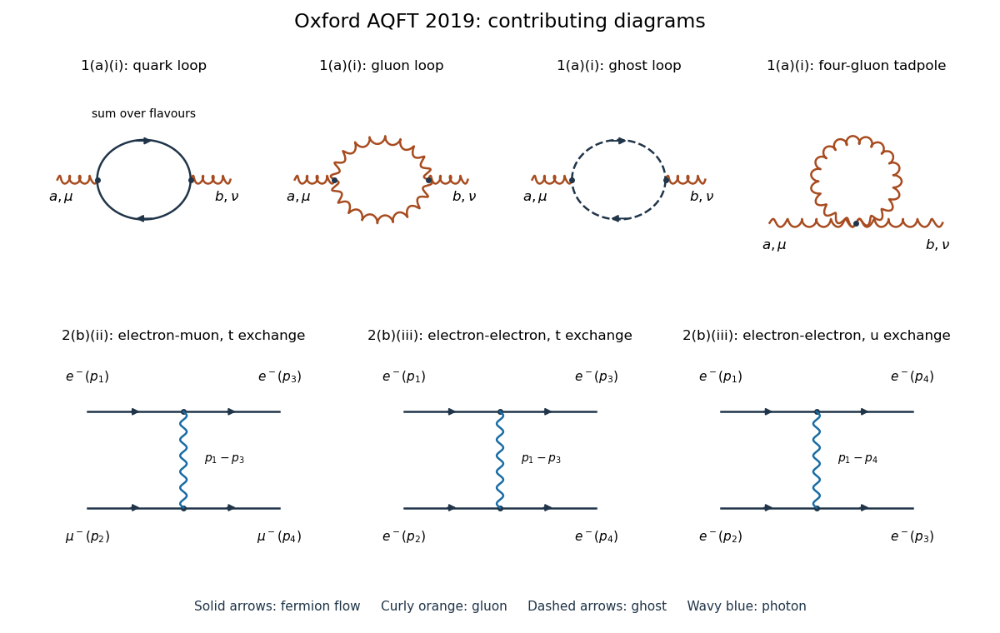

# 2019

↑ **Parent:** [Past exam of the advanced quantum field theory for particle physics course of the University of Oxford](../past-exam-of-the-advanced-quantum-field-theory-for-particle-physics-course-of-the-university-of-oxford.md)

Source paper: [https://www.whatdotheyknow.com/request/oxford_physics_past_papers_2/response/2340696/attach/7/Physics%20Papers%202018.pdf?cookie_passthrough=1](https://www.whatdotheyknow.com/request/oxford_physics_past_papers_2/response/2340696/attach/7/Physics%20Papers%202018.pdf?cookie_passthrough=1)

The bundle filename says 2018, but the paper's cover establishes Trinity Term 2019, 24 April 2019, and formal code A15272W1. These are solutions to that 2019 paper. Use [natural units](../mathematical-physics.md#natural-units), the [Minkowski metric](../special-relativity.md#minkowski-metric) $g=\operatorname{diag}(1,-1,-1,-1)$, and the [Feynman i-epsilon prescription](../quantum-field-theory.md#feynman-i-epsilon-prescription). Write $\not p=\gamma^\mu p_\mu$. In question 1, $D=4-\epsilon$, $g_D=\mu^{\epsilon/2}g$, and the amputated [gluon self-energy](../perturbative-quantum-field-theory.md#gluon-self-energy) insertion is **$i\Pi^{\mu\nu,ab}$**. This fixes the overall sign and factor of $i$ in the results below; defining the insertion as $-i\Pi$ instead reverses all corresponding definitions of $\Pi$. The [quadratic Casimir operator](../semisimple-lie-algebra.md#quadratic-casimir-operator) in the [Adjoint representation](../lie-algebra.md#adjoint-representation-of-a-lie-algebra) is $C_A=N_c$ for $SU(N_c)$, hence $C_A=3$ in [QCD](../standard-model.md#quantum-chromodynamics).

**[Figure 1](#image-one-loop-gluon-self-energy-and-tree-level-charged-lepton-scattering). One-loop gluon self-energy and tree-level charged-lepton scattering**. Original [Feynman diagrams](../perturbative-quantum-field-theory.md#feynman-diagram). The upper row gives the [quark](../standard-model.md#quark) loop, two-three-gluon-vertex loop, [Faddeev-Popov ghost field](../relativistic-quantum-field.md#faddeev-popov-ghost) loop, and four-gluon [tadpole diagram](../perturbative-quantum-field-theory.md#tadpole-diagram). The lower row gives the single [electron](../physics.md#electron)-[muon](../standard-model.md#muon) exchange graph and the two exchange graphs for [Møller scattering](../perturbative-quantum-field-theory.md#moller-scattering). Solid arrows indicate [fermion flow](../perturbative-quantum-field-theory.md#fermion-flow), curly orange lines denote [gluons](../standard-model.md#gluon), dashed arrows denote [Faddeev-Popov ghost fields](../relativistic-quantum-field.md#faddeev-popov-ghost), and wavy blue lines denote [photons](../quantum-mechanics.md#photon). A crossing without a dot is not a [Feynman vertex](../perturbative-quantum-field-theory.md#interaction-vertex).

**Table of contents**

- [1](#1)
  - [a](#1/a)
    - [i](#1/a/i)
      - [Solution](#1/a/i/solution)
    - [ii](#1/a/ii)
      - [Solution](#1/a/ii/solution)
    - [iii](#1/a/iii)
      - [Solution](#1/a/iii/solution)
    - [iv](#1/a/iv)
      - [Solution](#1/a/iv/solution)
  - [b](#1/b)
    - [Solution](#1/b/solution)
- [2](#2)
  - [a](#2/a)
    - [i](#2/a/i)
      - [Solution](#2/a/i/solution)
    - [ii](#2/a/ii)
      - [Solution](#2/a/ii/solution)
  - [b](#2/b)
    - [i](#2/b/i)
      - [Solution](#2/b/i/solution)
    - [ii](#2/b/ii)
      - [Solution](#2/b/ii/solution)
    - [iii](#2/b/iii)
      - [Solution](#2/b/iii/solution)
- [3](#3)
  - [a](#3/a)
    - [Solution](#3/a/solution)
  - [b](#3/b)
    - [i](#3/b/i)
      - [Solution](#3/b/i/solution)
    - [ii](#3/b/ii)
      - [Solution](#3/b/ii/solution)
    - [iii](#3/b/iii)
      - [Solution](#3/b/iii/solution)
    - [iv](#3/b/iv)
      - [Solution](#3/b/iv/solution)

## 1

↑ **Parent:** [2019](2019.md)

<h3 id="1/a">a</h3>

↑ **Parent:** [1](#1)

<h4 id="1/a/i">i</h4>

↑ **Parent:** [A](#1/a)

<h5 id="1/a/i/solution">Solution</h5>

↑ **Parent:** [I](#1/a/i)

There are four topologies for the one-loop [gluon self-energy](../perturbative-quantum-field-theory.md#gluon-self-energy), shown in the upper row of the figure:

- A closed [quark](../standard-model.md#quark) loop with the two external [gluons](../standard-model.md#gluon) attached through quark-gluon [Feynman vertices](../perturbative-quantum-field-theory.md#interaction-vertex), summed over active [quark flavors](../standard-model.md#quark-flavor).
- A loop of two internal [gluons](../standard-model.md#gluon) joining two three-gluon [Feynman vertices](../perturbative-quantum-field-theory.md#interaction-vertex), each carrying one external [gluon](../standard-model.md#gluon).
- A closed [Faddeev-Popov ghost field](../relativistic-quantum-field.md#faddeev-popov-ghost) loop with two ghost-gluon [Feynman vertices](../perturbative-quantum-field-theory.md#interaction-vertex).
- A single four-gluon [Feynman vertex](../perturbative-quantum-field-theory.md#interaction-vertex) with two external [gluons](../standard-model.md#gluon) and its remaining two legs contracted into a [tadpole diagram](../perturbative-quantum-field-theory.md#tadpole-diagram).

The two internal-[gluon](../standard-model.md#gluon) graphs have [symmetry factor](../perturbative-quantum-field-theory.md#feynman-diagram-symmetry-factor) $1/2$. The directed [quark](../standard-model.md#quark) and [ghost loops](../relativistic-quantum-field.md#ghost-loop) have [symmetry factor](../perturbative-quantum-field-theory.md#feynman-diagram-symmetry-factor) one and a minus sign for a closed anticommuting loop. The four-gluon [tadpole diagram](../perturbative-quantum-field-theory.md#tadpole-diagram) must be included in the list even though its massless [Feynman integral](../perturbative-quantum-field-theory.md#feynman-integral) vanishes in [dimensional regularization](../perturbative-quantum-field-theory.md#dimensional-regularization). Local [counterterms](../perturbative-quantum-field-theory.md#counterterm) are excluded here.

<h4 id="1/a/ii">ii</h4>

↑ **Parent:** [A](#1/a)

<h5 id="1/a/ii/solution">Solution</h5>

↑ **Parent:** [Ii](#1/a/ii)

Route a directed [ghost loop](../relativistic-quantum-field.md#ghost-loop) so that its internal [four-momenta](../special-relativity.md#four-momentum) are $l$ and $l+k$. At the external [gluon](../standard-model.md#gluon) with indices $(\mu,a)$, let the incoming ghost carry colour $c$ and the outgoing ghost carry colour $d$; the other [Feynman vertex](../perturbative-quantum-field-theory.md#interaction-vertex) has the reverse order. The stated ghost-gluon [Feynman rules](../perturbative-quantum-field-theory.md#feynman-rules) supply $g_D^2f^{acd}f^{bdc}(l+k)^\mu l^\nu$. Their [colour factor](../standard-model.md#color-factor) is

$$
f^{acd}f^{bdc}=-C_A\delta^{ab}.
$$

The two [ghost propagators](../relativistic-quantum-field.md#ghost-propagator) supply $i^2=-1$, while the closed [ghost loop](../relativistic-quantum-field.md#ghost-loop) supplies another $-1$. Thus, with the insertion convention stated above,

$$
i\Pi_{\mathrm{gh}}^{\mu\nu,ab}=-g_D^2C_A\delta^{ab}I^{\mu\nu},\qquad
I^{\mu\nu}=\int\frac{d^Dl}{(2\pi)^D}\frac{(l+k)^\mu l^\nu}{(l^2+i0)((l+k)^2+i0)}.
$$

This establishes every prefactor before integration. To isolate its [ultraviolet pole](../perturbative-quantum-field-theory.md#ultraviolet-pole), take generic [off shell](../classical-field-theory.md#off-shell) $k$, initially $k^2<0$, so the massless integral has no overlapping [infrared divergence](../quantum-field-theory.md#infrared-divergence). Introduce a [Feynman parameter](../perturbative-quantum-field-theory.md#feynman-parameter), shift $r=l+xk$, and set $\Delta=-x(1-x)k^2>0$. Odd powers of $r$ vanish, giving

$$
I^{\mu\nu}=\int_0^1dx\left[\frac{g^{\mu\nu}}{D}\int\frac{d^Dr}{(2\pi)^D}\frac{r^2}{(r^2-\Delta+i0)^2}-x(1-x)k^\mu k^\nu\int\frac{d^Dr}{(2\pi)^D}\frac1{(r^2-\Delta+i0)^2}\right].
$$

The needed [dimensional regularization](../perturbative-quantum-field-theory.md#dimensional-regularization) integrals follow from the supplied [gamma function](../complex-analysis.md#gamma-function) formula. In $D=4-\epsilon$,

$$
\begin{aligned}
J_1(\Delta)&=\int\frac{d^Dr}{(2\pi)^D}\frac1{r^2-\Delta+i0}
=\frac{i\Delta}{16\pi^2}\frac2\epsilon+O(1),\\
J_2(\Delta)&=\int\frac{d^Dr}{(2\pi)^D}\frac1{(r^2-\Delta+i0)^2}
=\frac{i}{16\pi^2}\frac2\epsilon+O(1),\\
\int\frac{d^Dr}{(2\pi)^D}\frac{r^2}{(r^2-\Delta+i0)^2}&=J_1+\Delta J_2=\frac{i}{16\pi^2}\frac{4\Delta}{\epsilon}+O(1).
\end{aligned}
$$

Here $\Gamma(\epsilon/2)=2/\epsilon+O(1)$, rather than $1/\epsilon$. Using $1/D=1/4+O(\epsilon)$ and $\int_0^1x(1-x)\,dx=1/6$, obtain

$$
I^{\mu\nu}\big|_{\mathrm{UV}}=-\frac{i}{96\pi^2\epsilon}\left(k^2g^{\mu\nu}+2k^\mu k^\nu\right).
$$

Therefore the [ghost-loop pole of the gluon self-energy](../perturbative-quantum-field-theory.md#ghost-loop-pole-of-the-gluon-self-energy) is

$$
\boxed{\Pi_{\mathrm{gh}}^{\mu\nu,ab}\big|_{\mathrm{UV}}=\frac{g^2C_A\delta^{ab}}{96\pi^2\epsilon}\left(k^2g^{\mu\nu}+2k^\mu k^\nu\right).}
$$

The factor $\mu^\epsilon$ in $g_D^2$ affects only finite terms at this order. The isolated [ghost loop](../relativistic-quantum-field.md#ghost-loop) is not transverse: contracting this result gives $g^2C_A\delta^{ab}k^2k^\nu/(32\pi^2\epsilon)$. Transversality is a condition on the complete [gluon self-energy](../perturbative-quantum-field-theory.md#gluon-self-energy), including the other loop graphs.

<h4 id="1/a/iii">iii</h4>

↑ **Parent:** [A](#1/a)

<h5 id="1/a/iii/solution">Solution</h5>

↑ **Parent:** [Iii](#1/a/iii)

There is one four-gluon [tadpole diagram](../perturbative-quantum-field-theory.md#tadpole-diagram). Temporarily replace its internal [gluon propagator](../relativistic-quantum-field.md#gluon-propagator) by $-ig_{\rho\sigma}\delta^{cd}/(l^2-m_g^2+i0)$. Contract the supplied four-gluon [Feynman vertex](../perturbative-quantum-field-theory.md#interaction-vertex) with $g_{\rho\sigma}\delta^{cd}$. Its first [colour factor](../standard-model.md#color-factor) vanishes because $f^{cce}=0$. Each of the other two terms contributes $C_A\delta^{ab}(D-1)g^{\mu\nu}$, so

$$
\delta^{cd}g_{\rho\sigma}V_4^{\mu\nu\rho\sigma,abcd}=-2ig_D^2C_A\delta^{ab}(D-1)g^{\mu\nu}.
$$

Include the [symmetry factor](../perturbative-quantum-field-theory.md#feynman-diagram-symmetry-factor) $1/2$ and the factor $-i$ from the internal [gluon propagator](../relativistic-quantum-field.md#gluon-propagator):

$$
i\Pi_{4g}^{\mu\nu,ab}=-g_D^2C_A\delta^{ab}(D-1)g^{\mu\nu}J_1(m_g^2).
$$

The exact regulated [tadpole integral](../perturbative-quantum-field-theory.md#tadpole-integral) is

$$
J_1(m_g^2)=-\frac{i}{(4\pi)^{D/2}}\Gamma(1-D/2)(m_g^2)^{D/2-1}.
$$

In particular,

$$
i\Pi_{4g}^{\mu\nu,ab}\big|_{\mathrm{UV}}=-\frac{i g^2C_A\delta^{ab}}{8\pi^2\epsilon}(D-1)m_g^2g^{\mu\nu}.
$$

The entire expression is proportional to $(m_g^2)^{1-\epsilon/2}$ and vanishes as the auxiliary [mass](../classical-mechanics.md#mass) tends to zero near four dimensions. Equivalently, its expanded terms are proportional to $m_g^2/\epsilon$, $m_g^2\log m_g^2$ and $m_g^2$, all of which disappear when the regulator is removed. Hence

$$
\boxed{\Pi_{4g}^{\mu\nu,ab}=0\qquad(m_g\to0).}
$$

This is the massless [scaleless integral](../perturbative-quantum-field-theory.md#scaleless-integral) result obtained directly in [dimensional regularization](../perturbative-quantum-field-theory.md#dimensional-regularization). The artificial [mass](../classical-mechanics.md#mass) is only an intermediate device for this graph; retaining it in the full theory would modify the [gauge symmetry](../relativistic-quantum-field.md#gauge-invariance) and cannot be used when applying the massless transversality identity in part (iv).

<h4 id="1/a/iv">iv</h4>

↑ **Parent:** [A](#1/a)

<h5 id="1/a/iv/solution">Solution</h5>

↑ **Parent:** [Iv](#1/a/iv)

The [Slavnov-Taylor identity](../relativistic-quantum-field.md#slavnov-taylor-identity) implies transversality of the full perturbative [gluon self-energy](../perturbative-quantum-field-theory.md#gluon-self-energy):

$$
k_\mu\left(\Pi_{3g}^{\mu\nu,ab}+\Pi_{4g}^{\mu\nu,ab}+\Pi_{\mathrm{gh}}^{\mu\nu,ab}+\Pi_q^{\mu\nu,ab}\right)=0.
$$

The [quark](../standard-model.md#quark) loop is separately transverse. This follows without evaluating its [Feynman integral](../perturbative-quantum-field-theory.md#feynman-integral): contract its vector [Feynman vertex](../perturbative-quantum-field-theory.md#interaction-vertex) with $k_\mu$ and use $\not k=(\not l+\not k-m)-(\not l-m)$ between its two [Dirac propagators](../quantum-field-theory.md#dirac-propagator). One obtains a difference of two loop integrals that cancel after a shift of $l$ in [dimensional regularization](../perturbative-quantum-field-theory.md#dimensional-regularization). The [colour factor](../standard-model.md#color-factor) is proportional to $\operatorname{tr}(T^aT^b)$ and does not obstruct this argument.

The four-gluon [tadpole diagram](../perturbative-quantum-field-theory.md#tadpole-diagram) vanishes after removal of $m_g$. Thus the nontransverse parts of the two-three-gluon-vertex loop and the [ghost loop](../relativistic-quantum-field.md#ghost-loop) must cancel. Contracting the preceding [ghost-loop pole of the gluon self-energy](../perturbative-quantum-field-theory.md#ghost-loop-pole-of-the-gluon-self-energy) gives

$$
\boxed{k_\mu\Pi_{3g}^{\mu\nu,ab}\big|_{\mathrm{UV}}=-k_\mu\Pi_{\mathrm{gh}}^{\mu\nu,ab}\big|_{\mathrm{UV}}=-\frac{g^2C_A\delta^{ab}}{32\pi^2\epsilon}k^2k^\nu.}
$$

For [QCD](../standard-model.md#quantum-chromodynamics), set $C_A=3$. No evaluation of the remaining three-gluon [Feynman diagram](../perturbative-quantum-field-theory.md#feynman-diagram) is required. Its uncontracted transverse part is not fixed by this identity.

<h3 id="1/b">b</h3>

↑ **Parent:** [1](#1)

<h4 id="1/b/solution">Solution</h4>

↑ **Parent:** [B](#1/b)

For the one-loop [renormalization-group beta function](../perturbative-quantum-field-theory.md#beta-function-physics), write $t=\log\mu$. Separating variables gives

$$
\int_{\alpha_i}^{\alpha_f}\frac{d\alpha}{\alpha^2}=b_0\int_{\log\mu_i}^{\log\mu_f}dt,
\qquad
\boxed{\alpha(\mu_f)=\frac{\alpha(\mu_i)}{1-b_0\alpha(\mu_i)\log(\mu_f/\mu_i)}.}
$$

This expression resums the leading logarithms of the one-loop [running coupling](../perturbative-quantum-field-theory.md#running-coupling), while omitting higher-order terms in the [renormalization-group beta function](../perturbative-quantum-field-theory.md#beta-function-physics). Assume a positive initial coupling.

For $b_0<0$, increasing the [renormalization scale](../perturbative-quantum-field-theory.md#renormalization-scale) decreases the [running coupling](../perturbative-quantum-field-theory.md#running-coupling); the zero-coupling [renormalization-group fixed point](../critical-phenomenon.md#renormalization-group-fixed-point) is attractive in the ultraviolet. This is [asymptotic freedom](../perturbative-quantum-field-theory.md#asymptotic-freedom). Toward lower scales the one-loop expression has a formal pole at $\mu_i\exp[1/(b_0\alpha_i)]<\mu_i$. The strong-coupling neighborhood of that pole lies outside perturbative control. [QCD](../standard-model.md#quantum-chromodynamics) provides the main example; the minimal [Standard Model](../standard-model.md) $SU(2)$ coupling is also [asymptotically free](../perturbative-quantum-field-theory.md#asymptotic-freedom) at one loop.

For $b_0>0$, the [running coupling](../perturbative-quantum-field-theory.md#running-coupling) grows with the [renormalization scale](../perturbative-quantum-field-theory.md#renormalization-scale) and formally diverges at the ultraviolet [Landau pole](../perturbative-quantum-field-theory.md#landau-pole) $\mu_i\exp[1/(b_0\alpha_i)]>\mu_i$. Toward the infrared it decreases to zero within this approximation. The [Standard Model](../standard-model.md) $U(1)$ [weak hypercharge](../standard-model.md#hypercharge) coupling has this sign, as does [QED](../perturbative-quantum-field-theory.md#quantum-electrodynamics) in a fixed charged-particle regime. A perturbative [Landau pole](../perturbative-quantum-field-theory.md#landau-pole) marks failure of the approximation, rather than proving that the exact theory has that divergence.

For $b_0=0$, the [running coupling](../perturbative-quantum-field-theory.md#running-coupling) is constant at this order; higher-loop terms decide whether it runs. Vanishing of the leading coefficient alone does not establish exact scale invariance.

For a concrete common convention, define $\alpha_i=g_i^2/(4\pi)$ with $g_Y$ in its usual, non-unified [weak hypercharge](../standard-model.md#hypercharge) normalization. In the minimal [Standard Model](../standard-model.md) with three generations and one Higgs doublet, above its particle thresholds,

$$
\frac{d\alpha_i}{d\log\mu}=\frac{b_i}{2\pi}\alpha_i^2,\qquad
(b_Y,b_2,b_3)=\left(\frac{41}{6},-\frac{19}{6},-7\right).
$$

Thus the question's $b_0$ is $b_i/(2\pi)$, with the sign regimes just described. Crossing a [mass](../classical-mechanics.md#mass) threshold changes the active field content and requires the appropriate piecewise [renormalization-group beta function](../perturbative-quantum-field-theory.md#beta-function-physics).

## 2

↑ **Parent:** [2019](2019.md)

<h3 id="2/a">a</h3>

↑ **Parent:** [2](#2)

<h4 id="2/a/i">i</h4>

↑ **Parent:** [A](#2/a)

<h5 id="2/a/i/solution">Solution</h5>

↑ **Parent:** [I](#2/a/i)

For a real local parameter $\alpha(x)$, the [Dirac adjoint](../relativistic-quantum-field.md#dirac-adjoint) varies as $\delta\bar\psi=ie\alpha\bar\psi$. The matter kinetic term varies by

$$
\delta(\bar\psi i\gamma^\mu\partial_\mu\psi)=e(\partial_\mu\alpha)\bar\psi\gamma^\mu\psi.
$$

The [QED](../perturbative-quantum-field-theory.md#quantum-electrodynamics) interaction varies by $-e(\partial_\mu\alpha)\bar\psi\gamma^\mu\psi$, since the phases in $\bar\psi\gamma^\mu\psi$ cancel. These two variations cancel pointwise. The [mass](../classical-mechanics.md#mass) term is invariant for the same reason, and $\delta F_{\mu\nu}=\partial_\mu\partial_\nu\alpha-\partial_\nu\partial_\mu\alpha=0$.

Only the [gauge fixing](../relativistic-quantum-field.md#gauge-fixing) term varies. Put $B=\partial_\mu A^\mu$; then $\delta B=\partial^2\alpha$, giving

$$
\boxed{\delta\mathcal L_{\mathrm{QED}}=-\frac1\xi(\partial_\mu A^\mu)\partial^2\alpha.}
$$

For arbitrary local $\alpha$, the [gauge-fixed action](../relativistic-quantum-field.md#gauge-fixed-action) is therefore not invariant under this transformation of its dynamical fields. The restricted parameters satisfying $\partial^2\alpha=0$ give a residual invariance of the displayed density.

<h4 id="2/a/ii">ii</h4>

↑ **Parent:** [A](#2/a)

<h5 id="2/a/ii/solution">Solution</h5>

↑ **Parent:** [Ii](#2/a/ii)

Let $\epsilon$ here be a constant infinitesimal transformation parameter, unrelated to the [dimensional regularization](../perturbative-quantum-field-theory.md#dimensional-regularization) parameter in question 1. The matter and Maxwell terms undergo an ordinary infinitesimal [gauge transformation](../electromagnetism.md#gauge-transformation) with $\alpha=\epsilon\phi$, and their variations cancel as before. The [gauge fixing](../relativistic-quantum-field.md#gauge-fixing) contribution is

$$
\delta\mathcal L_{\mathrm{gf}}=-\frac\epsilon\xi B\partial^2\phi.
$$

The extra real [scalar field](../classical-field-theory.md#scalar-field) kinetic term varies by

$$
\delta\left(\frac12\partial_\mu\phi\partial^\mu\phi\right)=\partial_\mu\phi\partial^\mu\delta\phi=-\frac\epsilon\xi(\partial_\mu\phi)(\partial^\mu B).
$$

Adding the two gives a total derivative:

$$
\boxed{\delta\mathcal L=-\frac\epsilon\xi\partial_\mu(B\partial^\mu\phi),\qquad\delta S=0.}
$$

The last equality uses vanishing boundary contributions, for example sufficiently fast decay of the fields. No field equations were used. This [gauge-scalar global symmetry of covariantly fixed QED](../classical-field-theory.md#gauge-scalar-global-symmetry-of-covariantly-fixed-qed) leaves the action invariant even though the density need not be invariant pointwise; the scalar's variation supplies exactly the missing boundary-term cancellation.

<h3 id="2/b">b</h3>

↑ **Parent:** [2](#2)

<h4 id="2/b/i">i</h4>

↑ **Parent:** [B](#2/b)

<h5 id="2/b/i/solution">Solution</h5>

↑ **Parent:** [I](#2/b/i)

First derive the contracted [gamma matrices](../algebra-over-a-field.md#gamma-matrices) identities from the [Clifford algebra](../algebra-over-a-field.md#clifford-algebra) in four dimensions. Moving the outer [gamma matrix](../algebra-over-a-field.md#gamma-matrices) through two factors gives

$$
\gamma_\rho\gamma_\alpha\gamma_\beta\gamma^\rho=4g_{\alpha\beta}\mathbf1.
$$

Moving it through three factors, and using this two-factor result, gives

$$
\begin{aligned}
\gamma_\rho\gamma_\alpha\gamma_\beta\gamma_\gamma\gamma^\rho
&=2\gamma_\beta\gamma_\gamma\gamma_\alpha-4g_{\beta\gamma}\gamma_\alpha\\
&=-2\gamma_\gamma\gamma_\beta\gamma_\alpha.
\end{aligned}
$$

Consequently $\gamma^\nu\not b\gamma_\mu\not c\gamma_\nu=-2\not c\gamma_\mu\not b$ and $\gamma_\mu\not b\not d\gamma^\mu=4(b\cdot d)\mathbf1$. Apply these in succession:

$$
\begin{aligned}
T&=\operatorname{tr}(\not a\gamma^\nu\not b\gamma_\mu\not c\gamma_\nu\not d\gamma^\mu)\\
&=-2\operatorname{tr}(\not a\not c\gamma_\mu\not b\not d\gamma^\mu)\\
&=-8(b\cdot d)\operatorname{tr}(\not a\not c)
=\boxed{-32(a\cdot c)(b\cdot d)}.
\end{aligned}
$$

The final step uses $\operatorname{tr}(\gamma^\alpha\gamma^\beta)=4g^{\alpha\beta}$. This is a genuinely four-dimensional instance of the [gamma matrix trace identities](../algebra-over-a-field.md#gamma-matrix-trace-identities); using it unchanged inside a $D$-dimensional loop calculation would require separate justification.

<h4 id="2/b/ii">ii</h4>

↑ **Parent:** [B](#2/b)

<h5 id="2/b/ii/solution">Solution</h5>

↑ **Parent:** [Ii](#2/b/ii)

Label the [four-momenta](../special-relativity.md#four-momentum) as $e^-(p_1)\mu^-(p_2)\to e^-(p_3)\mu^-(p_4)$. There is one [tree-level Feynman diagram](../perturbative-quantum-field-theory.md#tree-level-feynman-diagram), the $t$-channel [photon](../quantum-mechanics.md#photon) exchange shown in the lower-left panel. The two lepton species are distinct, so there is no exchanged-final-lepton diagram. With $s=(p_1+p_2)^2$, $t=(p_1-p_3)^2$ and $u=(p_1-p_4)^2$, the [Feynman rules](../perturbative-quantum-field-theory.md#feynman-rules) give

$$
i\mathcal M=\frac{ie^2}{t}[\bar u(p_3)\gamma^\mu u(p_1)][\bar u(p_4)\gamma_\mu u(p_2)].
$$

The massless [fermion spin sum](../relativistic-quantum-field.md#fermion-spin-sum) is $\sum_ru_r(p)\bar u_r(p)=\not p$. Averaging the two initial [spins](../angular-momentum-operator.md#spin) of each lepton supplies $1/4$, so

$$
\langle|\mathcal M|^2\rangle=\frac{e^4}{4t^2}\operatorname{tr}(\not p_3\gamma^\mu\not p_1\gamma^\nu)\operatorname{tr}(\not p_4\gamma_\mu\not p_2\gamma_\nu).
$$

The [gamma matrix trace identities](../algebra-over-a-field.md#gamma-matrix-trace-identities) imply, for arbitrary null external [four-momenta](../special-relativity.md#four-momentum),

$$
\operatorname{tr}(\not a\gamma^\mu\not b\gamma^\nu)\operatorname{tr}(\not c\gamma_\mu\not d\gamma_\nu)=32[(a\cdot c)(b\cdot d)+(a\cdot d)(b\cdot c)].
$$

To see the contraction, each trace is $4(a^\mu b^\nu+a^\nu b^\mu-g^{\mu\nu}a\cdot b)$; the terms proportional to $(a\cdot b)(c\cdot d)$ cancel in four dimensions, leaving the displayed two products. Here $p_1\cdot p_2=p_3\cdot p_4=s/2$ and $p_1\cdot p_4=p_2\cdot p_3=-u/2$. Therefore

$$
\boxed{\langle|\mathcal M|^2\rangle=2e^4\frac{s^2+u^2}{t^2}.}
$$

The requested proportionality constant is $2e^4=32\pi^2\alpha_{\mathrm{em}}^2$, where $\alpha_{\mathrm{em}}$ is the [fine-structure constant](../perturbative-quantum-field-theory.md#fine-structure-constant). Both numerator terms are required by the [spin sum](../relativistic-quantum-field.md#spin-sum); no final-state statistical factor enters a squared [scattering amplitude](../quantum-scattering.md#scattering-amplitude) for distinct leptons.

<h4 id="2/b/iii">iii</h4>

↑ **Parent:** [B](#2/b)

<h5 id="2/b/iii/solution">Solution</h5>

↑ **Parent:** [Iii](#2/b/iii)

For [Møller scattering](../perturbative-quantum-field-theory.md#moller-scattering), both the $t$-channel and $u$-channel [photon](../quantum-mechanics.md#photon) exchange [tree-level Feynman diagrams](../perturbative-quantum-field-theory.md#tree-level-feynman-diagram) contribute, as shown in the two remaining lower panels. Exchanging the identical final [electrons](../physics.md#electron) reverses the sign of the [scattering amplitude](../quantum-scattering.md#scattering-amplitude), so the [fermionic sign](../perturbative-quantum-field-theory.md#fermionic-sign) fixes

$$
\mathcal M=e^2\left(\frac{J_t}{t}-\frac{J_u}{u}\right),\qquad
J_t=[\bar u_3\gamma^\mu u_1][\bar u_4\gamma_\mu u_2],\quad
J_u=[\bar u_4\gamma^\mu u_1][\bar u_3\gamma_\mu u_2].
$$

The two direct squares follow from the preceding distinct-lepton calculation:

$$
\frac14\sum|J_t|^2=2(s^2+u^2),\qquad
\frac14\sum|J_u|^2=2(s^2+t^2).
$$

The interference cannot be discarded because the final [particles](../physics.md#particle-physics) are identical. Summing their [spins](../angular-momentum-operator.md#spin) joins all four external [Dirac spinors](../relativistic-quantum-field.md#dirac-spinor) into a single [trace](../linear-algebra.md#matrix-trace):

$$
\begin{aligned}
\sum J_tJ_u^*&=\operatorname{tr}(\not p_3\gamma^\mu\not p_1\gamma^\nu\not p_4\gamma_\mu\not p_2\gamma_\nu)\\
&=-32(p_3\cdot p_4)(p_1\cdot p_2)=-8s^2.
\end{aligned}
$$

The result from part (i) was used with relabelled contracted indices. Its negative sign combines with the explicit subtraction of the two exchange [scattering amplitudes](../quantum-scattering.md#scattering-amplitude), so the interference contribution to the averaged square is positive:

$$
-\frac{2e^4}{4tu}\operatorname{Re}\sum J_tJ_u^*=\frac{4e^4s^2}{tu}.
$$

Thus

$$
\boxed{\langle|\mathcal M|^2\rangle=2e^4\left[\frac{s^2+u^2}{t^2}+\frac{s^2+t^2}{u^2}+\frac{2s^2}{tu}\right].}
$$

This is symmetric under $t\leftrightarrow u$, as required by the identical final [electrons](../physics.md#electron). There is no additional $1/2!$ in the squared [scattering amplitude](../quantum-scattering.md#scattering-amplitude). Such a factor is used when integrating the [cross section](../physics.md#cross-section-physics) over a final-state region that counts both orderings of the identical pair; alternatively one integrates over one representative half of that region.

## 3

↑ **Parent:** [2019](2019.md)

<h3 id="3/a">a</h3>

↑ **Parent:** [3](#3)

<h4 id="3/a/solution">Solution</h4>

↑ **Parent:** [A](#3/a)

After [integration by parts](../calculus.md#integration-by-parts), the quadratic [Proca action](../electromagnetism.md#proca-action) with an external source is

$$
S[A,J]=\frac12\int d^4x\,A_\mu K^{\mu\nu}A_\nu+\int d^4x\,J^\mu A_\mu,\qquad
K^{\mu\nu}=g^{\mu\nu}(\partial^2+M^2)-\partial^\mu\partial^\nu.
$$

Since $M>0$, this kernel is invertible with the [Feynman i-epsilon prescription](../quantum-field-theory.md#feynman-i-epsilon-prescription); the massless [gauge redundancy](../relativistic-quantum-field.md#gauge-redundancy) is absent in this [unitary gauge](../standard-model.md#unitary-gauge) quadratic action. Complete the square by $A\mapsto A+K_F^{-1}J$ in the [Gaussian functional integral](../quantum-field-theory.md#gaussian-functional-integral). Its source-independent determinant cancels in the normalized [generating functional](../perturbative-quantum-field-theory.md#generating-functional):

$$
\boxed{\frac{Z[J]}{Z[0]}=\exp\left[-\frac i2\int d^4x\,d^4y\,J_\mu(x)(K_F^{-1})^{\mu\nu}(x-y)J_\nu(y)\right].}
$$

In [Fourier space](../fourier-transform.md#fourier-space), the kernel is

$$
K^{\mu\nu}(k)=(M^2-k^2)g^{\mu\nu}+k^\mu k^\nu.
$$

For $k^2\ne0$, use the [transverse projector of a vector field](../relativistic-quantum-field.md#transverse-projector-of-a-vector-field) $P_T^{\mu\nu}=g^{\mu\nu}-k^\mu k^\nu/k^2$ and the [longitudinal projector of a vector field](../relativistic-quantum-field.md#longitudinal-projector-of-a-vector-field) $P_L^{\mu\nu}=k^\mu k^\nu/k^2$. Their mixed-index products obey $P_TP_L=0$, so

$$
K=(M^2-k^2)P_T+M^2P_L,\qquad
K^{-1}=\frac{P_T}{M^2-k^2}+\frac{P_L}{M^2}=-\frac{g^{\mu\nu}-k^\mu k^\nu/M^2}{k^2-M^2}.
$$

The last expression also extends to $k^2=0$; that point only obstructs the intermediate projector decomposition. Two source [functional derivatives](../calculus-of-variations.md#functional-derivative) yield the [gauge-boson propagator](../relativistic-quantum-field.md#gauge-boson-propagator) $D_F=iK_F^{-1}$:

$$
\boxed{D_F^{\mu\nu}(k)=\frac{-i}{k^2-M^2+i0}\left(g^{\mu\nu}-\frac{k^\mu k^\nu}{M^2}\right),\qquad
\langle T A^\mu(x)A^\nu(y)\rangle=\int\frac{d^4k}{(2\pi)^4}e^{-ik\cdot(x-y)}D_F^{\mu\nu}(k).}
$$

The pole residue is the physical massive-vector [massive vector polarization sum](../relativistic-quantum-field.md#polarization-sum-for-a-massive-vector-boson). The longitudinal term is essential for inverting the quadratic kernel, and makes the naive $M\to0$ limit of this [unitary gauge](../standard-model.md#unitary-gauge) [Proca propagator](../electromagnetism.md#proca-propagator) singular.

<h3 id="3/b">b</h3>

↑ **Parent:** [3](#3)

<h4 id="3/b/i">i</h4>

↑ **Parent:** [B](#3/b)

<h5 id="3/b/i/solution">Solution</h5>

↑ **Parent:** [I](#3/b/i)

Expand the [matrix trace](../linear-algebra.md#matrix-trace) explicitly:

$$
\mathcal L=\sum_{i,j=1}^N\left[\partial_\mu\Phi_{ij}^*\partial^\mu\Phi_{ij}-m^2\Phi_{ij}^*\Phi_{ij}\right].
$$

Write $\Phi_{ij}=(x_{ij}+iy_{ij})/\sqrt2$ and collect the $2N^2$ real fields into a vector $X$. Then

$$
\mathcal L=\frac12\sum_{A=1}^{2N^2}\left[\partial_\mu X_A\partial^\mu X_A-m^2X_A^2\right].
$$

Both quadratic forms are preserved by every constant [orthogonal matrix](../linear-algebra.md#orthogonal-matrix) $R$, acting as $X\mapsto RX$. Thus the full linear internal symmetry contains $O(2N^2)$, with connected [special orthogonal group](../linear-algebra.md#special-orthogonal-group) $SO(2N^2)$ as requested. The enlargement beyond unitary transformations is possible because the real and imaginary components have identical kinetic and [mass](../classical-mechanics.md#mass) terms and no interactions distinguishing them.

For a [Hermitian matrix](../hilbert-space.md#hermitian-operator) $\Phi$, there are $N$ real diagonal entries and $N(N-1)/2$ independent complex off-diagonal entries, hence $N^2$ real fields. Choose an [orthonormal basis](../inner-product.md#orthonormal-basis) $T_A$ of [Hermitian matrices](../hilbert-space.md#hermitian-operator) for the [trace inner product](../inner-product.md#frobenius-inner-product), $\operatorname{tr}(T_AT_B)=\delta_{AB}$, and put $\Phi=\sum_AX_AT_A/\sqrt2$. The same calculation gives

$$
\boxed{SO(2N^2)\ \text{for a general complex matrix},\qquad SO(N^2)\ \text{for a Hermitian matrix},}
$$

where these are the connected rotation groups; their full orthogonal extensions are $O(2N^2)$ and $O(N^2)$. A purely quadratic theory with $m^2<0$ would have an unstable [scalar potential](../classical-field-theory.md#scalar-potential), but this algebraic symmetry statement still holds.

<h4 id="3/b/ii">ii</h4>

↑ **Parent:** [B](#3/b)

<h5 id="3/b/ii/solution">Solution</h5>

↑ **Parent:** [Ii](#3/b/ii)

Let $X=\Phi^\dagger\Phi$. Under the global transformation of the [chiral matrix scalar model](../scalar-field-theory.md#chiral-matrix-scalar-model),

$$
\Phi'=e^{i\theta}U_L\Phi U_R^\dagger,\qquad X'=U_RXU_R^\dagger.
$$

The phase and $U_L^\dagger U_L$ cancel, and $U_R^\dagger U_R=\mathbf1$. The [cyclic property of the trace](../linear-algebra.md#cyclic-property-of-the-trace) implies

$$
\operatorname{tr}X'=\operatorname{tr}X,\qquad
\operatorname{tr}(X'^2)=\operatorname{tr}(U_RX^2U_R^\dagger)=\operatorname{tr}X^2.
$$

Therefore each of the three terms in the [scalar potential](../classical-field-theory.md#scalar-potential) is invariant separately. Since $\theta,U_L,U_R$ are constant, $\partial_\mu\Phi'=e^{i\theta}U_L(\partial_\mu\Phi)U_R^\dagger$, giving invariance of the kinetic [matrix trace](../linear-algebra.md#matrix-trace) by the same argument. Hence

$$
\boxed{G=SU(N)_L\times SU(N)_R\times U(1)}
$$

is a global symmetry group of the [Lagrangian density](../classical-field-theory.md#lagrangian-density). Its action has a finite central kernel, which does not affect its [Lie algebra](../lie-algebra.md) or the broken-generator counting below. For special parameter choices the symmetry can be larger; the displayed group is a symmetry for the stated potential without such extra assumptions.

<h4 id="3/b/iii">iii</h4>

↑ **Parent:** [B](#3/b)

<h5 id="3/b/iii/solution">Solution</h5>

↑ **Parent:** [Iii](#3/b/iii)

It is useful first to establish the global minimum, rather than only a stationary point. The [positive semidefinite matrix](../quadratic-form.md#positive-semidefinite-matrix) $X=\Phi^\dagger\Phi$ has nonnegative [eigenvalues](../linear-operator-theory.md#eigenvalue) $x_1,\ldots,x_N$. For fixed $r=\sum_i x_i$, the [Cauchy-Schwarz inequality](../probability-and-statistics.md#cauchy-schwarz-inequality) gives $\sum_i x_i^2\ge r^2/N$, with equality exactly when all $x_i$ are equal. Since $\alpha>0$,

$$
V\ge\frac12\left(\frac\alpha N+\beta\right)r^2+m^2r.
$$

For $m^2<0$ and $\beta>0$, this lower bound has its minimum at

$$
r=-\frac{Nm^2}{\alpha+N\beta},\qquad x_i=C^2=-\frac{m^2}{\alpha+N\beta}>0.
$$

The bound is attained, so every minimum has $\Phi^\dagger\Phi=C^2\mathbf1$, or $\Phi=CW$ with $W$ a [unitary matrix](../linear-operator-theory.md#unitary-matrix). A global transformation removes $W$ by decomposing it into an overall phase and an $SU(N)$ matrix. Thus $\Phi_0=C\mathbf1$ is a valid representative of the [vacuum manifold](../quantum-field-theory.md#vacuum-manifold).

Preservation of this chosen [vacuum expectation value](../quantum-field-theory.md#vacuum-expectation-value) requires

$$
e^{i\theta}U_LU_R^\dagger=\mathbf1.
$$

Infinitesimally, with traceless Hermitian generators $L,R$, this reads $\theta\mathbf1+L-R=0$. Taking the [trace](../linear-algebra.md#matrix-trace) forces $\theta=0$, and then $L=R$. The surviving continuous transformations are consequently

$$
\boxed{\Phi\mapsto U\Phi U^\dagger,\qquad U\in SU(N),\qquad H_{\mathrm{connected}}\simeq SU(N)_{\mathrm{diagonal}}.}
$$

All other independent continuous directions change the chosen [vacuum expectation value](../quantum-field-theory.md#vacuum-expectation-value). Thus the number of broken generators is

$$
\boxed{[2(N^2-1)+1]-(N^2-1)=N^2.}
$$

Globally, taking the determinant of the stabilizer equation permits the discrete phases $e^{iN\theta}=1$, paired with $U_L=e^{-i\theta}U_R$. They induce the same conjugation action on $\Phi$. The faithful unbroken conjugation group is $SU(N)/\mathbb Z_N$; for example, at $N=2$, $U=-\mathbf1$ acts exactly like $U=\mathbf1$. Thus the question's description by $SU(N)$ is correct as a parametrization and at the [Lie algebra](../lie-algebra.md) level, with this central redundancy understood. It leaves the number of broken generators unchanged.

<h4 id="3/b/iv">iv</h4>

↑ **Parent:** [B](#3/b)

<h5 id="3/b/iv/solution">Solution</h5>

↑ **Parent:** [Iv](#3/b/iv)

Write $H=\phi_1$ and $P=\phi_2$, both [Hermitian matrices](../hilbert-space.md#hermitian-operator). Through quadratic order around the chosen [vacuum expectation value](../quantum-field-theory.md#vacuum-expectation-value),

$$
X=\Phi^\dagger\Phi=C^2\mathbf1+\sqrt2 CH+\frac12(H^2+P^2+i[H,P]).
$$

The [trace of a commutator](../linear-algebra.md#trace-of-a-commutator) vanishes. The needed [matrix traces](../linear-algebra.md#matrix-trace) are therefore

$$
\begin{aligned}
\operatorname{tr}X&=NC^2+\sqrt2 C\operatorname{tr}H+\frac12\operatorname{tr}(H^2+P^2),\\
\operatorname{tr}X^2&=NC^4+2\sqrt2 C^3\operatorname{tr}H+C^2\operatorname{tr}(3H^2+P^2)+O((H,P)^3),\\
(\operatorname{tr}X)^2&=N^2C^4+2\sqrt2 NC^3\operatorname{tr}H+NC^2\operatorname{tr}(H^2+P^2)+2C^2(\operatorname{tr}H)^2+O((H,P)^3).
\end{aligned}
$$

Using $m^2=-(\alpha+N\beta)C^2$, all linear terms cancel. The quadratic [scalar potential](../classical-field-theory.md#scalar-potential) reduces to

$$
\boxed{V^{(2)}=\alpha C^2\operatorname{tr}H^2+\beta C^2(\operatorname{tr}H)^2,}
$$

with no $P^2$ term. The kinetic term is

$$
\mathcal L_{\mathrm{kin}}^{(2)}=\frac12\operatorname{tr}[(\partial H)^2+(\partial P)^2],
$$

since its mixed term is the [trace of a commutator](../linear-algebra.md#trace-of-a-commutator). A [Hermitian matrix](../hilbert-space.md#hermitian-operator) has $N^2$ independent real components, so $P$ describes exactly $N^2$ massless scalar modes.

To determine the other [masses](../classical-mechanics.md#mass), take $T_0=\mathbf1/\sqrt N$ and traceless Hermitian $T_A$ with $\operatorname{tr}(T_AT_B)=\delta_{AB}$, and expand $H=h_0T_0+\sum_{A=1}^{N^2-1}h_AT_A$. These are canonically normalized real [scalar fields](../classical-field-theory.md#scalar-field). The [scalar mass matrix](../quantum-field-theory.md#scalar-mass-matrix) is diagonal in this basis:

$$
\boxed{m_{h_0}^2=2C^2(\alpha+N\beta)=-2m^2,\qquad m_{h_A}^2=2\alpha C^2\quad(A=1,\ldots,N^2-1),\qquad m_{P_A}^2=0\quad(A=0,\ldots,N^2-1).}
$$

Thus $H$ contains one massive singlet and a degenerate multiplet of $N^2-1$ massive fields in the [Adjoint representation](../lie-algebra.md#adjoint-representation-of-a-lie-algebra) of the unbroken diagonal $SU(N)$. Both squared [masses](../classical-mechanics.md#mass) are strictly positive for the specified parameters. The $P$ fields are the $N^2$ [Goldstone bosons](../critical-phenomenon.md#goldstone-boson) associated with the broken generators: $N^2-1$ traceless relative left-right rotations and one overall phase rotation.

[Goldstone's theorem](../quantum-field-theory.md#goldstone-theorem) guarantees those massless directions. It does not alone forbid additional accidental massless modes; the positive [scalar mass matrix](../quantum-field-theory.md#scalar-mass-matrix) computed here supplies the further conclusion that every $H$ component is massive. The fields describe a global symmetry, so these [Goldstone bosons](../critical-phenomenon.md#goldstone-boson) are physical rather than being absorbed into massive [gauge bosons](../relativistic-quantum-field.md#gauge-boson).

## ↑ Ancestors (9)

1. [Past exam of the advanced quantum field theory for particle physics course of the University of Oxford](../past-exam-of-the-advanced-quantum-field-theory-for-particle-physics-course-of-the-university-of-oxford.md)
2. [Advanced quantum field theory for particle physics course of the University of Oxford](../university-of-oxford.md#advanced-quantum-field-theory-for-particle-physics-course-of-the-university-of-oxford)
3. [Year 4 of the mathematical and theoretical physics course of the University of Oxford](../university-of-oxford.md#year-4-of-the-mathematical-and-theoretical-physics-course-of-the-university-of-oxford)
4. [Mathematical and theoretical physics course of the University of Oxford](../university-of-oxford.md#mathematical-and-theoretical-physics-course-of-the-university-of-oxford)
5. [Undergraduate course of the University of Oxford](../university-of-oxford.md#undergraduate-course-of-the-university-of-oxford)
6. [Course of the University of Oxford](../university-of-oxford.md#course-of-the-university-of-oxford)
7. [University of Oxford](../university-of-oxford.md)
8. [List of universities](../README.md#list-of-universities)
9. [Codex Wiki](../README.md)
