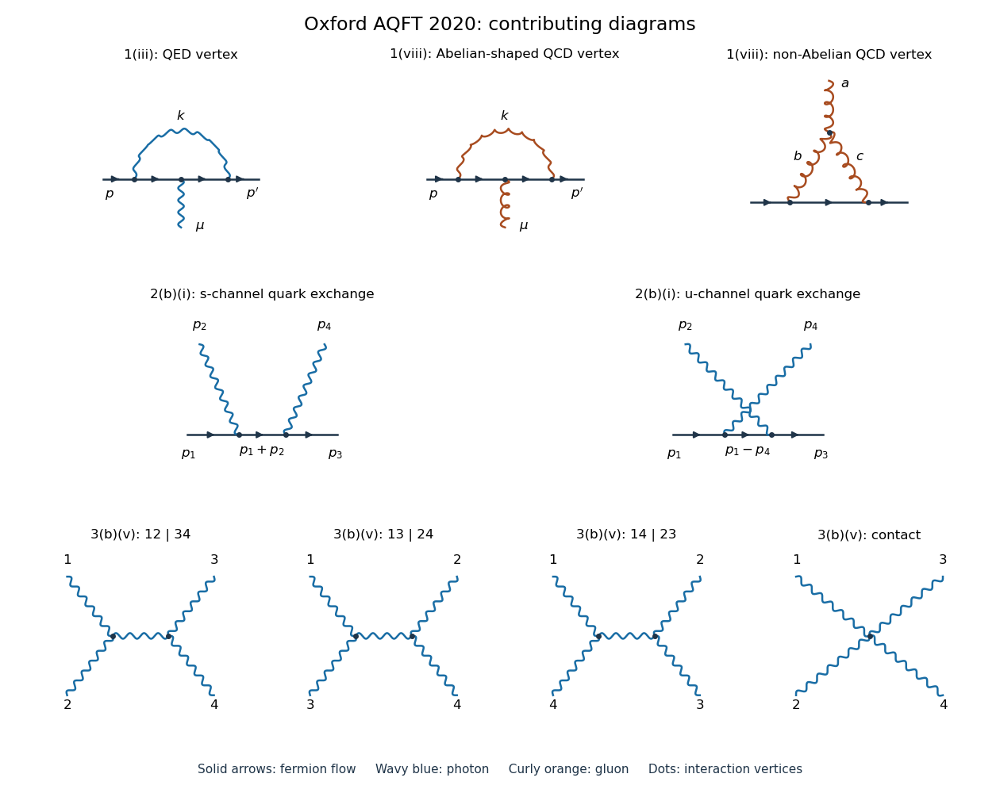

# 2020

↑ **Parent:** [Past exam of the advanced quantum field theory for particle physics course of the University of Oxford](split.md)

Source paper: [https://www.whatdotheyknow.com/request/oxford_physics_past_papers_2/response/2340696/attach/8/Physics%20Papers%202019.pdf?cookie_passthrough=1](https://www.whatdotheyknow.com/request/oxford_physics_past_papers_2/response/2340696/attach/8/Physics%20Papers%202019.pdf?cookie_passthrough=1)

Official standalone paper: [https://mmathphys.physics.ox.ac.uk/sites/default/files/mmathphys/documents/media/aqft_2020.pdf](https://mmathphys.physics.ox.ac.uk/sites/default/files/mmathphys/documents/media/aqft_2020.pdf)

The annual bundle's filename says 2019, but this paper's cover says Trinity Term 2020 and identifies A15272W1. These are solutions to that 2020 paper. Use [natural units](../natural-units.md), the [Minkowski metric](../minkowski-metric.md) $g=\operatorname{diag}(1,-1,-1,-1)$ and the [Feynman i-epsilon prescription](../feynman-i-epsilon-prescription.md). Write $\not p=\gamma^\mu p_\mu$. In question 1, $D=4-\epsilon$, $e_D=\mu^{\epsilon/2}e$, and $\mu$ is the [renormalization scale](../renormalization-scale.md); keeping the dimensionful coupling $e_D$ explicit prevents a factor-of-two ambiguity in the [ultraviolet pole](../ultraviolet-pole.md). In question 2(a), the factors of $i$ in the stated [generating functional](../generating-functional.md) fix the normalization of its kernels, as explained in the solution.

**[Figure 1](#image-vertex-corrections-quark-compton-scattering-and-nonlinear-gauge-photon-scattering). Vertex corrections, quark Compton scattering and nonlinear-gauge photon scattering**. Original [Feynman diagrams](../feynman-diagram.md). Solid arrows indicate [fermion flow](../fermion-flow.md); wavy lines denote [photons](../photon.md), and curly lines denote [gluons](../gluon.md). The upper row contains the single [QED](../quantum-electrodynamics.md) [one-particle-irreducible Feynman diagram](../one-particle-irreducible-feynman-diagram.md) and the two [QCD](../quantum-chromodynamics.md) [one-particle-irreducible Feynman diagrams](../one-particle-irreducible-feynman-diagram.md). The middle row gives the two [tree-level Feynman diagrams](../tree-level-feynman-diagram.md) for [Compton scattering](../compton-scattering.md). The bottom row gives the three exchange channels and the contact contribution to [light-by-light scattering](../light-by-light-scattering.md) in [nonlinear Abelian gauge fixing](../nonlinear-abelian-gauge-fixing.md). The four lower external labels use all-incoming [four-momenta](../four-momentum.md). Crossings without dots are not [Feynman vertices](../interaction-vertex.md).

**Table of contents**

- [1](2020/1.md)
  - [i](2020/1/i.md)
    - [Solution](2020/1/i/solution.md)
  - [ii](2020/1/ii.md)
    - [Solution](2020/1/ii/solution.md)
  - [iii](2020/1/iii.md)
    - [Solution](2020/1/iii/solution.md)
  - [iv](2020/1/iv.md)
    - [Solution](2020/1/iv/solution.md)
  - [v](2020/1/v.md)
    - [Solution](2020/1/v/solution.md)
  - [vi](2020/1/vi.md)
    - [Solution](2020/1/vi/solution.md)
  - [vii](2020/1/vii.md)
    - [Solution](2020/1/vii/solution.md)
  - [viii](2020/1/viii.md)
    - [Solution](2020/1/viii/solution.md)
- [2](2020/2.md)
  - [a](2020/2/a.md)
    - [i](2020/2/a/i.md)
      - [Solution](2020/2/a/i/solution.md)
    - [ii](2020/2/a/ii.md)
      - [Solution](2020/2/a/ii/solution.md)
    - [iii](2020/2/a/iii.md)
      - [Solution](2020/2/a/iii/solution.md)
  - [b](2020/2/b.md)
    - [i](2020/2/b/i.md)
      - [Solution](2020/2/b/i/solution.md)
    - [ii](2020/2/b/ii.md)
      - [Solution](2020/2/b/ii/solution.md)
    - [iii](2020/2/b/iii.md)
      - [Solution](2020/2/b/iii/solution.md)
- [3](2020/3.md)
  - [a](2020/3/a.md)
    - [i](2020/3/a/i.md)
      - [Solution](2020/3/a/i/solution.md)
    - [ii](2020/3/a/ii.md)
      - [Solution](2020/3/a/ii/solution.md)
  - [b](2020/3/b.md)
    - [i](2020/3/b/i.md)
      - [Solution](2020/3/b/i/solution.md)
    - [ii](2020/3/b/ii.md)
      - [Solution](2020/3/b/ii/solution.md)
    - [iii](2020/3/b/iii.md)
      - [Solution](2020/3/b/iii/solution.md)
    - [iv](2020/3/b/iv.md)
      - [Solution](2020/3/b/iv/solution.md)
    - [v](2020/3/b/v.md)
      - [Solution](2020/3/b/v/solution.md)

## ↑ Ancestors (9)

1. [Past exam of the advanced quantum field theory for particle physics course of the University of Oxford](split.md)
2. [Advanced quantum field theory for particle physics course of the University of Oxford](../advanced-quantum-field-theory-for-particle-physics-course-of-the-university-of-oxford.md)
3. [Year 4 of the mathematical and theoretical physics course of the University of Oxford](../year-4-of-the-mathematical-and-theoretical-physics-course-of-the-university-of-oxford.md)
4. [Mathematical and theoretical physics course of the University of Oxford](../mathematical-and-theoretical-physics-course-of-the-university-of-oxford.md)
5. [Undergraduate course of the University of Oxford](../undergraduate-course-of-the-university-of-oxford.md)
6. [Course of the University of Oxford](../course-of-the-university-of-oxford.md)
7. [University of Oxford](../university-of-oxford-split.md)
8. [List of universities](../list-of-universities.md)
9. [Codex Wiki](../split.md)
