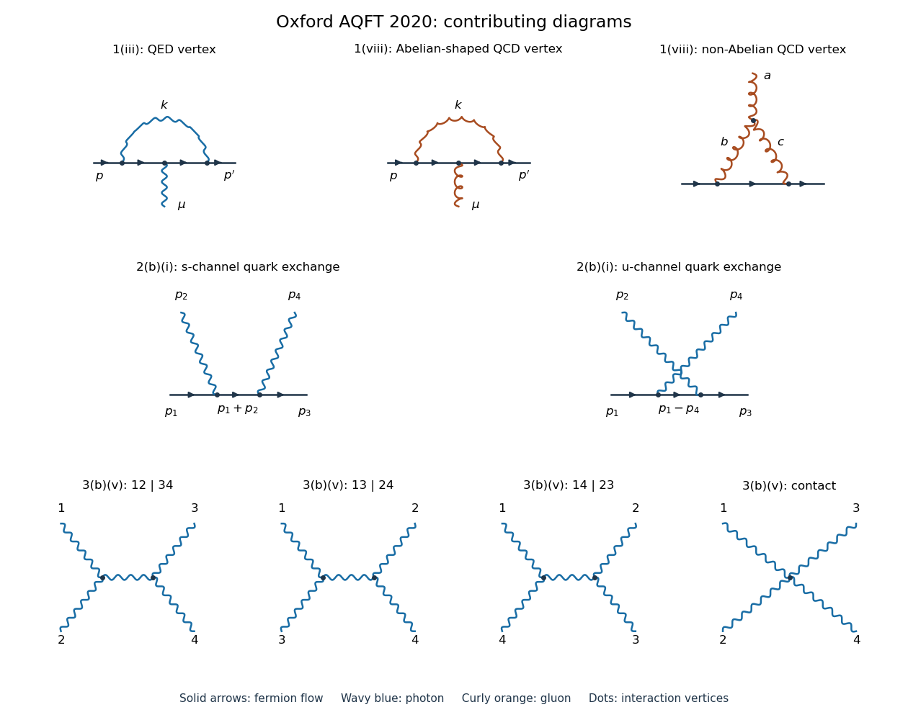

# 2020

↑ **Parent:** [Past exam of the advanced quantum field theory for particle physics course of the University of Oxford](../past-exam-of-the-advanced-quantum-field-theory-for-particle-physics-course-of-the-university-of-oxford.md)

Source paper: [https://www.whatdotheyknow.com/request/oxford_physics_past_papers_2/response/2340696/attach/8/Physics%20Papers%202019.pdf?cookie_passthrough=1](https://www.whatdotheyknow.com/request/oxford_physics_past_papers_2/response/2340696/attach/8/Physics%20Papers%202019.pdf?cookie_passthrough=1)

Official standalone paper: [https://mmathphys.physics.ox.ac.uk/sites/default/files/mmathphys/documents/media/aqft_2020.pdf](https://mmathphys.physics.ox.ac.uk/sites/default/files/mmathphys/documents/media/aqft_2020.pdf)

The annual bundle's filename says 2019, but this paper's cover says Trinity Term 2020 and identifies A15272W1. These are solutions to that 2020 paper. Use [natural units](../mathematical-physics.md#natural-units), the [Minkowski metric](../special-relativity.md#minkowski-metric) $g=\operatorname{diag}(1,-1,-1,-1)$ and the [Feynman i-epsilon prescription](../quantum-field-theory.md#feynman-i-epsilon-prescription). Write $\not p=\gamma^\mu p_\mu$. In question 1, $D=4-\epsilon$, $e_D=\mu^{\epsilon/2}e$, and $\mu$ is the [renormalization scale](../perturbative-quantum-field-theory.md#renormalization-scale); keeping the dimensionful coupling $e_D$ explicit prevents a factor-of-two ambiguity in the [ultraviolet pole](../perturbative-quantum-field-theory.md#ultraviolet-pole). In question 2(a), the factors of $i$ in the stated [generating functional](../perturbative-quantum-field-theory.md#generating-functional) fix the normalization of its kernels, as explained in the solution.

**[Figure 1](#image-vertex-corrections-quark-compton-scattering-and-nonlinear-gauge-photon-scattering). Vertex corrections, quark Compton scattering and nonlinear-gauge photon scattering**. Original [Feynman diagrams](../perturbative-quantum-field-theory.md#feynman-diagram). Solid arrows indicate [fermion flow](../perturbative-quantum-field-theory.md#fermion-flow); wavy lines denote [photons](../quantum-mechanics.md#photon), and curly lines denote [gluons](../standard-model.md#gluon). The upper row contains the single [QED](../perturbative-quantum-field-theory.md#quantum-electrodynamics) [one-particle-irreducible Feynman diagram](../perturbative-quantum-field-theory.md#one-particle-irreducible-feynman-diagram) and the two [QCD](../standard-model.md#quantum-chromodynamics) [one-particle-irreducible Feynman diagrams](../perturbative-quantum-field-theory.md#one-particle-irreducible-feynman-diagram). The middle row gives the two [tree-level Feynman diagrams](../perturbative-quantum-field-theory.md#tree-level-feynman-diagram) for [Compton scattering](../mathematical-physics.md#compton-scattering). The bottom row gives the three exchange channels and the contact contribution to [light-by-light scattering](../perturbative-quantum-field-theory.md#light-by-light-scattering) in [nonlinear Abelian gauge fixing](../relativistic-quantum-field.md#nonlinear-abelian-gauge-fixing). The four lower external labels use all-incoming [four-momenta](../special-relativity.md#four-momentum). Crossings without dots are not [Feynman vertices](../perturbative-quantum-field-theory.md#interaction-vertex).

**Table of contents**

- [1](#1)
  - [i](#1/i)
    - [Solution](#1/i/solution)
  - [ii](#1/ii)
    - [Solution](#1/ii/solution)
  - [iii](#1/iii)
    - [Solution](#1/iii/solution)
  - [iv](#1/iv)
    - [Solution](#1/iv/solution)
  - [v](#1/v)
    - [Solution](#1/v/solution)
  - [vi](#1/vi)
    - [Solution](#1/vi/solution)
  - [vii](#1/vii)
    - [Solution](#1/vii/solution)
  - [viii](#1/viii)
    - [Solution](#1/viii/solution)
- [2](#2)
  - [a](#2/a)
    - [i](#2/a/i)
      - [Solution](#2/a/i/solution)
    - [ii](#2/a/ii)
      - [Solution](#2/a/ii/solution)
    - [iii](#2/a/iii)
      - [Solution](#2/a/iii/solution)
  - [b](#2/b)
    - [i](#2/b/i)
      - [Solution](#2/b/i/solution)
    - [ii](#2/b/ii)
      - [Solution](#2/b/ii/solution)
    - [iii](#2/b/iii)
      - [Solution](#2/b/iii/solution)
- [3](#3)
  - [a](#3/a)
    - [i](#3/a/i)
      - [Solution](#3/a/i/solution)
    - [ii](#3/a/ii)
      - [Solution](#3/a/ii/solution)
  - [b](#3/b)
    - [i](#3/b/i)
      - [Solution](#3/b/i/solution)
    - [ii](#3/b/ii)
      - [Solution](#3/b/ii/solution)
    - [iii](#3/b/iii)
      - [Solution](#3/b/iii/solution)
    - [iv](#3/b/iv)
      - [Solution](#3/b/iv/solution)
    - [v](#3/b/v)
      - [Solution](#3/b/v/solution)

## 1

↑ **Parent:** [2020](2020.md)

<h3 id="1/i">i</h3>

↑ **Parent:** [1](#1)

<h4 id="1/i/solution">Solution</h4>

↑ **Parent:** [I](#1/i)

Let the bare fields obey the [wave-function renormalization](../perturbative-quantum-field-theory.md#wave-function-renormalization) definitions $\psi_0=Z_2^{1/2}\psi$, $A_{0\mu}=Z_3^{1/2}A_\mu$, and put $m_0=Z_m m$. Define the [vertex renormalization](../perturbative-quantum-field-theory.md#vertex-renormalization) factor by $e_0=\mu^{\epsilon/2}eZ_1Z_2^{-1}Z_3^{-1/2}$. Substitution into the bare [QED](../perturbative-quantum-field-theory.md#quantum-electrodynamics) [Lagrangian density](../classical-field-theory.md#lagrangian-density) gives

$$
\boxed{\mathcal L=Z_2\bar\psi i\not\partial\psi-Z_2Z_m m\bar\psi\psi-\frac{Z_3}{4}F_{\mu\nu}F^{\mu\nu}-e_DZ_1\bar\psi\gamma^\mu\psi A_\mu.}
$$

Equivalently, write $Z_i=1+\delta_i$ and $\delta_m=Z_2Z_m-1$. The [counterterm Lagrangian](../perturbative-quantum-field-theory.md#counterterm-lagrangian) is

$$
\mathcal L_{\mathrm{ct}}=\delta_2\bar\psi i\not\partial\psi-\delta_m m\bar\psi\psi-\frac{\delta_3}{4}F_{\mu\nu}F^{\mu\nu}-e_D\delta_1\bar\psi\gamma^\mu\psi A_\mu.
$$

For the subsequent [Feynman gauge](../relativistic-quantum-field.md#feynman-gauge) calculation include $-(\partial\cdot A)^2/2$ in the [gauge-fixed action](../relativistic-quantum-field.md#gauge-fixed-action). The [Ward identity for QED renormalization constants](../perturbative-quantum-field-theory.md#ward-identity-for-qed-renormalization-constants) implies $Z_1=Z_2$ when the [regularization](../statistical-learning.md#regularization) preserves [gauge invariance](../relativistic-quantum-field.md#gauge-invariance); this is a consequence, rather than an extra independent definition of the [renormalization constants](../perturbative-quantum-field-theory.md#renormalization-constant).

<h3 id="1/ii">ii</h3>

↑ **Parent:** [1](#1)

<h4 id="1/ii/solution">Solution</h4>

↑ **Parent:** [Ii](#1/ii)

The [Clifford algebra](../algebra-over-a-field.md#clifford-algebra) of the [gamma matrices](../algebra-over-a-field.md#gamma-matrices) gives $\gamma^\nu\gamma^\mu=2g^{\nu\mu}-\gamma^\mu\gamma^\nu$ and $\gamma^\nu\gamma_\nu=D\mathbf1$. Therefore

$$
\gamma^\nu\gamma^\mu\gamma_\nu=2g^{\nu\mu}\gamma_\nu-\gamma^\mu\gamma^\nu\gamma_\nu=2\gamma^\mu-D\gamma^\mu,
\qquad\boxed{\gamma^\nu\gamma^\mu\gamma_\nu=(2-D)\gamma^\mu.}
$$

The contraction $g^\nu{}_{\nu}=D$ must be retained until the [dimensional regularization](../perturbative-quantum-field-theory.md#dimensional-regularization) calculation is complete; replacing it prematurely by four can change finite terms multiplying a [ultraviolet pole](../perturbative-quantum-field-theory.md#ultraviolet-pole).

<h3 id="1/iii">iii</h3>

↑ **Parent:** [1](#1)

<h4 id="1/iii/solution">Solution</h4>

↑ **Parent:** [Iii](#1/iii)

There is one [one-particle-irreducible Feynman diagram](../perturbative-quantum-field-theory.md#one-particle-irreducible-feynman-diagram): an internal [photon](../quantum-mechanics.md#photon) joins two points of the open [fermion](../tensor-product-of-quantum-systems.md#fermion) line, with the external [photon](../quantum-mechanics.md#photon) attached to that line between them. It is the upper-left panel of the figure. Route internal [photon](../quantum-mechanics.md#photon) [four-momentum](../special-relativity.md#four-momentum) $k$ from the incoming side to the outgoing side; the adjacent internal [fermion](../tensor-product-of-quantum-systems.md#fermion) [four-momenta](../special-relativity.md#four-momentum) are $p-k$ and $p'-k$. The [symmetry factor](../perturbative-quantum-field-theory.md#feynman-diagram-symmetry-factor) is one.

The [vertex renormalization](../perturbative-quantum-field-theory.md#vertex-renormalization) [counterterm](../perturbative-quantum-field-theory.md#counterterm) is an additional local contribution when forming the renormalized [Feynman vertex](../perturbative-quantum-field-theory.md#interaction-vertex). External-leg [self-energy](../perturbative-quantum-field-theory.md#self-energy) insertions belong to the complete three-point [correlation function](../critical-phenomenon.md#correlation-function), rather than this amputated [one-particle-irreducible Feynman diagram](../perturbative-quantum-field-theory.md#one-particle-irreducible-feynman-diagram).

<h3 id="1/iv">iv</h3>

↑ **Parent:** [1](#1)

<h4 id="1/iv/solution">Solution</h4>

↑ **Parent:** [Iv](#1/iv)

With $q=p'-p$ and the routing just described, multiplication of the three [QED Feynman rules](../perturbative-quantum-field-theory.md#qed-feynman-rules) for the [Feynman vertices](../perturbative-quantum-field-theory.md#interaction-vertex), the two [Dirac propagators](../quantum-field-theory.md#dirac-propagator) and the [photon propagator](../quantum-field-theory.md#photon-propagator) gives $(-ie_D)^3i^2(-i)=-e_D^3$. Hence the unrenormalized amputated [Feynman vertex](../perturbative-quantum-field-theory.md#interaction-vertex) through this order is

$$
\boxed{iV^\mu(p,p')=-ie_D\gamma^\mu-e_D^3\int\frac{d^Dk}{(2\pi)^D}\frac{\gamma^\nu(\not p'-\not k+m)\gamma^\mu(\not p-\not k+m)\gamma_\nu}{(k^2+i0)[(p'-k)^2-m^2+i0][(p-k)^2-m^2+i0]}+O(e_D^5).}
$$

For the renormalized [Feynman vertex](../perturbative-quantum-field-theory.md#interaction-vertex), add $-ie_D\delta_1\gamma^\mu$ to this expression. Contributions from replacing parameters inside the one-loop term by their bare counterparts enter at higher [loop order](../perturbative-quantum-field-theory.md#loop-order).

<h3 id="1/v">v</h3>

↑ **Parent:** [1](#1)

<h4 id="1/v/solution">Solution</h4>

↑ **Parent:** [V](#1/v)

Keep $m>0$ and set $p=p'=0$, which is an [off shell](../classical-field-theory.md#off-shell) choice. The numerator is

$$
N^\mu=\gamma^\nu(-\not k+m)\gamma^\mu(-\not k+m)\gamma_\nu.
$$

Terms odd in $k$ integrate to zero. [Lorentz covariance](../special-relativity.md#lorentz-covariance) and [dimensional regularization](../perturbative-quantum-field-theory.md#dimensional-regularization) give, inside this integral,

$$
k_\rho k_\sigma\longmapsto\frac{k^2}{D}g_{\rho\sigma},\qquad
\not k\gamma^\mu\not k\longmapsto\frac{2-D}{D}k^2\gamma^\mu.
$$

Applying the [gamma matrices](../algebra-over-a-field.md#gamma-matrices) identity from part (ii) once more yields

$$
N^\mu\longmapsto\left[\frac{(D-2)^2}{D}k^2+(2-D)m^2\right]\gamma^\mu.
$$

Consequently

$$
\boxed{iV^\mu_{\mathrm{loop}}(0,0)=-e_D^3\gamma^\mu\int\frac{d^Dk}{(2\pi)^D}\frac{\alpha k^2+\beta m^2}{(k^2+i0)(k^2-m^2+i0)^2},\quad\alpha=\frac{(2-\epsilon)^2}{4-\epsilon},\quad\beta=\epsilon-2.}
$$

This [massive zero-momentum QED vertex integral](../perturbative-quantum-field-theory.md#massive-zero-momentum-qed-vertex-integral) uses an integrated tensor identity for the replacement of $N^\mu$, not an equality for each fixed $k$. The physical [photon](../quantum-mechanics.md#photon) remains massless. The retained [fermion](../tensor-product-of-quantum-systems.md#fermion) [mass](../classical-mechanics.md#mass) supplies a scale and makes this zero-external-[four-momentum](../special-relativity.md#four-momentum) calculation suitable for extracting the [ultraviolet pole](../perturbative-quantum-field-theory.md#ultraviolet-pole) without a [scaleless integral](../perturbative-quantum-field-theory.md#scaleless-integral).

<h3 id="1/vi">vi</h3>

↑ **Parent:** [1](#1)

<h4 id="1/vi/solution">Solution</h4>

↑ **Parent:** [Vi](#1/vi)

After a [Wick rotation](../perturbative-quantum-field-theory.md#wick-rotation), the term in question has radial behavior

$$
I_m=m^2\int\frac{d^4k}{(2\pi)^4}\frac1{(k^2+i0)(k^2-m^2+i0)^2}=-i\int\frac{d^4k_E}{(2\pi)^4}\frac{m^2}{k_E^2(k_E^2+m^2)^2}.
$$

The radial integrand is proportional to $k_E$ at the origin and to $k_E^{-3}$ at infinity. Thus it has neither an [infrared divergence](../quantum-field-theory.md#infrared-divergence) nor an [ultraviolet divergence](../perturbative-quantum-field-theory.md#ultraviolet-divergence). In fact the area of the unit three-sphere gives

$$
I_m=-\frac{i m^2}{8\pi^2}\int_0^\infty\frac{r\,dr}{(r^2+m^2)^2}=\boxed{-\frac{i}{16\pi^2}}.
$$

This also follows from the [Feynman parameter](../perturbative-quantum-field-theory.md#feynman-parameter) identity

$$
\frac1{AB^2}=2\int_0^1dx\,\frac{1-x}{[xA+(1-x)B]^3}
$$

with $A=k^2+i0$, $B=k^2-m^2+i0$. Although the parameterized denominator becomes massless at $x=1$, its numerator $1-x$ cancels the apparent endpoint singularity. Since $\beta\to-2$, multiplication by $\beta$ preserves finiteness. No artificial [photon](../quantum-mechanics.md#photon) [mass](../classical-mechanics.md#mass) is needed.

<h3 id="1/vii">vii</h3>

↑ **Parent:** [1](#1)

<h4 id="1/vii/solution">Solution</h4>

↑ **Parent:** [Vii](#1/vii)

Only the term proportional to $\alpha$ has an [ultraviolet pole](../perturbative-quantum-field-theory.md#ultraviolet-pole). Its $k^2$ cancels the massless denominator, leaving the standard [Feynman integral](../perturbative-quantum-field-theory.md#feynman-integral)

$$
J_D=\int\frac{d^Dk}{(2\pi)^D}\frac1{(k^2-m^2+i0)^2}=\frac{i}{(4\pi)^{D/2}}\Gamma(2-D/2)(m^2)^{D/2-2}.
$$

In the present [dimensional regularization](../perturbative-quantum-field-theory.md#dimensional-regularization) convention, $\Gamma(\epsilon/2)=2/\epsilon+O(1)$ and $\alpha=1+O(\epsilon)$. Therefore

$$
iV^\mu_{\mathrm{loop}}\big|_{\mathrm{UV}}=-ie_D\gamma^\mu\frac{e^2}{8\pi^2\epsilon}.
$$

The [counterterm](../perturbative-quantum-field-theory.md#counterterm) contribution is $-ie_D\delta_1\gamma^\mu$. Cancellation of the [ultraviolet pole](../perturbative-quantum-field-theory.md#ultraviolet-pole) fixes

$$
\boxed{Z_1=1+\delta_1=1-\frac{e^2}{8\pi^2\epsilon}+O(e^4)\quad(D=4-\epsilon),}
$$

where the displayed expression uses the [minimal subtraction scheme](../perturbative-quantum-field-theory.md#minimal-subtraction-scheme); a different [renormalization scheme](../perturbative-quantum-field-theory.md#renormalization-scheme) may add finite $O(e^2)$ terms. In the frequently used convention $D=4-2\varepsilon$, the same result is $Z_1=1-e^2/(16\pi^2\varepsilon)+O(e^4)$. The sign agrees with $Z_1=Z_2$ from the [Ward identity for QED renormalization constants](../perturbative-quantum-field-theory.md#ward-identity-for-qed-renormalization-constants) in [Feynman gauge](../relativistic-quantum-field.md#feynman-gauge).

<h3 id="1/viii">viii</h3>

↑ **Parent:** [1](#1)

<h4 id="1/viii/solution">Solution</h4>

↑ **Parent:** [Viii](#1/viii)

The [proper quark-gluon vertex colour factors](../standard-model.md#proper-quark-gluon-vertex-colour-factors) come from two [one-particle-irreducible Feynman diagrams](../perturbative-quantum-field-theory.md#one-particle-irreducible-feynman-diagram), shown in the upper-middle and upper-right panels. One has a virtual [gluon](../standard-model.md#gluon) joining the open [quark](../standard-model.md#quark) line on opposite sides of the external [gluon](../standard-model.md#gluon) insertion. The other has two virtual [gluons](../standard-model.md#gluon) meeting the external [gluon](../standard-model.md#gluon) at a three-gluon [Feynman vertex](../perturbative-quantum-field-theory.md#interaction-vertex), with their other ends joined by an internal [quark](../standard-model.md#quark). A [Faddeev-Popov ghost field](../relativistic-quantum-field.md#faddeev-popov-ghost) has no direct [quark](../standard-model.md#quark) coupling, so it supplies no additional one-loop [Feynman vertex](../perturbative-quantum-field-theory.md#interaction-vertex) graph here.

Let $T^a$ be the Hermitian generators of the [fundamental representation](../semisimple-lie-algebra.md#fundamental-representation) of $SU(N)$, with $\operatorname{tr}(T^aT^b)=\delta^{ab}/2$, $[T^a,T^b]=if^{abc}T^c$, $\sum_bT^bT^b=C_F\mathbf1$, and $f^{abc}f^{dbc}=C_A\delta^{ad}$. Here $C_F=(N^2-1)/(2N)$ and $C_A=N$ are [quadratic Casimir operators](../semisimple-lie-algebra.md#quadratic-casimir-operator) evaluated in the [fundamental representation](../semisimple-lie-algebra.md#fundamental-representation) and the [Adjoint representation](../lie-algebra.md#adjoint-representation-of-a-lie-algebra).

For the first graph, the ordered product is $\sum_bT^bT^aT^b$. Expand the double [commutator](../lie-algebra.md#commutator):

$$
\sum_b[T^b,[T^b,T^a]]=2C_FT^a-2\sum_bT^bT^aT^b=C_AT^a.
$$

Thus its [colour factor](../standard-model.md#color-factor) is

$$
\boxed{\sum_bT^bT^aT^b=\left(C_F-\frac{C_A}{2}\right)T^a=-\frac1{2N}T^a=-\frac16T^a\quad(N=3).}
$$

For the second graph choose the orientation of the three-gluon [Feynman vertex](../perturbative-quantum-field-theory.md#interaction-vertex) so that its group tensor is $f^{abc}$ and the ordered product along the [quark](../standard-model.md#quark) line is $T^bT^c$. Antisymmetry removes the [anticommutator](../vector-space.md#anticommutator) part:

$$
\boxed{f^{abc}T^bT^c=\frac12f^{abc}[T^b,T^c]=\frac{iC_A}{2}T^a=\frac{3i}{2}T^a\quad(N=3).}
$$

The corresponding real group coefficient is $C_A/2=3/2$ after the conventional factor of $i$ is incorporated into the remaining [Feynman rules](../perturbative-quantum-field-theory.md#feynman-rules). If the vertex is written with $if^{abc}$, its raw matrix product is instead $-C_AT^a/2$. Reversing the ordered product reverses its sign together with the orientation-dependent three-gluon [Feynman rule](../perturbative-quantum-field-theory.md#feynman-rule); these conventions describe the same [scattering amplitude](../quantum-scattering.md#scattering-amplitude). External-leg corrections and local [counterterms](../perturbative-quantum-field-theory.md#counterterm) are separate from these two proper one-loop graphs.

## 2

↑ **Parent:** [2020](2020.md)

<h3 id="2/a">a</h3>

↑ **Parent:** [2](#2)

<h4 id="2/a/i">i</h4>

↑ **Parent:** [A](#2/a)

<h5 id="2/a/i/solution">Solution</h5>

↑ **Parent:** [I](#2/a/i)

Use the [path integral](../quantum-field-theory.md#path-integral) with source term

$$
S_{\mathrm{src}}=\int d^4x\,[J^\mu A_\mu+\bar\eta_\alpha\psi_\alpha+\bar\psi_\alpha\eta_\alpha].
$$

The sources $\eta,\bar\eta$ are [Grassmann variables](../multilinear-algebra.md#grassmann-variable); all derivatives below are left [functional derivatives](../calculus-of-variations.md#functional-derivative). Because $\eta$ stands to the right of $\bar\psi$, differentiating with respect to it introduces a minus sign. The insertion rules are therefore

$$
\frac1i\frac{\delta}{\delta J^\mu}\longleftrightarrow A_\mu,\qquad
i\frac{\delta}{\delta\eta_\alpha}\longleftrightarrow\bar\psi_\alpha,\qquad
\frac1i\frac{\delta}{\delta\bar\eta_\beta}\longleftrightarrow\psi_\beta.
$$

For example $\delta_L(\bar\psi\eta)/\delta\eta=-\bar\psi$. The order of the odd [functional derivatives](../calculus-of-variations.md#functional-derivative) matters: the rightmost derivative acts first, and the displayed product inserts $\bar\psi_\alpha\psi_\beta$ in that order.

Expand $\exp[-ie\int\bar\psi\gamma^\mu\psi A_\mu]$ in its [power series](../sequence-and-series.md#power-series), replace each field by its source derivative, and pull the derivatives outside the free [path integral](../quantum-field-theory.md#path-integral). Re-exponentiating gives

$$
\boxed{Z[J,\eta,\bar\eta]=\exp\left[-ie\int d^4x\left(\frac1i\frac{\delta}{\delta J^\mu(x)}\right)\left(i\frac{\delta}{\delta\eta_\alpha(x)}\right)\gamma^\mu_{\alpha\beta}\left(\frac1i\frac{\delta}{\delta\bar\eta_\beta(x)}\right)\right]Z_0[J,\eta,\bar\eta].}
$$

This identity concerns the unnormalized [generating functional](../perturbative-quantum-field-theory.md#generating-functional). Normalized [correlation functions](../critical-phenomenon.md#correlation-function) divide by its zero-source value so that vacuum contributions cancel.

<h4 id="2/a/ii">ii</h4>

↑ **Parent:** [A](#2/a)

<h5 id="2/a/ii/solution">Solution</h5>

↑ **Parent:** [Ii](#2/a/ii)

First fix a convention that is implicit in the source. For the stated free [generating functional](../perturbative-quantum-field-theory.md#generating-functional)

$$
Z_0/Z_0[0]=\exp\left(i\bar\eta S\eta+\frac i2J\Delta J\right),
$$

the time-ordered [Wick contractions](../perturbative-quantum-field-theory.md#wick-contraction) are $S_F=\langle T\psi\bar\psi\rangle_0=-iS$ and $\Delta_F=\langle TAA\rangle_0=-i\Delta$. These follow directly by the source differentiation rules in part (i). Thus the kernels called [propagators](../quantum-field-theory.md#propagator) in the question are distinguished here from the contractions, which already include their factors of $i$.

At first order in the [QED](../perturbative-quantum-field-theory.md#quantum-electrodynamics) interaction, write $a$ for its integration point. The normalized three-point [correlation function](../critical-phenomenon.md#correlation-function) is

$$
G_{\nu\alpha\beta}=-ie\int d^4a\,\Delta_{F\nu\mu}(x-a)\gamma^\mu_{rs}\langle T\{\psi_\alpha(y)\bar\psi_\beta(z)\bar\psi_r(a)\psi_s(a)\}\rangle_0+O(e^3).
$$

The zeroth-order term vanishes because the free [photon](../quantum-mechanics.md#photon) one-point [correlation function](../critical-phenomenon.md#correlation-function) is zero. There are two nonzero [Wick contractions](../perturbative-quantum-field-theory.md#wick-contraction) of the four fields:

$$
\langle T\{\psi_\alpha(y)\bar\psi_\beta(z)\bar\psi_r(a)\psi_s(a)\}\rangle_0
=-S_{F\alpha\beta}(y-z)S_{Fsr}(0)+S_{F\alpha r}(y-a)S_{Fs\beta}(a-z).
$$

The first term pairs the two external [fermions](../tensor-product-of-quantum-systems.md#fermion) directly and closes the two fields at the interaction into a [fermion loop](../perturbative-quantum-field-theory.md#fermion-loop); its minus sign is the [closed fermion loop sign](../perturbative-quantum-field-theory.md#closed-fermion-loop-sign). The second term joins the external [fermions](../tensor-product-of-quantum-systems.md#fermion) through the interaction, giving the connected contribution. This is also obtained by differentiating the quartic term $(i\bar\eta S\eta)^2/2$ in the free [generating functional](../perturbative-quantum-field-theory.md#generating-functional); the two choices of bilinear cancel its factor $1/2$.

Insert $S_F=-iS$ and $\Delta_F=-i\Delta$. Since $(-ie)(-i)^3=e$, the result is exactly

$$
\boxed{G_{\nu\alpha\beta}=-e\int d^4a\,\Delta_{\mu\nu}(a-x)\left(\operatorname{tr}[\gamma^\mu S(0)]S_{\alpha\beta}(y-z)-[S(y-a)\gamma^\mu S(a-z)]_{\alpha\beta}\right)+O(e^3).}
$$

The trace term is a disconnected product of a photon [tadpole diagram](../perturbative-quantum-field-theory.md#tadpole-diagram) with the free external [fermion](../tensor-product-of-quantum-systems.md#fermion) [propagator](../quantum-field-theory.md#propagator); the other term is the connected three-point [correlation function](../critical-phenomenon.md#correlation-function). In this [QED](../perturbative-quantum-field-theory.md#quantum-electrodynamics) calculation the disconnected term vanishes, as established next. With a convention using $S_F,\Delta_F$ themselves as the symbols for the [propagators](../quantum-field-theory.md#propagator), the equivalent formula retains the prefactor $-ie$ and the connected-minus-trace ordering above; mixing these two conventions would give an erroneous overall phase.

<h4 id="2/a/iii">iii</h4>

↑ **Parent:** [A](#2/a)

<h5 id="2/a/iii/solution">Solution</h5>

↑ **Parent:** [Iii](#2/a/iii)

The massive [Dirac propagator](../quantum-field-theory.md#dirac-propagator) is

$$
S_F(x)=\int\frac{d^Dk}{(2\pi)^D}\frac{i(\not k+m)e^{-ik\cdot x}}{k^2-m^2+i0}.
$$

Use the [gamma matrix trace identities](../algebra-over-a-field.md#gamma-matrix-trace-identities) $\operatorname{tr}\gamma^\mu=0$ and $\operatorname{tr}(\gamma^\mu\gamma^\rho)=4g^{\mu\rho}$. They give

$$
\operatorname{tr}[\gamma^\mu S_F(0)]=4i\int\frac{d^Dk}{(2\pi)^D}\frac{k^\mu}{k^2-m^2+i0}=\boxed{0}.
$$

The integrand is odd under $k\mapsto-k$, and [dimensional regularization](../perturbative-quantum-field-theory.md#dimensional-regularization) preserves that symmetry. The same vanishing holds for $S=iS_F$. One must not assert that $S(0)$ itself is zero: its term proportional to $m\mathbf1$ generally is nonzero and divergent, but its trace against a single [gamma matrix](../algebra-over-a-field.md#gamma-matrices) is zero. This one-photon [fermion loop](../perturbative-quantum-field-theory.md#fermion-loop) is also the simplest instance of [Furry's theorem](../quantum-field-theory.md#furry-s-theorem).

<h3 id="2/b">b</h3>

↑ **Parent:** [2](#2)

<h4 id="2/b/i">i</h4>

↑ **Parent:** [B](#2/b)

<h5 id="2/b/i/solution">Solution</h5>

↑ **Parent:** [I](#2/b/i)

The two [tree-level Feynman diagrams](../perturbative-quantum-field-theory.md#tree-level-feynman-diagram) are the $s$-channel and $u$-channel [quark](../standard-model.md#quark) exchange graphs, drawn in the middle row of the figure. Along the directed [quark](../standard-model.md#quark) line the incoming [photon](../quantum-mechanics.md#photon) is absorbed before the outgoing [photon](../quantum-mechanics.md#photon) is emitted in the first graph; those two insertions are reversed in the second. Their internal [four-momenta](../special-relativity.md#four-momentum) are $q_s=p_1+p_2$ and $q_u=p_1-p_4$, respectively. There is no three-photon [Feynman vertex](../perturbative-quantum-field-theory.md#interaction-vertex) in ordinary [QED](../perturbative-quantum-field-theory.md#quantum-electrodynamics), and no two-photon-two-quark [contact interaction](../quantum-mechanics.md#contact-interaction-quantum-mechanics) in the [Dirac field](../relativistic-quantum-field.md#dirac-field) [Lagrangian density](../classical-field-theory.md#lagrangian-density).

<h4 id="2/b/ii">ii</h4>

↑ **Parent:** [B](#2/b)

<h5 id="2/b/ii/solution">Solution</h5>

↑ **Parent:** [Ii](#2/b/ii)

Put $Q_u=2/3$, $s=q_s^2$, $u=q_u^2$, and suppress the common [colour factor](../standard-model.md#color-factor) $\delta_{ji}$. Define $i\mathcal M$ by the product of [Feynman rules](../perturbative-quantum-field-theory.md#feynman-rules). With massless external [Dirac spinors](../relativistic-quantum-field.md#dirac-spinor) the two graphs give

$$
\mathcal M_{\mu\nu}=-e^2Q_u^2\bar u(p_3)\left[\gamma_\nu\frac{\not q_s}{s}\gamma_\mu+\gamma_\mu\frac{\not q_u}{u}\gamma_\nu\right]u(p_1).
$$

The massless [Dirac equation](../relativistic-quantum-field.md#dirac-equation) gives $\not p_1u(p_1)=0$ and $\bar u(p_3)\not p_3=0$. Thus

$$
\frac{\not q_s\not p_2}{s}u(p_1)=\frac{\not q_s(\not q_s-\not p_1)}s u(p_1)=u(p_1).
$$

By [four-momentum conservation](../special-relativity.md#four-momentum-conservation), $p_2=p_3-q_u$, so

$$
\bar u(p_3)\frac{\not p_2\not q_u}{u}=\bar u(p_3)\frac{(\not p_3-\not q_u)\not q_u}{u}=-\bar u(p_3).
$$

The two terms cancel:

$$
\boxed{p_2^\mu\mathcal M_{\mu\nu}=-e^2Q_u^2\bar u(p_3)(\gamma_\nu-\gamma_\nu)u(p_1)=0.}
$$

This is the [Ward identity](../perturbative-quantum-field-theory.md#ward-identity) for the incoming [photon](../quantum-mechanics.md#photon); replacing its [photon polarization vector](../quantum-mechanics.md#photon-polarization-vector) by its [four-momentum](../special-relativity.md#four-momentum) produces zero. The outgoing [photon](../quantum-mechanics.md#photon) obeys the analogous identity. Each exchange graph separately fails this test, so the cancellation requires their sum. Consequently the physical [scattering amplitude](../quantum-scattering.md#scattering-amplitude) is invariant under $\varepsilon^\mu(p_2)\mapsto\varepsilon^\mu(p_2)+c p_2^\mu$.

<h4 id="2/b/iii">iii</h4>

↑ **Parent:** [B](#2/b)

<h5 id="2/b/iii/solution">Solution</h5>

↑ **Parent:** [Iii](#2/b/iii)

For [massless quark Compton scattering](../mathematical-physics.md#massless-quark-compton-scattering), the [color average](../standard-model.md#color-average) contributes one, since $(1/N_c)\sum_{i,j}|\delta_{ji}|^2=1$. The [spin average](../relativistic-quantum-field.md#spin-average) and incoming [photon](../quantum-mechanics.md#photon) [polarization](../wave.md#polarization-waves) average supply $1/(2\cdot2)=1/4$. The [Ward identities](../perturbative-quantum-field-theory.md#ward-identity) permit use of $-g_{\mu\nu}$ for each [photon polarization completeness relation](../relativistic-quantum-field.md#photon-polarization-completeness-relation), and the massless [fermion spin sum](../relativistic-quantum-field.md#fermion-spin-sum) is $\sum_ru_r(p)\bar u_r(p)=\not p$.

Let

$$
A_{\mu\nu}=\gamma_\nu\frac{\not q_s}s\gamma_\mu+\gamma_\mu\frac{\not q_u}u\gamma_\nu.
$$

Reversing the [gamma matrices](../algebra-over-a-field.md#gamma-matrices) order gives its Dirac-conjugate matrix $\bar A^{\mu\nu}$. The squared [scattering amplitude](../quantum-scattering.md#scattering-amplitude) is

$$
\langle|\mathcal M|^2\rangle=\frac{e^4Q_u^4}{4}\operatorname{tr}(\not p_3 A_{\mu\nu}\not p_1\bar A^{\mu\nu}).
$$

For clarity evaluate the four traces before dividing by their denominators. The [Mandelstam variables](../special-relativity.md#mandelstam-variables) obey $s+t+u=0$, with $t=(p_1-p_3)^2$, $p_1\cdot p_2=s/2$, $p_1\cdot p_4=u(-1/2)$ and $p_1\cdot p_3=-t/2$. For the squared $s$-channel contribution, the [gamma matrix trace identities](../algebra-over-a-field.md#gamma-matrix-trace-identities) imply

$$
\begin{aligned}
T_{ss}&=\operatorname{tr}(\not p_3\gamma_\nu\not q_s\gamma_\mu\not p_1\gamma^\mu\not q_s\gamma^\nu)\\
&=-2\operatorname{tr}(\not p_3\gamma_\nu\not q_s\not p_1\not q_s\gamma^\nu)\\
&=-2s\operatorname{tr}(\not p_3\gamma_\nu\not p_2\gamma^\nu)
=4s\operatorname{tr}(\not p_3\not p_2)=-8su.
\end{aligned}
$$

Here $\not q_s\not p_1\not q_s=2(q_s\cdot p_1)\not q_s-q_s^2\not p_1=s\not p_2$ and $p_3\cdot p_2=-u/2$. For the squared $u$-channel contribution, $\not q_u\not p_1\not q_u=-u\not p_4$ gives

$$
T_{uu}=\operatorname{tr}(\not p_3\gamma_\mu\not q_u\gamma_\nu\not p_1\gamma^\nu\not q_u\gamma^\mu)=-16u(p_3\cdot p_4)=-8su.
$$

One interference trace reduces to

$$
\begin{aligned}
T_{su}&=\operatorname{tr}(\not p_3\gamma_\nu\not q_s\gamma_\mu\not p_1\gamma^\nu\not q_u\gamma^\mu)\\
&=-2\operatorname{tr}(\not p_3\gamma_\nu\not q_s\not q_u\gamma^\nu\not p_1)
=-32(q_s\cdot q_u)(p_3\cdot p_1)=0,
\end{aligned}
$$

since $q_s\cdot q_u=(s+t+u)/2=0$. The other interference trace is its complex conjugate and also vanishes. Therefore

$$
\boxed{\langle|\mathcal M|^2\rangle=-2e^4Q_u^4\left(\frac us+\frac su\right)=-\frac{32e^4}{81}\frac{s^2+u^2}{su},\qquad C=\frac{32e^4}{81}.}
$$

Equivalently $C=512\pi^2\alpha_{\mathrm{em}}^2/81$ in terms of the [fine-structure constant](../perturbative-quantum-field-theory.md#fine-structure-constant). In the physical noncollinear region $s>0$, $u<0$, so the result is positive. The singular massless endpoint $u=0$ reflects a [collinear divergence](../quantum-field-theory.md#collinear-divergence); it is not a negative squared [scattering amplitude](../quantum-scattering.md#scattering-amplitude).

## 3

↑ **Parent:** [2020](2020.md)

<h3 id="3/a">a</h3>

↑ **Parent:** [3](#3)

<h4 id="3/a/i">i</h4>

↑ **Parent:** [A](#3/a)

<h5 id="3/a/i/solution">Solution</h5>

↑ **Parent:** [I](#3/a/i)

[Goldstone's theorem](../quantum-field-theory.md#goldstone-theorem) states that in a relativistic [quantum field theory](../quantum-field-theory.md), spontaneous breaking of an exact continuous global internal [symmetry](../physics.md#symmetry-physics) produces a massless [Goldstone boson](../critical-phenomenon.md#goldstone-boson) for each independent broken generator. More precisely, a conserved global current whose charge acts nontrivially on the [vacuum expectation value](../quantum-field-theory.md#vacuum-expectation-value) has a massless pole in an appropriate current-field [correlation function](../critical-phenomenon.md#correlation-function). The usual counting assumes a [Lorentz invariant](../special-relativity.md#lorentz-invariance) [vacuum state](../quantum-field-theory.md#vacuum-state) and the standard locality and positivity hypotheses.

A local [gauge symmetry](../relativistic-quantum-field.md#gauge-invariance) is a [gauge redundancy](../relativistic-quantum-field.md#gauge-redundancy), so it does not by itself imply massless physical [Goldstone bosons](../critical-phenomenon.md#goldstone-boson). In the [Higgs mechanism](../standard-model.md#higgs-mechanism), the corresponding scalar directions provide the longitudinal [polarizations](../wave.md#polarization-waves) of massive [gauge bosons](../relativistic-quantum-field.md#gauge-boson).

<h4 id="3/a/ii">ii</h4>

↑ **Parent:** [A](#3/a)

<h5 id="3/a/ii/solution">Solution</h5>

↑ **Parent:** [Ii](#3/a/ii)

For [fundamental-doublet breaking of SU(2)](../relativistic-quantum-field.md#fundamental-doublet-breaking-of-su-2), assume $\lambda>0$ and $v>0$. The minima of the [scalar potential](../classical-field-theory.md#scalar-potential) satisfy $\phi^\dagger\phi=v^2/2$, giving a three-sphere [vacuum manifold](../quantum-field-theory.md#vacuum-manifold). A chosen [vacuum expectation value](../quantum-field-theory.md#vacuum-expectation-value) is $\phi_0=(0,v)^T/\sqrt2$. No nonzero generator $a_a\tau^a$ annihilates $\phi_0$: its squared norm is $v^2(a_1^2+a_2^2+a_3^2)/8$. At the group level, an $SU(2)$ matrix fixing the nonzero vector $\phi_0$ must be the identity. Thus all three generators of the [SU(2) gauge theory](../relativistic-quantum-field.md#su-2-gauge-theory) are broken in the usual perturbative [Higgs mechanism](../standard-model.md#higgs-mechanism) description.

Make the radial and angular fields explicit:

$$
\phi(x)=\exp\left(\frac{i\sigma^a\pi^a(x)}v\right)\frac1{\sqrt2}\begin{pmatrix}0\\v+h(x)\end{pmatrix}.
$$

A local [gauge transformation](../electromagnetism.md#gauge-transformation) removes the three angular fields $\pi^a$. In [unitary gauge](../standard-model.md#unitary-gauge), the [Pauli matrices](../algebra.md#pauli-matrices) identity $\{\tau^a,\tau^b\}=\delta^{ab}\mathbf1/2$ gives

$$
(D_\mu\phi)^\dagger D^\mu\phi=\frac12(\partial_\mu h)(\partial^\mu h)+\frac{g^2}{8}(v+h)^2A_\mu^aA^{a\mu}.
$$

The mixed derivative term cancels between a term and its complex conjugate. The [scalar potential](../classical-field-theory.md#scalar-potential) becomes

$$
V=\lambda\left(vh+\frac{h^2}{2}\right)^2=\lambda v^2h^2+\lambda vh^3+\frac\lambda4h^4.
$$

Consequently the complete physical [Lagrangian density](../classical-field-theory.md#lagrangian-density) is

$$
\begin{aligned}
\mathcal L={}&-\frac14F_{\mu\nu}^aF^{a\mu\nu}+\frac12(\partial h)^2
+\frac12m_A^2A_\mu^aA^{a\mu}-\frac12m_h^2h^2\\
&+\frac{g^2v}{4}hA_\mu^aA^{a\mu}+\frac{g^2}{8}h^2A_\mu^aA^{a\mu}-\lambda vh^3-\frac\lambda4h^4,\\
F_{\mu\nu}^a={}&\partial_\mu A_\nu^a-\partial_\nu A_\mu^a+g\epsilon^{abc}A_\mu^bA_\nu^c.
\end{aligned}
$$

Reading the quadratic terms with their canonical factors $1/2$ gives

$$
\boxed{m_{A^1}=m_{A^2}=m_{A^3}=\frac{gv}{2},\qquad m_h=\sqrt{2\lambda}\,v.}
$$

All physical scalar-vector and scalar self-interactions are displayed in the second line of $\mathcal L$. In particular the new cubic couplings proportional to $v$ are $hA^aA^a$ and $h^3$. Their [Feynman vertices](../perturbative-quantum-field-theory.md#interaction-vertex), together with the quartic ones, are

$$
\boxed{hA_\mu^aA_\nu^b:\ i\frac{g^2v}{2}\delta^{ab}g_{\mu\nu},\quad hhA_\mu^aA_\nu^b:\ i\frac{g^2}{2}\delta^{ab}g_{\mu\nu},\quad hhh:\ -6i\lambda v,\quad hhhh:\ -6i\lambda.}
$$

The three-vector and four-vector interactions are already contained in the non-Abelian [gauge field strength](../relativistic-quantum-field.md#gauge-field-strength) term. There are no further physical fields or interactions in this specified model. Before fixing [unitary gauge](../standard-model.md#unitary-gauge), the quadratic angular term is $\tfrac12(\partial_\mu\pi^a-m_AA_\mu^a)^2$. It exhibits three zero-curvature angular directions of the [scalar potential](../classical-field-theory.md#scalar-potential), but also their mixing with the [gauge fields](../relativistic-quantum-field.md#gauge-field). They supply the third [polarization](../wave.md#polarization-waves) of each massive [gauge boson](../relativistic-quantum-field.md#gauge-boson), rather than massless physical [particles](../physics.md#particle-physics).

The degrees of freedom count is $3\cdot2+4=10$ before breaking and $3\cdot3+1=10$ afterwards. If instead the symmetry were global, as in the decoupled $g=0$ scalar theory, the three angular fields would be physical massless [Goldstone bosons](../critical-phenomenon.md#goldstone-boson). This is consistent with [Goldstone's theorem](../quantum-field-theory.md#goldstone-theorem). The language of a broken local symmetry refers to this gauge-fixed expansion; a gauge-dependent [vacuum expectation value](../quantum-field-theory.md#vacuum-expectation-value) is not itself a gauge-invariant observable.

<h3 id="3/b">b</h3>

↑ **Parent:** [3](#3)

<h4 id="3/b/i">i</h4>

↑ **Parent:** [B](#3/b)

<h5 id="3/b/i/solution">Solution</h5>

↑ **Parent:** [I](#3/b/i)

A [gauge-invariant](../relativistic-quantum-field.md#gauge-invariance) [path integral](../quantum-field-theory.md#path-integral) counts all representatives of each [gauge orbit](../relativistic-quantum-field.md#gauge-orbit). In a perturbative region with a regular [gauge fixing](../relativistic-quantum-field.md#gauge-fixing) slice, insert the [Faddeev-Popov gauge-orbit identity](../relativistic-quantum-field.md#faddeev-popov-gauge-orbit-identity)

$$
1=\Delta_{\mathrm{FP}}[A]\int\mathcal D\omega\,\delta(F[A^\omega]-\sigma),\qquad
F[A]=\partial_\mu A^\mu+\lambda A_\mu A^\mu.
$$

The [Faddeev-Popov determinant](../relativistic-quantum-field.md#faddeev-popov-determinant) is the [functional Jacobian](../quantum-field-theory.md#functional-jacobian) converting integration over the [gauge transformation](../electromagnetism.md#gauge-transformation) parameter into integration over the condition. The redundant [gauge group](../relativistic-quantum-field.md#gauge-group) volume then factors out of normalized [correlation functions](../critical-phenomenon.md#correlation-function).

Choose $A_\mu^\omega=A_\mu+\partial_\mu\omega$. Its infinitesimal variation gives

$$
\delta F=\partial^2\omega+2\lambda A^\mu\partial_\mu\omega,\qquad
\boxed{\mathcal M(x,y)=[\partial_x^2+2\lambda A^\mu(x)\partial_{x\mu}]\delta^{(4)}(x-y),\quad\Delta_{\mathrm{FP}}[A]=\det\mathcal M.}
$$

There is no derivative of $A$ in this expression: only $A_\mu$ is varied in $A^2$. For $\lambda=0$, the determinant is field independent and can be absorbed into normalization. For $\lambda\ne0$, it is a functional of the [gauge field](../relativistic-quantum-field.md#gauge-field), so dropping it changes the [path integral](../quantum-field-theory.md#path-integral), even though the [gauge group](../relativistic-quantum-field.md#gauge-group) is Abelian. Constant residual [gauge transformations](../electromagnetism.md#gauge-transformation) are removed by boundary conditions or by dividing out their volume, as usual in perturbative [gauge fixing](../relativistic-quantum-field.md#gauge-fixing).

<h4 id="3/b/ii">ii</h4>

↑ **Parent:** [B](#3/b)

<h5 id="3/b/ii/solution">Solution</h5>

↑ **Parent:** [Ii](#3/b/ii)

An ordinary bosonic [Gaussian functional integral](../quantum-field-theory.md#gaussian-functional-integral) produces an inverse determinant. An integral over independent [Grassmann fields](../quantum-field-theory.md#grassmann-field) $c,\bar c$ instead produces a determinant, allowing a local action to represent the [Faddeev-Popov determinant](../relativistic-quantum-field.md#faddeev-popov-determinant). With one convenient antighost sign convention,

$$
\det\mathcal M\ \propto\ \int\mathcal D\bar c\,\mathcal Dc\,\exp\left(i\int d^4x\,\mathcal L_{\mathrm{gh}}\right),\qquad
\boxed{\mathcal L_{\mathrm{gh}}=-\bar c(\partial^2+2\lambda A^\mu\partial_\mu)c.}
$$

Multiplying the operator by the field-independent factor $-i$ changes only the normalization of its determinant. After [integration by parts](../calculus.md#integration-by-parts), an equivalent density is

$$
\mathcal L_{\mathrm{gh}}=(\partial_\mu\bar c)(\partial^\mu c)-2\lambda\bar c A^\mu\partial_\mu c.
$$

Thus the [Faddeev-Popov ghost fields](../relativistic-quantum-field.md#faddeev-popov-ghost) have a massless kinetic term and a photon-ghost-antighost interaction proportional to $\lambda$. They are auxiliary anticommuting scalar fields, not physical external [particles](../physics.md#particle-physics). Closed [ghost loops](../relativistic-quantum-field.md#ghost-loop) carry the minus sign of [Grassmann variables](../multilinear-algebra.md#grassmann-variable). Replacing $\bar c$ by $-\bar c$ reverses both displayed signs without changing any observable; both the kinetic and interaction conventions must be changed together.

<h4 id="3/b/iii">iii</h4>

↑ **Parent:** [B](#3/b)

<h5 id="3/b/iii/solution">Solution</h5>

↑ **Parent:** [Iii](#3/b/iii)

For fixed $A$, the delta functional sets $\sigma(x)=F[A](x)$. Therefore its weighted [functional integral](../quantum-field-theory.md#functional-measure) is

$$
\int\mathcal D\sigma\,\delta(F[A]-\sigma)\exp\left[-\frac{i}{2\xi}\int d^4x\,\sigma^2\right]
=\exp\left[-\frac{i}{2\xi}\int d^4x\,F[A]^2\right].
$$

Since the action enters as $e^{iS}$, the [gauge fixing](../relativistic-quantum-field.md#gauge-fixing) contribution is

$$
\boxed{\mathcal L_{\mathrm{gf}}=-\frac1{2\xi}\left(\partial_\mu A^\mu+\lambda A_\mu A^\mu\right)^2.}
$$

The [Faddeev-Popov determinant](../relativistic-quantum-field.md#faddeev-popov-determinant) does not depend on $\sigma$ and remains in the [path integral](../quantum-field-theory.md#path-integral). The limit $\xi\to0$ enforces the original condition sharply; for nonzero $\xi$ this is a weighted average of the gauge slices.

<h4 id="3/b/iv">iv</h4>

↑ **Parent:** [B](#3/b)

<h5 id="3/b/iv/solution">Solution</h5>

↑ **Parent:** [Iv](#3/b/iv)

Expand the [gauge fixing](../relativistic-quantum-field.md#gauge-fixing) square:

$$
\boxed{\mathcal L_{\mathrm{gf}}=-\frac1{2\xi}(\partial\cdot A)^2-\frac\lambda\xi(\partial\cdot A)A_\mu A^\mu-\frac{\lambda^2}{2\xi}(A_\mu A^\mu)^2.}
$$

The second term is a derivative cubic [photon](../quantum-mechanics.md#photon) interaction; the third is a quartic [photon](../quantum-mechanics.md#photon) [contact interaction](../quantum-mechanics.md#contact-interaction-quantum-mechanics). Both arise from [nonlinear Abelian gauge fixing](../relativistic-quantum-field.md#nonlinear-abelian-gauge-fixing), rather than an additional physical electromagnetic force.

For $\xi=1$, differentiating the quartic term with respect to four identical [gauge fields](../relativistic-quantum-field.md#gauge-field) gives eight copies for each pairing, hence

$$
V_4^{\alpha\beta\gamma\delta}=-4i\lambda^2(g^{\alpha\beta}g^{\gamma\delta}+g^{\alpha\gamma}g^{\beta\delta}+g^{\alpha\delta}g^{\beta\gamma}).
$$

With the Fourier convention $A(x)=\int d^4p\,(2\pi)^{-4}e^{ipx}A(p)$ and all [four-momenta](../special-relativity.md#four-momentum) incoming, the differentiated cubic term gives

$$
V_3^{\alpha\beta\gamma}=2\lambda(g^{\beta\gamma}p_1^\alpha+g^{\alpha\gamma}p_2^\beta+g^{\alpha\beta}p_3^\gamma),
$$

matching the supplied [Feynman rules](../perturbative-quantum-field-theory.md#feynman-rules). Reversing the Fourier convention reverses this cubic rule's sign; each exchange graph contains two such [Feynman vertices](../perturbative-quantum-field-theory.md#interaction-vertex), so its contribution is unchanged.

<h4 id="3/b/v">v</h4>

↑ **Parent:** [B](#3/b)

<h5 id="3/b/v/solution">Solution</h5>

↑ **Parent:** [V](#3/b/v)

There are four [tree-level Feynman diagrams](../perturbative-quantum-field-theory.md#tree-level-feynman-diagram): three [photon](../quantum-mechanics.md#photon) exchange graphs with pairings $12|34$, $13|24$, $14|23$, and the four-photon [contact interaction](../quantum-mechanics.md#contact-interaction-quantum-mechanics). They are drawn in the bottom row of the figure. With no external [fermions](../tensor-product-of-quantum-systems.md#fermion) or [Faddeev-Popov ghost fields](../relativistic-quantum-field.md#faddeev-popov-ghost), an internal matter or ghost line would have to close into a loop; it cannot add a [tree-level Feynman diagram](../perturbative-quantum-field-theory.md#tree-level-feynman-diagram) here.

Use all-incoming null [four-momenta](../special-relativity.md#four-momentum) $k_i$ with $\sum_i k_i=0$. Let $\varepsilon_i$ be the external [photon polarization vectors](../quantum-mechanics.md#photon-polarization-vector), including the complex conjugation for physical outgoing [photons](../quantum-mechanics.md#photon), and impose $k_i\cdot\varepsilon_i=0$. For one pairing $ij|kl$, put $K=k_i+k_j=-(k_k+k_l)$. At the first cubic [Feynman vertex](../perturbative-quantum-field-theory.md#interaction-vertex), the terms proportional to $k_i\cdot\varepsilon_i$ and $k_j\cdot\varepsilon_j$ vanish, leaving

$$
\varepsilon_{i\alpha}\varepsilon_{j\beta}V_3^{\alpha\beta\rho}(k_i,k_j,-K)=-2\lambda(\varepsilon_i\cdot\varepsilon_j)K^\rho.
$$

At the other end, the incoming internal [four-momentum](../special-relativity.md#four-momentum) is $+K$, giving $+2\lambda(\varepsilon_k\cdot\varepsilon_l)K^\sigma$. The [Feynman gauge](../relativistic-quantum-field.md#feynman-gauge) [photon propagator](../quantum-field-theory.md#photon-propagator) then gives

$$
i\mathcal M_{ij|kl}=(-2\lambda)(2\lambda)(\varepsilon_i\cdot\varepsilon_j)(\varepsilon_k\cdot\varepsilon_l)K^\rho\frac{-ig_{\rho\sigma}}{K^2+i0}K^\sigma
=4i\lambda^2(\varepsilon_i\cdot\varepsilon_j)(\varepsilon_k\cdot\varepsilon_l).
$$

The last expression is evaluated at generic kinematics, with singular channel limits taken after cancellation. Summing the three pairings produces $+4i\lambda^2P$, where

$$
P=(\varepsilon_1\cdot\varepsilon_2)(\varepsilon_3\cdot\varepsilon_4)+(\varepsilon_1\cdot\varepsilon_3)(\varepsilon_2\cdot\varepsilon_4)+(\varepsilon_1\cdot\varepsilon_4)(\varepsilon_2\cdot\varepsilon_3).
$$

The quartic [Feynman vertex](../perturbative-quantum-field-theory.md#interaction-vertex) contributes $i\mathcal M_{\mathrm{contact}}=-4i\lambda^2P$. Thus

$$
\boxed{i\mathcal M_{\mathrm{tree}}=4i\lambda^2P-4i\lambda^2P=0.}
$$

This is the [tree photon-scattering cancellation in a quadratic Abelian gauge](../relativistic-quantum-field.md#tree-photon-scattering-cancellation-in-a-quadratic-abelian-gauge): the individual [gauge fixing](../relativistic-quantum-field.md#gauge-fixing) interactions cancel in the physical [scattering amplitude](../quantum-scattering.md#scattering-amplitude). The argument uses transverse external [photon polarization vectors](../quantum-mechanics.md#photon-polarization-vector); it does not assert that an arbitrary [off shell](../classical-field-theory.md#off-shell) four-point [correlation function](../critical-phenomenon.md#correlation-function) vanishes. Physical [light-by-light scattering](../perturbative-quantum-field-theory.md#light-by-light-scattering) first occurs through charged-particle [loop Feynman diagrams](../perturbative-quantum-field-theory.md#loop-feynman-diagram).

## ↑ Ancestors (9)

1. [Past exam of the advanced quantum field theory for particle physics course of the University of Oxford](../past-exam-of-the-advanced-quantum-field-theory-for-particle-physics-course-of-the-university-of-oxford.md)
2. [Advanced quantum field theory for particle physics course of the University of Oxford](../university-of-oxford.md#advanced-quantum-field-theory-for-particle-physics-course-of-the-university-of-oxford)
3. [Year 4 of the mathematical and theoretical physics course of the University of Oxford](../university-of-oxford.md#year-4-of-the-mathematical-and-theoretical-physics-course-of-the-university-of-oxford)
4. [Mathematical and theoretical physics course of the University of Oxford](../university-of-oxford.md#mathematical-and-theoretical-physics-course-of-the-university-of-oxford)
5. [Undergraduate course of the University of Oxford](../university-of-oxford.md#undergraduate-course-of-the-university-of-oxford)
6. [Course of the University of Oxford](../university-of-oxford.md#course-of-the-university-of-oxford)
7. [University of Oxford](../university-of-oxford.md)
8. [List of universities](../README.md#list-of-universities)
9. [Codex Wiki](../README.md)
