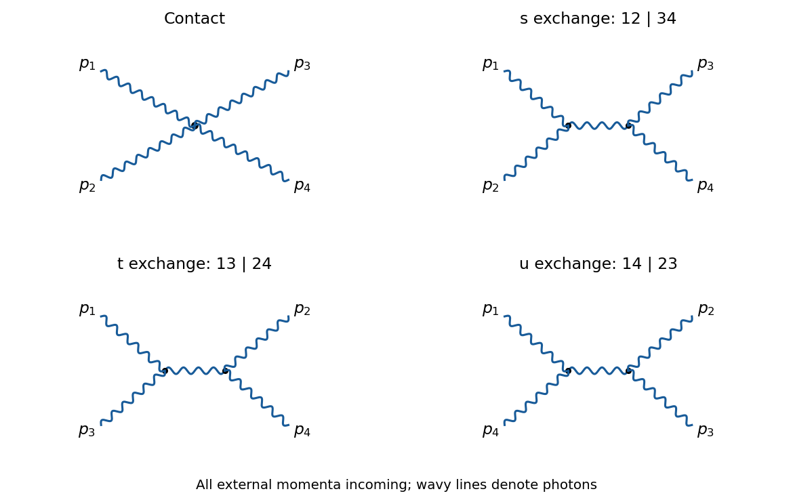

# 2021

↑ **Parent:** [Past exam of the advanced quantum field theory for particle physics course of the University of Oxford](../past-exam-of-the-advanced-quantum-field-theory-for-particle-physics-course-of-the-university-of-oxford.md)

Source paper: [https://www.whatdotheyknow.com/request/oxford_physics_past_papers_2/response/2340696/attach/9/Physics%20Papers%202020.pdf?cookie_passthrough=1](https://www.whatdotheyknow.com/request/oxford_physics_past_papers_2/response/2340696/attach/9/Physics%20Papers%202020.pdf?cookie_passthrough=1)

Official standalone paper: [https://mmathphys.physics.ox.ac.uk/sites/default/files/mmathphys/documents/media/aqft_2021.pdf](https://mmathphys.physics.ox.ac.uk/sites/default/files/mmathphys/documents/media/aqft_2021.pdf)

Use [natural units](../mathematical-physics.md#natural-units), the [Minkowski metric](../special-relativity.md#minkowski-metric) $g=\operatorname{diag}(1,-1,-1,-1)$ and the [Feynman i-epsilon prescription](../quantum-field-theory.md#feynman-i-epsilon-prescription). In question 1 use [dimensional regularization](../perturbative-quantum-field-theory.md#dimensional-regularization) with $d=4-2\epsilon$ and write $C_\epsilon=1/(16\pi^2\epsilon)$; in the alternative convention $d=4-\epsilon$, replace $C_\epsilon$ by $1/(8\pi^2\epsilon)$. Only [ultraviolet poles](../perturbative-quantum-field-theory.md#ultraviolet-pole) are retained there. Figure 1 is unreadable in the released source: the corresponding specific gaps are marked below. All other parts have complete derivations.

**Table of contents**

- [1](#1)
  - [i](#1/i)
    - [Solution](#1/i/solution)
  - [ii](#1/ii)
    - [Solution](#1/ii/solution)
  - [iii](#1/iii)
    - [Solution](#1/iii/solution)
  - [iv](#1/iv)
    - [Solution](#1/iv/solution)
  - [v](#1/v)
    - [Solution](#1/v/solution)
- [2](#2)
  - [a](#2/a)
    - [i](#2/a/i)
      - [Solution](#2/a/i/solution)
    - [ii](#2/a/ii)
      - [Solution](#2/a/ii/solution)
    - [iii](#2/a/iii)
      - [Solution](#2/a/iii/solution)
    - [iv](#2/a/iv)
      - [Solution](#2/a/iv/solution)
  - [b](#2/b)
    - [Solution](#2/b/solution)
- [3](#3)
  - [a](#3/a)
    - [i](#3/a/i)
      - [Solution](#3/a/i/solution)
    - [ii](#3/a/ii)
      - [Solution](#3/a/ii/solution)
    - [iii](#3/a/iii)
      - [Solution](#3/a/iii/solution)
  - [b](#3/b)
    - [i](#3/b/i)
      - [Solution](#3/b/i/solution)
    - [ii](#3/b/ii)
      - [Solution](#3/b/ii/solution)

## 1

↑ **Parent:** [2021](2021.md)

<h3 id="1/i">i</h3>

↑ **Parent:** [1](#1)

<h4 id="1/i/solution">Solution</h4>

↑ **Parent:** [I](#1/i)

The [superficial degree of divergence](../perturbative-quantum-field-theory.md#superficial-degree-of-divergence) of this [scalar electrodynamics three-point vertex](../perturbative-quantum-field-theory.md#scalar-electrodynamics-three-point-vertex) is one. Its [ultraviolet pole](../perturbative-quantum-field-theory.md#ultraviolet-pole) is consequently a local expression at most linear in the external [four-momenta](../special-relativity.md#four-momentum). The allowed [counterterm Lagrangian](../perturbative-quantum-field-theory.md#counterterm-lagrangian), with the charge-conjugation and Hermiticity properties of [scalar electrodynamics](../relativistic-quantum-field.md#scalar-electrodynamics), contains a single one-derivative [scalar electrodynamics three-point vertex](../perturbative-quantum-field-theory.md#scalar-electrodynamics-three-point-vertex):

$$
V_{\mathrm{ct}}^\mu(k,k')=-ie\delta_1(k+k')^\mu.
$$

Thus the coefficient $\delta_1$ is independent of the chosen external [four-momenta](../special-relativity.md#four-momentum). Setting $k'=0$ leaves $-ie\delta_1k^\mu$, so a nonzero generic $k$ still determines that coefficient. It does not determine the full finite [scattering amplitude](../quantum-scattering.md#scattering-amplitude) at other [four-momenta](../special-relativity.md#four-momentum).

Keep $m\ne0$ and generic [off shell](../classical-field-theory.md#off-shell) $k$ while extracting the [ultraviolet pole](../perturbative-quantum-field-theory.md#ultraviolet-pole). These choices avoid spurious [infrared divergences](../quantum-field-theory.md#infrared-divergence); setting all scales to zero would instead produce [scaleless integrals](../perturbative-quantum-field-theory.md#scaleless-integral) that can conceal the [ultraviolet pole](../perturbative-quantum-field-theory.md#ultraviolet-pole).

<h3 id="1/ii">ii</h3>

↑ **Parent:** [1](#1)

<h4 id="1/ii/solution">Solution</h4>

↑ **Parent:** [Ii](#1/ii)

**TODO (source gap):** Figure 1(a), including its internal connections and [four-momentum](../special-relativity.md#four-momentum) labels, is absent from the recoverable source. The local PDF renderer reports missing image objects, and the matching official PDF's figure could not be retrieved for visual inspection. Therefore the individual [Feynman diagram](../perturbative-quantum-field-theory.md#feynman-diagram) called (a) cannot be assigned an integrand and its separate independence of $\xi$ cannot be verified from the available diagram. A guessed replacement drawing would not resolve this gap.

An independent determination of the complete [ultraviolet pole](../perturbative-quantum-field-theory.md#ultraviolet-pole), given in part (iv), remains possible from the [scalar QED Ward identity](../perturbative-quantum-field-theory.md#scalar-quantum-electrodynamics-ward-identity). Together with the textually supplied integral in part (iv), it fixes the sum of the contributions outside that integral to $3ie^3C_\epsilon k^\mu$ in the stated [scalar electrodynamics three-point vertex](../perturbative-quantum-field-theory.md#scalar-electrodynamics-three-point-vertex) convention. That sum alone does not identify the contents of panel (a).

<h3 id="1/iii">iii</h3>

↑ **Parent:** [1](#1)

<h4 id="1/iii/solution">Solution</h4>

↑ **Parent:** [Iii](#1/iii)

**TODO (source gap):** Figure 1(c) and its [four-momentum](../special-relativity.md#four-momentum) labels are unreadable. The assertion about this individual [Feynman diagram](../perturbative-quantum-field-theory.md#feynman-diagram) therefore cannot be checked against its actual integrand. In particular, one must not identify the missing panel with a convenient vanishing [seagull vertex](../perturbative-quantum-field-theory.md#seagull-vertex) graph by inference.

A useful criterion, once the drawing is recovered, is that [dimensional regularization](../perturbative-quantum-field-theory.md#dimensional-regularization) annihilates a vector integral of the form

$$
\int\frac{d^dl}{(2\pi)^d}\,l^\mu f(l^2)=0
$$

by the change of variables $l\mapsto-l$. This would prove vanishing for every $\xi$ if all remaining factors were functions of $l^2$; a denominator involving $l+k$ must first be checked rather than discarded. Whether this criterion applies to panel (c) is precisely the unavailable information.

<h3 id="1/iv">iv</h3>

↑ **Parent:** [1](#1)

<h4 id="1/iv/solution">Solution</h4>

↑ **Parent:** [Iv](#1/iv)

The integral printed in the text can be evaluated without reconstructing Figure 1. Put $A=l^2-m^2+i0$ and $B=(l+k)^2-m^2+i0$, and let $I^\mu$ denote that integral without its factor $\xi$. The numerator contraction responsible for its [covariant gauge](../relativistic-quantum-field.md#covariant-gauge) dependence is

$$
l_\alpha\left(g^{\alpha\beta}-(1-\xi)\frac{l^\alpha l^\beta}{l^2}\right)(l+2k)_\beta
=\xi(l^2+2l\cdot k).
$$

With the [scalar electrodynamics three-point vertex](../perturbative-quantum-field-theory.md#scalar-electrodynamics-three-point-vertex) $-ie(p+p')^\mu$, three such vertices, two [scalar propagators](../scalar-field-theory.md#scalar-propagator) and one [photon propagator](../quantum-field-theory.md#photon-propagator) have overall factor $(-ie)^3i^2(-i)=-e^3$. Thus the supplied integrand gives $V_{\mathrm{supplied}}^\mu=-e^3\xi I^\mu$.

First isolate the numerator term $l^2$. Its contribution is

$$
I_0^\mu=\int\frac{d^dl}{(2\pi)^d}\frac{(2l+k)^\mu}{AB}.
$$

Under $l\mapsto-l-k$ the two denominators exchange and the numerator changes sign. A shift-invariant [dimensional regularization](../perturbative-quantum-field-theory.md#dimensional-regularization) therefore gives $\boxed{I_0^\mu=0}$, including the finite part.

For the remaining numerator $2(l\cdot k)(2l+k)^\mu$, only its term $4l^\mu(l\cdot k)$ contributes to the [ultraviolet pole](../perturbative-quantum-field-theory.md#ultraviolet-pole). Corrections from expanding the denominators, and the numerator $2k^\mu(l\cdot k)$, are [ultraviolet finite](../perturbative-quantum-field-theory.md#ultraviolet-finiteness) by [power counting](../perturbative-quantum-field-theory.md#power-counting-in-quantum-field-theory). Use [auxiliary-mass extraction of ultraviolet poles](../perturbative-quantum-field-theory.md#auxiliary-mass-extraction-of-ultraviolet-poles) with any $M>0$ rather than literally integrating a massless [scaleless integral](../perturbative-quantum-field-theory.md#scaleless-integral). [Lorentz covariance](../special-relativity.md#lorentz-covariance) then gives

$$
\begin{aligned}
I^\mu\big|_{\mathrm{UV}}
&=\frac4d k_\nu g^{\mu\nu}\int\frac{d^dl}{(2\pi)^d}\frac1{(l^2-M^2+i0)^2}\bigg|_{\mathrm{UV}}\\
&=iC_\epsilon k^\mu,\\
\boxed{V_{\mathrm{supplied}}^\mu\big|_{\mathrm{UV}}}&=\boxed{-ie^3\xi C_\epsilon k^\mu}.
\end{aligned}
$$

**TODO (source gap):** The algebra of the supplied expression is complete, but its graphical identification with Figure 1(b), including the routing at each internal vertex, cannot be visually verified from the unreadable panel.

The complete [renormalization constant](../perturbative-quantum-field-theory.md#renormalization-constant) can nevertheless be obtained independently. Here is a short [scalar QED wave-function pole](../perturbative-quantum-field-theory.md#scalar-qed-wave-function-pole) calculation, to avoid assuming either missing panel's value. For an external [four-momentum](../special-relativity.md#four-momentum) $p$, the exchange contribution to the [scalar self-energy](../perturbative-quantum-field-theory.md#scalar-self-energy) has numerator

$$
N=(2p-l)^2-(1-\xi)\frac{[(2p-l)\cdot l]^2}{l^2}
=4p^2-4\xi p\cdot l+\xi l^2-4(1-\xi)\frac{(p\cdot l)^2}{l^2}.
$$

Its denominator is $l^2[(p-l)^2-m^2+i0]$. The necessary [ultraviolet poles](../perturbative-quantum-field-theory.md#ultraviolet-pole), with the measure $d^dl/(2\pi)^d$, are respectively

$$
\int\frac1{l^2D}\bigg|_{\mathrm{UV}}=iC_\epsilon,\quad
\int\frac{l^\mu}{l^2D}\bigg|_{\mathrm{UV}}=\frac{p^\mu}2iC_\epsilon,\quad
\int\frac1D\bigg|_{\mathrm{UV}}=m^2iC_\epsilon,\quad
\int\frac{l^\mu l^\nu}{(l^2)^2D}\bigg|_{\mathrm{UV}}=\frac{g^{\mu\nu}}4iC_\epsilon,
\qquad D=(p-l)^2-m^2+i0.
$$

The first two follow by a [Feynman parameter](../perturbative-quantum-field-theory.md#feynman-parameter) and a shift of $l$; the third is a [tadpole integral](../perturbative-quantum-field-theory.md#tadpole-integral); the last follows by the same large-$l$ extraction used above. The [seagull vertex](../perturbative-quantum-field-theory.md#seagull-vertex) contributes only a [photon](../quantum-mechanics.md#photon) [tadpole integral](../perturbative-quantum-field-theory.md#tadpole-integral), which is a [scaleless integral](../perturbative-quantum-field-theory.md#scaleless-integral), and in any case cannot affect the coefficient of $p^2$. Multiplication by the exchange graph's factor $-e^2$ gives the [scalar self-energy](../perturbative-quantum-field-theory.md#scalar-self-energy) insertion

$$
-i e^2 C_\epsilon[(3-\xi)p^2+\xi m^2].
$$

The kinetic [counterterm](../perturbative-quantum-field-theory.md#counterterm) $i\delta_2p^2$ therefore requires $\delta_2=e^2(3-\xi)C_\epsilon$. The [scalar QED Ward identity](../perturbative-quantum-field-theory.md#scalar-quantum-electrodynamics-ward-identity) sets $\delta_1=\delta_2$, so

$$
\boxed{Z_1=1+\frac{e^2(3-\xi)}{16\pi^2\epsilon}+O(e^4).}
$$

Indeed the full unrenormalized [scalar electrodynamics three-point vertex](../perturbative-quantum-field-theory.md#scalar-electrodynamics-three-point-vertex) has [ultraviolet pole](../perturbative-quantum-field-theory.md#ultraviolet-pole) $ie^3(3-\xi)C_\epsilon k^\mu$, which is cancelled by $-ie\delta_1k^\mu$. Subtracting the supplied contribution gives the gauge-independent sum stated in part (ii), without assigning either unreadable panel an integrand.

<h3 id="1/v">v</h3>

↑ **Parent:** [1](#1)

<h4 id="1/v/solution">Solution</h4>

↑ **Parent:** [V](#1/v)

The [scalar QED Ward identity](../perturbative-quantum-field-theory.md#scalar-quantum-electrodynamics-ward-identity) equates the [vertex renormalization](../perturbative-quantum-field-theory.md#vertex-renormalization) and [wave-function renormalization](../perturbative-quantum-field-theory.md#wave-function-renormalization) constants. Consequently, using part (iv),

$$
\boxed{Z_2=Z_1=1+\frac{e^2(3-\xi)}{16\pi^2\epsilon}+O(e^4).}
$$

The [renormalization constants](../perturbative-quantum-field-theory.md#renormalization-constant) describe gauge-dependent fields and [off shell](../classical-field-theory.md#off-shell) vertices, so their dependence on $\xi$ is permitted. A physical [scattering amplitude](../quantum-scattering.md#scattering-amplitude) includes all [Feynman diagrams](../perturbative-quantum-field-theory.md#feynman-diagram), the [counterterms](../perturbative-quantum-field-theory.md#counterterm), and the external-state factors from [LSZ reduction](../perturbative-quantum-field-theory.md#lsz-reduction-formula). The [Ward identities](../perturbative-quantum-field-theory.md#ward-identity) ensure that the dependence on $\xi$ cancels for physical external states. Infrared-sensitive probabilities also require the usual inclusive treatment of unobserved soft [photons](../quantum-mechanics.md#photon). Thus no dependence on $\xi$ is implied for consistently calculated physical observables.

## 2

↑ **Parent:** [2021](2021.md)

<h3 id="2/a">a</h3>

↑ **Parent:** [2](#2)

<h4 id="2/a/i">i</h4>

↑ **Parent:** [A](#2/a)

<h5 id="2/a/i/solution">Solution</h5>

↑ **Parent:** [I](#2/a/i)

Use the [Mandelstam variables](../special-relativity.md#mandelstam-variables) $s=(p_1+p_2)^2$, $t=(p_1-p_3)^2$ and $u=(p_1-p_4)^2$. The external [on shell](../classical-field-theory.md#on-shell) relations are $p_1^2=p_2^2=m_e^2$ and $p_3^2=p_4^2=m_t^2$. Expanding the three [Mandelstam variables](../special-relativity.md#mandelstam-variables) and using [four-momentum conservation](../special-relativity.md#four-momentum-conservation), $p_3+p_4=p_1+p_2$, gives

$$
\begin{aligned}
s+t+u
&=3p_1^2+p_2^2+p_3^2+p_4^2+2p_1\cdot(p_2-p_3-p_4)\\
&=p_1^2+p_2^2+p_3^2+p_4^2\\
&=\boxed{2(m_e^2+m_t^2)}.
\end{aligned}
$$

<h4 id="2/a/ii">ii</h4>

↑ **Parent:** [A](#2/a)

<h5 id="2/a/ii/solution">Solution</h5>

↑ **Parent:** [Ii](#2/a/ii)

Let $\Sigma=m_e^2+m_t^2$, $Q_e=-1$, $Q_t=2/3$ and $N_c=3$. The single [tree-level Feynman diagram](../perturbative-quantum-field-theory.md#tree-level-feynman-diagram) is annihilation through a [virtual photon](../quantum-field-theory.md#virtual-photon). Up to an irrelevant common phase, its [scattering amplitude](../quantum-scattering.md#scattering-amplitude) is

$$
\mathcal M_\gamma=\frac{e^2Q_eQ_t}{s}\,[\bar v(p_2)\gamma^\mu u(p_1)]\,[\bar u(p_3)\gamma_\mu v(p_4)]\,\delta_{cd}.
$$

There are two initial [spin angular momentum](../angular-momentum-operator.md#spin) states for each particle, so the [spin average](../relativistic-quantum-field.md#spin-average) is $1/4$. The final [color charge](../standard-model.md#color-charge) sum gives $\sum_{c,d}|\delta_{cd}|^2=N_c$. There is no additional [photon polarization](../quantum-mechanics.md#photon-polarization) average for a [virtual photon](../quantum-field-theory.md#virtual-photon) and no separate polarization label beyond the [Dirac spinor](../relativistic-quantum-field.md#dirac-spinor) [spin sums](../relativistic-quantum-field.md#spin-sum).

The [spin sums](../relativistic-quantum-field.md#spin-sum) and the [gamma-matrix trace](../relativistic-quantum-field.md#gamma-matrix-trace) identities give

$$
\begin{aligned}
L^{\mu\nu}&=\operatorname{tr}[(\not p_2-m_e)\gamma^\mu(\not p_1+m_e)\gamma^\nu]\\
&=4[p_2^\mu p_1^\nu+p_2^\nu p_1^\mu-\tfrac{s}{2}g^{\mu\nu}],\\
H_{\mu\nu}&=\operatorname{tr}[(\not p_3+m_t)\gamma_\mu(\not p_4-m_t)\gamma_\nu]\\
&=4[p_{3\mu}p_{4\nu}+p_{3\nu}p_{4\mu}-\tfrac{s}{2}g_{\mu\nu}].
\end{aligned}
$$

Here $p_1\cdot p_2+m_e^2=p_3\cdot p_4+m_t^2=s/2$. Contracting gives

$$
\frac14L^{\mu\nu}H_{\mu\nu}
=8[(p_1\cdot p_3)(p_2\cdot p_4)+(p_1\cdot p_4)(p_2\cdot p_3)]+4s\Sigma.
$$

Since $2p_1\cdot p_3=2p_2\cdot p_4=\Sigma-t$ and $2p_1\cdot p_4=2p_2\cdot p_3=\Sigma-u$, this is the [massive vector-current annihilation kernel](../relativistic-quantum-field.md#massive-vector-current-annihilation-kernel)

$$
2[(\Sigma-t)^2+(\Sigma-u)^2+2s\Sigma]
=2[t^2+u^2+4s\Sigma-2\Sigma^2].
$$

Thus the absolutely normalized result is

$$
\boxed{\overline{|\mathcal M_\gamma|^2}
=\frac{2N_ce^4Q_e^2Q_t^2}{s^2}[t^2+u^2+4s\Sigma-2\Sigma^2]
=\frac{8e^4}{3s^2}[t^2+u^2+4s\Sigma-2\Sigma^2].}
$$

After taking out the displayed prefactor, $\boxed{A=1,\ B=4,\ C=-2}$. Because the source uses a proportionality sign, only their ratio is fixed until that prefactor is specified. Equivalently, after taking out just $e^4/s^2$, their values are $8/3,32/3,-16/3$. No mass has been neglected. At $m_e=0$ and $s=4m_t^2$, the bracket yields the finite isotropic threshold value of the [scattering amplitude](../quantum-scattering.md#scattering-amplitude); the vanishing threshold [scattering cross-section](../quantum-scattering.md#scattering-cross-section) comes from [relativistic two-body phase space](../quantum-scattering.md#relativistic-two-body-phase-space).

<h4 id="2/a/iii">iii</h4>

↑ **Parent:** [A](#2/a)

<h5 id="2/a/iii/solution">Solution</h5>

↑ **Parent:** [Iii](#2/a/iii)

The exchanged particle is now a [gluon](../standard-model.md#gluon), and the incoming [up quark](../standard-model.md#up-quark) mass replaces $m_e$. Define

$$
\Sigma_u=m_u^2+m_t^2,\qquad F_u=t^2+u^2+4s\Sigma_u-2\Sigma_u^2.
$$

The [Dirac trace](../relativistic-quantum-field.md#gamma-matrix-trace) and [spin average](../relativistic-quantum-field.md#spin-average) are unchanged. Normalize the fundamental [gauge generators](../relativistic-quantum-field.md#gauge-generator) by $\operatorname{tr}(T^AT^B)=\delta^{AB}/2$. Averaging over the $N_c^2$ initial [color charge](../standard-model.md#color-charge) choices and summing the final [color charge](../standard-model.md#color-charge) choices gives

$$
C_g=\frac1{N_c^2}\sum_{A,B}\operatorname{tr}(T^AT^B)\operatorname{tr}(T^AT^B)
=\frac{N_c^2-1}{4N_c^2}=\frac29.
$$

Replace the factor $N_ce^4Q_e^2Q_t^2$ from part (ii) by $g_s^4C_g$. Therefore

$$
\boxed{\overline{|\mathcal M_g|^2}=\frac{4g_s^4}{9s^2}F_u.}
$$

Keeping $m_u$ is allowed; if the usual negligible [up quark](../standard-model.md#up-quark) mass approximation is wanted, simply set $m_u=0$. The factor $1/N_c^2$ is essential: initial [quark](../standard-model.md#quark) [color charge](../standard-model.md#color-charge) states are averaged, whereas final ones are summed.

<h4 id="2/a/iv">iv</h4>

↑ **Parent:** [A](#2/a)

<h5 id="2/a/iv/solution">Solution</h5>

↑ **Parent:** [Iv](#2/a/iv)

There are two [tree-level Feynman diagrams](../perturbative-quantum-field-theory.md#tree-level-feynman-diagram), with intermediate [photon](../quantum-mechanics.md#photon) and [gluon](../standard-model.md#gluon) respectively. Their [color charge](../standard-model.md#color-charge) tensors are $\delta_{ji}\delta_{kl}$ and $\sum_AT^A_{ji}T^A_{kl}$. The pure [photon](../quantum-mechanics.md#photon) factor is

$$
C_\gamma=\frac1{N_c^2}\sum_{i,j,k,l}|\delta_{ji}\delta_{kl}|^2=1.
$$

Their interference vanishes after the [color charge](../standard-model.md#color-charge) sum because of [photon-gluon colour orthogonality](../standard-model.md#photon-gluon-colour-orthogonality):

$$
C_{\gamma g}=\frac1{N_c^2}\sum_A\operatorname{tr}(T^A)\operatorname{tr}(T^A)=0.
$$

Thus there is no term proportional to $e^2g_s^2$, and with the $F_u$ of part (iii),

$$
\boxed{\overline{|\mathcal M_\gamma+\mathcal M_g|^2}
=\frac{2F_u}{s^2}\left[e^4Q_u^2Q_t^2+\frac29g_s^4\right]
=\frac{F_u}{s^2}\left[\frac{32}{81}e^4+\frac49g_s^4\right].}
$$

Here $Q_u=Q_t=2/3$. The absence of interference concerns the specified averaged and summed result; a fixed choice of external [color charge](../standard-model.md#color-charge) need not have zero interference.

<h3 id="2/b">b</h3>

↑ **Parent:** [2](#2)

<h4 id="2/b/solution">Solution</h4>

↑ **Parent:** [B](#2/b)

There are exactly four [tree-level Feynman diagrams](../perturbative-quantum-field-theory.md#tree-level-feynman-diagram): one four-[photon](../quantum-mechanics.md#photon) contact graph and one exchange graph for each of the three partitions $12|34$, $13|24$ and $14|23$ of the external legs. The exchange graphs contain two cubic [Feynman vertices](../perturbative-quantum-field-theory.md#interaction-vertex). A [fermion loop](../perturbative-quantum-field-theory.md#fermion-loop) or a closed [Faddeev-Popov ghost](../relativistic-quantum-field.md#faddeev-popov-ghost) line has positive [loop order](../perturbative-quantum-field-theory.md#loop-order), so neither enters here.

**[Figure 1](#2/b/image-the-contact-graph-and-three-exchange-graphs-for-physical-photon-scattering-in-the-nonlinear-gauge-all-external-momenta-are-incoming). The contact graph and three exchange graphs for physical photon scattering in the nonlinear gauge; all external momenta are incoming**.

Write $p_1+p_2+p_3+p_4=0$ and take physical [photon polarization vectors](../quantum-mechanics.md#photon-polarization-vector) $\varepsilon_i$ with $p_i\cdot\varepsilon_i=0$ and $p_i^2=0$. At the cubic [Feynman vertex](../perturbative-quantum-field-theory.md#interaction-vertex) attached to legs $i,j$, the two terms containing $p_i\cdot\varepsilon_i$ or $p_j\cdot\varepsilon_j$ vanish. If $q=p_i+p_j$ flows into the internal line, the remaining factor at that end is

$$
-2\lambda q^\mu(\varepsilon_i\cdot\varepsilon_j).
$$

At the other end the internal incoming [four-momentum](../special-relativity.md#four-momentum) is $q$ rather than $-q$, giving $+2\lambda q^\nu(\varepsilon_k\cdot\varepsilon_l)$. Multiplication by the [photon propagator](../quantum-field-theory.md#photon-propagator) gives

$$
i\mathcal M_{ij|kl}=(-2\lambda q^\mu)\frac{-ig_{\mu\nu}}{q^2}(2\lambda q^\nu)
(\varepsilon_i\cdot\varepsilon_j)(\varepsilon_k\cdot\varepsilon_l)
=4i\lambda^2(\varepsilon_i\cdot\varepsilon_j)(\varepsilon_k\cdot\varepsilon_l).
$$

The cancellation holds first at generic nonzero channel [Mandelstam invariants](../special-relativity.md#mandelstam-variables) and then by continuation at degenerate kinematics. Summing the three exchange graphs produces $4i\lambda^2P$, where

$$
P=(\varepsilon_1\cdot\varepsilon_2)(\varepsilon_3\cdot\varepsilon_4)
+(\varepsilon_1\cdot\varepsilon_3)(\varepsilon_2\cdot\varepsilon_4)
+(\varepsilon_1\cdot\varepsilon_4)(\varepsilon_2\cdot\varepsilon_3).
$$

The quartic [Feynman vertex](../perturbative-quantum-field-theory.md#interaction-vertex) contributes $-4i\lambda^2P$. Therefore

$$
\boxed{\mathcal M_{\gamma\gamma\to\gamma\gamma}^{\mathrm{tree}}=0.}
$$

This is a cancellation for physical [on shell](../classical-field-theory.md#on-shell) [photon polarization vectors](../quantum-mechanics.md#photon-polarization-vector). The [off shell](../classical-field-theory.md#off-shell) four-[photon](../quantum-mechanics.md#photon) correlation function need not vanish. Physical [light-by-light scattering](../perturbative-quantum-field-theory.md#light-by-light-scattering) first occurs through charged-particle [loop Feynman diagrams](../perturbative-quantum-field-theory.md#loop-feynman-diagram).

## 3

↑ **Parent:** [2021](2021.md)

<h3 id="3/a">a</h3>

↑ **Parent:** [3](#3)

<h4 id="3/a/i">i</h4>

↑ **Parent:** [A](#3/a)

<h5 id="3/a/i/solution">Solution</h5>

↑ **Parent:** [I](#3/a/i)

Put $r^2=\Phi^T\Phi$. The potential has its minimum at

$$
\frac{dV}{dr}=-m^2r+4\lambda r^3=0,\qquad \boxed{v^2=\frac{m^2}{4\lambda}}.
$$

Choose the [vacuum expectation value](../quantum-field-theory.md#vacuum-expectation-value) $\Phi_0=(0,0,v)^T$. Since the [weak hypercharge](../standard-model.md#hypercharge) is zero, $Q=T^3$ on this [real scalar triplet](../scalar-field-theory.md#real-scalar-triplet), and $T^3\Phi_0=0$. Neither $T^1$ nor $T^2$ annihilates $\Phi_0$. The [stabilizer subgroup](../group-action.md#stabilizer-subgroup) is consequently

$$
\boxed{SU(2)\times U(1)_Y\longrightarrow U(1)_{T^3}\times U(1)_Y.}
$$

In particular, [spontaneous symmetry breaking](../quantum-field-theory.md#spontaneous-symmetry-breaking) has not reduced the two neutral [gauge generators](../relativistic-quantum-field.md#gauge-generator) to a single one: $Y$ annihilates every component and remains unbroken independently of $T^3$.

The [scalar mass matrix](../quantum-field-theory.md#scalar-mass-matrix) is

$$
\left.\frac{\partial^2V}{\partial\phi_i\partial\phi_j}\right|_{\Phi_0}
=(-m^2+4\lambda v^2)\delta_{ij}+8\lambda(\Phi_0)_i(\Phi_0)_j
=8\lambda v^2\delta_{i3}\delta_{j3}.
$$

With canonical kinetic normalization $\tfrac12(\partial h)^2$, the radial [Higgs boson](../standard-model.md#higgs-boson) therefore has

$$
\boxed{m_h^2=8\lambda v^2=2m^2,\qquad m_h=\sqrt2\,m.}
$$

The two tangential zero [eigenvalues](../linear-operator-theory.md#eigenvalue) are [Goldstone modes](../critical-phenomenon.md#goldstone-boson), absorbed by the two massive [gauge bosons](../relativistic-quantum-field.md#gauge-boson) through the [Higgs mechanism](../standard-model.md#higgs-mechanism).

<h4 id="3/a/ii">ii</h4>

↑ **Parent:** [A](#3/a)

<h5 id="3/a/ii/solution">Solution</h5>

↑ **Parent:** [Ii](#3/a/ii)

Let $g$ and $g'$ be the two [gauge couplings](../relativistic-quantum-field.md#gauge-coupling). In [unitary gauge](../standard-model.md#unitary-gauge), $\Phi=(0,0,v+h)^T$ and the [weak hypercharge](../standard-model.md#hypercharge) term in the [gauge covariant derivative](../relativistic-quantum-field.md#gauge-covariant-derivative) vanishes. Using $(T^a)_{bc}=-i\epsilon_{abc}$, the kinetic term becomes

$$
\frac12(D_\mu\Phi)^T(D^\mu\Phi)
=\frac12(\partial h)^2+\frac12g^2(v+h)^2[W_\mu^1W^{1\mu}+W_\mu^2W^{2\mu}].
$$

Thus, in the basis $(W^1,W^2,W^3,B)$, the [gauge-boson mass matrix](../relativistic-quantum-field.md#gauge-boson-mass-matrix) and its [eigenvalues](../linear-operator-theory.md#eigenvalue) are

$$
\boxed{M_V^2=g^2v^2\operatorname{diag}(1,1,0,0),\qquad
m_{W^\pm}=gv=\frac{gm}{2\sqrt\lambda},\quad m_{W^3}=m_B=0.}
$$

Here $W^\pm=(W^1\mp iW^2)/\sqrt2$. The two massless neutral [gauge bosons](../relativistic-quantum-field.md#gauge-boson) may be rotated to any orthonormal basis; no neutral mass term selects a unique mixing angle.

Expanding the same kinetic term to first order in $h$ gives

$$
\mathcal L_{hVV}=g^2vh[(W^1)^2+(W^2)^2]=2g^2vhW^+_\mu W^{-\mu}.
$$

Functional differentiation gives the [Feynman rules](../perturbative-quantum-field-theory.md#feynman-rules)

$$
\boxed{hW^+_\mu W^-_\nu:\quad 2ig^2v\,g_{\mu\nu}
=\frac{2im_W^2}{v}g_{\mu\nu},}
$$

and, in the real basis, $hW^a_\mu W^b_\nu:2ig^2v\delta^{ab}g_{\mu\nu}$ for $a,b\in\{1,2\}$. All such three-point [Feynman vertices](../perturbative-quantum-field-theory.md#interaction-vertex) involving $W^3$ or $B$ vanish. The factor two in the real basis comes from the two identical [gauge boson](../relativistic-quantum-field.md#gauge-boson) fields; in the charged basis it is already explicit in $\mathcal L_{hVV}$.

<h4 id="3/a/iii">iii</h4>

↑ **Parent:** [A](#3/a)

<h5 id="3/a/iii/solution">Solution</h5>

↑ **Parent:** [Iii](#3/a/iii)

This cannot be the sole symmetry-breaking sector of the [Standard Model](../standard-model.md). Its [gauge-boson mass matrix](../relativistic-quantum-field.md#gauge-boson-mass-matrix) has two zero [eigenvalues](../linear-operator-theory.md#eigenvalue), so besides the electromagnetic [photon](../quantum-mechanics.md#photon) it predicts an extra massless neutral [gauge boson](../relativistic-quantum-field.md#gauge-boson). Every linear combination of $W^3$ and $B$, including the combination normally called $Z$, is massless. The observed massive [Z boson](../standard-model.md#z-boson) is a concrete contradiction. Choosing $g,g',m,\lambda$ differently cannot change these two zero [eigenvalues](../linear-operator-theory.md#eigenvalue).

A [real scalar triplet](../scalar-field-theory.md#real-scalar-triplet) can occur as an additional sector, but a further [vacuum expectation value](../quantum-field-theory.md#vacuum-expectation-value), for example that of a [Higgs doublet](../standard-model.md#higgs-field), is then necessary to obtain the observed neutral [gauge boson](../relativistic-quantum-field.md#gauge-boson) mass pattern. This does not rescue the triplet-only model posed here.

<h3 id="3/b">b</h3>

↑ **Parent:** [3](#3)

<h4 id="3/b/i">i</h4>

↑ **Parent:** [B](#3/b)

<h5 id="3/b/i/solution">Solution</h5>

↑ **Parent:** [I](#3/b/i)

Normalize the [generating functional](../perturbative-quantum-field-theory.md#generating-functional) by its value with all sources zero, and take the connected part of the [time-ordered correlation function](../critical-phenomenon.md#time-ordered-correlation-function). Source differentiation of the interaction exponential is equivalent to the [Dyson series](../perturbative-quantum-field-theory.md#dyson-series) followed by [Wick's theorem](../perturbative-quantum-field-theory.md#wick-s-theorem). Write $D(x-y)=\langle T\phi(x)\phi(y)\rangle_0$ and $F_{ij}(x-y)=\langle T\psi_i(x)\bar\psi_j(y)\rangle_0$ temporarily, so that every contraction has an unambiguous meaning.

The second-order [Dyson series](../perturbative-quantum-field-theory.md#dyson-series) contributes

$$
\frac{(ig)^2}{2!}\int d^4x\,d^4y\,
\langle T\phi(x_a)\phi(y_a)\phi(x)\phi(y)
[\bar\psi_i(x)\psi_i(x)][\bar\psi_j(y)\psi_j(y)]\rangle_{0,c}.
$$

There are two connected external [scalar field](../classical-field-theory.md#scalar-field) attachments:

$$
D(x_a-x)D(y_a-y)+D(x_a-y)D(y_a-x).
$$

They become equal after exchanging the integration variables $x,y$, cancelling $2!$. The connected [fermion](../tensor-product-of-quantum-systems.md#fermion) contractions have the [closed fermion loop sign](../perturbative-quantum-field-theory.md#closed-fermion-loop-sign):

$$
\langle T[\bar\psi_i(x)\psi_i(x)][\bar\psi_j(y)\psi_j(y)]\rangle_{0,c}
=-F_{ij}(x-y)F_{ji}(y-x)
=-\operatorname{tr}[F(x-y)F(y-x)].
$$

The minus sign can also be checked directly: the pairing of the first with the fourth field and the second with the third has positive pairing parity, but $\langle T\bar\psi_i(x)\psi_j(y)\rangle=-F_{ji}(y-x)$. Multiplying it by $(ig)^2=-g^2$ leaves a positive result:

$$
G_c^{(2)}(x_a,y_a)=g^2\int d^4x\,d^4y\,
D(x_a-x)D(y_a-y)\operatorname{tr}[F(x-y)F(y-x)].
$$

A contraction of the two external fields with each other times a [vacuum bubble](../perturbative-quantum-field-theory.md#vacuum-feynman-diagram) cancels against the normalization. Separate [fermion](../tensor-product-of-quantum-systems.md#fermion) [tadpole integrals](../perturbative-quantum-field-theory.md#tadpole-integral) at $x$ and $y$ belong to a product of one-point functions, removed by taking the connected part.

To match the source's [generating functional](../perturbative-quantum-field-theory.md#generating-functional) convention, distinguish its displayed kernels from contractions. The positive $iJ\Delta J/2$ exponent gives $D=-i\Delta$. With the source insertion order in equation (5), the positive $i\bar\eta S_F\eta$ exponent similarly gives $F=-iS_F$. The two [scalar propagators](../scalar-field-theory.md#scalar-propagator) and two [Dirac propagators](../quantum-field-theory.md#dirac-propagator) supply a total phase $(-i)^4=1$. Thus, writing $S=S_F$ as in the requested formula,

$$
\boxed{G_c^{(2)}(x_a,y_a)=g^2\int d^4x\,d^4y\,
\Delta(x_a-x)\Delta(y_a-y)\operatorname{tr}[S(x-y)S(y-x)].}
$$

The [matrix trace](../linear-algebra.md#matrix-trace) closes the [spinor](../algebra-over-a-field.md#spinor) indices; no extra factor of two or additional [symmetry factor](../perturbative-quantum-field-theory.md#feynman-diagram-symmetry-factor) remains for a [Dirac field](../relativistic-quantum-field.md#dirac-field) with this [Yukawa interaction](../standard-model.md#yukawa-interaction).

<h4 id="3/b/ii">ii</h4>

↑ **Parent:** [B](#3/b)

<h5 id="3/b/ii/solution">Solution</h5>

↑ **Parent:** [Ii](#3/b/ii)

For commuting [real scalar fields](../scalar-field-theory.md#real-scalar-field), remove the [closed fermion loop sign](../perturbative-quantum-field-theory.md#closed-fermion-loop-sign) and replace the [Dirac propagators](../quantum-field-theory.md#dirac-propagator) by [scalar propagators](../scalar-field-theory.md#scalar-propagator). There are no [spinor](../algebra-over-a-field.md#spinor) indices, hence no [matrix trace](../linear-algebra.md#matrix-trace). With two independent [real scalar fields](../scalar-field-theory.md#real-scalar-field) $\chi_1,\chi_2$ and interaction $g\phi\chi_1\chi_2$, the same normalization gives

$$
\boxed{G_{c,\chi_1\chi_2}^{(2)}=-g^2\int d^4x\,d^4y\,
D(x_a-x)D(y_a-y)G_1(x-y)G_2(y-x).}
$$

The overall sign has reversed relative to part (i) because $(ig)^2$ is now unaccompanied by a [closed fermion loop sign](../perturbative-quantum-field-theory.md#closed-fermion-loop-sign). The same formula holds in the source's kernel convention, since there are again four [propagators](../quantum-field-theory.md#propagator).

There is an additional convention to specify if the two symbols are intended to denote the _same_ [real scalar field](../scalar-field-theory.md#real-scalar-field). For the literal interaction $g\phi\chi^2$, there are two identical connected [Wick contractions](../perturbative-quantum-field-theory.md#wick-contraction) between $\chi^2(x)$ and $\chi^2(y)$, so the coefficient becomes $-2g^2$. If the conventional interaction is instead $(g/2)\phi\chi^2$, each vertex is $ig$ and the loop has [symmetry factor](../perturbative-quantum-field-theory.md#feynman-diagram-symmetry-factor) $1/2$, giving coefficient $-g^2/2$. In both interpretations the [closed fermion loop sign](../perturbative-quantum-field-theory.md#closed-fermion-loop-sign) and [spinor](../algebra-over-a-field.md#spinor) [matrix trace](../linear-algebra.md#matrix-trace) disappear; the differing numerical factor comes from the interaction normalization and field identity.

## ↑ Ancestors (9)

1. [Past exam of the advanced quantum field theory for particle physics course of the University of Oxford](../past-exam-of-the-advanced-quantum-field-theory-for-particle-physics-course-of-the-university-of-oxford.md)
2. [Advanced quantum field theory for particle physics course of the University of Oxford](../university-of-oxford.md#advanced-quantum-field-theory-for-particle-physics-course-of-the-university-of-oxford)
3. [Year 4 of the mathematical and theoretical physics course of the University of Oxford](../university-of-oxford.md#year-4-of-the-mathematical-and-theoretical-physics-course-of-the-university-of-oxford)
4. [Mathematical and theoretical physics course of the University of Oxford](../university-of-oxford.md#mathematical-and-theoretical-physics-course-of-the-university-of-oxford)
5. [Undergraduate course of the University of Oxford](../university-of-oxford.md#undergraduate-course-of-the-university-of-oxford)
6. [Course of the University of Oxford](../university-of-oxford.md#course-of-the-university-of-oxford)
7. [University of Oxford](../university-of-oxford.md)
8. [List of universities](../README.md#list-of-universities)
9. [Codex Wiki](../README.md)
