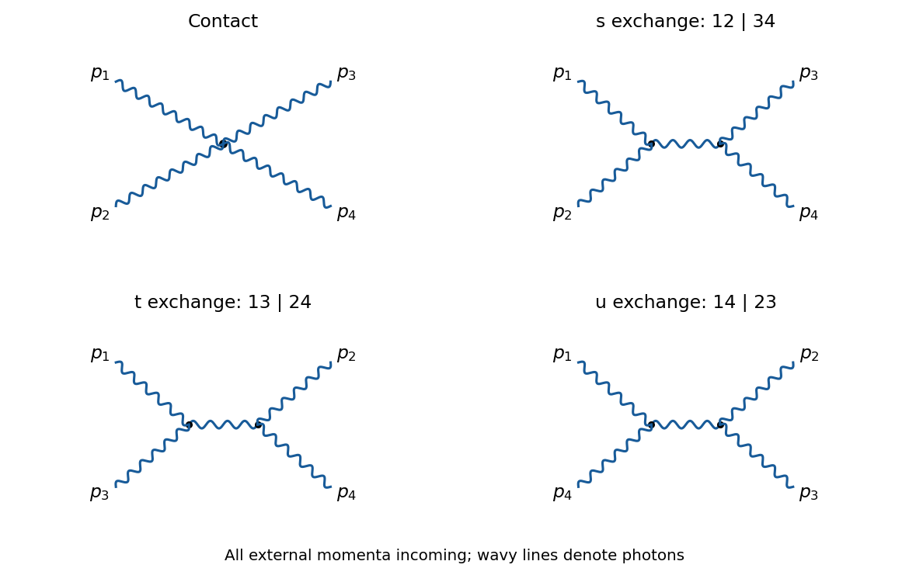

<h1 id="2/b/solution">Solution</h1>

↑ **Parent:** [B](../b.md)

There are exactly four [tree-level Feynman diagrams](../../../../tree-level-feynman-diagram.md): one four-[photon](../../../../photon.md) contact graph and one exchange graph for each of the three partitions $12|34$, $13|24$ and $14|23$ of the external legs. The exchange graphs contain two cubic [Feynman vertices](../../../../interaction-vertex.md). A [fermion loop](../../../../fermion-loop.md) or a closed [Faddeev-Popov ghost](../../../../faddeev-popov-ghost.md) line has positive [loop order](../../../../loop-order.md), so neither enters here.

**[Figure 1](#2/b/image-the-contact-graph-and-three-exchange-graphs-for-physical-photon-scattering-in-the-nonlinear-gauge-all-external-momenta-are-incoming). The contact graph and three exchange graphs for physical photon scattering in the nonlinear gauge; all external momenta are incoming**.

Write $p_1+p_2+p_3+p_4=0$ and take physical [photon polarization vectors](../../../../photon-polarization-vector.md) $\varepsilon_i$ with $p_i\cdot\varepsilon_i=0$ and $p_i^2=0$. At the cubic [Feynman vertex](../../../../interaction-vertex.md) attached to legs $i,j$, the two terms containing $p_i\cdot\varepsilon_i$ or $p_j\cdot\varepsilon_j$ vanish. If $q=p_i+p_j$ flows into the internal line, the remaining factor at that end is

$$
-2\lambda q^\mu(\varepsilon_i\cdot\varepsilon_j).
$$

At the other end the internal incoming [four-momentum](../../../../four-momentum.md) is $q$ rather than $-q$, giving $+2\lambda q^\nu(\varepsilon_k\cdot\varepsilon_l)$. Multiplication by the [photon propagator](../../../../photon-propagator.md) gives

$$
i\mathcal M_{ij|kl}=(-2\lambda q^\mu)\frac{-ig_{\mu\nu}}{q^2}(2\lambda q^\nu)
(\varepsilon_i\cdot\varepsilon_j)(\varepsilon_k\cdot\varepsilon_l)
=4i\lambda^2(\varepsilon_i\cdot\varepsilon_j)(\varepsilon_k\cdot\varepsilon_l).
$$

The cancellation holds first at generic nonzero channel [Mandelstam invariants](../../../../mandelstam-variables.md) and then by continuation at degenerate kinematics. Summing the three exchange graphs produces $4i\lambda^2P$, where

$$
P=(\varepsilon_1\cdot\varepsilon_2)(\varepsilon_3\cdot\varepsilon_4)
+(\varepsilon_1\cdot\varepsilon_3)(\varepsilon_2\cdot\varepsilon_4)
+(\varepsilon_1\cdot\varepsilon_4)(\varepsilon_2\cdot\varepsilon_3).
$$

The quartic [Feynman vertex](../../../../interaction-vertex.md) contributes $-4i\lambda^2P$. Therefore

$$
\boxed{\mathcal M_{\gamma\gamma\to\gamma\gamma}^{\mathrm{tree}}=0.}
$$

This is a cancellation for physical [on shell](../../../../on-shell.md) [photon polarization vectors](../../../../photon-polarization-vector.md). The [off shell](../../../../off-shell.md) four-[photon](../../../../photon.md) correlation function need not vanish. Physical [light-by-light scattering](../../../../light-by-light-scattering.md) first occurs through charged-particle [loop Feynman diagrams](../../../../loop-feynman-diagram.md).

## ↑ Ancestors (12)

1. [B](../b.md)
2. [2](../../2.md)
3. [2021](../../../2021-split.md)
4. [Past exam of the advanced quantum field theory for particle physics course of the University of Oxford](../../../split.md)
5. [Advanced quantum field theory for particle physics course of the University of Oxford](../../../../advanced-quantum-field-theory-for-particle-physics-course-of-the-university-of-oxford.md)
6. [Year 4 of the mathematical and theoretical physics course of the University of Oxford](../../../../year-4-of-the-mathematical-and-theoretical-physics-course-of-the-university-of-oxford.md)
7. [Mathematical and theoretical physics course of the University of Oxford](../../../../mathematical-and-theoretical-physics-course-of-the-university-of-oxford.md)
8. [Undergraduate course of the University of Oxford](../../../../undergraduate-course-of-the-university-of-oxford.md)
9. [Course of the University of Oxford](../../../../course-of-the-university-of-oxford.md)
10. [University of Oxford](../../../../university-of-oxford-split.md)
11. [List of universities](../../../../list-of-universities.md)
12. [Codex Wiki](../../../../split.md)
