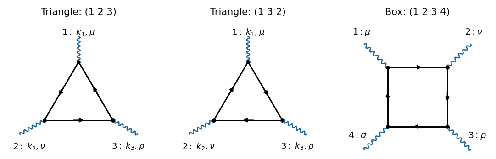
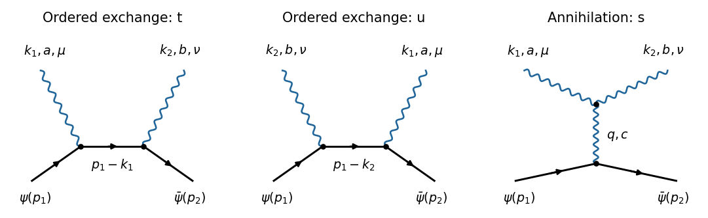

# 2024

↑ **Parent:** [Past exam of the advanced quantum field theory for particle physics course of the University of Oxford](../past-exam-of-the-advanced-quantum-field-theory-for-particle-physics-course-of-the-university-of-oxford.md)

Source PDF: [https://mmathphys.physics.ox.ac.uk/sites/g/files/vzsiac2991/files/mmathphys/documents/media/aqft_for_particle_physics_2024.pdf](https://mmathphys.physics.ox.ac.uk/sites/g/files/vzsiac2991/files/mmathphys/documents/media/aqft_for_particle_physics_2024.pdf)

Solutions to all seventeen lettered parts. Use [natural units](../mathematical-physics.md#natural-units), the [Minkowski metric](../special-relativity.md#minkowski-metric) $g_{\mu\nu}=\operatorname{diag}(1,-1,-1,-1)$, [Feynman slash notation](../algebra-over-a-field.md#feynman-slash-notation) $\not p=\gamma^\mu p_\mu$, and the [Feynman i-epsilon prescription](../quantum-field-theory.md#feynman-i-epsilon-prescription) in internal [propagators](../quantum-field-theory.md#propagator). Define the [scattering amplitude](../quantum-scattering.md#scattering-amplitude) by $S_{fi}=\delta_{fi}+i(2\pi)^4\delta^{(4)}(p_f-p_i)\mathcal M_{fi}$. The [gauge covariant derivative](../relativistic-quantum-field.md#gauge-covariant-derivative) convention in question 3 is specified there to match the printed three-boson [Feynman rule](../perturbative-quantum-field-theory.md#feynman-rule).

**Table of contents**

- [1](#1)
  - [a](#1/a)
    - [Solution](#1/a/solution)
  - [b](#1/b)
    - [Solution](#1/b/solution)
  - [c](#1/c)
    - [Solution](#1/c/solution)
  - [d](#1/d)
    - [Solution](#1/d/solution)
  - [e](#1/e)
    - [Solution](#1/e/solution)
  - [f](#1/f)
    - [Solution](#1/f/solution)
- [2](#2)
  - [a](#2/a)
    - [Solution](#2/a/solution)
  - [b](#2/b)
    - [Solution](#2/b/solution)
  - [c](#2/c)
    - [Solution](#2/c/solution)
  - [d](#2/d)
    - [Solution](#2/d/solution)
  - [e](#2/e)
    - [Solution](#2/e/solution)
  - [f](#2/f)
    - [Solution](#2/f/solution)
- [3](#3)
  - [a](#3/a)
    - [Solution](#3/a/solution)
  - [b](#3/b)
    - [Solution](#3/b/solution)
  - [c](#3/c)
    - [Solution](#3/c/solution)
  - [d](#3/d)
    - [Solution](#3/d/solution)
  - [e](#3/e)
    - [Solution](#3/e/solution)

## 1

↑ **Parent:** [2024](2024.md)

<h3 id="1/a">a</h3>

↑ **Parent:** [1](#1)

<h4 id="1/a/solution">Solution</h4>

↑ **Parent:** [A](#1/a)

For a [Dirac field](../relativistic-quantum-field.md#dirac-field), the [path integral](../quantum-field-theory.md#path-integral) is a [Berezin integral](../supersymmetric-quantum-mechanics.md#berezin-integral) over independent [Grassmann fields](../quantum-field-theory.md#grassmann-field) $\psi$ and $\bar\psi$:

$$
\boxed{Z=\mathcal N\int\mathcal D\bar\psi\,\mathcal D\psi\,
\exp\left[i\int d^4x\,\bar\psi(i\not\partial-m)\psi\right].}
$$

The vacuum [boundary conditions](../differential-equation.md#boundary-condition) and the [Feynman i-epsilon prescription](../quantum-field-theory.md#feynman-i-epsilon-prescription) are understood; $\mathcal N$ fixes the vacuum normalization. This is the vacuum [generating functional](../perturbative-quantum-field-theory.md#generating-functional) without sources, rather than a finite-temperature [partition function](../canonical-ensemble.md#canonical-partition-function).

The [Dirac adjoint](../relativistic-quantum-field.md#dirac-adjoint) transforms as $\bar\psi\mapsto\bar\psi e^{-i\alpha}$. For constant $\alpha$, $\partial_\mu(e^{i\alpha}\psi)=e^{i\alpha}\partial_\mu\psi$. Both the kinetic term and the [Dirac mass term](../relativistic-quantum-field.md#dirac-mass-term) therefore retain their values. This proves the [global phase symmetry](../classical-field-theory.md#global-phase-symmetry), whose [group](../group.md) is the [unitary group](../topological-group.md#unitary-group) $U(1)$.

<h3 id="1/b">b</h3>

↑ **Parent:** [1](#1)

<h4 id="1/b/solution">Solution</h4>

↑ **Parent:** [B](#1/b)

For the local variation $\delta\psi=i\alpha(x)\psi$, $\delta\bar\psi=-i\alpha(x)\bar\psi$, the terms proportional to $\alpha$ cancel and the differentiated phase gives

$$
\begin{aligned}
\delta\mathcal L
&=i(-i\alpha\bar\psi)\gamma^\mu\partial_\mu\psi
+i\bar\psi\gamma^\mu\partial_\mu(i\alpha\psi)
-m\,\delta(\bar\psi\psi)\\
&=-\bar\psi\gamma^\mu\psi\,\partial_\mu\alpha.
\end{aligned}
$$

Thus, for a compactly supported $\alpha$, [integration by parts](../calculus.md#integration-by-parts) gives

$$
\boxed{j^\mu=\bar\psi\gamma^\mu\psi,\qquad
\delta S=-\int d^4x\,j^\mu\partial_\mu\alpha
=\int d^4x\,\alpha\partial_\mu j^\mu.}
$$

This [Dirac current](../classical-field-theory.md#dirac-current) is the [Noether current](../classical-field-theory.md#noether-current) in the convention $\delta S=-\int j^\mu\partial_\mu\alpha$. Using the convention with a plus sign reverses the [Noether current](../classical-field-theory.md#noether-current) and the [conserved charge](../classical-field-theory.md#conserved-charge) together. There is one independent [global symmetry in field theory](../classical-field-theory.md#global-symmetry-in-field-theory), with four spacetime components of its [Noether current](../classical-field-theory.md#noether-current). The associated [conserved charge](../classical-field-theory.md#conserved-charge) is $Q=\int d^3x\,j^0$, with vacuum subtraction when required.

<h3 id="1/c">c</h3>

↑ **Parent:** [1](#1)

<h4 id="1/c/solution">Solution</h4>

↑ **Parent:** [C](#1/c)

An [operator equation in a path integral](../quantum-field-theory.md#operator-equation-in-a-path-integral) $\mathcal O(x)=0$ means that insertion of $\mathcal O(x)$ into every [time-ordered correlation function](../critical-phenomenon.md#time-ordered-correlation-function) vanishes when $x$ is separated from the other insertion points. At coincident points, [Ward identity contact terms](../perturbative-quantum-field-theory.md#ward-identity-contact-terms) can remain; an [operator equation](../quantum-field-theory.md#operator-equation-in-a-path-integral) does not assert that these distributions vanish.

Let $X$ be a product of local insertions. Make the local phase change of integration variables from part [b](#1/b). The [functional measure](../quantum-field-theory.md#functional-measure) has unit [functional Jacobian](../quantum-field-theory.md#functional-jacobian): the opposite phases of $\psi$ and $\bar\psi$ cancel in a vector-symmetry-preserving [regularization in quantum field theory](../perturbative-quantum-field-theory.md#regularization-in-quantum-field-theory). There is no vector [gauge anomaly](../relativistic-quantum-field.md#gauge-anomaly). Invariance under a change of integration variables gives

$$
0=\langle\delta_\alpha X\rangle
+i\int d^4x\,\alpha(x)\langle T\{\partial_\mu j^\mu(x)X\}\rangle.
$$

If $X=\prod_r\mathcal O_r(x_r)$ and $\delta_\alpha\mathcal O_r=iq_r\alpha(x_r)\mathcal O_r$, comparison of the coefficients of the arbitrary $\alpha(x)$ yields the [Ward-Takahashi identity](../perturbative-quantum-field-theory.md#ward-identity)

$$
\boxed{\langle T\{\partial_\mu j^\mu(x)X\}\rangle
=-\sum_rq_r\delta^{(4)}(x-x_r)\langle TX\rangle.}
$$

Consequently $\partial_\mu j^\mu=0$ is an [operator equation](../quantum-field-theory.md#operator-equation-in-a-path-integral) at separated points. This is stronger than just $\langle\partial_\mu j^\mu\rangle=0$. For example, $X=\psi(y)\bar\psi(z)$ has $q_y=1$, $q_z=-1$, so its two [Ward identity contact terms](../perturbative-quantum-field-theory.md#ward-identity-contact-terms) are $[-\delta^{(4)}(x-y)+\delta^{(4)}(x-z)]\langle T\psi(y)\bar\psi(z)\rangle$; dropping them would give a false identity. Equivalently, the [Dirac equation](../relativistic-quantum-field.md#dirac-equation) and the [adjoint Dirac equation](../relativistic-quantum-field.md#adjoint-dirac-equation) give $\partial_\mu(\bar\psi\gamma^\mu\psi)=0$, with the same coincident-point qualification in [time-ordered correlation functions](../critical-phenomenon.md#time-ordered-correlation-function).

<h3 id="1/d">d</h3>

↑ **Parent:** [1](#1)

<h4 id="1/d/solution">Solution</h4>

↑ **Parent:** [D](#1/d)

Couple a nondynamical [background gauge field](../relativistic-quantum-field.md#background-gauge-field) $B_\mu$ to the [Dirac current](../classical-field-theory.md#dirac-current), choosing a plus sign for the source term:

$$
\boxed{Z[B]=\mathcal N\int\mathcal D\bar\psi\,\mathcal D\psi\,
\exp\left\{i\int d^4x\,[\bar\psi(i\not\partial-m)\psi+B_\mu\bar\psi\gamma^\mu\psi]\right\}.}
$$

There is no integration over $B_\mu$. The [gauge covariant derivative](../relativistic-quantum-field.md#gauge-covariant-derivative) is $\partial_\mu-iB_\mu$, so the simultaneous transformations are

$$
\psi'=e^{i\alpha(x)}\psi,\qquad
\bar\psi'=\bar\psi e^{-i\alpha(x)},\qquad
B'_\mu=B_\mu+\partial_\mu\alpha.
$$

The kinetic term changes by $-j^\mu\partial_\mu\alpha$ and the source term changes by $+j^\mu\partial_\mu\alpha$. The [action](../lagrangian-mechanics.md#action) is therefore invariant, exactly for finite $\alpha$ as well as infinitesimally. Changing integration variables and using the invariant [functional measure](../quantum-field-theory.md#functional-measure) from part [c](#1/c) proves the [background gauge invariance of a current generating functional](../relativistic-quantum-field.md#background-gauge-invariance-of-a-current-generating-functional):

$$
\boxed{Z[B+\partial\alpha]=Z[B].}
$$

The allowed transformations preserve the vacuum [boundary conditions](../differential-equation.md#boundary-condition). Its infinitesimal version is $\partial_\mu\delta Z/\delta B_\mu=0$. Because $B_\mu$ is only a source, this statement needs no [gauge fixing](../relativistic-quantum-field.md#gauge-fixing) or photon kinetic term. The absence of a vector [gauge anomaly](../relativistic-quantum-field.md#gauge-anomaly) is essential to the change-of-variables argument.

<h3 id="1/e">e</h3>

↑ **Parent:** [1](#1)

<h4 id="1/e/solution">Solution</h4>

↑ **Parent:** [E](#1/e)

Collect the two [Dirac fields](../relativistic-quantum-field.md#dirac-field) into $\Psi=(\psi_1,\psi_2)^T$, with a common nonzero [mass](../classical-mechanics.md#mass) $m$. Then

$$
\boxed{\mathcal L=\sum_{i=1}^2\bar\psi_i(i\not\partial-m)\psi_i
=\bar\Psi(i\not\partial-m\mathbf1_2)\Psi.}
$$

Among complex-linear rotations of the [Dirac fields](../relativistic-quantum-field.md#dirac-field), the [internal symmetry of a classical field theory](../classical-field-theory.md#internal-symmetry-of-a-classical-field-theory) is $\Psi\mapsto U\Psi$, $U\in U(2)$, with $\bar\Psi\mapsto\bar\Psi U^\dagger$. Unitarity preserves the kinetic term, and the [mass matrix](../finite-element-method.md#mass-matrix) commutes with every $U$. This [unitary flavour symmetry of degenerate Dirac fields](../classical-field-theory.md#unitary-flavour-symmetry-of-degenerate-dirac-fields) has [group](../group.md) $(SU(2)\times U(1))/\mathbb Z_2$, where the quotient avoids counting the common central element twice.

Choose the four [Hermitian matrices](../hilbert-space.md#hermitian-operator) $T^0=\mathbf1_2/2$, $T^a=\sigma^a/2$ for $a=1,2,3$, with $\sigma^a$ the [Pauli matrices](../algebra.md#pauli-matrices). Promoting the four parameters to functions gives $\delta S=-\int d^4x\,(\partial_\mu\alpha^A)\bar\Psi\gamma^\mu T^A\Psi$. The four [Noether currents](../classical-field-theory.md#noether-current) are therefore

$$
\boxed{j_A^\mu=\bar\Psi\gamma^\mu T^A\Psi,\qquad A=0,1,2,3.}
$$

Their divergences vanish by the equal-mass [Dirac equations](../relativistic-quantum-field.md#dirac-equation). The singlet is half the total [Dirac current](../classical-field-theory.md#dirac-current); the other three currents rotate the two species.

**Free-theory qualification.** If “global internal symmetry” allows mixing the [Dirac fields](../relativistic-quantum-field.md#dirac-field) with [charge-conjugate fields](../quantum-field-theory.md#charge-conjugate-field), the completely free theory written here has a larger [enhanced internal symmetry of free Dirac fields](../classical-field-theory.md#enhanced-internal-symmetry-of-free-dirac-fields). Write $\psi_i=(\lambda_{2i-1}+i\lambda_{2i})/\sqrt2$ using four [Majorana fermions](../relativistic-quantum-field.md#majorana-spinor). Up to a [total derivative](../calculus.md#total-derivative),

$$
\mathcal L=\frac12\sum_{A=1}^4\bar\lambda_A(i\not\partial-m)\lambda_A.
$$

The full [orthogonal group](../linear-algebra.md#orthogonal-group) $O(4)$ acts on the four real species; its connected part is $SO(4)$. Its six [Noether currents](../classical-field-theory.md#noether-current) can be chosen as $J_{AB}^\mu=i\bar\lambda_A\gamma^\mu\lambda_B$ for $A<B$, up to the common sign convention. The antisymmetry of this [Majorana fermion](../relativistic-quantum-field.md#majorana-spinor) vector bilinear makes these the six independent rotations. A concrete rotation outside the stated complex-linear $U(2)$ is $\lambda_2\mapsto\cos\theta\lambda_2+\sin\theta\lambda_3$, $\lambda_3\mapsto-\sin\theta\lambda_2+\cos\theta\lambda_3$: it preserves the displayed [Lagrangian density](../classical-field-theory.md#lagrangian-density) while mixing $\psi_i$ with their [charge-conjugate fields](../quantum-field-theory.md#charge-conjugate-field). The usual $U(2)$ answer specifies the subgroup preserving the chosen common [fermion number](../relativistic-quantum-field.md#fermion-number).

<h3 id="1/f">f</h3>

↑ **Parent:** [1](#1)

<h4 id="1/f/solution">Solution</h4>

↑ **Parent:** [F](#1/f)

In the [Weyl representation of the gamma matrices](../relativistic-quantum-field.md#weyl-representation-of-the-gamma-matrices), write each [Dirac field](../relativistic-quantum-field.md#dirac-field) as $\psi_i=(\ell_{i\alpha},r_i^{\dot\alpha})^T$, where $\ell_i$ and $r_i$ have opposite [chirality](../relativistic-quantum-field.md#chirality-physics). With the [Weyl sigma matrices](../relativistic-quantum-field.md#weyl-sigma-matrices) $\sigma^\mu=(\mathbf1,\boldsymbol\sigma)$ and $\bar\sigma^\mu=(\mathbf1,-\boldsymbol\sigma)$,

$$
\boxed{\mathcal L=\sum_{i=1}^2\left[
i\ell_i^\dagger\bar\sigma^\mu\partial_\mu\ell_i
+ir_i^\dagger\sigma^\mu\partial_\mu r_i
-m(\ell_i^\dagger r_i+r_i^\dagger\ell_i)\right].}
$$

The [Dirac mass term](../relativistic-quantum-field.md#dirac-mass-term) couples the two [Weyl fields](../relativistic-quantum-field.md#weyl-field). Under $\ell\mapsto U_L\ell$, $r\mapsto U_Rr$, its first term acquires $U_L^\dagger U_R$, so a common nonzero [mass](../classical-mechanics.md#mass) requires $U_L=U_R$. At zero [mass](../classical-mechanics.md#mass) there is no such constraint:

$$
\boxed{G_{\rm number\ preserving}=U(2)_L\times U(2)_R.}
$$

This is the [chiral flavour symmetry of massless Dirac fields](../classical-field-theory.md#chiral-flavour-symmetry-of-massless-dirac-fields). Its eight [Noether currents](../classical-field-theory.md#noether-current) are $j_{L,A}^\mu=\ell^\dagger\bar\sigma^\mu T^A\ell$ and $j_{R,A}^\mu=r^\dagger\sigma^\mu T^Ar$. The sum $j_R+j_L$ is the [vector current](../relativistic-quantum-field.md#vector-current), and $j_R-j_L$ is the [axial current](../relativistic-quantum-field.md#axial-current), for each flavour generator. This statement concerns the free theory in flat spacetime; an interacting theory can have a [chiral anomaly](../relativistic-quantum-field.md#chiral-anomaly).

For completeness, allowing the extra transformations described in part [e](#1/e) gives four left-handed [Weyl fields](../relativistic-quantum-field.md#weyl-field), $q=(\ell_1,\ell_2,r_1^c,r_2^c)^T$, where $r_i^c$ is the left-handed [charge-conjugate field](../quantum-field-theory.md#charge-conjugate-field) of $r_i$. After [integration by parts](../calculus.md#integration-by-parts) their kinetic term is $iq^\dagger\bar\sigma^\mu\partial_\mu q$, whose maximal linear [unitary group](../topological-group.md#unitary-group) is $U(4)$. The symmetric [mass matrix](../finite-element-method.md#mass-matrix) for equal [Dirac masses](../relativistic-quantum-field.md#dirac-mass-term) is

$$
M=m\begin{pmatrix}0&\mathbf1_2\\\mathbf1_2&0\end{pmatrix},\qquad
\mathcal L_m=-\frac12(q^TMq+\text{Hermitian conjugate}),
$$

with the antisymmetric spinor contraction implicit. A unitary change of basis makes $M=m\mathbf1_4$; preserving both the kinetic term and $M$ requires $V^\dagger V=V^TV=\mathbf1_4$, hence real $V\in O(4)$. Thus the unrestricted free-theory enhancement is $U(4)$ at zero [mass](../classical-mechanics.md#mass) and $O(4)$ at equal nonzero [mass](../classical-mechanics.md#mass); the familiar $U(2)_L\times U(2)_R$ and diagonal $U(2)$ are their common-[fermion number](../relativistic-quantum-field.md#fermion-number)-preserving subgroups.

## 2

↑ **Parent:** [2024](2024.md)

<h3 id="2/a">a</h3>

↑ **Parent:** [2](#2)

<h4 id="2/a/solution">Solution</h4>

↑ **Parent:** [A](#2/a)

The two [one-loop Feynman diagrams](../perturbative-quantum-field-theory.md#one-loop-feynman-diagram) are [fermion loops](../perturbative-quantum-field-theory.md#fermion-loop) with three photon [interaction vertices](../perturbative-quantum-field-theory.md#interaction-vertex). Fix vertex 1; the two cyclic orders are $(1,2,3)$ and $(1,3,2)$. A cyclic rotation does not produce another [Feynman diagram](../perturbative-quantum-field-theory.md#feynman-diagram). Keeping all three external labels in the same positions, these two orders can be represented by the same triangle with opposite [fermion flow](../perturbative-quantum-field-theory.md#fermion-flow), as in the first two panels.

**[Figure 1](#2/a/image-original-feynman-diagrams-for-the-two-orientations-of-the-three-photon-fermion-loop-and-a-representative-four-photon-box-diagram). Original Feynman diagrams for the two orientations of the three-photon fermion loop and a representative four-photon box diagram**.

The [photons](../quantum-mechanics.md#photon) are labelled $(k_1,\mu)$, $(k_2,\nu)$, $(k_3,\rho)$, with all [four-momenta](../special-relativity.md#four-momentum) incoming and $k_1+k_2+k_3=0$. The [amputation of external propagators](../perturbative-quantum-field-theory.md#amputation-of-external-propagators) removes the three external photon [propagators](../quantum-field-theory.md#propagator), leaving their Lorentz indices open. There are no other connected [one-loop Feynman diagrams](../perturbative-quantum-field-theory.md#one-loop-feynman-diagram) with only three external [photons](../quantum-mechanics.md#photon) in [QED](../perturbative-quantum-field-theory.md#quantum-electrodynamics).

<h3 id="2/b">b</h3>

↑ **Parent:** [2](#2)

<h4 id="2/b/solution">Solution</h4>

↑ **Parent:** [B](#2/b)

Put $S(p)=i(\not p+m)/(p^2-m^2+i0)$ for the [Dirac propagator](../quantum-field-theory.md#dirac-propagator), and $\int_\ell=\mu_R^{2\epsilon}\int d^{4-2\epsilon}\ell/(2\pi)^{4-2\epsilon}$ for a translation-invariant [dimensional regularization](../perturbative-quantum-field-theory.md#dimensional-regularization) of the [loop momentum](../perturbative-quantum-field-theory.md#loop-momentum) integral. The two oriented [scattering amplitudes](../quantum-scattering.md#scattering-amplitude) are

$$
\boxed{\begin{aligned}
i\mathcal M_A^{\mu\nu\rho}
&=-\int_\ell\operatorname{tr}\left[
(-ie\gamma^\mu)S(\ell+k_1)
(-ie\gamma^\nu)S(\ell-k_3)
(-ie\gamma^\rho)S(\ell)\right],\\
i\mathcal M_B^{\mu\nu\rho}
&=-\int_\ell\operatorname{tr}\left[
(-ie\gamma^\mu)S(\ell+k_1)
(-ie\gamma^\rho)S(\ell-k_2)
(-ie\gamma^\nu)S(\ell)\right].
\end{aligned}}
$$

The common minus sign is the [closed fermion loop sign](../perturbative-quantum-field-theory.md#closed-fermion-loop-sign). There is no additional [symmetry factor](../perturbative-quantum-field-theory.md#feynman-diagram-symmetry-factor) for either labelled orientation. Each expression is a [trace](../linear-algebra.md#matrix-trace) over spinor indices; all external photon [propagators](../quantum-field-theory.md#propagator) are amputated. If $K(p)=(\not p+m)/(p^2-m^2+i0)$, the common factor is $-(-ie)^3i^3=-e^3$, so, for example, $i\mathcal M_A=-e^3\int_\ell\operatorname{tr}[\gamma^\mu K(\ell+k_1)\gamma^\nu K(\ell-k_3)\gamma^\rho K(\ell)]$.

<h3 id="2/c">c</h3>

↑ **Parent:** [2](#2)

<h4 id="2/c/solution">Solution</h4>

↑ **Parent:** [C](#2/c)

Use the source's [charge-conjugation matrix](../quantum-field-theory.md#charge-conjugation-matrix) convention $C\gamma^\mu C^{-1}=-(\gamma^\mu)^T$. It implies

$$
C^{-1}(\gamma^\mu)^TC=-\gamma^\mu,\qquad
C^{-1}K(p)^TC=K(-p).
$$

A [trace](../linear-algebra.md#matrix-trace) equals the [trace](../linear-algebra.md#matrix-trace) of its [matrix transpose](../vector-space.md#transpose), which reverses the order of all factors. Inserting the displayed identities gives

$$
\begin{aligned}
T_A(\ell)&=\operatorname{tr}[\gamma^\mu K(\ell+k_1)\gamma^\nu K(\ell-k_3)\gamma^\rho K(\ell)]\\
&=-\operatorname{tr}[K(-\ell)\gamma^\rho K(-\ell+k_3)\gamma^\nu K(-\ell-k_1)\gamma^\mu]\\
&=-\operatorname{tr}[\gamma^\mu K(-\ell)\gamma^\rho K(-\ell+k_3)\gamma^\nu K(-\ell-k_1)].
\end{aligned}
$$

There is one minus sign from each of the three photon [interaction vertices](../perturbative-quantum-field-theory.md#interaction-vertex), and none from the transformed [Dirac propagators](../quantum-field-theory.md#dirac-propagator). In the last line, change [loop momentum](../perturbative-quantum-field-theory.md#loop-momentum) to $\ell'=-\ell-k_1$. Since $k_1+k_3=-k_2$, its three [Dirac propagators](../quantum-field-theory.md#dirac-propagator) become $K(\ell'+k_1)$, $K(\ell'-k_2)$, $K(\ell')$, exactly those of the reversed orientation. Hence

$$
\boxed{\mathcal M_A^{\mu\nu\rho}=-\mathcal M_B^{\mu\nu\rho},\qquad
\mathcal M_{\rm one\ loop}^{\mu\nu\rho}=0.}
$$

This is [Furry's theorem](../quantum-field-theory.md#furry-s-theorem). The [regularization in quantum field theory](../perturbative-quantum-field-theory.md#regularization-in-quantum-field-theory) matters: the individual [Feynman integrals](../perturbative-quantum-field-theory.md#feynman-integral) are superficially divergent, so an unregulated shift of a divergent integral is not a proof. A common [dimensional regularization](../perturbative-quantum-field-theory.md#dimensional-regularization) preserves [charge conjugation](../quantum-field-theory.md#charge-conjugation) and the vector [Ward identity](../perturbative-quantum-field-theory.md#ward-identity), making the change of variables legitimate. No [chirality matrix](../algebra-over-a-field.md#chirality-matrix) occurs, so the axial triangle [anomaly](../relativistic-quantum-field.md#anomaly-physics) is not involved.

<h3 id="2/d">d</h3>

↑ **Parent:** [2](#2)

<h4 id="2/d/solution">Solution</h4>

↑ **Parent:** [D](#2/d)

For an $n$-vertex [fermion loop](../perturbative-quantum-field-theory.md#fermion-loop), reversing the [fermion flow](../perturbative-quantum-field-theory.md#fermion-flow) reverses the ordered product inside its [trace](../linear-algebra.md#matrix-trace). The same [charge-conjugation matrix](../quantum-field-theory.md#charge-conjugation-matrix) calculation transforms every [Dirac propagator](../quantum-field-theory.md#dirac-propagator) by $p\mapsto-p$ and contributes $-1$ for each vector photon [interaction vertex](../perturbative-quantum-field-theory.md#interaction-vertex). Relabel the [loop momentum](../perturbative-quantum-field-theory.md#loop-momentum) so that the external labels are fixed. The reversed [Feynman diagram](../perturbative-quantum-field-theory.md#feynman-diagram) therefore obeys

$$
\boxed{\mathcal M_{\rm reversed}=(-1)^n\mathcal M_{\rm original}.}
$$

For odd $n\geq3$, the $(n-1)!$ cyclic orders pair into opposite orientations and cancel. For $n=1$, the single photon tadpole maps into itself with a minus sign and is zero. The common [closed fermion loop sign](../perturbative-quantum-field-theory.md#closed-fermion-loop-sign) is present on both sides and does not supply the factor $(-1)^n$. This proves [Furry's theorem](../quantum-field-theory.md#furry-s-theorem) for all the requested [one-loop Feynman diagrams](../perturbative-quantum-field-theory.md#one-loop-feynman-diagram). The [charge conjugation](../quantum-field-theory.md#charge-conjugation) argument also gives vanishing odd-photon [correlation functions](../critical-phenomenon.md#correlation-function) to all orders in vacuum [QED](../perturbative-quantum-field-theory.md#quantum-electrodynamics), provided no [charge conjugation symmetry](../quantum-field-theory.md#charge-conjugation-symmetry) breaking background or charged external state is introduced.

<h3 id="2/e">e</h3>

↑ **Parent:** [2](#2)

<h4 id="2/e/solution">Solution</h4>

↑ **Parent:** [E](#2/e)

The third panel of the figure in part [a](#2/a) is a representative four-photon [box diagram](../perturbative-quantum-field-theory.md#box-diagram). Fix the external photon labelled 1 and orient the [fermion loop](../perturbative-quantum-field-theory.md#fermion-loop). The six inequivalent cyclic orders of the labelled [interaction vertices](../perturbative-quantum-field-theory.md#interaction-vertex) are

$$
\boxed{(1234),\ (1243),\ (1324),\ (1342),\ (1423),\ (1432).}
$$

They are obtained by permuting labels $2,3,4$ on the displayed box, keeping label 1 fixed. Equivalently there are three undirected boxes, each with two opposite [fermion flows](../perturbative-quantum-field-theory.md#fermion-flow). The reversal pairs are

$$
(1234)\leftrightarrow(1432),\qquad
(1243)\leftrightarrow(1342),\qquad
(1324)\leftrightarrow(1423).
$$

For four photon [interaction vertices](../perturbative-quantum-field-theory.md#interaction-vertex), the sign in part [d](#2/d) is positive, so the members of each pair add. They can be represented by three [box diagrams](../perturbative-quantum-field-theory.md#box-diagram) multiplied by two. There is no tree photon self-coupling in [QED](../perturbative-quantum-field-theory.md#quantum-electrodynamics), and therefore no triangle or bubble with a photon self-vertex to add at this [loop order](../perturbative-quantum-field-theory.md#loop-order). This is the one-loop [light-by-light scattering](../perturbative-quantum-field-theory.md#light-by-light-scattering) contribution, of order $e^4$.

<h3 id="2/f">f</h3>

↑ **Parent:** [2](#2)

<h4 id="2/f/solution">Solution</h4>

↑ **Parent:** [F](#2/f)

At large [loop momentum](../perturbative-quantum-field-theory.md#loop-momentum), each [Dirac propagator](../quantum-field-theory.md#dirac-propagator) scales as $\ell^{-1}$. One four-dimensional loop and four internal [Dirac propagators](../quantum-field-theory.md#dirac-propagator) therefore give the [superficial degree of divergence](../perturbative-quantum-field-theory.md#superficial-degree-of-divergence)

$$
D=4-4=0.
$$

Thus a possible [ultraviolet divergence](../perturbative-quantum-field-theory.md#ultraviolet-divergence) in the sum is logarithmic. By locality its divergent coefficient is a degree-zero polynomial in the external [four-momenta](../special-relativity.md#four-momentum), namely a constant Lorentz tensor,

$$
\mathcal M_{\rm div}^{\mu\nu\rho\sigma}
=\frac1\epsilon\left(a\,g^{\mu\nu}g^{\rho\sigma}
+b\,g^{\mu\rho}g^{\nu\sigma}
+c\,g^{\mu\sigma}g^{\nu\rho}\right).
$$

The photon [Ward identities](../perturbative-quantum-field-theory.md#ward-identity) apply to the complete sum for arbitrary external [four-momenta](../special-relativity.md#four-momentum), including [off shell](../classical-field-theory.md#off-shell) ones: $k_{1\mu}\mathcal M^{\mu\nu\rho\sigma}=0$, and likewise for the other legs. A constant tensor with $k_{1\mu}\mathcal M_{\rm div}^{\mu\nu\rho\sigma}=0$ for every $k_1$ must be zero. Hence $a=b=c=0$ and

$$
\boxed{\mathcal M_{\rm one\ loop}^{\mu\nu\rho\sigma}\ \text{is ultraviolet finite}.}
$$

Equivalently, a logarithmic divergence would require a local dimension-four $A^4$ [counterterm](../perturbative-quantum-field-theory.md#counterterm), forbidden by Abelian [gauge invariance](../relativistic-quantum-field.md#gauge-invariance). A gauge-invariant four-photon [local operator](../category-theory.md#lawvere-tierney-topology) starts with four [gauge field strengths](../relativistic-quantum-field.md#gauge-field-strength), for example $(F_{\mu\nu}F^{\mu\nu})^2$, of [mass dimension](../perturbative-quantum-field-theory.md#mass-dimension) eight; it cannot be this [power counting](../perturbative-quantum-field-theory.md#power-counting-in-quantum-field-theory) divergence. Individual boxes need not be finite; their forbidden divergent parts cancel in the sum. There are no divergent proper loop subgraphs at this [loop order](../perturbative-quantum-field-theory.md#loop-order). With the massive [Dirac field](../relativistic-quantum-field.md#dirac-field) in the source, there is also no soft or collinear [infrared divergence](../quantum-field-theory.md#infrared-divergence) at generic external kinematics. The argument establishes ultraviolet finiteness, and does not claim the absence of physical threshold singularities.

## 3

↑ **Parent:** [2024](2024.md)

<h3 id="3/a">a</h3>

↑ **Parent:** [3](#3)

<h4 id="3/a/solution">Solution</h4>

↑ **Parent:** [A](#3/a)

Choose $D_\mu=\partial_\mu-igA_\mu^at^a$ on the [Dirac field](../relativistic-quantum-field.md#dirac-field), $t^a=\sigma^a/2$ in the [fundamental representation](../semisimple-lie-algebra.md#fundamental-representation) of [SU(2)](../topological-group.md#su-2-group), and $[t^a,t^b]=i\epsilon^{abc}t^c$. Define the [gauge field strength](../relativistic-quantum-field.md#gauge-field-strength) and the [Adjoint representation](../lie-algebra.md#adjoint-representation-of-a-lie-algebra) [gauge covariant derivative](../relativistic-quantum-field.md#gauge-covariant-derivative) by

$$
F_{\mu\nu}^a=\partial_\mu A_\nu^a-\partial_\nu A_\mu^a
+g\epsilon^{abc}A_\mu^bA_\nu^c,\qquad
(D_\mu c)^a=\partial_\mu c^a+g\epsilon^{abc}A_\mu^bc^c.
$$

The required [gauge-fixed Yang-Mills Lagrangian in a covariant gauge](../relativistic-quantum-field.md#gauge-fixed-yang-mills-lagrangian-in-a-covariant-gauge), including the matter term, is

$$
\boxed{\mathcal L=-\frac14F_{\mu\nu}^aF^{a\mu\nu}
+\bar\psi(i\gamma^\mu D_\mu-m)\psi
-\frac1{2\xi}(\partial^\mu A_\mu^a)^2
-\bar c^a\partial^\mu(D_\mu c)^a.}
$$

Here $c^a$ and $\bar c^a$ are independent [Grassmann fields](../quantum-field-theory.md#grassmann-field) in the [Adjoint representation](../lie-algebra.md#adjoint-representation-of-a-lie-algebra): the [Faddeev-Popov ghost fields](../relativistic-quantum-field.md#faddeev-popov-ghost) and [antighost fields](../relativistic-quantum-field.md#faddeev-popov-antighost-field). Under an infinitesimal [gauge transformation](../electromagnetism.md#gauge-transformation), $\delta A_\mu^a=(D_\mu\omega)^a$; hence the [Lorenz gauge](../relativistic-electromagnetism.md#lorenz-gauge-condition) function $G^a=\partial^\mu A_\mu^a$ varies by $\partial^\mu D_\mu^{ab}\omega^b$. Its [Faddeev-Popov determinant](../relativistic-quantum-field.md#faddeev-popov-determinant) is represented by the ghost term, with an irrelevant field-independent determinant sign absorbed into normalization. [Integration by parts](../calculus.md#integration-by-parts) gives $\mathcal L_{\rm gh}=(\partial^\mu\bar c^a)(D_\mu c)^a$, explicitly showing the [ghost-gluon vertex](../relativistic-quantum-field.md#ghost-gluon-vertex).

There is no scalar vacuum expectation value here, so [R-xi gauge](../relativistic-quantum-field.md#r-xi-gauge) reduces to the linear [covariant gauge](../relativistic-quantum-field.md#covariant-gauge) displayed above, with no [Goldstone boson](../critical-phenomenon.md#goldstone-boson) term. At $\xi=1$ the [Feynman gauge](../relativistic-quantum-field.md#feynman-gauge) [gauge boson](../relativistic-quantum-field.md#gauge-boson) [propagator](../quantum-field-theory.md#propagator) is $-i\delta^{ab}g_{\mu\nu}/(k^2+i0)$. With Fourier convention $e^{-ikx}$ and all three boson [four-momenta](../special-relativity.md#four-momentum) incoming, this choice gives exactly the source's $+g\epsilon^{abc}$ three-boson [Feynman rule](../perturbative-quantum-field-theory.md#feynman-rule), and the matter [interaction vertex](../perturbative-quantum-field-theory.md#interaction-vertex) is $+ig\gamma^\mu t^a$. The sign of $D_\mu$ has been explicitly chosen here; the QED convention in question 2 instead has vertex $-ie\gamma^\mu$.

<h3 id="3/b">b</h3>

↑ **Parent:** [3](#3)

<h4 id="3/b/solution">Solution</h4>

↑ **Parent:** [B](#3/b)

There are three [tree-level Feynman diagrams](../perturbative-quantum-field-theory.md#tree-level-feynman-diagram): two ordered fermion-exchange diagrams and one [s-channel](../special-relativity.md#scattering-s-channel) [gauge boson](../relativistic-quantum-field.md#gauge-boson) exchange diagram. Write the outgoing labels as $(k_1,a,\mu)$ and $(k_2,b,\nu)$.

**[Figure 2](#3/b/image-original-tree-level-feynman-diagrams-for-fermion-and-antifermion-annihilation-into-two-non-abelian-gauge-bosons-two-ordered-exchanges-and-the-three-boson-annihilation-channel). Original tree-level Feynman diagrams for fermion and antifermion annihilation into two non-Abelian gauge bosons: two ordered exchanges and the three-boson annihilation channel**.

Following the [fermion flow](../perturbative-quantum-field-theory.md#fermion-flow) from $u(p_1)$ to $\bar v(p_2)$, the first diagram emits boson 1 and then boson 2; its internal [four-momentum](../special-relativity.md#four-momentum) is $r_t=p_1-k_1$ and its ordered colour factor is $t^bt^a$. The second emits boson 2 and then boson 1, giving $r_u=p_1-k_2$ and $t^at^b$. The third annihilates into one virtual [gauge boson](../relativistic-quantum-field.md#gauge-boson) of [four-momentum](../special-relativity.md#four-momentum) $q=p_1+p_2=k_1+k_2$ and uses the three-boson [interaction vertex](../perturbative-quantum-field-theory.md#interaction-vertex). There is no two-fermion two-boson contact [interaction vertex](../perturbative-quantum-field-theory.md#interaction-vertex) for the minimally coupled [Dirac field](../relativistic-quantum-field.md#dirac-field), and no tree ghost contribution with these external states.

<h3 id="3/c">c</h3>

↑ **Parent:** [3](#3)

<h4 id="3/c/solution">Solution</h4>

↑ **Parent:** [C](#3/c)

Use the [Feynman rules](../perturbative-quantum-field-theory.md#feynman-rules) and [Feynman gauge](../relativistic-quantum-field.md#feynman-gauge) convention from part [a](#3/a). Put $s=q^2$, $t=r_t^2$, $u=r_u^2$, the [Mandelstam variables](../special-relativity.md#mandelstam-variables), and define the three-boson tensor with incoming [four-momenta](../special-relativity.md#four-momentum) $(q,-k_1,-k_2)$:

$$
V^{\lambda\mu\nu}
=g^{\lambda\mu}(q+k_1)^\nu
+g^{\mu\nu}(k_2-k_1)^\lambda
-g^{\nu\lambda}(q+k_2)^\mu.
$$

The contributions, with external [Dirac spinors](../relativistic-quantum-field.md#dirac-spinor) included and both external [gauge boson](../relativistic-quantum-field.md#gauge-boson) [propagators](../quantum-field-theory.md#propagator) amputated, are

$$
\boxed{\begin{aligned}
\mathcal M_t^{ab\mu\nu}
&=-g^2\bar v(p_2)\,t^bt^a\gamma^\nu
\frac{\not r_t+m}{t-m^2+i0}\gamma^\mu u(p_1),\\
\mathcal M_u^{ab\mu\nu}
&=-g^2\bar v(p_2)\,t^at^b\gamma^\mu
\frac{\not r_u+m}{u-m^2+i0}\gamma^\nu u(p_1),\\
\mathcal M_s^{ab\mu\nu}
&=-ig^2\epsilon^{abc}\bar v(p_2)t^c\gamma_\lambda u(p_1)
\frac{V^{\lambda\mu\nu}}{s+i0},\\
\mathcal M^{ab\mu\nu}&=\mathcal M_t^{ab\mu\nu}
+\mathcal M_u^{ab\mu\nu}+\mathcal M_s^{ab\mu\nu}.
\end{aligned}}
$$

For example, $i\mathcal M_t$ contains $(+ig)^2i=-ig^2$. In the annihilation channel, the current vertex, [propagator](../quantum-field-theory.md#propagator), and three-boson vertex give $(+ig)(-i)g=g^2$, so division by the defining overall $i$ gives $-ig^2$. These relative signs are essential for the cancellation in part [d](#3/d). The antisymmetric colour factor makes the last expression symmetric under simultaneously exchanging $(a,\mu,k_1)$ and $(b,\nu,k_2)$, as required for identical outgoing [gauge bosons](../relativistic-quantum-field.md#gauge-boson). The [on shell](../classical-field-theory.md#on-shell) external [Dirac spinors](../relativistic-quantum-field.md#dirac-spinor) obey $(\not p_1-m)u(p_1)=0$, $\bar v(p_2)(\not p_2+m)=0$.

<h3 id="3/d">d</h3>

↑ **Parent:** [3](#3)

<h4 id="3/d/solution">Solution</h4>

↑ **Parent:** [D](#3/d)

For the outgoing massless [gauge bosons](../relativistic-quantum-field.md#gauge-boson), take $k_1^2=k_2^2=0$. Work away from internal poles, with the [Feynman i-epsilon prescription](../quantum-field-theory.md#feynman-i-epsilon-prescription) understood. The [Dirac equations](../relativistic-quantum-field.md#dirac-equation) and [four-momentum conservation](../special-relativity.md#four-momentum-conservation) give

$$
\begin{aligned}
\bar v\not k_2&=\bar v(\not r_t-m),\\
\not k_2u&=-(\not r_u-m)u.
\end{aligned}
$$

Multiplying by the neighboring [Dirac propagator](../quantum-field-theory.md#dirac-propagator) numerator cancels its denominator. The two fermion-exchange diagrams therefore yield the [matrix commutator](../lie-algebra.md#commutator)

$$
\begin{aligned}
k_{2\nu}(\mathcal M_t+\mathcal M_u)^{ab\mu\nu}
&=g^2\bar v\gamma^\mu(t^at^b-t^bt^a)u\\
&=ig^2\epsilon^{abc}J_c^\mu,\qquad
J_c^\lambda=\bar v(p_2)\gamma^\lambda t^cu(p_1).
\end{aligned}
$$

The annihilation [vector current](../relativistic-quantum-field.md#vector-current) obeys $q_\lambda J_c^\lambda=\bar v(\not p_1+\not p_2)t^cu=0$. Direct contraction of the three-boson tensor gives

$$
k_{2\nu}V^{\lambda\mu\nu}
=s g^{\lambda\mu}-q^\lambda k_2^\mu-k_2^\lambda k_1^\mu.
$$

Thus

$$
k_{2\nu}\mathcal M_s^{ab\mu\nu}
=-ig^2\epsilon^{abc}\left(J_c^\mu-\frac{J_c\cdot k_2}{s}k_1^\mu\right).
$$

The terms proportional to $J_c^\mu$ cancel, leaving the [non-Abelian Ward identity for fermion annihilation](../relativistic-quantum-field.md#non-abelian-ward-identity-for-fermion-annihilation)

$$
\boxed{k_{2\nu}\mathcal M^{ab\mu\nu}
=ig^2\epsilon^{abc}\frac{J_c\cdot k_2}{s}\,k_1^\mu.}
$$

The open-index tensor is generally nonzero: neither $\epsilon^{abc}$ nor $J_c\cdot k_2$ is constrained to vanish. For a concrete nonzero configuration, take [centre-of-momentum frame](../special-relativity.md#center-of-momentum-frame) kinematics $p_1=(E,0,0,p)$, $p_2=(E,0,0,-p)$, $p=\sqrt{E^2-m^2}$, $k_1=(E,E,0,0)$, $k_2=(E,-E,0,0)$. Standard [Dirac spinors](../relativistic-quantum-field.md#dirac-spinor) with two-component spin labels $\chi=(1,0)^T$ for $u$ and $\eta=(0,1)^T$ for $v$ give the spinor current $(0,2E,2iE,0)$ and its contraction with $k_2$ is $2E^2$. Choosing both colour spinors $(1,0)^T$ and $(a,b,c)=(1,2,3)$ multiplies this by $1/2$, still nonzero. This explicitly rules out an unconditional tensor identity $k_{2\nu}\mathcal M^{ab\mu\nu}=0$.

For a physical [polarization vector](../relativistic-quantum-field.md#polarization-vector) $\varepsilon_{1\mu}^*$, however, $k_1\cdot\varepsilon_1^*=0$, and therefore

$$
\boxed{\varepsilon_{1\mu}^*\,k_{2\nu}\mathcal M^{ab\mu\nu}=0.}
$$

This is the required decoupling of a pure-gauge [polarization vector](../relativistic-quantum-field.md#polarization-vector) on leg 2 when the other leg is physical. Interchanging the legs gives the corresponding identity for leg 1. The role of the three-boson diagram is explicit: it cancels the noncommuting colour-current term left by the two fermion exchanges.

<h3 id="3/e">e</h3>

↑ **Parent:** [3](#3)

<h4 id="3/e/solution">Solution</h4>

↑ **Parent:** [E](#3/e)

The non-Abelian counterpart of the photon [Ward identity](../perturbative-quantum-field-theory.md#ward-identity) is a [Slavnov-Taylor identity](../relativistic-quantum-field.md#slavnov-taylor-identity), derived from [BRST symmetry](../relativistic-quantum-field.md#brst-symmetry). A [scattering amplitude](../quantum-scattering.md#scattering-amplitude) with all other external states physical vanishes when one external massless [gauge boson](../relativistic-quantum-field.md#gauge-boson) [polarization vector](../relativistic-quantum-field.md#polarization-vector) is replaced by its [four-momentum](../special-relativity.md#four-momentum). An amputated tensor with the remaining indices open need not be transverse: part [d](#3/d) gives its explicit nonzero longitudinal remainder.

Consequently, amplitudes involving several unphysical covariant [polarization vectors](../relativistic-quantum-field.md#polarization-vector) need not vanish. For example, contracting the result of part [d](#3/d) with a timelike vector $n_\mu$ gives $ig^2\epsilon^{abc}(J_c\cdot k_2)(n\cdot k_1)/s$, nonzero in the explicit configuration there for $n=(1,0,0,0)$. Even with other states physical, the pure-gauge vector $k$ is the relevant null combination; separate timelike and spatial longitudinal basis vectors are not themselves pure gauge, and their separate amplitudes need not be zero.

These auxiliary components do **not** define separately observable positive probabilities. Physical states are classes in [BRST cohomology](../relativistic-quantum-field.md#brst-cohomology), and the [S-matrix](../quantum-scattering.md#s-matrix) preserves that physical state space in this anomaly-free [vectorlike gauge spectrum](../relativistic-quantum-field.md#vectorlike-gauge-spectrum). There is no physical transition from a physical state to a nonphysical state. The incorrect stronger statement would be that every covariant component called “unphysical” has a zero matrix element.

For [loop Feynman diagrams](../perturbative-quantum-field-theory.md#loop-feynman-diagram) or [unitarity cuts](../quantum-scattering.md#unitarity-cut), summing covariant gauge indices with $-g_{\mu\nu}$ propagates those auxiliary components. In a [Non-Abelian gauge theory](../relativistic-quantum-field.md#yang-mills-theory), their cancellation requires the interacting [Faddeev-Popov ghost fields](../relativistic-quantum-field.md#faddeev-popov-ghost) as well as the [gauge boson](../relativistic-quantum-field.md#gauge-boson) diagrams. Ghost contributions carry their [Grassmann field](../quantum-field-theory.md#grassmann-field) loop signs and restore the [Slavnov-Taylor identities](../relativistic-quantum-field.md#slavnov-taylor-identity) and physical [unitarity](../vector-space.md#unitary-operator). One may instead use a formulation with only physical propagating [polarization vectors](../relativistic-quantum-field.md#polarization-vector), but one cannot simply discard the ghost diagrams while retaining the [Feynman gauge](../relativistic-quantum-field.md#feynman-gauge) rules from part [a](#3/a).

## ↑ Ancestors (9)

1. [Past exam of the advanced quantum field theory for particle physics course of the University of Oxford](../past-exam-of-the-advanced-quantum-field-theory-for-particle-physics-course-of-the-university-of-oxford.md)
2. [Advanced quantum field theory for particle physics course of the University of Oxford](../university-of-oxford.md#advanced-quantum-field-theory-for-particle-physics-course-of-the-university-of-oxford)
3. [Year 4 of the mathematical and theoretical physics course of the University of Oxford](../university-of-oxford.md#year-4-of-the-mathematical-and-theoretical-physics-course-of-the-university-of-oxford)
4. [Mathematical and theoretical physics course of the University of Oxford](../university-of-oxford.md#mathematical-and-theoretical-physics-course-of-the-university-of-oxford)
5. [Undergraduate course of the University of Oxford](../university-of-oxford.md#undergraduate-course-of-the-university-of-oxford)
6. [Course of the University of Oxford](../university-of-oxford.md#course-of-the-university-of-oxford)
7. [University of Oxford](../university-of-oxford.md)
8. [List of universities](../README.md#list-of-universities)
9. [Codex Wiki](../README.md)
