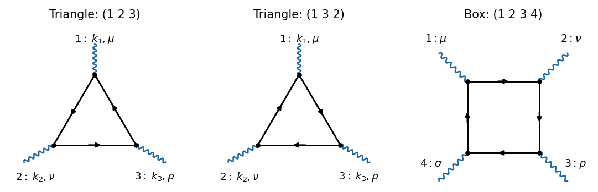

<h1 id="2/a/solution">Solution</h1>

↑ **Parent:** [A](../a.md)

The two [one-loop Feynman diagrams](../../../../one-loop-feynman-diagram.md) are [fermion loops](../../../../fermion-loop.md) with three photon [interaction vertices](../../../../interaction-vertex.md). Fix vertex 1; the two cyclic orders are $(1,2,3)$ and $(1,3,2)$. A cyclic rotation does not produce another [Feynman diagram](../../../../feynman-diagram.md). Keeping all three external labels in the same positions, these two orders can be represented by the same triangle with opposite [fermion flow](../../../../fermion-flow.md), as in the first two panels.

**[Figure 1](#2/a/image-original-feynman-diagrams-for-the-two-orientations-of-the-three-photon-fermion-loop-and-a-representative-four-photon-box-diagram). Original Feynman diagrams for the two orientations of the three-photon fermion loop and a representative four-photon box diagram**.

The [photons](../../../../photon.md) are labelled $(k_1,\mu)$, $(k_2,\nu)$, $(k_3,\rho)$, with all [four-momenta](../../../../four-momentum.md) incoming and $k_1+k_2+k_3=0$. The [amputation of external propagators](../../../../amputation-of-external-propagators.md) removes the three external photon [propagators](../../../../propagator.md), leaving their Lorentz indices open. There are no other connected [one-loop Feynman diagrams](../../../../one-loop-feynman-diagram.md) with only three external [photons](../../../../photon.md) in [QED](../../../../quantum-electrodynamics.md).

## ↑ Ancestors (12)

1. [A](../a.md)
2. [2](../../2.md)
3. [2024](../../../2024-split.md)
4. [Past exam of the advanced quantum field theory for particle physics course of the University of Oxford](../../../split.md)
5. [Advanced quantum field theory for particle physics course of the University of Oxford](../../../../advanced-quantum-field-theory-for-particle-physics-course-of-the-university-of-oxford.md)
6. [Year 4 of the mathematical and theoretical physics course of the University of Oxford](../../../../year-4-of-the-mathematical-and-theoretical-physics-course-of-the-university-of-oxford.md)
7. [Mathematical and theoretical physics course of the University of Oxford](../../../../mathematical-and-theoretical-physics-course-of-the-university-of-oxford.md)
8. [Undergraduate course of the University of Oxford](../../../../undergraduate-course-of-the-university-of-oxford.md)
9. [Course of the University of Oxford](../../../../course-of-the-university-of-oxford.md)
10. [University of Oxford](../../../../university-of-oxford-split.md)
11. [List of universities](../../../../list-of-universities.md)
12. [Codex Wiki](../../../../split.md)
