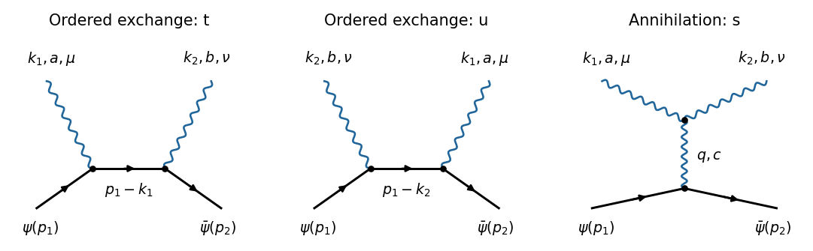

<h1 id="3/b/solution">Solution</h1>

↑ **Parent:** [B](../b.md)

There are three [tree-level Feynman diagrams](../../../../tree-level-feynman-diagram.md): two ordered fermion-exchange diagrams and one [s-channel](../../../../scattering-s-channel.md) [gauge boson](../../../../gauge-boson.md) exchange diagram. Write the outgoing labels as $(k_1,a,\mu)$ and $(k_2,b,\nu)$.

**[Figure 2](#3/b/image-original-tree-level-feynman-diagrams-for-fermion-and-antifermion-annihilation-into-two-non-abelian-gauge-bosons-two-ordered-exchanges-and-the-three-boson-annihilation-channel). Original tree-level Feynman diagrams for fermion and antifermion annihilation into two non-Abelian gauge bosons: two ordered exchanges and the three-boson annihilation channel**.

Following the [fermion flow](../../../../fermion-flow.md) from $u(p_1)$ to $\bar v(p_2)$, the first diagram emits boson 1 and then boson 2; its internal [four-momentum](../../../../four-momentum.md) is $r_t=p_1-k_1$ and its ordered colour factor is $t^bt^a$. The second emits boson 2 and then boson 1, giving $r_u=p_1-k_2$ and $t^at^b$. The third annihilates into one virtual [gauge boson](../../../../gauge-boson.md) of [four-momentum](../../../../four-momentum.md) $q=p_1+p_2=k_1+k_2$ and uses the three-boson [interaction vertex](../../../../interaction-vertex.md). There is no two-fermion two-boson contact [interaction vertex](../../../../interaction-vertex.md) for the minimally coupled [Dirac field](../../../../dirac-field.md), and no tree ghost contribution with these external states.

## ↑ Ancestors (12)

1. [B](../b.md)
2. [3](../../3.md)
3. [2024](../../../2024-split.md)
4. [Past exam of the advanced quantum field theory for particle physics course of the University of Oxford](../../../split.md)
5. [Advanced quantum field theory for particle physics course of the University of Oxford](../../../../advanced-quantum-field-theory-for-particle-physics-course-of-the-university-of-oxford.md)
6. [Year 4 of the mathematical and theoretical physics course of the University of Oxford](../../../../year-4-of-the-mathematical-and-theoretical-physics-course-of-the-university-of-oxford.md)
7. [Mathematical and theoretical physics course of the University of Oxford](../../../../mathematical-and-theoretical-physics-course-of-the-university-of-oxford.md)
8. [Undergraduate course of the University of Oxford](../../../../undergraduate-course-of-the-university-of-oxford.md)
9. [Course of the University of Oxford](../../../../course-of-the-university-of-oxford.md)
10. [University of Oxford](../../../../university-of-oxford-split.md)
11. [List of universities](../../../../list-of-universities.md)
12. [Codex Wiki](../../../../split.md)
