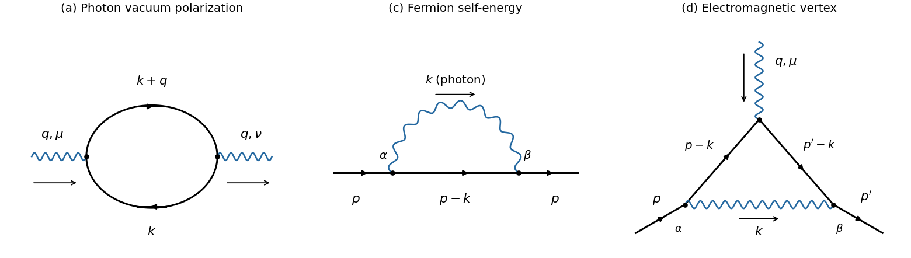

# 2025

↑ **Parent:** [Past exam of the advanced quantum field theory for particle physics course of the University of Oxford](../past-exam-of-the-advanced-quantum-field-theory-for-particle-physics-course-of-the-university-of-oxford.md)

Source PDF: [https://mmathphys.physics.ox.ac.uk/sites/g/files/vzsiac2991/files/mmathphys/documents/media/a15272h1corrected.pdf](https://mmathphys.physics.ox.ac.uk/sites/g/files/vzsiac2991/files/mmathphys/documents/media/a15272h1corrected.pdf)

Solutions to all seventeen lettered parts. The source is the version publicly labelled _corrected_; no claim about the contents of an earlier version is needed. Use [natural units](../mathematical-physics.md#natural-units), the [Minkowski metric](../special-relativity.md#minkowski-metric) $g=\operatorname{diag}(1,-1,-1,-1)$, and $\Box=\partial_\mu\partial^\mu$ for the [d'Alembert operator](../wave-equation.md#d-alembert-operator). In question 2, every denominator has its [Feynman i-epsilon prescription](../quantum-field-theory.md#feynman-i-epsilon-prescription) $+i0$, and $\int_k=\mu_R^{2\epsilon}\int d^{4-2\epsilon}k/(2\pi)^{4-2\epsilon}$. Here $\epsilon$ is the [dimensional regularization](../perturbative-quantum-field-theory.md#dimensional-regularization) parameter; the small parameter in 1(f) is denoted $\eta$ to distinguish it. Signs follow the insertion [Feynman rules](../perturbative-quantum-field-theory.md#feynman-rules) printed on source page 4.

**Table of contents**

- [1](#1)
  - [a](#1/a)
    - [Solution](#1/a/solution)
  - [b](#1/b)
    - [Solution](#1/b/solution)
  - [c](#1/c)
    - [Solution](#1/c/solution)
  - [d](#1/d)
    - [Solution](#1/d/solution)
  - [e](#1/e)
    - [Solution](#1/e/solution)
  - [f](#1/f)
    - [Solution](#1/f/solution)
  - [g](#1/g)
    - [Solution](#1/g/solution)
- [2](#2)
  - [a](#2/a)
    - [Solution](#2/a/solution)
  - [b](#2/b)
    - [Solution](#2/b/solution)
  - [c](#2/c)
    - [Solution](#2/c/solution)
  - [d](#2/d)
    - [Solution](#2/d/solution)
  - [e](#2/e)
    - [Solution](#2/e/solution)
- [3](#3)
  - [a](#3/a)
    - [Solution](#3/a/solution)
  - [b](#3/b)
    - [Solution](#3/b/solution)
  - [c](#3/c)
    - [Solution](#3/c/solution)
  - [d](#3/d)
    - [Solution](#3/d/solution)
  - [e](#3/e)
    - [Solution](#3/e/solution)

## 1

↑ **Parent:** [2025](2025.md)

<h3 id="1/a">a</h3>

↑ **Parent:** [1](#1)

<h4 id="1/a/solution">Solution</h4>

↑ **Parent:** [A](#1/a)

The [scalar field path integral](../quantum-field-theory.md#scalar-field-path-integral) integrates over real field histories with vacuum [boundary conditions](../differential-equation.md#boundary-condition). With $S_0[\phi]=\int d^4x\,\mathcal L_0$, the [partition function](../canonical-ensemble.md#canonical-partition-function) is

$$
\boxed{Z=\mathcal N\int\mathcal D\phi\,
\exp\left\{i\int d^4x\left[\frac12\partial_\mu\phi\partial^\mu\phi-\frac12(m^2-i0)\phi^2-\frac\lambda{4!}\phi^4\right]\right\}.}
$$

The constant $\mathcal N$ fixes the desired vacuum normalization. A [generating functional](../perturbative-quantum-field-theory.md#generating-functional) adds $\int d^4x\,J\phi$ to the [action](../lagrangian-mechanics.md#action); the required [partition function](../canonical-ensemble.md#canonical-partition-function) is its zero-source value. Equivalently, a [Wick rotation](../perturbative-quantum-field-theory.md#wick-rotation) gives $Z_E=\mathcal N_E\int\mathcal D\phi\,e^{-S_E[\phi]}$, with the positive-sign kinetic and potential terms in the [Euclidean action](../perturbative-quantum-field-theory.md#euclidean-action) when $m^2\geq0$ and $\lambda>0$.

<h3 id="1/b">b</h3>

↑ **Parent:** [1](#1)

<h4 id="1/b/solution">Solution</h4>

↑ **Parent:** [B](#1/b)

Vary the [action](../lagrangian-mechanics.md#action), taking the field variation to vanish at the boundary. [Integration by parts](../calculus.md#integration-by-parts) gives

$$
\delta S_0=\int d^4x\left[\partial^\mu\phi\,\partial_\mu\delta\phi-m^2\phi\delta\phi-\frac\lambda6\phi^3\delta\phi\right]
=-\int d^4x\left(\Box\phi+m^2\phi+\frac\lambda6\phi^3\right)\delta\phi.
$$

Thus the [Euler-Lagrange field equation](../classical-field-theory.md#euler-lagrange-field-equation) is

$$
\boxed{\Box\phi+m^2\phi+\frac\lambda6\phi^3=0.}
$$

For the [field redefinition](../perturbative-quantum-field-theory.md#field-redefinition) in part [f](#1/f), define the [functional derivative](../calculus-of-variations.md#functional-derivative) $E(\phi)=\delta S_0/\delta\phi=-(\Box\phi+m^2\phi+\lambda\phi^3/6)$. The sign does not affect the [equation of motion](../classical-mechanics.md#equation-of-motion), but it fixes the sign of an added [redundant operator](../perturbative-quantum-field-theory.md#redundant-operator).

<h3 id="1/c">c</h3>

↑ **Parent:** [1](#1)

<h4 id="1/c/solution">Solution</h4>

↑ **Parent:** [C](#1/c)

The [action](../lagrangian-mechanics.md#action) is dimensionless, so in four dimensions the [Lagrangian density](../classical-field-theory.md#lagrangian-density) has [mass dimension](../perturbative-quantum-field-theory.md#mass-dimension) four. Its kinetic term fixes $[\phi]=1$ and $[\partial_\mu]=1$. An interaction $g_D\mathcal O_D$ with $[\mathcal O_D]=D$ has $[g_D]=4-D$. Therefore

$$
\boxed{D\leq4\ \text{is renormalizable by power counting};\qquad D>4\ \text{has a negative-dimensional coupling}.}
$$

In an [effective field theory](../quantum-field-theory.md#effective-field-theory) with heavy scale $\Lambda$, a higher-dimensional [local operator](../category-theory.md#lawvere-tierney-topology) enters as $c_D\mathcal O_D/\Lambda^{D-4}$. For characteristic scales $E,m\ll\Lambda$ and coefficients compatible with this expansion, its effects are suppressed by powers of the small ratios. Omitting these terms defines the leading approximation and its [truncation error in effective field theory](../perturbative-quantum-field-theory.md#truncation-error-in-effective-field-theory). It is not a fundamental prohibition: such terms must be retained if that accuracy is required. A continuum [renormalizable quantum field theory](../perturbative-quantum-field-theory.md#renormalizable-quantum-field-theory) can instead be defined by the closed set of [counterterms](../perturbative-quantum-field-theory.md#counterterm) of dimension at most four.

Up to [total derivatives](../calculus.md#total-derivative), all [Lorentz scalar](../special-relativity.md#lorentz-scalar) terms of dimension at most four built from one [real scalar field](../scalar-field-theory.md#real-scalar-field) are

$$
1,\quad\phi,\quad\phi^2,\quad\phi^3,\quad\phi^4,\quad
\partial_\mu\phi\partial^\mu\phi.
$$

The term $\phi\Box\phi$ is equivalent to the kinetic term by [integration by parts](../calculus.md#integration-by-parts); $\Box\phi$ and $\Box(\phi^2)$ contribute only at the boundary. The displayed [Lagrangian density](../classical-field-theory.md#lagrangian-density) omits the linear and cubic interactions and a field-independent constant. The exact [Z2 symmetry](../quantum-field-theory.md#z2-symmetry) $\phi\mapsto-\phi$ forbids both odd interactions, and [radiative corrections](../perturbative-quantum-field-theory.md#radiative-correction) preserving this [symmetry](../physics.md#symmetry-physics) cannot generate them. The constant shifts the vacuum [energy](../energy.md) and the normalization of $Z$ and can be dropped when gravity and absolute vacuum [energy](../energy.md) are not being studied. A constant vacuum [counterterm](../perturbative-quantum-field-theory.md#counterterm) may still be used when renormalizing unnormalized vacuum diagrams. The kinetic coefficient has already been fixed by field normalization.

<h3 id="1/d">d</h3>

↑ **Parent:** [1](#1)

<h4 id="1/d/solution">Solution</h4>

↑ **Parent:** [D](#1/d)

For [dimension-six operators of a real scalar field](../quantum-field-theory.md#dimension-six-operators-of-a-real-scalar-field), let $n$ count fields and $r$ count [partial derivatives](../multivariable-calculus.md#partial-derivative). [Mass dimension](../perturbative-quantum-field-theory.md#mass-dimension) gives $n+r=6$. [Lorentz invariance](../special-relativity.md#lorentz-invariance) requires even $r$. Discard derivatives acting on the entire expression, but **do not yet identify different expressions by integration by parts**. A complete list of seven representatives is

$$
\boxed{\begin{aligned}
\mathcal O_1&=\phi^6,\\
\mathcal O_2&=\phi^2\partial_\mu\phi\partial^\mu\phi,&
\mathcal O_3&=\phi^3\Box\phi,\\
\mathcal O_4&=\phi\Box^2\phi,&
\mathcal O_5&=\partial_\mu\phi\,\partial^\mu\Box\phi,\\
\mathcal O_6&=(\Box\phi)^2,&
\mathcal O_7&=(\partial_\mu\partial_\nu\phi)(\partial^\mu\partial^\nu\phi).
\end{aligned}}
$$

For $(n,r)=(6,0)$ there is one choice; for $(4,2)$ the derivative distribution is either $2$ or $1+1$; for $(2,4)$ it is $4$, $3+1$, or $2+2$, the last allowing two distinct metric contractions. Commuting [partial derivatives](../multivariable-calculus.md#partial-derivative) identifies alternative orderings. Contractions with a [Levi-Civita symbol](../multivariable-calculus.md#levi-civita-symbol) vanish because an antisymmetric index pair necessarily contracts symmetric derivatives. The remaining case $(0,6)$ gives no field-dependent expression. No independent odd-$r$ [Lorentz scalar](../special-relativity.md#lorentz-scalar) exists.

The source's seven means this unreduced list. If “ignoring total derivative operators” were interpreted as already taking the full quotient by [total derivatives](../calculus.md#total-derivative), seven would be incorrect: the next part gives three representatives of that quotient. Dimensionful factors multiplying lower-dimensional terms do not count as new canonical-dimension-six field monomials.

<h3 id="1/e">e</h3>

↑ **Parent:** [1](#1)

<h4 id="1/e/solution">Solution</h4>

↑ **Parent:** [E](#1/e)

Write $X\simeq Y$ when the two densities differ by a [total derivative](../calculus.md#total-derivative). Under the [boundary conditions](../differential-equation.md#boundary-condition) used in the [action](../lagrangian-mechanics.md#action), they have the same integral. The following identities establish the [integration-by-parts reduction of scalar operators](../quantum-field-theory.md#integration-by-parts-reduction-of-scalar-operators):

$$
\begin{aligned}
\partial_\mu(\phi^3\partial^\mu\phi)&=3\phi^2(\partial\phi)^2+\phi^3\Box\phi,
&\mathcal O_2&\simeq-\frac13\mathcal O_3,\\
\partial_\mu(\phi\partial^\mu\Box\phi)&=\partial_\mu\phi\partial^\mu\Box\phi+\phi\Box^2\phi,
&\mathcal O_4&\simeq-\mathcal O_5,\\
\partial_\mu(\partial^\mu\phi\Box\phi)&=(\Box\phi)^2+\partial_\mu\phi\partial^\mu\Box\phi,
&\mathcal O_5&\simeq-\mathcal O_6,\\
\partial_\mu(\partial_\nu\phi\partial^\mu\partial^\nu\phi)&=
(\partial_\mu\partial_\nu\phi)^2+\partial_\nu\phi\partial^\nu\Box\phi,
&\mathcal O_7&\simeq-\mathcal O_5.
\end{aligned}
$$

Consequently

$$
\boxed{\{\phi^6,\ \phi^3\Box\phi,\ (\Box\phi)^2\}}
$$

spans the [operator basis in effective field theory](../quantum-field-theory.md#operator-basis-in-effective-field-theory) before [equation-of-motion reduction of scalar operators](../quantum-field-theory.md#equation-of-motion-reduction-of-scalar-operators). These four independent relations reduce the seven representatives to three; the three sectors have different field or derivative content, so [integration by parts](../calculus.md#integration-by-parts) cannot identify them further.

<h3 id="1/f">f</h3>

↑ **Parent:** [1](#1)

<h4 id="1/f/solution">Solution</h4>

↑ **Parent:** [F](#1/f)

Use the sign convention $E(\phi)=\delta S_0/\delta\phi$ from part [b](#1/b), and let

$$
S_\eta[\phi]=S_0[\phi]+\eta\int d^4x\,f(\phi)E(\phi).
$$

In the [path integral](../quantum-field-theory.md#path-integral), make the local [field redefinition](../perturbative-quantum-field-theory.md#field-redefinition) $\phi_{\rm old}=\chi-\eta f(\chi)$. The [functional Taylor expansion](../calculus-of-variations.md#functional-taylor-expansion) of the [action](../lagrangian-mechanics.md#action) gives

$$
\begin{aligned}
S_0[\chi-\eta f(\chi)]
&=S_0[\chi]-\eta\int d^4x\,f(\chi)\frac{\delta S_0}{\delta\chi(x)}+O(\eta^2),\\
\eta\int d^4x\,f(\phi_{\rm old})E(\phi_{\rm old})
&=\eta\int d^4x\,f(\chi)E(\chi)+O(\eta^2).
\end{aligned}
$$

The two first-order terms cancel. Neglecting the [functional Jacobian](../quantum-field-theory.md#functional-jacobian) as permitted,

$$
\boxed{Z_\eta=\mathcal N\int\mathcal D\chi\,\exp\{iS_0[\chi]+O(\eta^2)\}.}
$$

Thus $fE$ is a [redundant operator](../perturbative-quantum-field-theory.md#redundant-operator) at first order, by the [equivalence theorem for field redefinitions](../perturbative-quantum-field-theory.md#equivalence-theorem-for-field-redefinitions). The same argument works for a local derivative-dependent $f$, which is needed to remove $(\Box\phi)^2$. Insertions and sources must be transformed too: arbitrary untransformed [off shell](../classical-field-theory.md#off-shell) [correlation functions](../critical-phenomenon.md#correlation-function) need not be equal.

**Sign qualification.** If instead $E_+=\Box\phi+m^2\phi+\lambda\phi^3/6$ is used, then $E_+=-\delta S_0/\delta\phi$. An added $+\eta fE_+$ is removed by $\phi_{\rm old}=\chi+\eta f(\chi)$. The minus shift requested in the source therefore fixes which sign is meant by its otherwise unspecified $E$.

<h3 id="1/g">g</h3>

↑ **Parent:** [1](#1)

<h4 id="1/g/solution">Solution</h4>

↑ **Parent:** [G](#1/g)

Let $a=\lambda/6$. Within terms already suppressed by $\Lambda^{-2}$, the leading [equation of motion](../classical-mechanics.md#equation-of-motion) gives $\Box\phi=-m^2\phi-a\phi^3$. Equality here means equivalence under a perturbative [field redefinition](../perturbative-quantum-field-theory.md#field-redefinition), together with [integration by parts](../calculus.md#integration-by-parts), rather than a pointwise identity inside arbitrary [off shell](../classical-field-theory.md#off-shell) [correlation functions](../critical-phenomenon.md#correlation-function). Hence

$$
\begin{aligned}
\phi^3\Box\phi&\doteq-m^2\phi^4-\frac\lambda6\phi^6,\\
(\Box\phi)^2&\doteq m^4\phi^2+\frac{m^2\lambda}{3}\phi^4+\frac{\lambda^2}{36}\phi^6.
\end{aligned}
$$

For the second relation, factor the difference as $(\Box\phi-m^2\phi-a\phi^3)(\Box\phi+m^2\phi+a\phi^3)$, which is explicitly a [redundant operator](../perturbative-quantum-field-theory.md#redundant-operator). If

$$
\Delta\mathcal L=\frac1{\Lambda^2}\left[c_1\phi^6+c_2\phi^3\Box\phi+c_3(\Box\phi)^2\right],
$$

the reduced correction is

$$
\Delta\mathcal L\doteq\frac1{\Lambda^2}\left[
c_3m^4\phi^2+\left(-c_2m^2+\frac{c_3m^2\lambda}{3}\right)\phi^4
+\left(c_1-\frac\lambda6c_2+\frac{\lambda^2}{36}c_3\right)\phi^6\right].
$$

The first two coefficients shift the already present [mass](../classical-mechanics.md#mass) and quartic [coupling constant](../statistical-model.md#coupling-constant-physics). After these shifts,

$$
\boxed{\text{one genuinely new dimension-six interaction remains: }\quad
\frac{c_{6,\rm red}}{\Lambda^2}\phi^6,\qquad
c_{6,\rm red}=c_1-\frac\lambda6c_2+\frac{\lambda^2}{36}c_3.}
$$

This is the [equation-of-motion reduction of scalar operators](../quantum-field-theory.md#equation-of-motion-reduction-of-scalar-operators) through $O(\Lambda^{-2})$; terms of $O(\Lambda^{-4})$ are outside that truncation. The lower-dimensional shifts should not be silently dropped when $m\ne0$.

## 2

↑ **Parent:** [2025](2025.md)

<h3 id="2/a">a</h3>

↑ **Parent:** [2](#2)

<h4 id="2/a/solution">Solution</h4>

↑ **Parent:** [A](#2/a)

The first panel is the [one-particle-irreducible Feynman diagram](../perturbative-quantum-field-theory.md#one-particle-irreducible-feynman-diagram) for [photon vacuum polarization](../perturbative-quantum-field-theory.md#photon-vacuum-polarization). The two internal [Dirac propagators](../quantum-field-theory.md#dirac-propagator) carry $k$ and $k+q$, and the external [photons](../quantum-mechanics.md#photon) carry $q$. The other panels fix the routings used in parts [c](#2/c) and [d](#2/d).

**[Figure 1](#2/a/image-original-labelled-one-loop-qed-feynman-diagrams-photon-vacuum-polarization-fermion-self-energy-and-the-electromagnetic-interaction-vertex). Original labelled one-loop QED Feynman diagrams: photon vacuum polarization, fermion self-energy, and the electromagnetic interaction vertex**.

The [closed fermion loop sign](../perturbative-quantum-field-theory.md#closed-fermion-loop-sign) contributes a minus sign; there is no extra [symmetry factor](../perturbative-quantum-field-theory.md#feynman-diagram-symmetry-factor). Applying the given [Feynman rules](../perturbative-quantum-field-theory.md#feynman-rules), with the external [propagators](../quantum-field-theory.md#propagator) amputated,

$$
i\Pi_{\mu\nu}(q)=(-1)\int_k\operatorname{tr}\left[
(-ie\gamma_\mu)\frac{i(\not k+m)}{k^2-m^2+i0}
(-ie\gamma_\nu)\frac{i(\not k+\not q+m)}{(k+q)^2-m^2+i0}\right].
$$

Equivalently, the required [amplitude](../wave.md#wave-amplitude) is

$$
\boxed{\Pi_{\mu\nu}(q)=ie^2\int_k
\frac{\operatorname{tr}[\gamma_\mu(\not k+m)\gamma_\nu(\not k+\not q+m)]}
{(k^2-m^2+i0)((k+q)^2-m^2+i0)}.}
$$

The [Feynman slash notation](../algebra-over-a-field.md#feynman-slash-notation) is $\not k=\gamma^\rho k_\rho$ and $\operatorname{tr}\mathbf1=4$ in the chosen [dimensional regularization](../perturbative-quantum-field-theory.md#dimensional-regularization) convention.

<h3 id="2/b">b</h3>

↑ **Parent:** [2](#2)

<h4 id="2/b/solution">Solution</h4>

↑ **Parent:** [B](#2/b)

The [Ward identity](../perturbative-quantum-field-theory.md#ward-identity) implies $q^\mu\Pi_{\mu\nu}=0$. [Lorentz invariance](../special-relativity.md#lorentz-invariance) then gives $\Pi_{\mu\nu}=(q^2g_{\mu\nu}-q_\mu q_\nu)\Pi$, so $g^{\mu\nu}\Pi_{\mu\nu}=(d-1)q^2\Pi$. The [gamma matrices](../algebra-over-a-field.md#gamma-matrices) satisfy $\gamma_\mu\not k\gamma^\mu=(2-d)\not k$. Odd [traces](../linear-algebra.md#matrix-trace) vanish, and therefore

$$
g^{\mu\nu}\operatorname{tr}[\gamma_\mu(\not k+m)\gamma_\nu(\not k+\not q+m)]
=4[-(d-2)k\cdot(k+q)+dm^2].
$$

Substituting gives the requested [scalar](../vector-space.md#scalar) coefficient:

$$
\boxed{\Pi(q^2)=\frac{4ie^2}{(d-1)q^2}\int_k
\frac{-(d-2)k\cdot(k+q)+dm^2}{[(k+q)^2-m^2+i0][k^2-m^2+i0]}.}
$$

To extract the [ultraviolet divergence](../perturbative-quantum-field-theory.md#ultraviolet-divergence) without introducing a [Feynman parameter](../perturbative-quantum-field-theory.md#feynman-parameter), set $A=(k+q)^2-m^2$, $B=k^2-m^2$ and use

$$
2k\cdot(k+q)=A+B+2m^2-q^2.
$$

Translation invariance of [dimensional regularization](../perturbative-quantum-field-theory.md#dimensional-regularization) gives $\int_kA^{-1}=\int_kB^{-1}=\mathcal I_1$. Consequently

$$
\Pi(q^2)=\frac{4ie^2}{(d-1)q^2}\left[-(d-2)\mathcal I_1+
\left(2m^2+\frac{d-2}{2}q^2\right)\mathcal I_2(q^2)\right].
$$

In the [pole](../isolated-singularity.md#pole) coefficient one may set $d=4$: the bracket becomes

$$
\frac{i}{16\pi^2\epsilon}[-2m^2+2m^2+q^2]
=\frac{iq^2}{16\pi^2\epsilon}.
$$

Thus the [ultraviolet pole of QED vacuum polarization](../perturbative-quantum-field-theory.md#ultraviolet-pole-of-qed-vacuum-polarization) is

$$
\boxed{\Pi(q^2)\big|_{\rm UV}=-\frac{e^2}{12\pi^2\epsilon},\qquad
\Pi_{\mu\nu}\big|_{\rm UV}=-\frac{e^2}{12\pi^2\epsilon}(q^2g_{\mu\nu}-q_\mu q_\nu).}
$$

The cancellation of the apparent $m^2/q^2$ divergence is essential: [gauge invariance](../relativistic-quantum-field.md#gauge-invariance) forbids a [photon](../quantum-mechanics.md#photon) [mass](../classical-mechanics.md#mass) [counterterm](../perturbative-quantum-field-theory.md#counterterm). The scalar result at $q^2=0$ is understood by continuation after this cancellation.

<h3 id="2/c">c</h3>

↑ **Parent:** [2](#2)

<h4 id="2/c/solution">Solution</h4>

↑ **Parent:** [C](#2/c)

The middle panel in part [a](#2/a) has an internal [photon](../quantum-mechanics.md#photon) of [momentum](../momentum.md) $k$ joining two points on a [fermion](../tensor-product-of-quantum-systems.md#fermion) line; the internal [fermion](../tensor-product-of-quantum-systems.md#fermion) has [momentum](../momentum.md) $p-k$. It is a [one-particle-irreducible Feynman diagram](../perturbative-quantum-field-theory.md#one-particle-irreducible-feynman-diagram) with no [closed fermion loop sign](../perturbative-quantum-field-theory.md#closed-fermion-loop-sign). In [Feynman gauge](../relativistic-quantum-field.md#feynman-gauge),

$$
-i\Sigma(p)=\int_k(-ie\gamma^\alpha)
\frac{i(\not p-\not k+m)}{(p-k)^2-m^2+i0}
(-ie\gamma^\beta)\frac{-ig_{\alpha\beta}}{k^2+i0},
$$

or

$$
\boxed{\Sigma(p)=-ie^2\int_k
\frac{(2-d)(\not p-\not k)+dm}{[k^2+i0][(p-k)^2-m^2+i0]}.}
$$

The decomposition in the source gives $\operatorname{tr}(\not p\Sigma)=4p^2S(p^2)$. In particular,

$$
S(p^2)=-\frac{ie^2(d-2)}{p^2}\int_k
\frac{p\cdot k-p^2}{[k^2+i0][(p-k)^2-m^2+i0]}.
$$

For a direct [ultraviolet divergence](../perturbative-quantum-field-theory.md#ultraviolet-divergence) extraction, use a [Feynman parameter](../perturbative-quantum-field-theory.md#feynman-parameter) $x$ multiplying the massive denominator, shift $r=k-xp$, and define $\Delta=xm^2-x(1-x)p^2$. Then $\not p-\not k=(1-x)\not p-\not r$ and

$$
\int_0^1dx\int_r\frac1{(r^2-\Delta+i0)^2}
\bigg|_{\rm UV}=\frac{i}{16\pi^2\epsilon}\int_0^1dx.
$$

Odd $r$ terms integrate to zero. Taking the [trace](../linear-algebra.md#matrix-trace) explicitly supplies the weight $(2-d)(1-x)$, whose integral tends to $-1$. Hence

$$
\operatorname{tr}(\not p\Sigma)\big|_{\rm UV}
=-\frac{4e^2p^2}{16\pi^2\epsilon},\qquad
\boxed{S(p^2)\big|_{\rm UV}=-\frac{e^2}{16\pi^2\epsilon}.}
$$

As a check on the same [fermion self-energy](../perturbative-quantum-field-theory.md#fermion-self-energy) calculation,

$$
\Sigma(p)\big|_{\rm UV}=\frac{e^2}{16\pi^2\epsilon}(-\not p+4m).
$$

This is the [ultraviolet pole of QED fermion self-energy](../perturbative-quantum-field-theory.md#ultraviolet-pole-of-qed-fermion-self-energy). It is safe to extract it at generic external [momentum](../momentum.md); an [on shell](../classical-field-theory.md#on-shell) or massless limit must distinguish any [infrared divergence](../quantum-field-theory.md#infrared-divergence) from this [ultraviolet divergence](../perturbative-quantum-field-theory.md#ultraviolet-divergence).

<h3 id="2/d">d</h3>

↑ **Parent:** [2](#2)

<h4 id="2/d/solution">Solution</h4>

↑ **Parent:** [D](#2/d)

In the right panel of part [a](#2/a), $p$ enters the [fermion](../tensor-product-of-quantum-systems.md#fermion) line, $p'=p+q$ leaves it, and a virtual [photon](../quantum-mechanics.md#photon) of [momentum](../momentum.md) $k$ bridges the external [photon](../quantum-mechanics.md#photon) vertex. Write $\Gamma^\mu=\gamma^\mu+\Lambda^\mu$ and $F_1=1+F_1^{(1)}+\cdots$. The one-loop [amplitude](../wave.md#wave-amplitude) is

$$
\begin{aligned}
-ie\Lambda^\mu={}&\int_k(-ie\gamma^\alpha)
\frac{i(\not p'-\not k+m)}{(p'-k)^2-m^2+i0}
(-ie\gamma^\mu)\frac{i(\not p-\not k+m)}{(p-k)^2-m^2+i0}
(-ie\gamma^\beta)\frac{-ig_{\alpha\beta}}{k^2+i0},\\
&\boxed{\Lambda^\mu=-ie^2\int_k
\frac{\gamma^\alpha(\not p'-\not k+m)\gamma^\mu(\not p-\not k+m)\gamma_\alpha}
{[k^2+i0][(p'-k)^2-m^2+i0][(p-k)^2-m^2+i0]}.}
\end{aligned}
$$

This [Feynman integral](../perturbative-quantum-field-theory.md#feynman-integral) has a logarithmic [superficial degree of divergence](../perturbative-quantum-field-theory.md#superficial-degree-of-divergence). Its [ultraviolet pole](../perturbative-quantum-field-theory.md#ultraviolet-pole) is independent of the external [momenta](../momentum.md) and $m$, because every such numerator insertion or denominator correction lowers the large-$k$ degree. Preserve an auxiliary positive [mass](../classical-mechanics.md#mass) $M$ while extracting the [ultraviolet pole](../perturbative-quantum-field-theory.md#ultraviolet-pole); setting everything to zero would create a [scaleless integral](../perturbative-quantum-field-theory.md#scaleless-integral) and conceal the cancellation of [ultraviolet](../optics.md#ultraviolet) and [infrared divergences](../quantum-field-theory.md#infrared-divergence).

The leading numerator is $\gamma^\alpha\not k\gamma^\mu\not k\gamma_\alpha$. Symmetric integration replaces $k_\rho k_\sigma$ by $g_{\rho\sigma}k^2/d$. Two contractions of [gamma matrices](../algebra-over-a-field.md#gamma-matrices) then give

$$
\gamma^\alpha\not k\gamma^\mu\not k\gamma_\alpha
\ \longmapsto\ \frac{(d-2)^2}{d}k^2\gamma^\mu,
\qquad
\operatorname{tr}\left[\gamma^\alpha\not k\gamma^\mu\not k\gamma_\alpha\gamma_\mu\right]
=4(d-2)^2k^2.
$$

For the [auxiliary-mass extraction of ultraviolet poles](../perturbative-quantum-field-theory.md#auxiliary-mass-extraction-of-ultraviolet-poles),

$$
J_M=\int_k\frac{k^2}{(k^2-M^2+i0)^3}
=\int_k\left[\frac1{(k^2-M^2+i0)^2}+\frac{M^2}{(k^2-M^2+i0)^3}\right],
\qquad J_M\big|_{\rm UV}=\frac{i}{16\pi^2\epsilon}.
$$

The second term is [ultraviolet](../optics.md#ultraviolet) convergent. Thus

$$
\frac1{4d}\operatorname{tr}(\Lambda^\mu\gamma_\mu)\big|_{\rm UV}
=-ie^2\frac{(d-2)^2}{d}J_M\big|_{\rm UV},
\qquad
\boxed{F_1^{(1)}(q^2)\big|_{\rm UV}=\frac{e^2}{16\pi^2\epsilon}.}
$$

The [ultraviolet pole of the QED vertex](../perturbative-quantum-field-theory.md#ultraviolet-pole-of-the-qed-vertex) is therefore $\Lambda^\mu|_{\rm UV}=e^2\gamma^\mu/(16\pi^2\epsilon)$. The Pauli structure has zero [trace](../linear-algebra.md#matrix-trace) against $\gamma_\mu$ and no [ultraviolet pole](../perturbative-quantum-field-theory.md#ultraviolet-pole) at this order.

**Form-factor qualification.** The two [electron electromagnetic vertex form factors](../perturbative-quantum-field-theory.md#electron-electromagnetic-vertex-form-factors) in the source describe matrix elements between external [on shell](../classical-field-theory.md#on-shell) [Dirac spinors](../relativistic-quantum-field.md#dirac-spinor). A general [off shell](../classical-field-theory.md#off-shell) vertex has more structures, so the unprojected [trace](../linear-algebra.md#matrix-trace) is not a projector for the complete finite on-shell $F_1$. It does correctly isolate the divergent local $\gamma^\mu$ coefficient, which is all that is required here.

<h3 id="2/e">e</h3>

↑ **Parent:** [2](#2)

<h4 id="2/e/solution">Solution</h4>

↑ **Parent:** [E](#2/e)

In $d=4-2\epsilon$, the [modified minimal subtraction scheme](../perturbative-quantum-field-theory.md#modified-minimal-subtraction-scheme) subtracts $\Delta_{\overline{\rm MS}}=1/\epsilon-\gamma_E+\log(4\pi)$ for each one-loop pole, with no further finite, kinematics-dependent subtraction. Equivalently, use a rescaled [renormalization scale](../perturbative-quantum-field-theory.md#renormalization-scale) $\overline\mu^2=4\pi e^{-\gamma_E}\mu_R^2$ and subtract only $1/\epsilon$ in that convention. This differs from the [minimal subtraction scheme](../perturbative-quantum-field-theory.md#minimal-subtraction-scheme) by a fixed scale convention.

Let $C=e^2\Delta_{\overline{\rm MS}}/(16\pi^2)$. With the source's [counterterm](../perturbative-quantum-field-theory.md#counterterm) insertion signs, cancellation proceeds as follows. The vertex has $-ie\gamma^\mu C$ from the loop and $-ie\gamma^\mu\delta_1$ from its [counterterm](../perturbative-quantum-field-theory.md#counterterm), giving $\delta_1=-C$. The kinetic part of the [fermion self-energy](../perturbative-quantum-field-theory.md#fermion-self-energy) insertion is $+i\not p C$ and its [counterterm](../perturbative-quantum-field-theory.md#counterterm) is $+i\not p\delta_2$, giving $\delta_2=-C$. Finally the [photon vacuum polarization](../perturbative-quantum-field-theory.md#photon-vacuum-polarization) insertion is $-i(q^2g_{\mu\nu}-q_\mu q_\nu)(4C/3)$ and its [counterterm](../perturbative-quantum-field-theory.md#counterterm) is $-i(q^2g_{\mu\nu}-q_\mu q_\nu)\delta_3$, giving

$$
\boxed{\delta_1=\delta_2=-\frac{e^2}{16\pi^2}\Delta_{\overline{\rm MS}},\qquad
\delta_3=-\frac{e^2}{12\pi^2}\Delta_{\overline{\rm MS}}.}
$$

Writing $Z_i=1+\delta_i$ therefore verifies the [Ward identity for QED renormalization constants](../perturbative-quantum-field-theory.md#ward-identity-for-qed-renormalization-constants), $Z_1=Z_2$, at one loop. The [proper-vertex Ward-Takahashi identity in QED](../perturbative-quantum-field-theory.md#proper-vertex-ward-takahashi-identity-in-qed) independently gives $\Lambda^\mu(p,p)=-\partial\Sigma(p)/\partial p_\mu$, whose divergent part reproduces the opposite signs of $F_1^{(1)}$ and $S$ found above. The equality holds in a common [gauge fixing](../relativistic-quantum-field.md#gauge-fixing) and subtraction prescription; the individual constants $Z_1,Z_2$ are gauge dependent.

## 3

↑ **Parent:** [2025](2025.md)

<h3 id="3/a">a</h3>

↑ **Parent:** [3](#3)

<h4 id="3/a/solution">Solution</h4>

↑ **Parent:** [A](#3/a)

Start with the formally gauge-redundant [path integral](../quantum-field-theory.md#path-integral) $Z=\operatorname{vol}(\mathcal G)^{-1}\int\mathcal DA\,e^{iS[A]}$. Use $A_\mu^\theta=A_\mu+\partial_\mu\theta$, and the generalized [Lorenz gauge condition](../relativistic-electromagnetism.md#lorenz-gauge-condition) $F_\omega[A]=\partial_\mu A^\mu-\omega$. In a perturbative neighborhood where residual zero modes are removed by [boundary conditions](../differential-equation.md#boundary-condition), insert the [Faddeev-Popov gauge-orbit identity](../relativistic-quantum-field.md#faddeev-popov-gauge-orbit-identity)

$$
1=\Delta_{\rm FP}[A]\int\mathcal D\theta\,
\delta[F_\omega(A^\theta)],\qquad
\frac{\delta F_\omega(A^\theta)(x)}{\delta\theta(y)}
=\Box_x\delta^{(4)}(x-y).
$$

Thus $\Delta_{\rm FP}=\det\Box$. [Gauge invariance](../relativistic-quantum-field.md#gauge-invariance) lets the $\theta$ integration factor out and cancel $\operatorname{vol}(\mathcal G)$. Average over $\omega$ with the [Gaussian integral](../integral.md#gaussian-integral) weight $\exp[-i\int\omega^2/(2\xi)]$; the delta functional fixes $\omega=\partial\cdot A$ and gives

$$
\mathcal L_{\rm gf}=-\frac1{2\xi}(\partial\cdot A)^2.
$$

Represent the [functional determinant](../quantum-field-theory.md#functional-determinant) by the independent [Grassmann fields](../quantum-field-theory.md#grassmann-field) $\bar c,c$. A field-independent determinant sign can be absorbed in normalization, so a convenient convention is

$$
\det\Box\ \propto\ \int\mathcal D\bar c\mathcal Dc\,
\exp\left[-i\int d^4x\,\bar c\Box c\right].
$$

Therefore

$$
\boxed{Z=\mathcal N\int\mathcal DA\mathcal D\bar c\mathcal Dc\,
\exp\left\{i\int d^4x\left[-\frac14F_{\mu\nu}F^{\mu\nu}
-\frac1{2\xi}(\partial\cdot A)^2-\bar c\Box c\right]\right\}.}
$$

The [Faddeev-Popov ghosts](../relativistic-quantum-field.md#faddeev-popov-ghost) are free and decouple because $\Box$ is independent of $A$. For a [Non-Abelian gauge theory](../relativistic-quantum-field.md#yang-mills-theory), an infinitesimal [gauge transformation](../electromagnetism.md#gauge-transformation) gives $\delta A_\mu^a=D_\mu^{ab}\theta^b$, so the [Faddeev-Popov operator](../relativistic-quantum-field.md#faddeev-popov-operator) is $\partial^\mu D_\mu^{ab}[A]$ and

$$
\mathcal L_{\rm gh}=-\bar c^a\partial^\mu D_\mu^{ab}[A]c^b.
$$

It contains a [ghost-gluon vertex](../relativistic-quantum-field.md#ghost-gluon-vertex): these [Faddeev-Popov ghosts](../relativistic-quantum-field.md#faddeev-popov-ghost) do not decouple in covariant [gauge fixing](../relativistic-quantum-field.md#gauge-fixing) of [Lorenz gauge](../relativistic-electromagnetism.md#lorenz-gauge-condition) type.

<h3 id="3/b">b</h3>

↑ **Parent:** [3](#3)

<h4 id="3/b/solution">Solution</h4>

↑ **Parent:** [B](#3/b)

Choose the [gauge covariant derivative](../relativistic-quantum-field.md#gauge-covariant-derivative) $D_\mu=\partial_\mu+ieA_\mu$. Write $\rho=f+h$, $r=1+h/f$ and $B_\mu=\partial_\mu\pi/f+eA_\mu$. The [polar parametrization of the Abelian Higgs field](../classical-field-theory-soliton.md#polar-parametrization-of-the-abelian-higgs-field) gives

$$
D_\mu\phi=\frac{e^{i\pi/f}}{\sqrt2}\left[\partial_\mu h+i(f+h)B_\mu\right],
\qquad
\phi^\dagger\phi-\frac{f^2}{2}=fh+\frac{h^2}{2}.
$$

Hence the full [Lagrangian density](../classical-field-theory.md#lagrangian-density) is

$$
\boxed{\mathcal L=-\frac14F_{\mu\nu}F^{\mu\nu}
+\frac12(\partial h)^2+\frac12\left(1+\frac hf\right)^2(\partial_\mu\pi+efA_\mu)^2
-\frac\lambda2f^2h^2-\frac\lambda2fh^3-\frac\lambda8h^4.}
$$

Assume $f>0$ and $\lambda>0$, so the minimum has $|\phi|=f/\sqrt2$. In this convention the local [gauge symmetry](../relativistic-quantum-field.md#gauge-invariance) acts as

$$
\boxed{\phi\mapsto e^{i\alpha}\phi,\qquad
A_\mu\mapsto A_\mu-\frac1e\partial_\mu\alpha,\qquad
h\mapsto h,\qquad\pi\mapsto\pi+f\alpha.}
$$

The combination $\partial_\mu\pi+efA_\mu$, the radial field $h$, and the [gauge field strength](../relativistic-quantum-field.md#gauge-field-strength) are each invariant, proving invariance of the displayed [Lagrangian density](../classical-field-theory.md#lagrangian-density).

This parametrization follows the circle of classical minima: $h$ measures distance away from the [vacuum manifold](../quantum-field-theory.md#vacuum-manifold), whereas $\pi$ moves along a [gauge orbit](../relativistic-quantum-field.md#gauge-orbit). It separates the massive radial [Higgs mode](../quantum-field-theory.md#higgs-mode) from the would-be [Goldstone boson](../critical-phenomenon.md#goldstone-boson) and makes its removal by the [Higgs mechanism](../standard-model.md#higgs-mechanism) transparent. At quadratic order,

$$
\mathcal L_2=-\frac14F^2+\frac12(\partial h)^2-\frac12\lambda f^2h^2
+\frac12(\partial\pi)^2+efA\cdot\partial\pi+\frac12e^2f^2A^2,
\qquad m_h^2=\lambda f^2,\quad m_A^2=e^2f^2.
$$

The [polar parametrization of the Abelian Higgs field](../classical-field-theory-soliton.md#polar-parametrization-of-the-abelian-higgs-field) is a local description near the chosen nonzero [vacuum expectation value](../quantum-field-theory.md#vacuum-expectation-value); it is singular at $\phi=0$ and is not a global coordinate system for configurations with zeros or winding.

<h3 id="3/c">c</h3>

↑ **Parent:** [3](#3)

<h4 id="3/c/solution">Solution</h4>

↑ **Parent:** [C](#3/c)

[Unitary gauge](../standard-model.md#unitary-gauge) fixes the scalar phase to zero. Locally choose $\alpha=-\pi/f$ in part [b](#3/b); then $\pi'=0$ and $A'_\mu=A_\mu+\partial_\mu\pi/(ef)$. The remaining fields are the radial [Higgs mode](../quantum-field-theory.md#higgs-mode) and a massive vector. Its quadratic [Lagrangian density](../classical-field-theory.md#lagrangian-density) is $-F^2/4+m_A^2A^2/2$ and its [gauge-boson propagator](../relativistic-quantum-field.md#gauge-boson-propagator) is

$$
\boxed{D^U_{\mu\nu}(k)=\frac{-i}{k^2-m_A^2+i0}
\left(g_{\mu\nu}-\frac{k_\mu k_\nu}{m_A^2}\right).}
$$

For $k^2\ne0$, introduce the transverse and longitudinal [orthogonal projectors](../hilbert-space.md#orthogonal-projection) $P^T_{\mu\nu}=g_{\mu\nu}-k_\mu k_\nu/k^2$ and $P^L_{\mu\nu}=k_\mu k_\nu/k^2$. Omitting the infinitesimal in this algebraic decomposition,

$$
D^U=-\frac{iP^T}{k^2-m_A^2}+\frac{iP^L}{m_A^2}.
$$

At large [momentum](../momentum.md) in [Euclidean space](../normed-vector-space.md#euclidean-norm), the transverse coefficient falls as $k^{-2}$ but the longitudinal coefficient approaches a constant of order $m_A^{-2}$. Thus [power counting](../perturbative-quantum-field-theory.md#power-counting-in-quantum-field-theory) applied directly to [unitary gauge](../standard-model.md#unitary-gauge) [Feynman diagrams](../perturbative-quantum-field-theory.md#feynman-diagram) suggests increasingly severe [ultraviolet divergences](../perturbative-quantum-field-theory.md#ultraviolet-divergence). This hides the [renormalizability](../perturbative-quantum-field-theory.md#renormalizable-quantum-field-theory) of physical [scattering amplitudes](../quantum-scattering.md#scattering-amplitude); it does not disprove it. A finite-$\xi$ [R-xi gauge](../relativistic-quantum-field.md#r-xi-gauge) exposes the better [propagator](../quantum-field-theory.md#propagator) scaling while preserving the fields needed to track the cancellations.

<h3 id="3/d">d</h3>

↑ **Parent:** [3](#3)

<h4 id="3/d/solution">Solution</h4>

↑ **Parent:** [D](#3/d)

Let $m_A=ef$, $r=1+h/f$, and $H=\partial\cdot A-\xi m_A r^2\pi$, so the given $G=H/\sqrt\xi$ contributes $\mathcal L_{\rm gf}=-H^2/(2\xi)$. Its quadratic cross term is $+m_A\pi\partial\cdot A$, which cancels $m_AA\cdot\partial\pi$ from the scalar kinetic term after [integration by parts](../calculus.md#integration-by-parts). The free vector and would-be [Goldstone boson](../critical-phenomenon.md#goldstone-boson) [propagators](../quantum-field-theory.md#propagator) are therefore diagonal; $\pi$ has gauge-dependent [mass](../classical-mechanics.md#mass) squared $\xi m_A^2$.

The field-dependent factor $r^2$ cancels more than just the constant-coefficient mixing, but a residual derivative interaction remains. Indeed,

$$
\begin{aligned}
\mathcal L_{\rm mix}+\mathcal L_{\rm gf,cross}
&=m_A r^2(A\cdot\partial\pi+\pi\partial\cdot A)\\
&=\partial_\mu(m_A r^2A^\mu\pi)-m_A\pi A^\mu\partial_\mu r^2\\
&\simeq-2e\left(1+\frac hf\right)\pi A^\mu\partial_\mu h.
\end{aligned}
$$

Thus the [nonlinear R-xi gauge in polar Higgs variables](../relativistic-quantum-field.md#nonlinear-r-xi-gauge-in-polar-higgs-variables) removes quadratic mixing; it does not remove every interaction containing $A$ and $\pi$.

Use the [gauge transformation](../electromagnetism.md#gauge-transformation) in part [b](#3/b). Since $h$ is invariant,

$$
\delta_\alpha H=-\frac1e\Box\alpha-\xi m_A r^2f\alpha
=-\frac1e[\Box+\xi m_A^2r^2]\alpha.
$$

The factor $-1/(e\sqrt\xi)$ in $\delta G/\delta\alpha$ is field independent and is absorbed into the [partition function](../canonical-ensemble.md#canonical-partition-function) normalization. Exponentiating the remaining [Faddeev-Popov determinant](../relativistic-quantum-field.md#faddeev-popov-determinant) with the sign convention of part [a](#3/a) gives

$$
\boxed{\mathcal L_{\rm gh}=-\bar c\left[\Box+\xi e^2(f+h)^2\right]c
=-\bar c(\Box+\xi m_A^2)c
-2\xi e^2fh\bar cc-\xi e^2h^2\bar cc.}
$$

The [ghost coupling in the Abelian Higgs model](../relativistic-quantum-field.md#ghost-coupling-in-the-abelian-higgs-model) therefore survives even though the [gauge group](../relativistic-quantum-field.md#gauge-group) is Abelian: these [Faddeev-Popov ghosts](../relativistic-quantum-field.md#faddeev-popov-ghost) interact with $h$ and **do not decouple for generic $\xi$**. The distinction from part [a](#3/a) is the scalar dependence of the [gauge fixing](../relativistic-quantum-field.md#gauge-fixing) function. In the $\xi\to0$ [Landau gauge](../quantum-theory.md#landau-gauge-for-a-uniform-magnetic-field) limit these particular ghost interactions vanish.

<h3 id="3/e">e</h3>

↑ **Parent:** [3](#3)

<h4 id="3/e/solution">Solution</h4>

↑ **Parent:** [E](#3/e)

After the quadratic mixing cancellation, the vector inverse quadratic operator is

$$
K=-(k^2-m_A^2)P^T-\left(\frac{k^2}{\xi}-m_A^2\right)P^L.
$$

Inverting its two [orthogonal projectors](../hilbert-space.md#orthogonal-projection) and multiplying by $i$ gives

$$
\boxed{D^{(\xi)}_{\mu\nu}(k)=\frac{-i}{k^2-m_A^2+i0}
\left[g_{\mu\nu}-(1-\xi)\frac{k_\mu k_\nu}{k^2-\xi m_A^2+i0}\right].}
$$

Equivalently $D^{(\xi)}=-iP^T/(k^2-m_A^2+i0)-i\xi P^L/(k^2-\xi m_A^2+i0)$. At fixed finite $\xi$, both sectors fall as $k^{-2}$ at large [momentum](../momentum.md) in [Euclidean space](../normed-vector-space.md#euclidean-norm); $\xi=1$ gives $-ig_{\mu\nu}/(k^2-m_A^2+i0)$, and taking $\xi\to\infty$ at fixed $k$ recovers [unitary gauge](../standard-model.md#unitary-gauge). The latter limit is not uniform in [ultraviolet](../optics.md#ultraviolet) [momentum](../momentum.md).

The expected [power counting](../perturbative-quantum-field-theory.md#power-counting-in-quantum-field-theory) conclusion is that this $k^{-2}$ behaviour, together with polynomial interactions of [mass dimension](../perturbative-quantum-field-theory.md#mass-dimension) at most four in Cartesian scalar variables and the [gauge symmetry](../relativistic-quantum-field.md#gauge-invariance) identities, permits [renormalization of spontaneously broken gauge theories](../perturbative-quantum-field-theory.md#renormalization-of-spontaneously-broken-gauge-theories) using a finite set of physical parameters. **The propagator alone is not sufficient to establish that claim in the polar variables of this question.** In fact, part [b](#3/b) contains $h(\partial\pi)^2/f$ and $h^2(\partial\pi)^2/(2f^2)$, of dimensions five and six, and the nonlinear [gauge fixing](../relativistic-quantum-field.md#gauge-fixing) term contains $-\xi e^2h^4\pi^2/(2f^2)$, also of dimension six. Ordinary [power counting](../perturbative-quantum-field-theory.md#power-counting-in-quantum-field-theory) is consequently not manifest in these variables.

For a representation where it is manifest, write $\phi=(f+H+i\chi)/\sqrt2$ and choose the usual polynomial [R-xi gauge](../relativistic-quantum-field.md#r-xi-gauge) function $\partial\cdot A-\xi ef\chi$. It yields the same free vector [propagator](../quantum-field-theory.md#propagator), cancels the quadratic mixing, and leaves only dimension-at-most-four interactions, including its [Faddeev-Popov ghosts](../relativistic-quantum-field.md#faddeev-popov-ghost). This supplies the missing vertex condition in the source's proposed inference; the [equivalence theorem for field redefinitions](../perturbative-quantum-field-theory.md#equivalence-theorem-for-field-redefinitions) relates physical predictions near the [vacuum](../physics.md#vacuum). Good [propagator](../quantum-field-theory.md#propagator) falloff is the necessary ingredient illustrated by the requested formula, rather than a complete proof for arbitrary parametrizations or nonlinear choices of [gauge fixing](../relativistic-quantum-field.md#gauge-fixing).

## ↑ Ancestors (9)

1. [Past exam of the advanced quantum field theory for particle physics course of the University of Oxford](../past-exam-of-the-advanced-quantum-field-theory-for-particle-physics-course-of-the-university-of-oxford.md)
2. [Advanced quantum field theory for particle physics course of the University of Oxford](../university-of-oxford.md#advanced-quantum-field-theory-for-particle-physics-course-of-the-university-of-oxford)
3. [Year 4 of the mathematical and theoretical physics course of the University of Oxford](../university-of-oxford.md#year-4-of-the-mathematical-and-theoretical-physics-course-of-the-university-of-oxford)
4. [Mathematical and theoretical physics course of the University of Oxford](../university-of-oxford.md#mathematical-and-theoretical-physics-course-of-the-university-of-oxford)
5. [Undergraduate course of the University of Oxford](../university-of-oxford.md#undergraduate-course-of-the-university-of-oxford)
6. [Course of the University of Oxford](../university-of-oxford.md#course-of-the-university-of-oxford)
7. [University of Oxford](../university-of-oxford.md)
8. [List of universities](../README.md#list-of-universities)
9. [Codex Wiki](../README.md)
