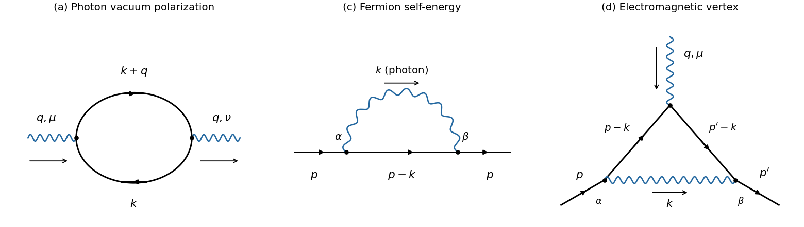

<h1 id="2/a/solution">Solution</h1>

↑ **Parent:** [A](../a.md)

The first panel is the [one-particle-irreducible Feynman diagram](../../../../one-particle-irreducible-feynman-diagram.md) for [photon vacuum polarization](../../../../photon-vacuum-polarization.md). The two internal [Dirac propagators](../../../../dirac-propagator.md) carry $k$ and $k+q$, and the external [photons](../../../../photon.md) carry $q$. The other panels fix the routings used in parts [c](../c.md) and [d](../d.md).

**[Figure 1](#2/a/image-original-labelled-one-loop-qed-feynman-diagrams-photon-vacuum-polarization-fermion-self-energy-and-the-electromagnetic-interaction-vertex). Original labelled one-loop QED Feynman diagrams: photon vacuum polarization, fermion self-energy, and the electromagnetic interaction vertex**.

The [closed fermion loop sign](../../../../closed-fermion-loop-sign.md) contributes a minus sign; there is no extra [symmetry factor](../../../../feynman-diagram-symmetry-factor.md). Applying the given [Feynman rules](../../../../feynman-rules.md), with the external [propagators](../../../../propagator.md) amputated,

$$
i\Pi_{\mu\nu}(q)=(-1)\int_k\operatorname{tr}\left[
(-ie\gamma_\mu)\frac{i(\not k+m)}{k^2-m^2+i0}
(-ie\gamma_\nu)\frac{i(\not k+\not q+m)}{(k+q)^2-m^2+i0}\right].
$$

Equivalently, the required [amplitude](../../../../wave-amplitude.md) is

$$
\boxed{\Pi_{\mu\nu}(q)=ie^2\int_k
\frac{\operatorname{tr}[\gamma_\mu(\not k+m)\gamma_\nu(\not k+\not q+m)]}
{(k^2-m^2+i0)((k+q)^2-m^2+i0)}.}
$$

The [Feynman slash notation](../../../../feynman-slash-notation.md) is $\not k=\gamma^\rho k_\rho$ and $\operatorname{tr}\mathbf1=4$ in the chosen [dimensional regularization](../../../../dimensional-regularization.md) convention.

## ↑ Ancestors (12)

1. [A](../a.md)
2. [2](../../2.md)
3. [2025](../../../2025-split.md)
4. [Past exam of the advanced quantum field theory for particle physics course of the University of Oxford](../../../split.md)
5. [Advanced quantum field theory for particle physics course of the University of Oxford](../../../../advanced-quantum-field-theory-for-particle-physics-course-of-the-university-of-oxford.md)
6. [Year 4 of the mathematical and theoretical physics course of the University of Oxford](../../../../year-4-of-the-mathematical-and-theoretical-physics-course-of-the-university-of-oxford.md)
7. [Mathematical and theoretical physics course of the University of Oxford](../../../../mathematical-and-theoretical-physics-course-of-the-university-of-oxford.md)
8. [Undergraduate course of the University of Oxford](../../../../undergraduate-course-of-the-university-of-oxford.md)
9. [Course of the University of Oxford](../../../../course-of-the-university-of-oxford.md)
10. [University of Oxford](../../../../university-of-oxford-split.md)
11. [List of universities](../../../../list-of-universities.md)
12. [Codex Wiki](../../../../split.md)
