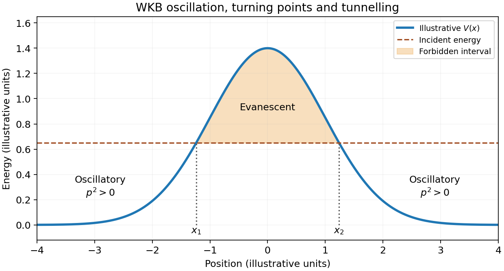
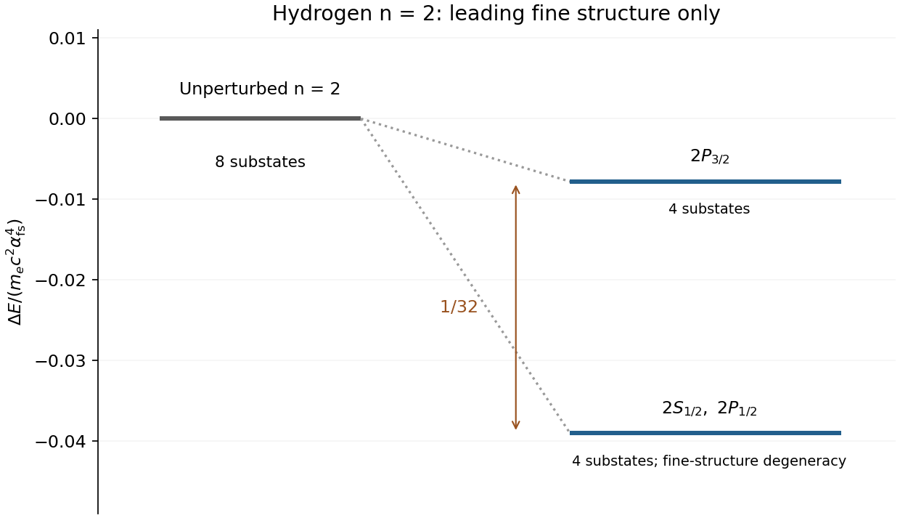
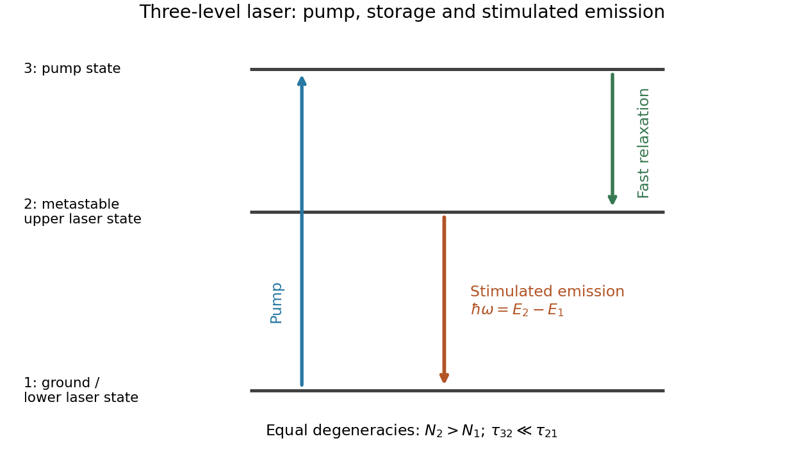
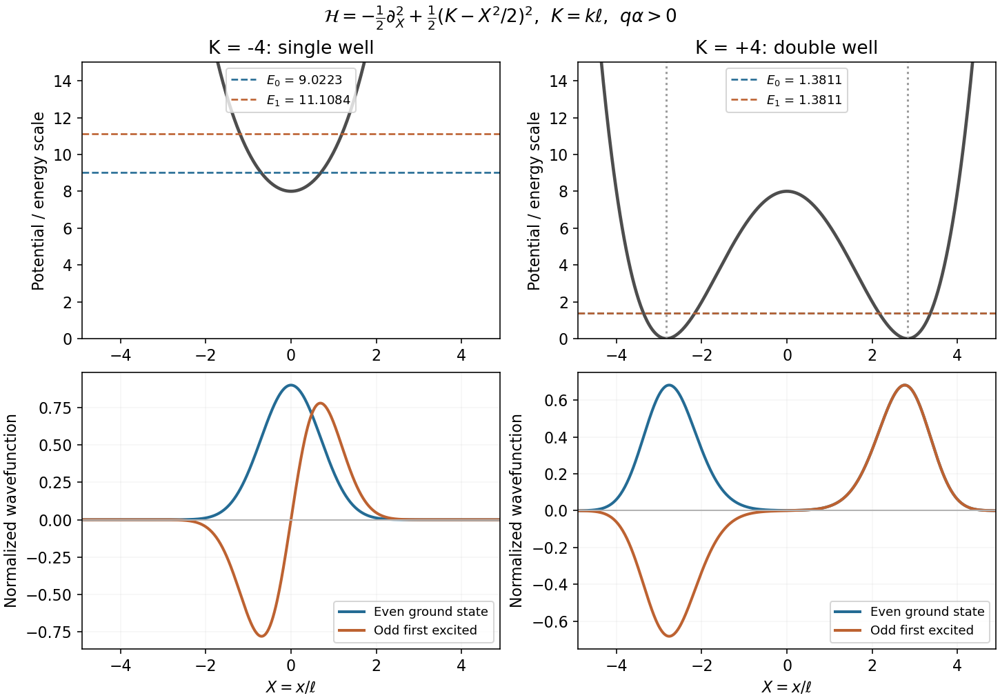

# Paper 1

↑ **Parent:** [2012](../2012.md)

[Original examination PDF, physical pages207–210](https://www.whatdotheyknow.com/request/natural_science_tripos_physics_e_2/response/2340776/attach/2/FOI%202023%20399%20Zahid%20materials.pdf?cookie_passthrough=1#page=207)

**Table of contents**

- [1](#1)
  - [a](#1/a)
    - [Solution](#1/a/solution)
  - [b](#1/b)
    - [Solution](#1/b/solution)
  - [c](#1/c)
    - [Solution](#1/c/solution)
- [2](#2)
  - [a](#2/a)
    - [Solution](#2/a/solution)
  - [b](#2/b)
    - [Solution](#2/b/solution)
  - [c](#2/c)
    - [Solution](#2/c/solution)
- [3](#3)
  - [Solution](#3/solution)
- [4](#4)
  - [Solution](#4/solution)

## 1

↑ **Parent:** [Paper 1](paper-1.md)

<h3 id="1/a">a</h3>

↑ **Parent:** [1](#1)

<h4 id="1/a/solution">Solution</h4>

↑ **Parent:** [A](#1/a)

The closed shells have $L=S=0$, so only the two equivalent p electrons matter. Their [addition of angular momentum](../../angular-momentum-operator.md#addition-of-angular-momentum) allows $L=0,1,2$ and $S=0,1$, subject to the [Pauli exclusion principle](../../tensor-product-of-quantum-systems.md#pauli-exclusion-principle). Interchanging two $l=1$ orbital states has sign $(-1)^{2-L}=(-1)^L$: even L is spatially symmetric and needs the antisymmetric spin singlet; odd L is spatially antisymmetric and needs the symmetric spin triplet. Thus the [allowed LS terms of a p-squared configuration](../../angular-momentum-operator.md#allowed-ls-terms-of-a-p-squared-configuration) are $^1S$, $^1D$ and $^3P$.

In [LS coupling](../../angular-momentum-operator.md#ls-coupling), $J=|L-S|,\ldots,L+S$. The complete list of [term symbols](../../atomic-physics.md#term-symbol) is therefore

$$
\boxed{{}^1S_0,\qquad{}^1D_2,\qquad{}^3P_0,\ {}^3P_1,\ {}^3P_2.}
$$

They contain $1+5+(1+3+5)=15=\binom62$ magnetic substates, exhausting the antisymmetric two-electron space. All have even spatial [parity](../../quantum-mechanics.md#parity), since each p orbital is odd.

<h3 id="1/b">b</h3>

↑ **Parent:** [1](#1)

<h4 id="1/b/solution">Solution</h4>

↑ **Parent:** [B](#1/b)

For the [linear rigid rotor](../../molecule.md#linear-rigid-rotor), $E_\ell=\hbar^2\ell(\ell+1)/(2I)$ and the electric [electric dipole moment](../../electrostatics.md#electric-dipole-moment) interaction is $V=-E\hat d_z$. The isotropic $\ell=0$ state has no first-order shift. Its only coupled rotational state is $\ell=1,m_\ell=0$, at gap $\Delta_{\rm rot}=\hbar^2/I$, giving the [quadratic Stark shift of a polar linear rotor](../../mathematical-physics.md#quadratic-stark-shift-of-a-polar-linear-rotor)

$$
\boxed{\Delta E_g=-\frac{E^2(d^2/3)}{\Delta_{\rm rot}}=-\frac{Id^2E^2}{3\hbar^2}.}
$$

Using $1\,\mathrm{kV\,cm^{-1}}=10^5\,\mathrm{V\,m^{-1}}$ and the supplied I and d gives

$$
\boxed{\Delta E_g\simeq-8.05\times10^{-27}\,\mathrm J,\qquad \Delta E_g/h\simeq-12.2\,\mathrm{MHz}.}
$$

The negative sign is the expected second-order [Stark effect](../../mathematical-physics.md#stark-effect) of a nondegenerate ground state. The mixing parameter $dE/(\sqrt3\Delta_{\rm rot})\simeq0.074$ is small, supporting the weak-field estimate. The constants h and $\hbar=h/(2\pi)$ use their defined SI values; no molecular input beyond the supplied data is needed.

<h3 id="1/c">c</h3>

↑ **Parent:** [1](#1)

<h4 id="1/c/solution">Solution</h4>

↑ **Parent:** [C](#1/c)

The [coherent state](../../quantum-theory.md#coherent-state) satisfies $\langle a\rangle=\alpha$, $\langle a^\dagger\rangle=\alpha^*$ and $\langle a^\dagger a\rangle=|\alpha|^2$. The [canonical commutation relation](../../quantum-mechanics.md#canonical-commutation-relation) adds the vacuum term $\langle aa^\dagger\rangle=|\alpha|^2+1$. Therefore

$$
\langle\hat E\rangle=E_0(\alpha+\alpha^*),\qquad
\langle\hat E^2\rangle=E_0^2[\alpha^2+(\alpha^*)^2+2|\alpha|^2+1],
$$

and the [coherent-state electric-field variance](../../quantum-optics.md#coherent-state-electric-field-variance) is

$$
\boxed{(\Delta E)^2=\langle\hat E^2\rangle-\langle\hat E\rangle^2=E_0^2,\qquad \Delta E=E_0.}
$$

Here $E_0$ is taken positive as the field-amplitude scale. The [coherent state](../../quantum-theory.md#coherent-state) displaces the mean field without changing this vacuum [optical quadrature](../../quantum-optics.md#optical-quadrature) noise.

## 2

↑ **Parent:** [Paper 1](paper-1.md)

<h3 id="2/a">a</h3>

↑ **Parent:** [2](#2)

<h4 id="2/a/solution">Solution</h4>

↑ **Parent:** [A](#2/a)

The [WKB approximation](../../analysis.md#wkb-approximation), also called JWKB, describes a short local de Broglie wavelength in a slowly varying [potential energy](../../energy.md#potential-energy). For $p(x)=\sqrt{2m[E-V(x)]}$ in a classically allowed region, its two local waves are

$$
\boxed{\psi(x)\simeq\frac1{\sqrt{p(x)}}\left[Ae^{(i/\hbar)\int^xp(s)ds}+Be^{-(i/\hbar)\int^xp(s)ds}\right].}
$$

The phase follows the classical [momentum](../../momentum.md); its amplitude varies to conserve [probability current](../../wave-function.md#probability-current). In a forbidden region, putting $\kappa(x)=\sqrt{2m[V(x)-E]}$ gives $\psi\simeq\kappa^{-1/2}[Ce^{\int^x\kappa/\hbar}+De^{-\int^x\kappa/\hbar}]$, with boundary conditions selecting the physical combination.

The [WKB validity condition](../../analysis.md#wkb-validity-condition) is $\hbar|p'|/p^2\ll1$, with the analogous condition on $\kappa$. It fails at a [turning point](../../energy.md#turning-point) where $E=V$. For a simple turning point, locally linearizing V yields an [Airy function](../../linear-ordinary-differential-equation.md#airy-function); matching fixes the relative amplitudes and a $\pi/4$ phase. Two such turning points give the [two-turning-point WKB quantization condition](../../analysis.md#two-turning-point-wkb-quantization-condition)

$$
\boxed{\int_{x_1}^{x_2}p(x)\,dx=\left(n+\tfrac12\right)\pi\hbar,\qquad n=0,1,\ldots.}
$$

For an opaque barrier, the [WKB tunnelling exponent](../../analysis.md#wkb-tunnelling-exponent) instead gives

$$
\boxed{T\sim\exp\left[-\frac2\hbar\int_{x_1}^{x_2}\kappa(x)\,dx\right].}
$$

The factor two distinguishes probability from amplitude. Matching determines the prefactor; the exponential alone is not accurate near the barrier top. These formulas connect [bound state](../../quantum-system.md#bound-state) [energy eigenvalues](../../energy-eigenvalue.md) and [quantum tunnelling](../../quantum-mechanics.md#quantum-tunnelling) to classical actions. [§2.2, printed pp.37–49, semiclassical expansion, Airy matching and tunnelling](../../physics-bibliography.md#topics-in-quantum-mechanics-by-david-tong)

**[Figure 1](#2/a/image-an-illustrative-smooth-barrier-separates-two-oscillatory-wkb-regions-by-an-evanescent-interval). An illustrative smooth barrier separates two oscillatory WKB regions by an evanescent interval**. [Source](paper-1-aqp2012-wkb-barrier.py).

<h3 id="2/b">b</h3>

↑ **Parent:** [2](#2)

<h4 id="2/b/solution">Solution</h4>

↑ **Parent:** [B](#2/b)

For a point, stationary proton, the leading hydrogen [fine structure](../../atomic-physics.md#fine-structure) comes from three order-$1/c^2$ contributions to the nonrelativistic electron [Hamiltonian](../../hamiltonian-mechanics.md#hamiltonian):

$$
\boxed{H_{\rm fs}=-\frac{p^4}{8m_e^3c^2}+\frac1{2m_e^2c^2r}\frac{dV}{dr}\,\mathbf L\cdot\mathbf S+\frac{\hbar^2}{8m_e^2c^2}\nabla^2V,\qquad V=-\frac{e^2}{4\pi\epsilon_0r}.}
$$

These are the [relativistic kinetic-energy correction](../../atomic-physics.md#relativistic-kinetic-energy-correction), [spin-orbit interaction](../../atomic-physics.md#spin-orbit-interaction) and [Darwin term](../../atomic-physics.md#darwin-term). The spin-orbit coefficient includes the [Thomas precession](../../special-relativity.md#thomas-precession) factor of one half; $\langle\mathbf L\cdot\mathbf S\rangle=\hbar^2[j(j+1)-l(l+1)-3/4]/2$. The Coulomb Darwin contribution is a positive contact term, relevant for S states. These corrections distinguish total [angular momentum](../../momentum.md#angular-momentum) $j=l\pm1/2$, while leaving magnetic substates degenerate without an external field.

Writing $\alpha_{\rm fs}=e^2/(4\pi\epsilon_0\hbar c)$, the combined [hydrogen fine-structure correction](../../atomic-physics.md#hydrogen-fine-structure-correction) is

$$
\boxed{\Delta E_{nj}=-\frac{m_ec^2\alpha_{\rm fs}^4}{2n^3}\left[\frac1{j+1/2}-\frac3{4n}\right].}
$$

Thus the splitting is of order $\alpha_{\rm fs}^2$ times the principal binding energy. In the $n=2$ shell, $2S_{1/2}$ and $2P_{1/2}$ remain degenerate in this approximation, while $2P_{3/2}$ is higher by $m_ec^2\alpha_{\rm fs}^4/32$. The [Lamb shift](../../atomic-physics.md#lamb-shift) lifts the remaining S–P degeneracy; [hyperfine structure](../../quantum-mechanics.md#hyperfine-structure) is a separate nuclear-spin effect. Neither is part of the displayed correction. Nuclear recoil and finite nuclear size have also been neglected. [§§3.1.2–3.1.5, printed pp.68–79, relativistic motion, spin-orbit/Darwin terms and their sum](../../physics-bibliography.md#topics-in-quantum-mechanics-by-david-tong)

**[Figure 2](#2/b/image-leading-hydrogen-n-2-fine-structure-corrections-retain-the-2s1-2-2p1-2-degeneracy). Leading hydrogen n=2 fine-structure corrections retain the 2S1/2–2P1/2 degeneracy**. [Source](paper-1-aqp2012-hydrogen-fine-structure.py).

<h3 id="2/c">c</h3>

↑ **Parent:** [2](#2)

<h4 id="2/c/solution">Solution</h4>

↑ **Parent:** [C](#2/c)

A [three-level laser](../../laser.md#three-level-laser) uses a pump transition from ground level1 to a higher level3, rapid relaxation $3\to2$, and a long-lived upper lasing level2. The laser transition is $2\to1$, so its lower level is the ground state. Fast feeding and slow upper-state decay allow excitation to accumulate, unlike steady resonant pumping of a simple two-level transition.

[Stimulated emission](../../laser.md#stimulated-emission) adds photons to the stimulating optical mode, but ground-state [photon absorption](../../quantum-mechanics.md#photon-absorption) competes with it. The [population inversion](../../laser.md#population-inversion) condition is $N_2/g_2>N_1/g_1$ when the relevant transition strengths obey the usual Einstein relations. For equal degeneracies and negligible $N_3$, it reduces to **$N_2>N_1$, requiring more than half the active population in level2**.

For a simple pump rate R per ground-state emitter, fast $3\to2$ relaxation and negligible laser intensity, the [three-level laser rate equation](../../laser.md#three-level-laser-rate-equation) reduces to

$$
\dot N_2=RN_1-\frac{N_2}{\tau_{21}},\qquad N_1+N_2\simeq N_{\rm tot},\qquad
\boxed{\frac{N_2}{N_1}=R\tau_{21},\quad R\tau_{21}>1\ \text{for inversion}.}
$$

This [three-level ground-state inversion threshold](../../laser.md#three-level-ground-state-inversion-threshold) is only transparency; positive gain must also overcome optical losses. For an illustrative uniformly filled cavity of length $\ell$, equal absorption/emission cross-section $\sigma$, internal intensity-loss coefficient $\alpha_i$ and mirror power reflectivities $R_1,R_2$, the threshold condition is

$$
\boxed{g=\sigma(n_2-n_1)\geq\alpha_i+\frac1{2\ell}\ln\frac1{R_1R_2}.}
$$

Here $n_i$ are number densities, unlike the total populations $N_i$. The [optical resonator](../../optical-instrument.md#optical-cavity) supplies feedback and selects modes; a partially transmitting mirror couples out light. Spontaneous emission seeds the field, and stimulated transitions deplete the inversion until saturated gain balances loss. A [ruby laser](../../laser.md#ruby-laser) is the standard example. Real level degeneracies, branching losses and pump saturation modify the simple equations. [Chapter7§§7.1–7.2.1, printed pp.293–298, optical feedback and three-/four-level media; original reduced ground-state model specified above](../../physics-bibliography.md#fundamentals-of-photonics-and-quantum-electronics-lecture-notes-by-franz-x-kartner)

**[Figure 3](#2/c/image-original-three-level-laser-scheme-with-fast-feeding-of-a-metastable-upper-laser-state). Original three-level laser scheme with fast feeding of a metastable upper laser state**. [Source](paper-1-aqp2012-three-level-laser.py).

## 3

↑ **Parent:** [Paper 1](paper-1.md)

<h3 id="3/solution">Solution</h3>

↑ **Parent:** [3](#3)

For a spinless particle, [minimal coupling](../../quantum-theory.md#minimal-coupling) gives $H=(\mathbf p-q\mathbf A)^2/(2m)+q\phi$. Choose the [vector potential](../../multivariable-calculus.md#vector-potential) $\mathbf A=(0,\alpha x^2/2,0)$ and $\phi=0$. Its [curl](../../multivariable-calculus.md#curl) is $\mathbf B=\alpha x\hat{\mathbf z}$ and $[p_y,A_y]=0$, so

$$
\boxed{H=\frac1{2m}\left[p_x^2+\left(p_y-\frac{q\alpha x^2}{2}\right)^2\right].}
$$

The [translation separation in a magnetic field gradient](../../quantum-mechanics.md#translation-separation-in-a-magnetic-field-gradient) follows from $[H,p_y]=0$: a simultaneous [energy eigenstate](../../energy-eigenvalue.md#energy-eigenstate) can be written $\Psi=L_y^{-1/2}e^{iky}\Phi_k(x)$. The [periodic boundary condition](../../differential-equation.md#periodic-boundary-conditions) requires $e^{ikL_y}=1$, hence **$k=2\pi n/L_y$**, $n\in\mathbb Z$. The remaining [Schrödinger equation](../../mathematical-physics.md#schrodinger-equation) is

$$
\left[-\frac{\hbar^2}{2m}\frac{d^2}{dx^2}+V_k(x)\right]\Phi_k=E_k\Phi_k,\qquad
\boxed{V_k(x)=\frac1{2m}\left(\hbar k-\frac{g x^2}{2}\right)^2,\quad g=q\alpha.}
$$

This [magnetic-gradient quartic confinement](../../quantum-mechanics.md#magnetic-gradient-quartic-confinement) has a positive quartic coefficient for $g\ne0$. If $k/g<0$, it is a single well at zero, with $V_k(0)=\hbar^2k^2/(2m)$. Its harmonic curvature gives

$$
\omega_s=\frac{\sqrt{-\hbar gk}}m,\qquad
\Phi_0\propto e^{-x^2/(2a_s^2)},\quad\Phi_1\propto x e^{-x^2/(2a_s^2)},\quad a_s=\sqrt{\frac\hbar{m\omega_s}}.
$$

Thus the two lowest states are respectively even and odd, with one central peak or two opposite-sign lobes, and approximately $E_j=V_k(0)+(j+1/2)\hbar\omega_s$. They are not a nearly degenerate pair.

If $k/g>0$, the two minima are $x=\pm x_0$, $x_0=\sqrt{2\hbar k/g}$, with zero potential there and a central barrier $\hbar^2k^2/(2m)$. For well-separated minima the [lowest parity states of a symmetric double well](../../quantum-mechanics.md#lowest-parity-states-of-a-symmetric-double-well) are

$$
\boxed{\Phi_0\simeq\frac{\phi_L+\phi_R}{\sqrt{2(1+s)}},\qquad
\Phi_1\simeq\frac{\phi_L-\phi_R}{\sqrt{2(1-s)}},\qquad s=\langle\phi_L|\phi_R\rangle\ll1.}
$$

Here $\phi_L,\phi_R$ are the localized ground-state Gaussians. Their even combination is the lower state; the odd combination has a node at the origin. Weak [quantum tunnelling](../../quantum-mechanics.md#quantum-tunnelling) gives an exponentially small [double-well tunneling splitting](../../quantum-mechanics.md#double-well-tunneling-splitting).

To obtain their common leading energy, put $x=x_0+\delta x$. Since $\hbar k=gx_0^2/2$,

$$
V_k(x_0+\delta x)=\frac{g^2x_0^2}{2m}(\delta x)^2+O((\delta x)^3),\qquad
\omega_d=\frac{|g|x_0}{m}=\frac{\sqrt{2\hbar gk}}m.
$$

The [double-well oscillator scale in a linear magnetic field](../../quantum-mechanics.md#double-well-oscillator-scale-in-a-linear-magnetic-field) therefore gives

$$
\boxed{E_{k,0}\simeq E_{k,1}\simeq\frac{\hbar\omega_d}{2}=\frac1m\sqrt{\frac{\hbar^3q\alpha k}{2}}.}
$$

The asymptotic condition is $x_0\gg\sqrt{\hbar/(m\omega_d)}$, so the barrier separates narrow local oscillator states. It is this scale comparison that makes the source's “large” ratio meaningful.

The [signed group velocity of a magnetic-gradient doublet](../../quantum-mechanics.md#signed-group-velocity-of-a-magnetic-gradient-doublet) follows by differentiating the band energy with respect to the conserved wavevector:

$$
\boxed{v_y=\frac1\hbar\frac{dE_k}{dk}\simeq\frac{E_k}{2\hbar k}=\frac{\hbar q\alpha}{2m\sqrt{2\hbar q\alpha k}}.}
$$

For $q\alpha>0$ the double-well branch has $k>0$ and moves along $+y$; reversing both signs reverses its velocity. To this order the two parity states have the same velocity. Corrections include local anharmonicity and the exponentially small splitting. The spinless Hamiltonian specified here has no extra [Zeeman effect](../../atomic-physics.md#zeeman-splitting) term.

**[Figure 4](#3/image-original-quartic-magnetic-gradient-potentials-and-numerical-lowest-even-odd-wavefunctions-for-opposite-wavevector-signs). Original quartic magnetic-gradient potentials and numerical lowest even/odd wavefunctions for opposite wavevector signs**. [Source](paper-1-aqp2012-magnetic-gradient-wells.py).

## 4

↑ **Parent:** [Paper 1](paper-1.md)

<h3 id="4/solution">Solution</h3>

↑ **Parent:** [4](#4)

Insert the expansion in the time-dependent [Schrödinger equation](../../mathematical-physics.md#schrodinger-equation), cancel the unperturbed evolution, and project onto $\langle\psi_n|$. With $V_{nm}(t)=\langle\psi_n|V(t)|\psi_m\rangle$,

$$
i\hbar\dot c_n(t)=\sum_m e^{i(\omega_n-\omega_m)t}V_{nm}(t)c_m(t).
$$

In first-order [time-dependent perturbation theory](../../quantum-mechanics.md#time-dependent-perturbation-theory), put $c_m(t)=\delta_{m0}$ on the right and use $c_n(-\infty)=0$ for $n\ne0$. Integration gives

$$
\boxed{c_n(t)=\frac1{i\hbar}\int_{-\infty}^t e^{i(\omega_n-\omega_0)t'}V_{n0}(t')\,dt'+O(V^2).}
$$

The initial state must be the specified unperturbed eigenstate, the integral must exist under the switching prescription, and total transition probability must stay small. The diagonal term produces a first-order phase; setting $c_0=1$ in the off-diagonal integral changes those amplitudes only at second order. A weak peak perturbation alone is insufficient if its accumulated action invalidates this expansion.

For the [infinite square well](../../quantum-mechanics.md#infinite-square-well), retain the source's zero-based labels:

$$
\psi_n(x)=\sqrt{\frac2w}\sin\frac{(n+1)\pi x}{w},\qquad E_n=\frac{\pi^2\hbar^2(n+1)^2}{2m_ew^2},\qquad n=0,1,\ldots.
$$

An electron in a field along $+x$ has perturbation $V(t)=+eE_0xe^{-t/\tau}$ for $t\geq0$. About the well centre, $x-w/2$ is odd, whereas $\psi_0$ and $\psi_2$ are both even. The constant $w/2$ has zero off-diagonal matrix element, so the [first-order parity selection in an infinite well](../../quantum-mechanics.md#first-order-parity-selection-in-an-infinite-well) gives **$\langle\psi_2|x|\psi_0\rangle=0$**. Excitation to that state is forbidden at first order, not necessarily at higher orders.

For the first excited state, direct integration or the supplied integral gives

$$
x_{10}=\frac2w\int_0^w x\sin\frac{2\pi x}w\sin\frac{\pi x}w\,dx=-\frac{16w}{9\pi^2},\qquad
\omega_{10}=\frac{3\pi^2\hbar}{2m_ew^2}.
$$

The Fourier amplitude of the [exponentially decaying electric-field pulse](../../quantum-mechanics.md#exponentially-decaying-electric-field-pulse) is $\int_0^\infty e^{-t/\tau+i\omega t}dt=\tau/(1-i\omega\tau)$. Thus

$$
c_1(\infty)=\frac{eE_0x_{10}\tau}{i\hbar(1-i\omega_{10}\tau)},\qquad
\boxed{P_{0\to1}=\frac{256e^2E_0^2w^2\tau^2}{81\pi^4\hbar^2\left[1+\left(3\pi^2\hbar\tau/(2m_ew^2)\right)^2\right]}.}
$$

This is the leading, quadratic-in-field transition probability; the total probability of all excitations must remain small.

Starting instead in $\psi_1$, which is odd about the centre, the pulse can transfer amplitude to the ground state and to even-labelled excited states $\psi_2,\psi_4,\ldots$. Other odd-labelled states have zero first-order dipole amplitude. Both downward and upward transitions are possible; their relative probabilities depend on dipole matrix elements and the pulse's spectral weight at the corresponding energy gaps. Most population remains in $\psi_1$, with a small depletion equal to the summed leading transition probabilities. The [common diagonal dipole phase in an infinite well](../../quantum-mechanics.md#common-diagonal-dipole-phase-in-an-infinite-well) is $-eE_0w\tau/(2\hbar)$ and has no population effect. After the pulse, the remaining coherent superposition evolves under the unperturbed [Hamiltonian](../../hamiltonian-mechanics.md#hamiltonian); no spontaneous relaxation is implied by this closed-system model.

## ↑ Ancestors (11)

1. [2012](../2012.md)
2. [Past exam of the advanced quantum physics course of the University of Cambridge](../../past-exam-of-the-advanced-quantum-physics-course-of-the-university-of-cambridge.md)
3. [Advanced Quantum Physics course of the University of Cambridge](../../university-of-cambridge.md#advanced-quantum-physics-course-of-the-university-of-cambridge)
4. [Physics course of the year 3 of the natural sciences course of the University of Cambridge](../../university-of-cambridge.md#physics-course-of-the-year-3-of-the-natural-sciences-course-of-the-university-of-cambridge)
5. [Year 3 of the natural sciences course of the University of Cambridge](../../university-of-cambridge.md#year-3-of-the-natural-sciences-course-of-the-university-of-cambridge)
6. [Year of the natural sciences course of the University of Cambridge](../../university-of-cambridge.md#year-of-the-natural-sciences-course-of-the-university-of-cambridge)
7. [Natural sciences course of the University of Cambridge](../../university-of-cambridge.md#natural-sciences-course-of-the-university-of-cambridge)
8. [Course of the University of Cambridge](../../university-of-cambridge.md#course-of-the-university-of-cambridge)
9. [University of Cambridge](../../university-of-cambridge.md)
10. [List of universities](../../README.md#list-of-universities)
11. [Codex Wiki](../../README.md)
