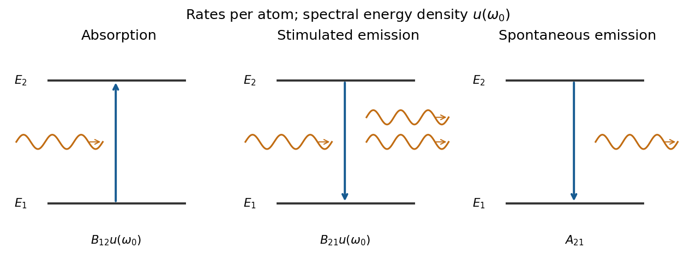

# Paper 1

↑ **Parent:** [2013](../2013.md)

[Original examination PDF, physical pages250–253](https://www.whatdotheyknow.com/request/natural_science_tripos_physics_e_2/response/2340776/attach/2/FOI%202023%20399%20Zahid%20materials.pdf?cookie_passthrough=1#page=250)

**Table of contents**

- [1](#1)
  - [a](#1/a)
    - [Solution](#1/a/solution)
  - [b](#1/b)
    - [Solution](#1/b/solution)
  - [c](#1/c)
    - [Solution](#1/c/solution)
- [2](#2)
  - [a](#2/a)
    - [Solution](#2/a/solution)
  - [b](#2/b)
    - [Solution](#2/b/solution)
  - [c](#2/c)
    - [Solution](#2/c/solution)
- [3](#3)
  - [Solution](#3/solution)
- [4](#4)
  - [Solution](#4/solution)

## 1

↑ **Parent:** [Paper 1](paper-1.md)

<h3 id="1/a">a</h3>

↑ **Parent:** [1](#1)

<h4 id="1/a/solution">Solution</h4>

↑ **Parent:** [A](#1/a)

Put $\mathbf J=\mathbf S_1+\mathbf S_2$. [Angular momentum addition](../../momentum.md#angular-momentum-addition) gives $j=0,1,2,3$, and the [spin-dot-product eigenvalue](../../angular-momentum-operator.md#spin-dot-product-eigenvalue) is

$$
\frac{\hbar^2}{2}\left[j(j+1)-2\frac32\frac52\right].
$$

Thus the [spin-three-halves pair spectrum](../../angular-momentum-operator.md#spin-three-halves-pair-spectrum) is

$$
\boxed{\frac{\hbar^2}{4}(-15,-11,-3,9),\quad\text{with multiplicities }1,3,5,7.}
$$

For identical [fermions](../../tensor-product-of-quantum-systems.md#fermion), [exchange parity of two coupled identical spins](../../angular-momentum-operator.md#exchange-parity-of-two-coupled-identical-spins) makes $j=0,2$ spin-antisymmetric and $j=1,3$ spin-symmetric. Corresponding spatial exchange symmetries make the full state antisymmetric; without a specified spatial state, none of these [total-spin sectors](../../angular-momentum-operator.md#total-spin-sector) is excluded.

<h3 id="1/b">b</h3>

↑ **Parent:** [1](#1)

<h4 id="1/b/solution">Solution</h4>

↑ **Parent:** [B](#1/b)

Adjacent [nodes of a wavefunction](../../wave-function.md#node-of-a-wavefunction) are separated by roughly $a/n$, so a locally sinusoidal [wavefunction](../../wave-function.md) has typical [wavevector](../../elasticity-physics.md#wavevector) $k\sim\pi n/a$. The [kinetic-energy estimate from wavefunction nodes](../../wave-function.md#kinetic-energy-estimate-from-wavefunction-nodes) is therefore

$$
\boxed{\langle K\rangle\sim\frac{\hbar^2\pi^2 n^2}{2ma^2}\quad(n\gg1).}
$$

Equivalently, $\langle K\rangle=\hbar^2\int|\psi'|^2dx/(2m\int|\psi|^2dx)$. The robust scaling is $\hbar^2 n^2/(ma^2)$; the precise coefficient depends on how the extent is defined and how the oscillations vary near [classical turning points](../../analysis.md#classical-turning-point). For few nodes, use an order-one offset to $n$: the nodeless [ground state](../../quantum-mechanics.md#ground-state) still has [confinement energy bound from position support](../../quantum-theory.md#confinement-energy-bound-from-position-support) of order $\hbar^2/(ma^2)$, rather than zero.

<h3 id="1/c">c</h3>

↑ **Parent:** [1](#1)

<h4 id="1/c/solution">Solution</h4>

↑ **Parent:** [C](#1/c)

Centre the [infinite square well](../../quantum-mechanics.md#infinite-square-well) at zero. Its [ground state](../../quantum-mechanics.md#ground-state) [wavefunction](../../wave-function.md) is $\psi(x)=\sqrt{2/L}\cos(\pi x/L)$ inside the well and zero outside. The [momentum representation in quantum mechanics](../../wave-function.md#momentum-representation-in-quantum-mechanics) gives the [wavevector](../../elasticity-physics.md#wavevector) amplitude

$$
\phi(k)=\frac1{\sqrt{2\pi}}\int\psi(x)e^{-ikx}dx
=2\sqrt{\pi L}\,\frac{\cos(kL/2)}{\pi^2-(kL)^2}.
$$

Consequently the unnormalised [wavevector distribution of an infinite-well ground state](../../quantum-mechanics.md#wavevector-distribution-of-an-infinite-well-ground-state) is

$$
\boxed{p(k)\propto\frac{\cos^2(kL/2)}{[\pi^2-(kL)^2]^2}.}
$$

The apparent singularities at $k=\pm\pi/L$ are removable. The normalized [probability density](../../wave-function.md#probability-density) is $4\pi L$ times the boxed expression and has limit $L/(4\pi)$ there. Translating the well changes only the [Fourier transform](../../fourier-transform.md)'s phase. The [wavevector](../../elasticity-physics.md#wavevector) is continuously distributed; a box [energy eigenstate](../../energy-eigenvalue.md#energy-eigenstate) is not a free [momentum eigenstate](../../energy-eigenvalue.md#momentum-eigenstate).

## 2

↑ **Parent:** [Paper 1](paper-1.md)

<h3 id="2/a">a</h3>

↑ **Parent:** [2](#2)

<h4 id="2/a/solution">Solution</h4>

↑ **Parent:** [A](#2/a)

For [identical particles](../../tensor-product-of-quantum-systems.md#indistinguishable-particles), the [particle exchange operator](../../tensor-product-of-quantum-systems.md#particle-exchange-operator) exchanges both spatial and [spin](../../angular-momentum-operator.md#spin) labels. The [symmetrization postulate](../../tensor-product-of-quantum-systems.md#symmetrization-postulate) requires a symmetric full state for [bosons](../../tensor-product-of-quantum-systems.md#boson) and an antisymmetric full state for [fermions](../../tensor-product-of-quantum-systems.md#fermion). A product $\Psi=\phi\chi$ must therefore have spatial and spin exchange eigenvalues whose product is $+1$ or $-1$, respectively; a general state may be a sum of such products.

For orthonormal spatial orbitals $u,v$, the combinations $\phi_\pm=[u(1)v(2)\pm v(1)u(2)]/\sqrt2$ have opposite exchange parities. Two spin-one-half [fermions](../../tensor-product-of-quantum-systems.md#fermion) combine $\phi_+$ with the antisymmetric [spin-one-half singlet state](../../angular-momentum-operator.md#spin-one-half-singlet-state) $(|\uparrow\downarrow\rangle-|\downarrow\uparrow\rangle)/\sqrt2$, or $\phi_-$ with one of the three symmetric [spin-one-half triplet states](../../angular-momentum-operator.md#spin-one-half-triplet-state). **Two particles in the same spatial orbital must be a spin singlet.** This is the [Pauli exclusion principle](../../tensor-product-of-quantum-systems.md#pauli-exclusion-principle) applied to complete [spin orbitals](../../tensor-product-of-quantum-systems.md#spin-orbital), not a ban on sharing a spatial orbital with opposite [spins](../../angular-momentum-operator.md#spin).

A [Slater determinant](../../tensor-product-of-quantum-systems.md#slater-determinant) enforces fermionic antisymmetry for many occupied [spin orbitals](../../tensor-product-of-quantum-systems.md#spin-orbital). Bosonic symmetrization instead uses a [permanent](../../linear-algebra.md#permanent-mathematics); repeated orbital occupations are allowed. These exchange requirements apply even when particles do not interact.

<h3 id="2/b">b</h3>

↑ **Parent:** [2](#2)

<h4 id="2/b/solution">Solution</h4>

↑ **Parent:** [B](#2/b)

A single-mode [coherent state](../../quantum-theory.md#coherent-state) is an [annihilation operator](../../quantum-harmonic-oscillator.md#annihilation-operator) eigenstate:

$$
|\alpha\rangle=e^{-|\alpha|^2/2}\sum_{n=0}^\infty\frac{\alpha^n}{\sqrt{n!}}|n\rangle,\qquad a|\alpha\rangle=\alpha|\alpha\rangle.
$$

Its [photon statistics](../../quantum-optics.md#photon-statistics) are [Poisson distribution](../../discrete-probability-distribution.md#poisson-distribution): $\langle n\rangle=\operatorname{Var}n=|\alpha|^2$. For [optical quadratures](../../quantum-optics.md#optical-quadrature) $X=(a+a^\dagger)/2$, $P=(a-a^\dagger)/(2i)$, one has $[X,P]=i/2$ and $\operatorname{Var}X=\operatorname{Var}P=1/4$. Its field mean oscillates classically while retaining vacuum fluctuations.[§4.4.2, printed pp.132–133: coherent states and driving a harmonic oscillator](../../physics-bibliography.md#topics-in-quantum-mechanics-by-david-tong)[Slides3,9–12, physical PDF pp.2,5–6: quadrature fluctuations and squeezing](../../physics-bibliography.md#quantum-optical-communication-lecture-6-by-jeffrey-h-shapiro)

A [classical mixture of coherent states](../../quantum-theory.md#classical-mixture-of-coherent-states) has a nonnegative [Glauber-Sudarshan representation](../../quantum-theory.md#glauber-sudarshan-representation). A [nonclassical state of light](../../quantum-optics.md#nonclassical-state-of-light) cannot be represented that way. Examples are a [squeezed vacuum state](../../quantum-harmonic-oscillator.md#squeezed-vacuum-state), with quadrature variances $e^{-2r}/4$ and $e^{2r}/4$, and a nonvacuum [number state](../../quantum-harmonic-oscillator.md#number-state), with zero [photon number](../../quantum-harmonic-oscillator.md#photon-number) variance. **Noise below the vacuum level in one quadrature, sub-Poisson number noise, or [photon antibunching](../../quantum-optics.md#photon-antibunching) can witness nonclassicality.** For $|n\rangle$, $g^{(2)}(0)=1-1/n<1$; coherent light has $g^{(2)}(0)=1$. [Thermal light](../../quantum-optics.md#thermal-light) has excess noise but is a classical mixture: noncoherent does not by itself mean nonclassical.

**[Figure 1](#2/b/image-coherent-light-has-equal-vacuum-quadrature-noise-squeezing-reduces-one-variance-and-increases-the-other). Coherent light has equal vacuum quadrature noise; squeezing reduces one variance and increases the other**. [Source](paper-1-aqp2013-quadrature-noise.py).

<h3 id="2/c">c</h3>

↑ **Parent:** [2](#2)

<h4 id="2/c/solution">Solution</h4>

↑ **Parent:** [C](#2/c)

The [Stark effect](../../mathematical-physics.md#stark-effect) changes atomic [energy levels](../../quantum-mechanics.md#energy-level) in a static [electric field](../../electric-field.md). For $\mathbf E=\mathcal E\hat{\mathbf z}$, the [electric-dipole interaction](../../quantum-mechanics.md#electric-dipole-interaction) is $H'=-d_z\mathcal E=e\mathcal E z$ for an electron, with $e>0$. A nondegenerate state of definite [parity](../../quantum-mechanics.md#parity) has $\langle z\rangle=0$, so its leading [quadratic Stark effect](../../mathematical-physics.md#quadratic-stark-effect) is

$$
\Delta E_n^{(2)}=e^2\mathcal E^2\sum_{r\ne n}\frac{|\langle r|z|n\rangle|^2}{E_n-E_r}.
$$

The [ground state](../../quantum-mechanics.md#ground-state) shift is negative, conventionally $-\alpha\mathcal E^2/2$ with positive [electric polarizability](../../electrostatics.md#electric-polarizability).[Equations(7.40),(7.57),(7.65): parity selection and polarizability](../../physics-bibliography.md#quantum-mechanics-by-richard-fitzpatrick/quadratic-stark-effect)

Degenerate opposite-parity states require [degenerate perturbation theory](../../quantum-mechanics.md#degenerate-perturbation-theory). In ideal Coulomb [hydrogen](../../chemical-substance.md#hydrogen), the $2s,2p_0$ subspace has an off-diagonal matrix element of magnitude $3ea_{\rm B}\mathcal E$, where $a_{\rm B}$ is the [Bohr radius](../../mathematical-physics.md#bohr-radius). Its mixed states shift by

$$
\boxed{\Delta E=\pm3ea_{\rm B}\mathcal E,\qquad\Delta E_{2p_{\pm1}}=0\ \text{to first order}.}
$$

This [Linear Stark effect in the first excited hydrogen eigenspace](../../mathematical-physics.md#linear-stark-effect-in-the-first-excited-hydrogen-eigenspace) assumes fine-structure and Lamb splittings are negligible compared with the mixing. In an isolated parity eigenstate with such degeneracies resolved, sufficiently weak fields restore quadratic behaviour. Strong fields require further mixing and can ionize the atom.[Equations(7.82)–(7.94): n=2 mixing and shifts](../../physics-bibliography.md#quantum-mechanics-by-richard-fitzpatrick/linear-stark-effect)

## 3

↑ **Parent:** [Paper 1](paper-1.md)

<h3 id="3/solution">Solution</h3>

↑ **Parent:** [3](#3)

With $y=x-x_0$ and [oscillator length](../../quantum-harmonic-oscillator.md#oscillator-length) $a_0=\sqrt{\hbar/(m\omega)}$, the first two [harmonic oscillator eigenfunctions](../../quantum-harmonic-oscillator.md#harmonic-oscillator-eigenfunction) and [energies](../../energy.md) are

$$
\psi_0=\frac{e^{-y^2/(2a_0^2)}}{\pi^{1/4}\sqrt{a_0}},\qquad
\psi_1=\sqrt2\frac{y}{a_0}\psi_0,\qquad
\boxed{E_0=\frac{\hbar\omega}{2},\quad E_1=\frac{3\hbar\omega}{2}.}
$$

The [ground state](../../quantum-mechanics.md#ground-state) is even and nodeless; the first excited state is odd with one [node of a wavefunction](../../wave-function.md#node-of-a-wavefunction). Their rms widths are $a_0/\sqrt2$ and $\sqrt{3/2}\,a_0$. Also, $m\omega^2a_0^2\sim\hbar\omega$ gives the characteristic extent directly.

For the [shaken harmonic trap](../../quantum-harmonic-oscillator.md#shaken-harmonic-trap), expanding about the unshifted [Hamiltonian](../../hamiltonian-mechanics.md#hamiltonian) gives

$$
H'(t)=-m\omega^2\varepsilon x\cos\Omega t+\frac12m\omega^2\varepsilon^2\cos^2\Omega t\,I
\quad(0\le t\le T).
$$

The scalar term gives only a common phase and no transitions. In [time-dependent perturbation theory](../../quantum-mechanics.md#time-dependent-perturbation-theory), initially $c_0=1$, $c_{n\ne0}=0$ and the oscillatory factor for $0\to1$ is $e^{i(E_1-E_0)t/\hbar}=e^{i\omega t}$. Thus

$$
c_1(T)=-\frac{\varepsilon m\omega^2}{i\hbar}\langle1|x|0\rangle\int_0^T e^{i\omega t}\cos\Omega t\,dt.
$$

The odd operator $x$ makes transitions to even $n>0$ vanish by [parity](../../quantum-mechanics.md#parity). In fact the [first-order selection rule for a linearly driven oscillator](../../quantum-harmonic-oscillator.md#first-order-selection-rule-for-a-linearly-driven-oscillator) is stronger: since $x=a_0(a+a^\dagger)/\sqrt2$,

$$
\langle n|x|0\rangle=\frac{a_0}{\sqrt2}\delta_{n1}.
$$

**All excited $n\ne1$ amplitudes vanish at first order**, including odd $n>1$. This assertion does not apply to the surviving $c_0$ or to higher perturbative orders.

Put $\delta=\omega-\Omega$, $\Sigma=\omega+\Omega$. The exact first-order time integral is

$$
I(T)=e^{i\delta T/2}\frac{\sin(\delta T/2)}{\delta}
+e^{i\Sigma T/2}\frac{\sin(\Sigma T/2)}{\Sigma}.
$$

Near resonance, the second term oscillates rapidly at approximately $2\omega$ and is bounded by $1/\Sigma$, whereas the first grows as $T/2$ on resonance. Thus $\omega T\gg1$ justifies the [rotating-wave approximation](../../quantum-mechanics.md#rotating-wave-approximation), $\cos\Omega t\mapsto e^{-i\Omega t}/2$. At zeros of the resonant term, the omitted small contribution can dominate the residual; the approximation has no uniform relative-error bound there.

Using the requested order-one approximation $\langle1|x|0\rangle\simeq a_0$ and $m\omega^2a_0/\hbar=\omega/a_0$ gives the [square-pulse resonance profile](../../quantum-mechanics.md#square-pulse-resonance-profile)

$$
\boxed{p_1\simeq\left(\frac{\varepsilon\omega}{a_0}\right)^2\frac{\sin^2(\delta T/2)}{\delta^2},\qquad
p_1(\omega)\simeq\left(\frac{\varepsilon\omega T}{2a_0}\right)^2.}
$$

The exact [harmonic oscillator](../../classical-mechanics.md#simple-harmonic-motion) matrix element instead gives **half this probability**. The finite central maximum is at $\Omega=\omega$; first zeros are at $|\Omega-\omega|=2\pi/T$, with smaller side lobes and a $1/\delta^2$ envelope. Increasing $T$ narrows the peak as $1/T$ and increases its height as $T^2$, as long as [weak resonant driving](../../quantum-harmonic-oscillator.md#weak-resonant-driving) keeps $p_1\ll1$. Small displacement alone does not ensure this for arbitrarily long $T$; near resonance one also needs $\varepsilon\omega T/a_0\ll1$.

**[Figure 2](#3/image-even-and-odd-oscillator-wavefunctions-and-the-finite-duration-sinc-squared-excitation-profile). Even and odd oscillator wavefunctions and the finite-duration sinc-squared excitation profile**. [Source](paper-1-aqp2013-oscillator-resonance.py).

## 4

↑ **Parent:** [Paper 1](paper-1.md)

<h3 id="4/solution">Solution</h3>

↑ **Parent:** [4](#4)

Define $\hbar\omega_0=E_2-E_1$ and use [radiation energy density](../../statistical-physics.md#radiation-energy-density) $u(\omega)$ per unit [angular frequency](../../lagrangian-mechanics.md#angular-frequency), excluding the zero-point contribution. The [Angular-frequency Einstein coefficients](../../atomic-physics.md#angular-frequency-einstein-coefficients) give rates per atom: $B_{12}u(\omega_0)$ for absorption, $B_{21}u(\omega_0)$ for [stimulated emission](../../laser.md#stimulated-emission), and $A_{21}$ for [spontaneous emission](../../atomic-physics.md#spontaneous-emission). Stimulated emission adds a photon to the stimulating mode; spontaneous emission persists with no incident photons.

**[Figure 3](#4/image-absorption-stimulated-emission-and-spontaneous-emission-between-two-nondegenerate-levels). Absorption, stimulated emission and spontaneous emission between two nondegenerate levels**. [Source](paper-1-aqp2013-radiative-transitions.py).

In thermal equilibrium the [Boltzmann distribution](../../thermodynamics.md#boltzmann-distribution) gives $N_2/N_1=e^{-\hbar\omega_0/(k_{\rm B}T)}$. Balancing up and down rates yields

$$
N_1B_{12}u=N_2(A_{21}+B_{21}u),\qquad
u=\frac{A_{21}}{B_{12}e^{\hbar\omega_0/(k_{\rm B}T)}-B_{21}}.
$$

Matching the [Planck law](../../statistical-physics.md#planck-s-law) for every temperature fixes

$$
\boxed{B_{12}=B_{21},\qquad\frac{A_{21}}{B_{21}}=\frac{\hbar\omega_0^3}{\pi^2c^3}.}
$$

No degeneracy factor is needed for these nondegenerate levels.[§4.3.2, printed pp.123–127: thermal balance and Einstein coefficients](../../physics-bibliography.md#topics-in-quantum-mechanics-by-david-tong)

For plates of large area $A$ and spacing $d$, the surviving low-frequency [transverse electromagnetic mode](../../electromagnetic-wave.md#transverse-electromagnetic-mode) has one polarization, $\mathbf E\parallel\hat{\mathbf z}$, and in-plane [wavevector](../../elasticity-physics.md#wavevector). Periodic in-plane counting gives

$$
dN=\frac{A}{(2\pi)^2}\,2\pi k\,dk,\qquad
\frac1{Ad}\frac{dN}{d\omega}=\frac{\omega}{2\pi c^2d}.
$$

Multiplying this [single-polarization two-dimensional photon density of states](../../quantum-ideal-gas-statistics.md#single-polarization-two-dimensional-photon-density-of-states) by $\hbar\omega$ and the [Bose-Einstein distribution](../../quantum-ideal-gas-statistics.md#bose-einstein-distribution) produces the [thermal radiation between parallel conducting plates](../../statistical-physics.md#thermal-radiation-between-parallel-conducting-plates):

$$
\boxed{u_{\rm plates}(\omega)=\frac{\hbar\omega^2}{2\pi c^2d}\frac1{e^{\hbar\omega/(k_{\rm B}T)}-1}.}
$$

The same rate balance therefore gives

$$
\left(\frac AB\right)_{\rm plates}=\frac{\hbar\omega_0^2}{2\pi c^2d},\qquad
\boxed{\frac{(A/B)_{\rm plates}}{(A/B)_{\rm free}}=\frac{\pi c}{2\omega_0d}\gg1.}
$$

These $B$ coefficients refer to the radiation polarization in their respective environments: isotropic free-space $B$ must not automatically be equated to the coefficient for a specified $z$-polarized field.

For [hydrogen](../../chemical-substance.md#hydrogen), take the quantization axis along $z$, neglect [spin-orbit coupling](../../atomic-physics.md#spin-orbit-interaction), and assume perfect plates, a wide in-plane region and an unmodified atomic wavefunction: $a_{\rm B}\ll d\ll c/\omega_0$, with negligible surface-induced mixing or shifts. The [electric-dipole selection rules for hydrogen](../../mathematical-physics.md#electric-dipole-selection-rules-for-hydrogen) require $\Delta l=\pm1$; the allowed $z$ field has $\Delta m_\ell=0$. Hence the [polarization-selective spontaneous emission between conducting plates](../../atomic-physics.md#polarization-selective-spontaneous-emission-between-conducting-plates) gives

$$
\boxed{m_\ell=0:\quad A_{\rm plates}\sim A_{\rm free}\frac{c}{\omega_0d},\qquad
\tau_{\rm plates}\sim\tau_{\rm free}\frac{\omega_0d}{c}.}
$$

The [thin-cavity enhancement of a normal electric dipole](../../atomic-physics.md#thin-cavity-enhancement-of-a-normal-electric-dipole) applies: the $2p_0\to1s$ dipole points along $z$ and couples to the enhanced mode density. For $m_\ell=\pm1$, the transition dipoles lie in the $x$–$y$ plane and couple to none of these low-frequency modes: **the electric-dipole decay rate is zero in the ideal model**, so this channel's lifetime is infinite. Real finite, imperfect plates and additional decay or mixing channels limit the lifetime. The order-one orientation factor for the allowed transition does not change the requested lifetime scaling.

## ↑ Ancestors (11)

1. [2013](../2013.md)
2. [Past exam of the advanced quantum physics course of the University of Cambridge](../../past-exam-of-the-advanced-quantum-physics-course-of-the-university-of-cambridge.md)
3. [Advanced Quantum Physics course of the University of Cambridge](../../university-of-cambridge.md#advanced-quantum-physics-course-of-the-university-of-cambridge)
4. [Physics course of the year 3 of the natural sciences course of the University of Cambridge](../../university-of-cambridge.md#physics-course-of-the-year-3-of-the-natural-sciences-course-of-the-university-of-cambridge)
5. [Year 3 of the natural sciences course of the University of Cambridge](../../university-of-cambridge.md#year-3-of-the-natural-sciences-course-of-the-university-of-cambridge)
6. [Year of the natural sciences course of the University of Cambridge](../../university-of-cambridge.md#year-of-the-natural-sciences-course-of-the-university-of-cambridge)
7. [Natural sciences course of the University of Cambridge](../../university-of-cambridge.md#natural-sciences-course-of-the-university-of-cambridge)
8. [Course of the University of Cambridge](../../university-of-cambridge.md#course-of-the-university-of-cambridge)
9. [University of Cambridge](../../university-of-cambridge.md)
10. [List of universities](../../README.md#list-of-universities)
11. [Codex Wiki](../../README.md)
