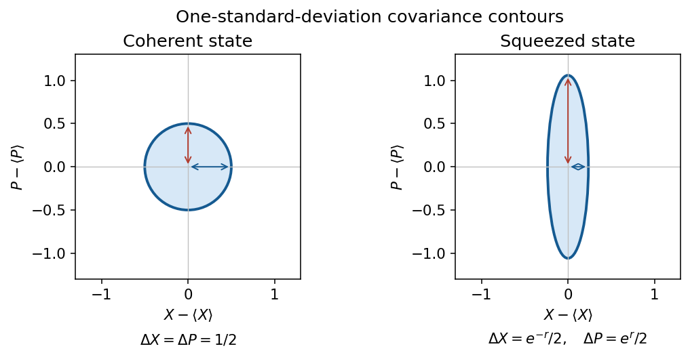

<h1 id="2/b/solution">Solution</h1>

↑ **Parent:** [B](../b.md)

A single-mode [coherent state](../../../../../coherent-state.md) is an [annihilation operator](../../../../../annihilation-operator.md) eigenstate:

$$
|\alpha\rangle=e^{-|\alpha|^2/2}\sum_{n=0}^\infty\frac{\alpha^n}{\sqrt{n!}}|n\rangle,\qquad a|\alpha\rangle=\alpha|\alpha\rangle.
$$

Its [photon statistics](../../../../../photon-statistics.md) are [Poisson distribution](../../../../../poisson-distribution.md): $\langle n\rangle=\operatorname{Var}n=|\alpha|^2$. For [optical quadratures](../../../../../optical-quadrature.md) $X=(a+a^\dagger)/2$, $P=(a-a^\dagger)/(2i)$, one has $[X,P]=i/2$ and $\operatorname{Var}X=\operatorname{Var}P=1/4$. Its field mean oscillates classically while retaining vacuum fluctuations.[§4.4.2, printed pp.132–133: coherent states and driving a harmonic oscillator](../../../../../topics-in-quantum-mechanics-by-david-tong.md)[Slides3,9–12, physical PDF pp.2,5–6: quadrature fluctuations and squeezing](../../../../../quantum-optical-communication-lecture-6-by-jeffrey-h-shapiro.md)

A [classical mixture of coherent states](../../../../../classical-mixture-of-coherent-states.md) has a nonnegative [Glauber-Sudarshan representation](../../../../../glauber-sudarshan-representation.md). A [nonclassical state of light](../../../../../nonclassical-state-of-light.md) cannot be represented that way. Examples are a [squeezed vacuum state](../../../../../squeezed-vacuum-state.md), with quadrature variances $e^{-2r}/4$ and $e^{2r}/4$, and a nonvacuum [number state](../../../../../number-state.md), with zero [photon number](../../../../../photon-number.md) variance. **Noise below the vacuum level in one quadrature, sub-Poisson number noise, or [photon antibunching](../../../../../photon-antibunching.md) can witness nonclassicality.** For $|n\rangle$, $g^{(2)}(0)=1-1/n<1$; coherent light has $g^{(2)}(0)=1$. [Thermal light](../../../../../thermal-light.md) has excess noise but is a classical mixture: noncoherent does not by itself mean nonclassical.

**[Figure 1](#2/b/image-coherent-light-has-equal-vacuum-quadrature-noise-squeezing-reduces-one-variance-and-increases-the-other). Coherent light has equal vacuum quadrature noise; squeezing reduces one variance and increases the other**. [Source](paper-1-aqp2013-quadrature-noise.py).

## ↑ Ancestors (14)

1. [B](../b.md)
2. [2](../../2.md)
3. [Paper 1](../../../paper-1-split.md)
4. [2013](../../../split.md)
5. [Past exam of the advanced quantum physics course of the University of Cambridge](../../../../split.md)
6. [Advanced Quantum Physics course of the University of Cambridge](../../../../../advanced-quantum-physics-course-of-the-university-of-cambridge.md)
7. [Physics course of the year 3 of the natural sciences course of the University of Cambridge](../../../../../physics-course-of-the-year-3-of-the-natural-sciences-course-of-the-university-of-cambridge.md)
8. [Year 3 of the natural sciences course of the University of Cambridge](../../../../../year-3-of-the-natural-sciences-course-of-the-university-of-cambridge.md)
9. [Year of the natural sciences course of the University of Cambridge](../../../../../year-of-the-natural-sciences-course-of-the-university-of-cambridge.md)
10. [Natural sciences course of the University of Cambridge](../../../../../natural-sciences-course-of-the-university-of-cambridge.md)
11. [Course of the University of Cambridge](../../../../../course-of-the-university-of-cambridge.md)
12. [University of Cambridge](../../../../../university-of-cambridge-split.md)
13. [List of universities](../../../../../list-of-universities.md)
14. [Codex Wiki](../../../../../split.md)
