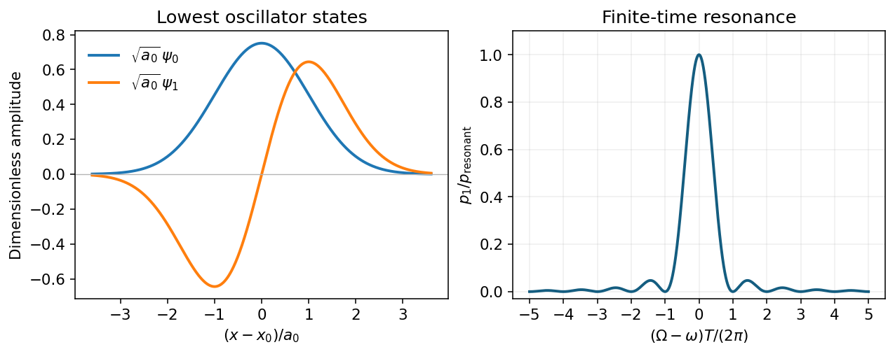

<h1 id="3/solution">Solution</h1>

↑ **Parent:** [3](../3.md)

With $y=x-x_0$ and [oscillator length](../../../../oscillator-length.md) $a_0=\sqrt{\hbar/(m\omega)}$, the first two [harmonic oscillator eigenfunctions](../../../../harmonic-oscillator-eigenfunction.md) and [energies](../../../../energy-split.md) are

$$
\psi_0=\frac{e^{-y^2/(2a_0^2)}}{\pi^{1/4}\sqrt{a_0}},\qquad
\psi_1=\sqrt2\frac{y}{a_0}\psi_0,\qquad
\boxed{E_0=\frac{\hbar\omega}{2},\quad E_1=\frac{3\hbar\omega}{2}.}
$$

The [ground state](../../../../ground-state.md) is even and nodeless; the first excited state is odd with one [node of a wavefunction](../../../../node-of-a-wavefunction.md). Their rms widths are $a_0/\sqrt2$ and $\sqrt{3/2}\,a_0$. Also, $m\omega^2a_0^2\sim\hbar\omega$ gives the characteristic extent directly.

For the [shaken harmonic trap](../../../../shaken-harmonic-trap.md), expanding about the unshifted [Hamiltonian](../../../../hamiltonian.md) gives

$$
H'(t)=-m\omega^2\varepsilon x\cos\Omega t+\frac12m\omega^2\varepsilon^2\cos^2\Omega t\,I
\quad(0\le t\le T).
$$

The scalar term gives only a common phase and no transitions. In [time-dependent perturbation theory](../../../../time-dependent-perturbation-theory.md), initially $c_0=1$, $c_{n\ne0}=0$ and the oscillatory factor for $0\to1$ is $e^{i(E_1-E_0)t/\hbar}=e^{i\omega t}$. Thus

$$
c_1(T)=-\frac{\varepsilon m\omega^2}{i\hbar}\langle1|x|0\rangle\int_0^T e^{i\omega t}\cos\Omega t\,dt.
$$

The odd operator $x$ makes transitions to even $n>0$ vanish by [parity](../../../../parity.md). In fact the [first-order selection rule for a linearly driven oscillator](../../../../first-order-selection-rule-for-a-linearly-driven-oscillator.md) is stronger: since $x=a_0(a+a^\dagger)/\sqrt2$,

$$
\langle n|x|0\rangle=\frac{a_0}{\sqrt2}\delta_{n1}.
$$

**All excited $n\ne1$ amplitudes vanish at first order**, including odd $n>1$. This assertion does not apply to the surviving $c_0$ or to higher perturbative orders.

Put $\delta=\omega-\Omega$, $\Sigma=\omega+\Omega$. The exact first-order time integral is

$$
I(T)=e^{i\delta T/2}\frac{\sin(\delta T/2)}{\delta}
+e^{i\Sigma T/2}\frac{\sin(\Sigma T/2)}{\Sigma}.
$$

Near resonance, the second term oscillates rapidly at approximately $2\omega$ and is bounded by $1/\Sigma$, whereas the first grows as $T/2$ on resonance. Thus $\omega T\gg1$ justifies the [rotating-wave approximation](../../../../rotating-wave-approximation.md), $\cos\Omega t\mapsto e^{-i\Omega t}/2$. At zeros of the resonant term, the omitted small contribution can dominate the residual; the approximation has no uniform relative-error bound there.

Using the requested order-one approximation $\langle1|x|0\rangle\simeq a_0$ and $m\omega^2a_0/\hbar=\omega/a_0$ gives the [square-pulse resonance profile](../../../../square-pulse-resonance-profile.md)

$$
\boxed{p_1\simeq\left(\frac{\varepsilon\omega}{a_0}\right)^2\frac{\sin^2(\delta T/2)}{\delta^2},\qquad
p_1(\omega)\simeq\left(\frac{\varepsilon\omega T}{2a_0}\right)^2.}
$$

The exact [harmonic oscillator](../../../../simple-harmonic-motion.md) matrix element instead gives **half this probability**. The finite central maximum is at $\Omega=\omega$; first zeros are at $|\Omega-\omega|=2\pi/T$, with smaller side lobes and a $1/\delta^2$ envelope. Increasing $T$ narrows the peak as $1/T$ and increases its height as $T^2$, as long as [weak resonant driving](../../../../weak-resonant-driving.md) keeps $p_1\ll1$. Small displacement alone does not ensure this for arbitrarily long $T$; near resonance one also needs $\varepsilon\omega T/a_0\ll1$.

**[Figure 2](#3/image-even-and-odd-oscillator-wavefunctions-and-the-finite-duration-sinc-squared-excitation-profile). Even and odd oscillator wavefunctions and the finite-duration sinc-squared excitation profile**. [Source](paper-1-aqp2013-oscillator-resonance.py).

## ↑ Ancestors (13)

1. [3](../3.md)
2. [Paper 1](../../paper-1-split.md)
3. [2013](../../split.md)
4. [Past exam of the advanced quantum physics course of the University of Cambridge](../../../split.md)
5. [Advanced Quantum Physics course of the University of Cambridge](../../../../advanced-quantum-physics-course-of-the-university-of-cambridge.md)
6. [Physics course of the year 3 of the natural sciences course of the University of Cambridge](../../../../physics-course-of-the-year-3-of-the-natural-sciences-course-of-the-university-of-cambridge.md)
7. [Year 3 of the natural sciences course of the University of Cambridge](../../../../year-3-of-the-natural-sciences-course-of-the-university-of-cambridge.md)
8. [Year of the natural sciences course of the University of Cambridge](../../../../year-of-the-natural-sciences-course-of-the-university-of-cambridge.md)
9. [Natural sciences course of the University of Cambridge](../../../../natural-sciences-course-of-the-university-of-cambridge.md)
10. [Course of the University of Cambridge](../../../../course-of-the-university-of-cambridge.md)
11. [University of Cambridge](../../../../university-of-cambridge-split.md)
12. [List of universities](../../../../list-of-universities.md)
13. [Codex Wiki](../../../../split.md)
