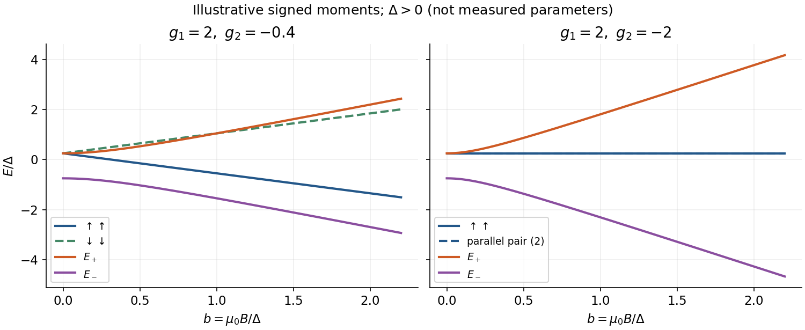
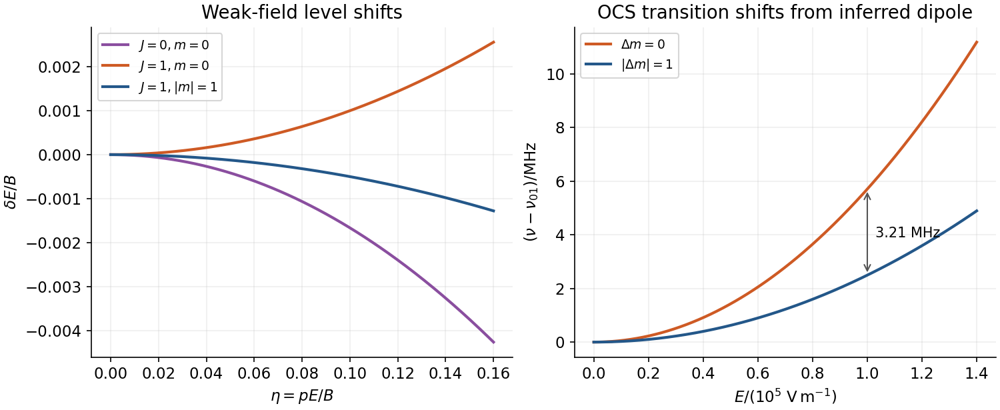

# Paper 1

↑ **Parent:** [2014](../2014.md)

[Original examination PDF, physical pages295–298](https://www.whatdotheyknow.com/request/natural_science_tripos_physics_e_2/response/2340776/attach/2/FOI%202023%20399%20Zahid%20materials.pdf?cookie_passthrough=1#page=295)

**Table of contents**

- [1](#1)
  - [a](#1/a)
    - [Solution](#1/a/solution)
  - [b](#1/b)
    - [Solution](#1/b/solution)
  - [c](#1/c)
    - [Solution](#1/c/solution)
- [2](#2)
  - [a](#2/a)
    - [Solution](#2/a/solution)
  - [b](#2/b)
    - [Solution](#2/b/solution)
  - [c](#2/c)
    - [Solution](#2/c/solution)
- [3](#3)
  - [Solution](#3/solution)
  - [a](#3/a)
    - [Solution](#3/a/solution)
  - [b](#3/b)
    - [Solution](#3/b/solution)
  - [Solution (energy sketch)](#3/solution-energy-sketch)
- [4](#4)
  - [Solution](#4/solution)

## 1

↑ **Parent:** [Paper 1](paper-1.md)

<h3 id="1/a">a</h3>

↑ **Parent:** [1](#1)

<h4 id="1/a/solution">Solution</h4>

↑ **Parent:** [A](#1/a)

The normalized [quantum harmonic oscillator](../../quantum-harmonic-oscillator.md) [ground state](../../quantum-mechanics.md#ground-state) has $|A|^2=\sqrt{m\omega/(\pi\hbar)}$ and [energy](../../energy.md) $E_0=\hbar\omega/2$. Its [classical turning points](../../analysis.md#classical-turning-point) are $x=\pm\sqrt{\hbar/(m\omega)}$. With $y=x\sqrt{m\omega/\hbar}$, the [ground-state oscillator probability beyond the turning points](../../quantum-harmonic-oscillator.md#ground-state-oscillator-probability-beyond-the-turning-points) is

$$
\boxed{P=\frac2{\sqrt\pi}\int_1^\infty e^{-y^2}\,dy=1-\operatorname{erf}(1)\simeq0.16.}
$$

The stated rounded [error function](../../integral.md#error-function) gives $0.16$; the more precise Gaussian integral is $0.15730$.

<h3 id="1/b">b</h3>

↑ **Parent:** [1](#1)

<h4 id="1/b/solution">Solution</h4>

↑ **Parent:** [B](#1/b)

An impulse integrated across its full support produces the [impulsive quantum kick](../../quantum-mechanics.md#impulsive-quantum-kick) $K=e^{-i\hat U/\hbar}$. Thus the leading transition amplitude is $-iU_{21}/\hbar$ and

$$
\boxed{P_{1\to2}=\frac{|U_{21}|^2}{\hbar^2}+O(|U_{21}/\hbar|^4).}
$$

Here $U_{21}$ has units of action. The [off-diagonal two-state impulse](../../quantum-mechanics.md#off-diagonal-two-state-impulse) is exactly $P=\sin^2(|U_{21}|/\hbar)$ for a Hermitian two-state impulse with zero diagonal. No [energy](../../energy.md) denominator occurs: the impulse is instantaneous.

<h3 id="1/c">c</h3>

↑ **Parent:** [1](#1)

<h4 id="1/c/solution">Solution</h4>

↑ **Parent:** [C](#1/c)

For two equivalent $p$ [electrons](../../physics.md#electron), antisymmetry permits

$$
\boxed{{}^3P_{0,1,2},\qquad{}^1D_2,\qquad{}^1S_0.}
$$

Their $9+5+1=15$ states exhaust $\binom62$. [Hund's rules](../../chemistry.md#hund-s-rules) first maximize [spin](../../angular-momentum-operator.md#spin), then orbital [angular momentum](../../momentum.md#angular-momentum); the less-than-half-filled $p$ shell puts the smallest $J$ lowest. Hence the ground level is **${}^3P_0$**. This is the [allowed LS terms of a p-squared configuration](../../angular-momentum-operator.md#allowed-ls-terms-of-a-p-squared-configuration).[Ground configuration2s²2p² and its³P,¹D,¹S levels](../../physics-bibliography.md#energy-levels-of-neutral-carbon-by-national-institute-of-standards-and-technology)

## 2

↑ **Parent:** [Paper 1](paper-1.md)

<h3 id="2/a">a</h3>

↑ **Parent:** [2](#2)

<h4 id="2/a/solution">Solution</h4>

↑ **Parent:** [A](#2/a)

The [postulates of quantum mechanics](../../quantum-mechanics.md#postulates-of-quantum-mechanics) assign a pure state to a normalized ray in a complex [Hilbert space](../../hilbert-space.md), and an observable to a [self-adjoint operator](../../linear-operator-theory.md#self-adjoint-operator). A spectral outcome projector $P_a$ has [Born rule](../../wave-function.md#born-rule) [probability](../../probability-theory.md#probability) $p_a=\langle\psi|P_a|\psi\rangle$. An ideal [projective measurement](../../quantum-measurement.md#projective-measurement) updates the state to $P_a|\psi\rangle/\sqrt{p_a}$ when $p_a>0$; degeneracy requires the full outcome projector.

Between measurements, an isolated system obeys $i\hbar\partial_t|\psi\rangle=H|\psi\rangle$, giving unitary evolution. Composite systems use [tensor products](../../multilinear-algebra.md#tensor-product); identical particles additionally obey the appropriate exchange symmetry. Mixed preparations use a [density matrix](../../density-matrix.md), with $p_a=\operatorname{tr}(\rho P_a)$. These postulates require a specified [Hamiltonian](../../hamiltonian-mechanics.md#hamiltonian) and measurement model; they do not assign those automatically.[Quantum states, observables, measurement and Schrödinger evolution](../../physics-bibliography.md#quantum-mechanics-by-david-tong)

<h3 id="2/b">b</h3>

↑ **Parent:** [2](#2)

<h4 id="2/b/solution">Solution</h4>

↑ **Parent:** [B](#2/b)

The [central field approximation](../../atomic-physics.md#central-field-approximation) replaces the anisotropic many-electron environment by an average spherical potential, giving one-electron orbitals labelled by $n,l,m$. Screening changes the effective radial attraction and removes the pure Coulomb degeneracy between different $l$.

The [Hartree method](../../quantum-mechanics.md#hartree-method) improves the potential self-consistently. For normalized occupied orbitals,

$$
\left[-\frac{\hbar^2\nabla^2}{2m_e}-\frac{Ze^2}{4\pi\varepsilon_0r}+\sum_{j\ne i}\frac{e^2}{4\pi\varepsilon_0}\int\frac{|\phi_j(\mathbf r')|^2}{|\mathbf r-\mathbf r'|}\,d^3r'\right]\phi_i=\epsilon_i\phi_i.
$$

Guess orbitals, construct their mean fields, solve the [Hartree equations](../../quantum-mechanics.md#hartree-equations), and iterate to convergence. The $j\ne i$ sum excludes self-interaction in this product-state model. A spherical average can enforce the central-field specialization. A [Hartree product state](../../quantum-mechanics.md#hartree-product-state) omits fermionic exchange and dynamical correlation; [Hartree-Fock method](../../chemistry.md#hartree-fock-method) adds antisymmetry and exchange through a [Slater determinant](../../tensor-product-of-quantum-systems.md#slater-determinant). Converged orbital [eigenvalues](../../linear-operator-theory.md#eigenvalue) must not simply be added as the total [energy](../../energy.md), because that double counts pair interactions.[Authored Atoms chapter,§7.3.1: Hartree self-consistency and product-state limitations](../../physics-bibliography.md#topics-in-quantum-mechanics-by-david-tong)

<h3 id="2/c">c</h3>

↑ **Parent:** [2](#2)

<h4 id="2/c/solution">Solution</h4>

↑ **Parent:** [C](#2/c)

A [laser](../../laser.md) combines pumping, an amplifying medium and optical feedback. [Stimulated emission](../../laser.md#stimulated-emission) adds photons to an occupied optical mode; net amplification requires [population inversion](../../laser.md#population-inversion) between the relevant levels after accounting for their degeneracies. Pumping through additional levels and rapid lower-level relaxation can sustain inversion; a closed [two-level system](../../canonical-ensemble.md#two-level-system) under steady incoherent resonant pumping cannot sustain it.

An [optical resonator](../../optical-instrument.md#optical-cavity) selects modes and feeds light back through the gain medium. For intensity gain coefficient $g$, internal intensity loss $\alpha_i$, length $L$ and mirror intensity reflectivities $R_1,R_2$, the [round-trip laser threshold condition](../../laser.md#round-trip-laser-threshold-condition) is

$$
\boxed{R_1R_2e^{2(g-\alpha_i)L}=1,\qquad g_{\rm th}=\alpha_i+\frac1{2L}\log\frac1{R_1R_2}.}
$$

Above threshold, saturation limits gain and a partially transmitting mirror provides output. Typical properties are strong directionality, substantial coherence and narrow bandwidth; multiple modes and pulsed operation are possible, so perfect monochromaticity is not universal.[Chapter7,§§7.1–7.2 and [laser threshold](../../laser.md#laser-threshold): feedback, gain and level schemes](../../physics-bibliography.md#fundamentals-of-photonics-and-quantum-electronics-lecture-notes-by-franz-x-kartner)

**[Figure 1](#2/c/image-pumping-sustains-gain-while-a-resonator-supplies-feedback-and-output-coupling). Pumping sustains gain while a resonator supplies feedback and output coupling**. [Source](paper-1-aqp2014-laser-principle.py).

## 3

↑ **Parent:** [Paper 1](paper-1.md)

<h3 id="3/solution">Solution</h3>

↑ **Parent:** [3](#3)

For [spin](../../angular-momentum-operator.md#spin) one-half, $s_\pm=s_x\pm is_y=(\hbar/2)(\sigma_x\pm i\sigma_y)$, hence

$$
\boxed{s_+=\hbar\begin{pmatrix}0&1\\0&0\end{pmatrix},\qquad s_-=\hbar\begin{pmatrix}0&0\\1&0\end{pmatrix}.}
$$

They raise or lower the [spin](../../angular-momentum-operator.md#spin) projection by one unit of $\hbar$ and annihilate the corresponding endpoint. The exchange identity $\boldsymbol\sigma_1\cdot\boldsymbol\sigma_2=\sigma_{1z}\sigma_{2z}+2(\sigma_{1+}\sigma_{2-}+\sigma_{1-}\sigma_{2+})$ preserves total [spin](../../angular-momentum-operator.md#spin) projection.

Write $\Delta=\Delta E$, $u=\mu_0B(g_1+g_2)$ and $w=\mu_0B(g_1-g_2)$. In the **listed** order $(\uparrow\uparrow,\downarrow\downarrow,\uparrow\downarrow,\downarrow\uparrow)$, direct action gives

$$
H=\begin{pmatrix}
\Delta/4-u/2&0&0&0\\
0&\Delta/4+u/2&0&0\\
0&0&-\Delta/4-w/2&\Delta/2\\
0&0&\Delta/2&-\Delta/4+w/2
\end{pmatrix}.
$$

**The printed matrix instead uses $(\uparrow\uparrow,\uparrow\downarrow,\downarrow\uparrow,\downarrow\downarrow)$.** Permuting the listed indices to $(1,3,4,2)$ recovers its central block and diagonal entries. This is a basis-order mismatch in the source, not a different [Hamiltonian](../../hamiltonian-mechanics.md#hamiltonian).

The [two-spin exchange spectrum with unequal signed magnetic moments](../../angular-momentum-operator.md#two-spin-exchange-spectrum-with-unequal-signed-magnetic-moments) is

$$
\boxed{E_{\uparrow\uparrow}=\frac\Delta4-\frac u2,\quad E_{\downarrow\downarrow}=\frac\Delta4+\frac u2,\quad E_\pm=-\frac\Delta4\pm\frac12\sqrt{\Delta^2+w^2}.}
$$

Use the products $g_j\mu_0$ as the signed magnetic coefficients in the stated [Hamiltonian](../../hamiltonian-mechanics.md#hamiltonian). Opposite physical charges must be represented in those signs; they do not by themselves imply equal moment magnitudes. Here $\mu_0$ denotes the source's magneton, not vacuum permeability.

<h3 id="3/a">a</h3>

↑ **Parent:** [3](#3)

<h4 id="3/a/solution">Solution</h4>

↑ **Parent:** [A](#3/a)

At zero field, the [spin-one-half triplet state](../../angular-momentum-operator.md#spin-one-half-triplet-state) has [energy](../../energy.md) $\Delta/4$ and degeneracy three; the [spin-one-half singlet state](../../angular-momentum-operator.md#spin-one-half-singlet-state) has [energy](../../energy.md) $-3\Delta/4$ and degeneracy one:

$$
\boxed{E_t=\Delta/4\ (3),\qquad E_s=-3\Delta/4\ (1).}
$$

For $\Delta>0$ the singlet is lower; for $\Delta<0$ the triplet is lower. If $\Delta=0$, all four states coincide.

<h3 id="3/b">b</h3>

↑ **Parent:** [3](#3)

<h4 id="3/b/solution">Solution</h4>

↑ **Parent:** [B](#3/b)

For $|w|\gg|\Delta|$, the mixed states approach opposite-spin product states and

$$
\boxed{E_\pm\simeq-\frac\Delta4\pm\frac{|w|}{2},\qquad E_{\uparrow\uparrow,\downarrow\downarrow}=\frac\Delta4\mp\frac u2.}
$$

The omitted mixed-branch correction is of order $\Delta^2/|w|$. The four levels are **generically nondegenerate**, apart from special moment choices or crossings.

For equal-and-opposite signed moments, $g_2=-g_1$, $u=0$ and the parallel-spin level remains exactly twofold degenerate at $\Delta/4$; the other two approach $-\Delta/4\pm|g_1\mu_0B|$. Equal moment magnitudes are an extra assumption, not implied by opposite charges alone. If $g_1=g_2$, the differential Zeeman term vanishes and the singlet/triplet-zero block stays unmixed by the field. This is the [strong-field limit of a two-spin exchange spectrum](../../angular-momentum-operator.md#strong-field-limit-of-a-two-spin-exchange-spectrum).

<h3 id="3/solution-energy-sketch">Solution (energy sketch)</h3>

↑ **Parent:** [3](#3)

The square-root branches avoid one another when $\Delta\ne0$; crossings with a parallel-spin branch are allowed because total [spin](../../angular-momentum-operator.md#spin) projections differ. At zero field the positive-$\Delta$ sketch has one lower singlet and a triplet above it. The source supplies no numerical moment ratio, so the two panels show explicit illustrative signed choices, including the exactly compensated case.

**[Figure 2](#3/image-two-spin-exchange-and-zeeman-energies-depend-on-the-signed-moment-ratio-with-an-exact-parallel-spin-degeneracy-for-opposite-equal-moments). Two-spin exchange and Zeeman energies depend on the signed moment ratio, with an exact parallel-spin degeneracy for opposite equal moments**. [Source](paper-1-aqp2014-spin-spectrum.py).

## 4

↑ **Parent:** [Paper 1](paper-1.md)

<h3 id="4/solution">Solution</h3>

↑ **Parent:** [4](#4)

The quoted expansion is [nondegenerate perturbation theory](../../quantum-mechanics.md#nondegenerate-perturbation-theory) for a known isolated eigenstate of a time-independent [Hamiltonian](../../hamiltonian-mechanics.md#hamiltonian). A useful small-mixing condition is $|\langle k|H_1|i\rangle|\ll|E_i-E_k|$ for coupled states. First order is a diagonal expectation value; second order describes virtual mixing. A degenerate or nearly degenerate coupled subspace must first be treated by diagonalization there. Symmetry can eliminate terms, and convergence still needs checking. Ground-state second-order shifts are nonpositive because all denominators are negative.[Non-degenerate perturbation theory and its breakdown at coupled degeneracies](../../physics-bibliography.md#quantum-mechanics-by-richard-fitzpatrick)

For the [rotational Stark effect](../../mathematical-physics.md#rotational-stark-effect), $H_1=-pE\cos\theta$, where $\theta$ is the **[polar angle](../../multivariable-calculus.md#polar-angle) to the field**. The source calls it azimuthal, which is inconsistent with this coupling. Rotor states have [parity](../../quantum-mechanics.md#parity) $(-1)^J$, while $\cos\theta$ is odd, so every first-order [matrix element](../../vector-space.md#matrix-element) within one fixed-$J$ manifold vanishes. The $m$ degeneracy therefore causes no first-order splitting.

Only $J\pm1$ with the same $m$ contribute in second order. Using their [energy](../../energy.md) differences $2BJ$ and $-2B(J+1)$,

$$
\delta E_{Jm}^{(2)}=\frac{(pE)^2}{2B}\left[\frac{J^2-m^2}{J(2J-1)(2J+1)}-\frac{(J+1)^2-m^2}{(J+1)(2J+1)(2J+3)}\right].
$$

For $J\ge1$ this simplifies to the [quadratic Stark shift of a polar linear rotor](../../mathematical-physics.md#quadratic-stark-shift-of-a-polar-linear-rotor),

$$
\boxed{\delta E_{Jm}^{(2)}=\frac{(pE)^2[J(J+1)-3m^2]}{2BJ(J+1)(2J-1)(2J+3)}.}
$$

For $J=0$, only $J'=1,m=0$ contributes, with squared angular [matrix element](../../vector-space.md#matrix-element) $1/3$ and denominator $-2B$:

$$
\boxed{\delta E_{00}^{(2)}=-\frac{(pE)^2}{6B}.}
$$

Here $B$ is the rotational [energy](../../energy.md) constant, unlike the [magnetic field](../../magnetic-field.md) in Question3.

The unperturbed line gives $B/h=6.08\,\mathrm{GHz}$. The $J=1$ shifts are $(pE)^2/(10B)$ for $m=0$ and $-(pE)^2/(20B)$ for $m=\pm1$. Subtracting the common lower-state shift gives transition shifts $4(pE)^2/(15Bh)$ and $7(pE)^2/(60Bh)$. Their separation determines the [dipole moment from a rotational Stark doublet](../../mathematical-physics.md#dipole-moment-from-a-rotational-stark-doublet):

$$
\Delta\nu=\frac{3(pE)^2}{20Bh},\qquad\boxed{p=\frac hE\sqrt{\frac{20}{3}\frac Bh\Delta\nu}=2.39\times10^{-30}\,\mathrm{C\,m}\simeq0.717\,\mathrm D.}
$$

The $\mathrm D$ unit is the [debye](../../electronegativity.md#debye-unit). Using external $h=6.62607015\times10^{-34}\,\mathrm{J\,s}$ and $1\,\mathrm D=3.33564\times10^{-30}\,\mathrm{C\,m}$ gives $pE/B\simeq0.0593$, consistent with weak-field perturbation theory. The two shifted [frequencies](../../wave.md#frequency) are about $12.165707$ and $12.162497\,\mathrm{GHz}$; [polarization](../../wave.md#polarization-waves) selects $\Delta m=0$ or $\pm1$. The inferred value is a magnitude; these shifts do not determine the dipole's sign.[Exact SI Planck constant](../../physics-bibliography.md#codata-recommended-values-of-the-fundamental-physical-constants-2022-by-national-institute-of-standards-and-technology)[Section5: [debye](../../electronegativity.md#debye-unit) conversion](../../chemistry-bibliography.md#triatomic-spectral-database-by-national-institute-of-standards-and-technology)

**[Figure 3](#4/image-opposite-parity-mixing-produces-quadratic-rotor-shifts-and-a-polarization-dependent-rotational-doublet). Opposite-parity mixing produces quadratic rotor shifts and a polarization-dependent rotational doublet**. [Source](paper-1-aqp2014-rotor-stark-shifts.py).

## ↑ Ancestors (11)

1. [2014](../2014.md)
2. [Past exam of the advanced quantum physics course of the University of Cambridge](../../past-exam-of-the-advanced-quantum-physics-course-of-the-university-of-cambridge.md)
3. [Advanced Quantum Physics course of the University of Cambridge](../../university-of-cambridge.md#advanced-quantum-physics-course-of-the-university-of-cambridge)
4. [Physics course of the year 3 of the natural sciences course of the University of Cambridge](../../university-of-cambridge.md#physics-course-of-the-year-3-of-the-natural-sciences-course-of-the-university-of-cambridge)
5. [Year 3 of the natural sciences course of the University of Cambridge](../../university-of-cambridge.md#year-3-of-the-natural-sciences-course-of-the-university-of-cambridge)
6. [Year of the natural sciences course of the University of Cambridge](../../university-of-cambridge.md#year-of-the-natural-sciences-course-of-the-university-of-cambridge)
7. [Natural sciences course of the University of Cambridge](../../university-of-cambridge.md#natural-sciences-course-of-the-university-of-cambridge)
8. [Course of the University of Cambridge](../../university-of-cambridge.md#course-of-the-university-of-cambridge)
9. [University of Cambridge](../../university-of-cambridge.md)
10. [List of universities](../../README.md#list-of-universities)
11. [Codex Wiki](../../README.md)
