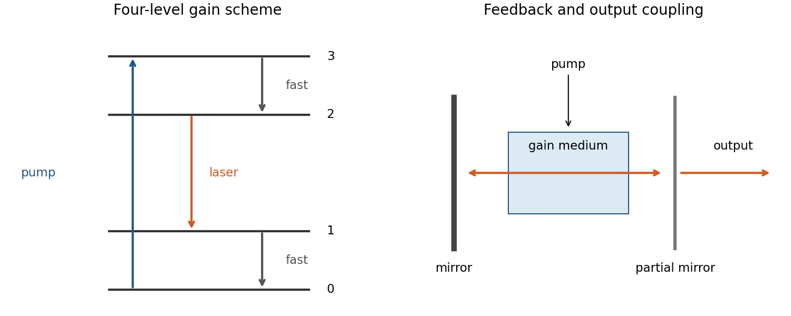

<h1 id="2/c/solution">Solution</h1>

↑ **Parent:** [C](../c.md)

A [laser](../../../../../laser-split.md) combines pumping, an amplifying medium and optical feedback. [Stimulated emission](../../../../../stimulated-emission.md) adds photons to an occupied optical mode; net amplification requires [population inversion](../../../../../population-inversion.md) between the relevant levels after accounting for their degeneracies. Pumping through additional levels and rapid lower-level relaxation can sustain inversion; a closed [two-level system](../../../../../two-level-system.md) under steady incoherent resonant pumping cannot sustain it.

An [optical resonator](../../../../../optical-cavity.md) selects modes and feeds light back through the gain medium. For intensity gain coefficient $g$, internal intensity loss $\alpha_i$, length $L$ and mirror intensity reflectivities $R_1,R_2$, the [round-trip laser threshold condition](../../../../../round-trip-laser-threshold-condition.md) is

$$
\boxed{R_1R_2e^{2(g-\alpha_i)L}=1,\qquad g_{\rm th}=\alpha_i+\frac1{2L}\log\frac1{R_1R_2}.}
$$

Above threshold, saturation limits gain and a partially transmitting mirror provides output. Typical properties are strong directionality, substantial coherence and narrow bandwidth; multiple modes and pulsed operation are possible, so perfect monochromaticity is not universal.[Chapter7,§§7.1–7.2 and [laser threshold](../../../../../laser-threshold.md): feedback, gain and level schemes](../../../../../fundamentals-of-photonics-and-quantum-electronics-lecture-notes-by-franz-x-kartner.md)

**[Figure 1](#2/c/image-pumping-sustains-gain-while-a-resonator-supplies-feedback-and-output-coupling). Pumping sustains gain while a resonator supplies feedback and output coupling**. [Source](paper-1-aqp2014-laser-principle.py).

## ↑ Ancestors (14)

1. [C](../c.md)
2. [2](../../2.md)
3. [Paper 1](../../../paper-1-split.md)
4. [2014](../../../split.md)
5. [Past exam of the advanced quantum physics course of the University of Cambridge](../../../../split.md)
6. [Advanced Quantum Physics course of the University of Cambridge](../../../../../advanced-quantum-physics-course-of-the-university-of-cambridge.md)
7. [Physics course of the year 3 of the natural sciences course of the University of Cambridge](../../../../../physics-course-of-the-year-3-of-the-natural-sciences-course-of-the-university-of-cambridge.md)
8. [Year 3 of the natural sciences course of the University of Cambridge](../../../../../year-3-of-the-natural-sciences-course-of-the-university-of-cambridge.md)
9. [Year of the natural sciences course of the University of Cambridge](../../../../../year-of-the-natural-sciences-course-of-the-university-of-cambridge.md)
10. [Natural sciences course of the University of Cambridge](../../../../../natural-sciences-course-of-the-university-of-cambridge.md)
11. [Course of the University of Cambridge](../../../../../course-of-the-university-of-cambridge.md)
12. [University of Cambridge](../../../../../university-of-cambridge-split.md)
13. [List of universities](../../../../../list-of-universities.md)
14. [Codex Wiki](../../../../../split.md)
