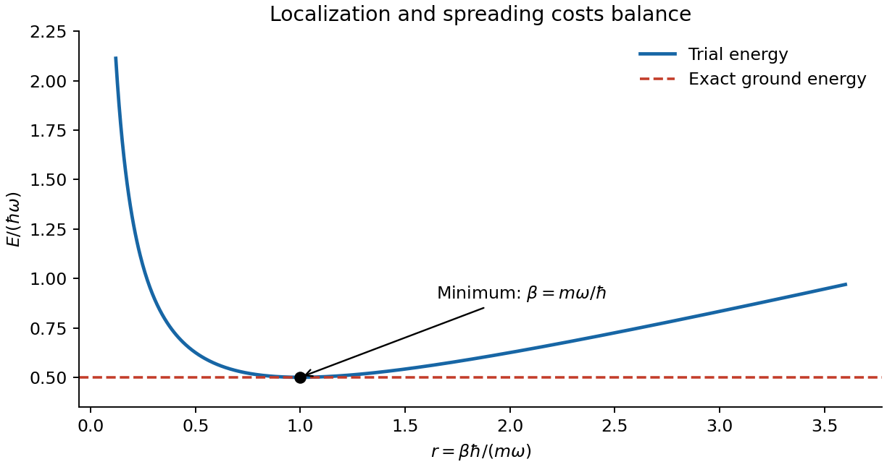
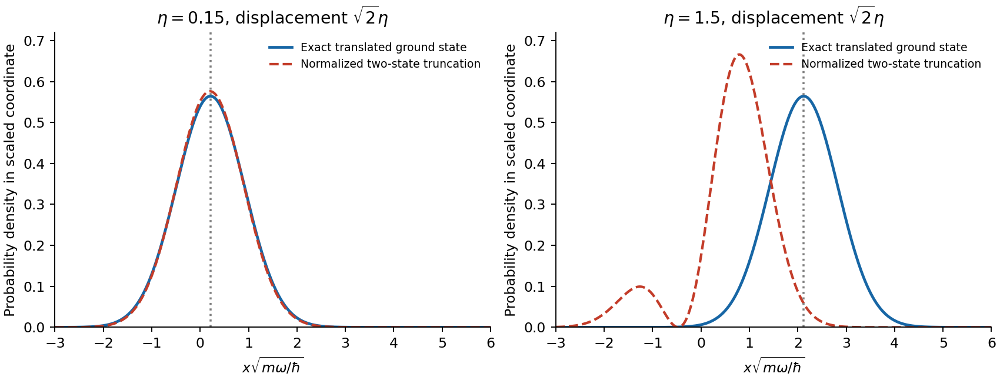
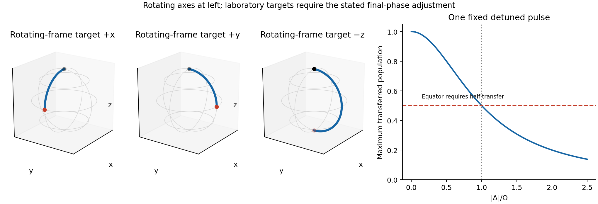

# Paper 1

↑ **Parent:** [2015](../2015.md)

Original paper: [Advanced Quantum Physics, 27 May 2015; physical PDF pages 343–346](https://www.whatdotheyknow.com/request/natural_science_tripos_physics_e_2/response/2340776/attach/2/FOI%202023%20399%20Zahid%20materials.pdf?cookie_passthrough=1#page=343).

**Table of contents**

- [1](#1)
  - [a](#1/a)
    - [Solution](#1/a/solution)
  - [b](#1/b)
    - [Solution](#1/b/solution)
  - [c](#1/c)
    - [Solution](#1/c/solution)
- [2](#2)
  - [a](#2/a)
    - [Solution](#2/a/solution)
  - [b](#2/b)
    - [Solution](#2/b/solution)
  - [c](#2/c)
    - [Solution](#2/c/solution)
- [3](#3)
  - [Solution](#3/solution)
- [4](#4)
  - [Solution](#4/solution)
  - [i](#4/i)
    - [Solution](#4/i/solution)
  - [ii](#4/ii)
    - [Solution](#4/ii/solution)
  - [iii](#4/iii)
    - [Solution](#4/iii/solution)

## 1

↑ **Parent:** [Paper 1](paper-1.md)

<h3 id="1/a">a</h3>

↑ **Parent:** [1](#1)

<h4 id="1/a/solution">Solution</h4>

↑ **Parent:** [A](#1/a)

The [Pauli exclusion principle](../../tensor-product-of-quantum-systems.md#pauli-exclusion-principle) allows each one-particle magnetic substate only once, since the [fermions](../../tensor-product-of-quantum-systems.md#fermion) share the other [quantum numbers](../../quantum-system.md#quantum-number). To maximize the total [angular momentum](../../momentum.md#angular-momentum) projection, occupy $m_j=5/2,3/2,1/2,-1/2$, giving

$$
M_{\max}=\frac52+\frac32+\frac12-\frac12=4.
$$

The corresponding [Slater determinant](../../tensor-product-of-quantum-systems.md#slater-determinant) is a [highest-weight vector](../../semisimple-lie-algebra.md#highest-weight-vector): every attempted raising operation either tries to exceed $j$ or duplicates an occupied substate and vanishes. Therefore it belongs to a multiplet with **$\boxed{J_{\max}=4}$**, not the distinguishable-particle value $4j=10$. Equivalently, four particles in a six-state shell have two holes whose maximum [angular momentum](../../momentum.md#angular-momentum) projection is $5/2+3/2=4$. The general [maximum total angular momentum of equivalent fermions](../../angular-momentum-operator.md#maximum-total-angular-momentum-of-equivalent-fermions) is $J_{\max}=Nj-N(N-1)/2$ for $N\leq2j+1$.

<h3 id="1/b">b</h3>

↑ **Parent:** [1](#1)

<h4 id="1/b/solution">Solution</h4>

↑ **Parent:** [B](#1/b)

At incident [wave number](../../wave-equation.md#wavenumber) $k$, low [kinetic energy](../../energy.md#kinetic-energy) means $ka\ll1$: the [de Broglie wavelength](../../wave-function.md#de-broglie-wavelength) is much larger than the scattering region. A generic finite-range scatterer can then be described to leading order without resolving its angular structure. In [partial-wave scattering](../../quantum-scattering.md#partial-wave-scattering), this is leading [S-wave scattering](../../quantum-scattering.md#s-wave-quantum-scattering). The $\ell=0$ [spherical harmonic](../../analysis.md#spherical-harmonic) is constant, whereas the centrifugal term $\hbar^2\ell(\ell+1)/(2mr^2)$ impedes penetration to the potential for $\ell>0$.

For a [central potential](../../energy.md#central-potential) with regular threshold behaviour, the [finite-range partial-wave threshold law](../../quantum-scattering.md#finite-range-partial-wave-threshold-law) gives $\delta_\ell=O(k^{2\ell+1})$. Thus

$$
f(\theta)=\frac1k\sum_{\ell=0}^{\infty}(2\ell+1)e^{i\delta_\ell}\sin\delta_\ell\,P_\ell(\cos\theta)
\simeq\frac{e^{i\delta_0}\sin\delta_0}{k},
$$

which is independent of scattering angle. For finite nonzero [scattering length](../../quantum-scattering.md#scattering-length-from-a-partial-wave-s-matrix) $a_s$, $f\to-a_s$ and **$d\sigma/d\Omega\to a_s^2$ is isotropic**. The potential range $a$ and [scattering length](../../quantum-scattering.md#scattering-length-from-a-partial-wave-s-matrix) $a_s$ are different quantities. The claim describes the generic leading [S-wave scattering](../../quantum-scattering.md#s-wave-quantum-scattering) limit; tuned vanishing [S-wave scattering](../../quantum-scattering.md#s-wave-quantum-scattering) amplitude or exceptional threshold resonances require separate analysis rather than a universal angular conclusion.

<h3 id="1/c">c</h3>

↑ **Parent:** [1](#1)

<h4 id="1/c/solution">Solution</h4>

↑ **Parent:** [C](#1/c)

Closed $1s^2$ and $2s^2$ subshells have $L=S=0$. In the open $2p^4$ subshell, three [electrons](../../physics.md#electron) can have parallel [spins](../../angular-momentum-operator.md#spin) in $m_\ell=-1,0,1$, and the fourth must have the opposite [spin](../../angular-momentum-operator.md#spin), giving maximum $S=1$. Treating the shell as two $p$ holes gives the same allowed terms as $p^2$; at this [spin](../../angular-momentum-operator.md#spin), antisymmetry permits $L=1$, rather than $L=2$. One can also see $M_L=1$ by placing the fourth [electron](../../physics.md#electron) in $m_\ell=1$.

[Hund's rules](../../chemistry.md#hund-s-rules) therefore select the $ {}^3P$ term. Since four [electrons](../../physics.md#electron) exceed half filling of the six-state $p$ subshell, its lowest [atomic fine-structure level](../../atomic-physics.md#atomic-fine-structure-level) has the largest $J=L+S=2$:

$$
\boxed{1s^2\,2s^2\,2p^4\;{}^3P_2,\qquad S=1,\ L=1,\ J=2.}
$$

Its zero-field magnetic degeneracy is $2J+1=5$. The experimentally tabulated neutral-oxygen ground level has precisely this term and $J$.[first configuration block, 2s2 2p4, triplet P, J=2 at zero energy](../../physics-bibliography.md#energy-levels-of-neutral-oxygen-by-national-institute-of-standards-and-technology)

## 2

↑ **Parent:** [Paper 1](paper-1.md)

<h3 id="2/a">a</h3>

↑ **Parent:** [2](#2)

<h4 id="2/a/solution">Solution</h4>

↑ **Parent:** [A](#2/a)

The [quantum variational principle](../../quantum-mechanics.md#quantum-variational-principle) turns the ground-state problem into minimization of a [Rayleigh quotient](../../linear-operator-theory.md#rayleigh-quotient):

$$
E[\psi]=\frac{\langle\psi|H|\psi\rangle}{\langle\psi|\psi\rangle}\geq E_0.
$$

The [Hamiltonian](../../hamiltonian-mechanics.md#hamiltonian) must be a [self-adjoint operator](../../linear-operator-theory.md#self-adjoint-operator) bounded below, and the nonzero trial state must have finite form [energy](../../energy.md). Expanding a normalized trial state in exact [energy eigenstates](../../energy-eigenvalue.md#energy-eigenstate) gives $E[\psi]=\sum_n|c_n|^2E_n$, a weighted average no smaller than $E_0$. Equality requires support only in the ground-state eigenspace. The spectral version also accommodates continuous [spectrum](../../linear-operator-theory.md#spectrum-functional-analysis); a lowest normalizable [eigenstate](../../energy-eigenvalue.md#eigenstate) is not required merely to bound the spectral infimum.

The [variational method](../../quantum-theory.md#variational-method) chooses a trial family with the correct [boundary conditions](../../differential-equation.md#boundary-condition), [fermionic exchange symmetry](../../tensor-product-of-quantum-systems.md#fermi-dirac-statistics) and other required [quantum numbers](../../quantum-system.md#quantum-number), evaluates its [energy](../../energy.md) and minimizes over its parameters. It gives an **upper bound on [ground-state energy](../../quantum-mechanics.md#ground-state-energy)**. Enlarging a nested trial family can only improve or preserve its optimal bound. A low [energy](../../energy.md) does not by itself establish a highly accurate [wavefunction](../../wave-function.md), especially near degeneracy; [energy](../../energy.md) errors are second order in small admixtures orthogonal to a nondegenerate exact [ground state](../../quantum-mechanics.md#ground-state).

For example, a normalized Gaussian trial for a one-dimensional [quantum harmonic oscillator](../../quantum-harmonic-oscillator.md) is $\psi_\beta=(\beta/\pi)^{1/4}e^{-\beta x^2/2}$, with $\beta>0$. Its [energy](../../energy.md) is

$$
E(\beta)=\frac{\hbar^2\beta}{4m}+\frac{m\omega^2}{4\beta},\qquad
\boxed{\beta_{\rm opt}=m\omega/\hbar,\quad E_{\min}=\hbar\omega/2.}
$$

The two terms balance kinetic localization cost against the potential cost of spreading out. This [Gaussian variational energy for the harmonic oscillator](../../quantum-theory.md#gaussian-variational-energy-for-the-harmonic-oscillator) happens to attain the exact answer because the family contains the exact [ground state](../../quantum-mechanics.md#ground-state).

**[Figure 1](#2/a/image-gaussian-variational-energy-and-its-exact-harmonic-oscillator-minimum). Gaussian variational energy and its exact harmonic-oscillator minimum**.

A trial expansion $\psi=\sum_j c_j\chi_j$ in a finite, possibly nonorthogonal basis gives the [generalized eigenvalue problem](../../linear-operator-theory.md#generalized-eigenvalue-problem) $H\mathbf c=ES\mathbf c$, with $H_{ij}=\langle\chi_i|H|\chi_j\rangle$ and $S_{ij}=\langle\chi_i|\chi_j\rangle$. Its lowest Ritz value minimizes the quotient in that subspace. For excited states, the [excited-state variational constraint](../../quantum-mechanics.md#excited-state-variational-constraint) imposes exact [orthogonality](../../inner-product.md#orthogonal-vectors) to the lower [eigenstates](../../energy-eigenvalue.md#eigenstate) to obtain a corresponding upper bound; the [Courant–Fischer min-max principle](../../compact-operator.md#courant-fischer-min-max-principle) yields upper bounds for ordered Ritz [eigenvalues](../../linear-operator-theory.md#eigenvalue) from a common subspace. [orthogonality](../../inner-product.md#orthogonal-vectors) only to an independently approximate [ground state](../../quantum-mechanics.md#ground-state) does not automatically provide an excited-state bound: residual true-ground-state contamination can lower the trial [energy](../../energy.md) below the desired excited [energy](../../energy.md). Symmetry can impose exact [orthogonality](../../inner-product.md#orthogonal-vectors) when the relevant states have different symmetry sectors.

<h3 id="2/b">b</h3>

↑ **Parent:** [2](#2)

<h4 id="2/b/solution">Solution</h4>

↑ **Parent:** [B](#2/b)

For a particle of charge $q$ and [mass](../../classical-mechanics.md#mass) $m$ in a uniform [magnetic field](../../magnetic-field.md) $\mathbf B=B\hat z$, [minimal coupling](../../quantum-theory.md#minimal-coupling) replaces [momentum](../../momentum.md) by $\mathbf p-q\mathbf A$. Choose [Landau gauge](../../quantum-theory.md#landau-gauge-for-a-uniform-magnetic-field) $\mathbf A=(0,Bx,0)$ and first restrict motion to the $xy$ plane. Since $p_y=\hbar k_y$ is conserved,

$$
H=\frac{p_x^2}{2m}+\frac{(\hbar k_y-qBx)^2}{2m}
=\frac{p_x^2}{2m}+\frac12m\omega_c^2(x-x_c)^2,
$$

$$
\omega_c=\frac{|qB|}{m},\qquad x_c=\frac{\hbar k_y}{qB},\qquad
\boxed{E_n=\hbar\omega_c(n+\tfrac12),\quad n=0,1,2,\ldots.}
$$

These [Landau levels](../../quantum-theory.md#landau-level) quantize the classical cyclotron motion. The [wavefunctions](../../wave-function.md) are harmonic-oscillator functions centred at $x_c$, multiplied by $e^{ik_yy}$. Changing $k_y$ shifts the [guiding centre](../../electromagnetism.md#guiding-center) without changing the [energy](../../energy.md). Gauge-dependent labels such as $k_y$ are not themselves observables; the level spacing and degeneracy are gauge independent. The [magnetic length](../../quantum-theory.md#magnetic-length) $\ell_B=\sqrt{\hbar/|qB|}$ is the transverse orbital scale.

For a large rectangle of sides $L_x,L_y$, periodicity along $y$ gives $\Delta k_y=2\pi/L_y$. Requiring centres inside the sample gives, for each orbital level and each specified [spin](../../angular-momentum-operator.md#spin) state,

$$
\boxed{D=\frac{L_xL_y}{2\pi\ell_B^2}
=\frac{|qB|A}{h}=\frac{|\Phi|}{h/|q|}.}
$$

Thus each [magnetic flux quantum](../../quantum-theory.md#magnetic-flux-quantum) supplies one guiding-centre state. The continuum bulk count neglects boundary corrections; magnetic periodic conditions on a torus require integer flux count. A finite confining edge lifts the simple flat guiding-centre [spectrum](../../linear-operator-theory.md#spectrum-functional-analysis) near that edge.

**[Figure 2](#2/b/image-translated-oscillator-centres-and-degenerate-orbital-landau-levels-in-a-uniform-field). Translated oscillator centres and degenerate orbital Landau levels in a uniform field**.

[spin](../../angular-momentum-operator.md#spin) adds a Zeeman term. For [electrons](../../physics.md#electron) with gyromagnetic factor $g$, its contribution is $g\mu_B Bm_s$, with $m_s=\pm1/2$ and $\mu_B=e\hbar/(2m_e)$. If $g=2$ and the orbital [mass](../../classical-mechanics.md#mass) is $m_e$, the branches become $\hbar\omega_c n$ and $\hbar\omega_c(n+1)$: the lowest combined level has one [spin](../../angular-momentum-operator.md#spin) branch, while positive levels coincide in pairs. In a material, effective [mass](../../classical-mechanics.md#mass) and effective $g$ need not give that coincidence.

In three dimensions, free motion parallel to $B$ adds $\hbar^2k_z^2/(2m)$, so each orbital index labels a one-dimensional continuum rather than an isolated three-dimensional [energy](../../energy.md). Resolved magnetic quantization requires the spacing to exceed substantial thermal and disorder broadening. The changing occupation of these levels underlies magnetic quantum oscillations; in two dimensions their degeneracy and filling are central to the [integer quantum Hall effect](../../relativistic-electromagnetism.md#integer-quantum-hall-effect). These statements assume nonrelativistic, approximately independent particles, rather than arbitrary interacting or disordered spectra.

<h3 id="2/c">c</h3>

↑ **Parent:** [2](#2)

<h4 id="2/c/solution">Solution</h4>

↑ **Parent:** [C](#2/c)

A [helium atom](../../chemical-substance.md#helium-atom) has two [electrons](../../physics.md#electron) bound to nuclear charge $+2e$. In the nonrelativistic fixed-nucleus approximation, using [atomic units](../../physics.md#atomic-units),

$$
H=-\frac12\nabla_1^2-\frac12\nabla_2^2-\frac2{r_1}-\frac2{r_2}+\frac1{r_{12}}.
$$

The last term couples the [electrons](../../physics.md#electron), so a product of independent hydrogenic orbitals is not an exact solution. The dominant ground configuration is $1s^2$. Its spatial [wavefunction](../../wave-function.md) is symmetric, so Fermi antisymmetry requires the [spin](../../angular-momentum-operator.md#spin) singlet

$$
\chi_{00}=\frac{|\uparrow\downarrow\rangle-|\downarrow\uparrow\rangle}{\sqrt2},\qquad
\boxed{\text{helium ground level }1s^2\;{}^1S_0.}
$$

A triplet cannot put both [electrons](../../physics.md#electron) in the same $1s$ spatial orbital. Correlation changes the exact spatial function, including its dependence on $r_{12}$, while preserving this ground-state symmetry.

A useful [helium variational effective charge](../../quantum-theory.md#helium-variational-effective-charge) takes normalized orbitals $\phi_\zeta(\mathbf r)=(\zeta^3/\pi)^{1/2}e^{-\zeta r}$ for both [electrons](../../physics.md#electron) and multiplies their product by $\chi_{00}$. The [energy](../../energy.md) in Hartree units is

$$
E(\zeta)=\zeta^2-4\zeta+\frac58\zeta,\qquad
\boxed{\zeta_{\rm opt}=\frac{27}{16},\quad E_{\rm var}=-\frac{729}{256}E_h\simeq-77.5\,\mathrm{eV}.}
$$

The reduced effective charge expresses screening. Neglecting repulsion gives $-4E_h$, while its expectation in the unscreened $\zeta=2$ product gives $-2.75E_h$; optimizing the orbital improves that trial estimate. The exact ground [energy](../../energy.md) is lower than the optimized product [energy](../../energy.md), since the product omits explicit [electron correlation](../../physics.md#electron-correlation). This calculation keeps nuclear charge two in $H$; only the trial orbital parameter is varied.

For a [singly excited helium state](../../chemical-substance.md#singly-excited-helium-state) with distinct orthonormal orbitals $a=1s$ and $b=n\ell$, the spatial combinations are

$$
\Phi_\pm=\frac{a(1)b(2)\pm b(1)a(2)}{\sqrt2}.
$$

The symmetric $\Phi_+$ pairs with the antisymmetric [spin](../../angular-momentum-operator.md#spin) singlet, while antisymmetric $\Phi_-$ pairs with the symmetric [spin](../../angular-momentum-operator.md#spin) triplet. With the same orbitals, their leading energies are

$$
E_\pm=\epsilon_a+\epsilon_b+J_{ab}\pm K_{ab},\qquad
\boxed{E_{\rm singlet}-E_{\rm triplet}=2K_{ab}.}
$$

Here $J_{ab}$ is the direct [Coulomb integral](../../chemistry.md#coulomb-integral) and $K_{ab}$ is the [exchange integral](../../chemistry.md#exchange-integral). The latter is positive for the [Coulomb interaction](../../electrostatics.md#coulomb-interaction), so the triplet is lower for this fixed-orbital comparison. [singlet-triplet exchange splitting in helium](../../chemical-substance.md#singlet-triplet-exchange-splitting-in-helium) arises from antisymmetry and spatial correlation in the [Coulomb interaction](../../electrostatics.md#coulomb-interaction), not from inserting a separate classical spin-spin force. Spin-singlet [helium](../../chemical-substance.md#helium) states are [parahelium](../../chemical-substance.md#singlet-helium-state); spin-triplet [helium](../../chemical-substance.md#helium) states are [orthohelium](../../chemical-substance.md#triplet-helium-state). The two spectra approximately form separate families because the leading electric dipole operator does not change total [spin](../../angular-momentum-operator.md#spin).[§3.2.2, Helium and the Exchange Energy, printed pp. 91–96: spatial/spin symmetry and exchange splitting](../../physics-bibliography.md#topics-in-quantum-mechanics-by-david-tong)

The lowest $1s2s$ terms are $ {}^3S_1$ and $ {}^1S_0$, with the triplet lower. The $1s2p$ configuration gives $ {}^3P_{0,1,2}^{\rm o}$ and $ {}^1P_1^{\rm o}$, where the odd [parity](../../quantum-mechanics.md#parity) allows singlet $P$ to connect to the even-parity ground singlet by an [electric dipole transition](../../quantum-mechanics.md#electric-dipole-transition). Both $1s2s$ levels lack an allowed direct electric dipole decay to $1s^2$: the triplet is [spin](../../angular-momentum-operator.md#spin) forbidden, and singlet $S\to S$ is forbidden by [orbital angular momentum](../../quantum-mechanics.md#orbital-angular-momentum) and [parity](../../quantum-mechanics.md#parity). This explains [helium metastability](../../chemical-substance.md#helium-metastability) without implying an infinite lifetime once weaker radiative processes or collisions are allowed.

**[Figure 3](#2/c/image-low-neutral-helium-singlet-and-triplet-levels-plotted-from-independently-cited-tabulated-energies). Low neutral-helium singlet and triplet levels, plotted from independently cited tabulated energies**.

The observed first $1s2s$ excitation energies are approximately $19.82$ and $20.62\,\mathrm{eV}$ for the triplet and singlet, respectively. Higher singly excited Rydberg series approach the He II ground-state ionization threshold; doubly excited states above that threshold can autoionize and are not all stable bound excited levels.[1s2s and 1s2p configuration rows; He II ground-state limit at 198310.6691 inverse centimetres](../../physics-bibliography.md#energy-levels-of-neutral-helium-by-national-institute-of-standards-and-technology)

## 3

↑ **Parent:** [Paper 1](paper-1.md)

<h3 id="3/solution">Solution</h3>

↑ **Parent:** [3](#3)

Introduce a bookkeeping parameter $\lambda$ in $H=H_0+\lambda H_1$ and expand $|\phi_n\rangle=|\psi_n\rangle+\lambda|\eta_n\rangle+O(\lambda^2)$ and $\mathcal E_n=E_n+\lambda\Delta E_n+O(\lambda^2)$. Fix [phase](../../wave.md#phase-waves) and normalization at this order by $\langle\psi_n|\eta_n\rangle=0$. The first-order Schrödinger equation is

$$
(H_0-E_n)|\eta_n\rangle=-(H_1-\Delta E_n)|\psi_n\rangle.
$$

[angular momentum](../../momentum.md#angular-momentum) projection onto $\langle\psi_n|$ gives $\Delta E_n=\langle\psi_n|H_1|\psi_n\rangle$. [angular momentum](../../momentum.md#angular-momentum) projection onto a different [eigenstate](../../energy-eigenvalue.md#eigenstate) gives

$$
\langle\psi_j|\eta_n\rangle=\frac{\langle\psi_j|H_1|\psi_n\rangle}{E_n-E_j},\qquad j\ne n.
$$

Completeness therefore yields the [first-order nondegenerate perturbation theory](../../quantum-mechanics.md#first-order-nondegenerate-perturbation-theory) result

$$
\boxed{|\phi_n\rangle=|\psi_n\rangle+\sum_{j\ne n}
\frac{\langle\psi_j|H_1|\psi_n\rangle}{E_n-E_j}|\psi_j\rangle+O(H_1^2).}
$$

Nonzero [energy](../../energy.md) denominators are essential. The displayed state has unit norm through first order; exact normalization would change terms of second order. A continuum, if present, contributes its corresponding [integral](../../integral.md) as well as any discrete sum.

For the oscillator in a static [electric field](../../electric-field.md), electrostatic [potential energy](../../energy.md#potential-energy) is $H_1=-q\epsilon x$ and $\omega=\sqrt{k/m}$. [parity](../../quantum-mechanics.md#parity) gives $\langle0|x|0\rangle=0$, and the supplied Gaussian [wavefunctions](../../wave-function.md) give

$$
x_{\rm zp}\equiv\langle1|x|0\rangle
=\sqrt{2\alpha}\int x^2|\psi_0(x)|^2dx
=\frac1{\sqrt{2\alpha}}=\sqrt{\frac{\hbar}{2m\omega}}.
$$

Since $E_0-E_1=-\hbar\omega$, the two-state first-order [ground state](../../quantum-mechanics.md#ground-state) is

$$
|\phi_0\rangle=|0\rangle+\eta|1\rangle+O(\epsilon^2),\qquad
\eta=\frac{q\epsilon x_{\rm zp}}{\hbar\omega}.
$$

Thus $\langle x\rangle=2\eta x_{\rm zp}+O(\epsilon^2)$, and the induced electric dipole is

$$
\boxed{d=q\langle x\rangle=\frac{q^2\epsilon}{m\omega^2}=\frac{q^2}{k}\epsilon
\quad\text{to first order}.}
$$

It is aligned with the field for either sign of $q$. The [harmonic-oscillator electric polarizability](../../electrostatics.md#harmonic-oscillator-electric-polarizability) is $q^2/k$. The [position operator](../../quantum-mechanics.md#position-operator) connects $|0\rangle$ only to $|1\rangle$, so the requested two-state calculation contains the complete first-order dipole response, rather than dropping other first-order terms.

Complete the square to find the exact [electric-field displacement of a quantum harmonic oscillator](../../quantum-harmonic-oscillator.md#electric-field-displacement-of-a-quantum-harmonic-oscillator):

$$
H=\frac{p^2}{2m}+\frac12k(x-x_0)^2-\frac{q^2\epsilon^2}{2k},\qquad x_0=\frac{q\epsilon}{k}.
$$

The exact normalized ground [wavefunction](../../wave-function.md) is $\psi_0(x-x_0)$, with [energy](../../energy.md) $\hbar\omega/2-q^2\epsilon^2/(2k)$. Its mean displacement is $x_0$, so

$$
\boxed{d_{\rm exact}=q x_0=\frac{q^2\epsilon}{k}.}
$$

**The first-order dipole equals the exact dipole**, because the restoring force is exactly linear and translating a harmonic well does not change its width or [frequency](../../wave.md#frequency). This agreement of one expectation value does not make the truncated [wavefunction](../../wave-function.md) exact. The [Hellmann–Feynman theorem](../../quantum-mechanics.md#hellmann-feynman-theorem) provides an independent check: $d=-\partial E_0/\partial\epsilon$.

For [perturbation theory](../../asymptotic-expansion.md#perturbation-theory) to approximate the state, $|\eta|\ll1$, or $|x_0|\ll2x_{\rm zp}$. The exact translated [ground state](../../quantum-mechanics.md#ground-state) has the original-oscillator expansion

$$
|0;x_0\rangle=e^{-\eta^2/2}\sum_{n=0}^{\infty}\frac{\eta^n}{\sqrt{n!}}|n\rangle.
$$

It is a [coherent state](../../quantum-theory.md#coherent-state) with mean occupation $\eta^2$. Large fields require many oscillator levels, whereas the first-order state retains only two. The [normalized two-state truncation of a displaced oscillator](../../quantum-harmonic-oscillator.md#normalized-two-state-truncation-of-a-displaced-oscillator) instead gives

$$
|\phi_{01}\rangle=\frac{|0\rangle+\eta|1\rangle}{\sqrt{1+\eta^2}},\qquad
\langle x\rangle_{01}=\frac{x_0}{1+\eta^2},
$$

which incorrectly tends towards zero for large $|\eta|$ instead of following the displaced well. In [position](../../classical-mechanics.md#position) space the truncated polynomial times Gaussian also develops a node absent from the exact [ground state](../../quantum-mechanics.md#ground-state). Taking a linearized formula outside its small-state-correction regime is therefore invalid even though its dipole coefficient happens to be exact.

**[Figure 4](#3/image-exact-translated-ground-state-compared-with-its-normalized-two-state-truncation-at-weak-and-strong-displacement). Exact translated ground state compared with its normalized two-state truncation at weak and strong displacement**.

## 4

↑ **Parent:** [Paper 1](paper-1.md)

<h3 id="4/solution">Solution</h3>

↑ **Parent:** [4](#4)

Insert the interaction-picture expansion into the Schrödinger equation. The [phases](../../wave.md#phase-waves) multiplying the basis states already solve the unperturbed evolution, leaving

$$
i\hbar\dot c_r=\sum_s H'_{rs}\cos(\omega t)
\,e^{i(\omega_r-\omega_s)t}c_s.
$$

Hermiticity requires $H'_{21}=\hbar(\omega')^*$, not $\hbar\omega'$ unless the coupling is real. Since the diagonal [matrix elements](../../vector-space.md#matrix-element) vanish and $\omega_0=\omega_2-\omega_1$, expanding the cosine gives

$$
\boxed{i\dot c_2=\frac{(\omega')^*}{2}c_1
[e^{i(\omega+\omega_0)t}+e^{-i(\omega-\omega_0)t}],}
$$

$$
\boxed{i\dot c_1=\frac{\omega'}{2}c_2
[e^{i(\omega-\omega_0)t}+e^{-i(\omega+\omega_0)t}].}
$$

The conjugate pair of couplings conserves $|c_1|^2+|c_2|^2$. Near resonance, the difference [frequency](../../wave.md#frequency) is slow while the sum [frequency](../../wave.md#frequency) is approximately $2\omega_0$. Rapid terms alternate sign before an appreciable slow transfer accumulates. The [rotating-wave approximation](../../quantum-mechanics.md#rotating-wave-approximation) retains the slow terms when $|\omega'|,|\omega-\omega_0|\ll\omega+\omega_0$; resonance alone is insufficient for a strong drive. Counter-rotating corrections include small shifts of the resonance and need not remain negligible at arbitrary strength or arbitrarily long times.

For the [spin](../../angular-momentum-operator.md#spin) preparation, use $H=-\boldsymbol\mu\cdot\mathbf B=-\gamma\mathbf s\cdot\mathbf B$ and $\mathbf s=\hbar\boldsymbol\sigma/2$. Choose $B>0$ and $\gamma>0$ to fix helicity, with $|\uparrow\rangle=(1,0)^T$, $|\downarrow\rangle=(0,1)^T$ and $\omega_0=\gamma B$. The initial $|\uparrow\rangle$ is the lower state. For negative $\gamma$, reverse the RF rotation sense; [pulse areas](../../control-theory.md#quantum-pulse-area) use $|\gamma|$, and signed [Larmor precession](../../angular-momentum-operator.md#larmor-precession) determines the corresponding [phase](../../wave.md#phase-waves) adjustment.

A [circularly rotating magnetic drive](../../quantum-system.md#circularly-rotating-magnetic-drive) uses two transverse fields in quadrature during $0<t<\tau$:

$$
\mathbf B(t)=(B_1\cos(\omega_0t+\varphi),\,-B_1\sin(\omega_0t+\varphi),\,B),
\qquad \Omega=\gamma B_1>0.
$$

With $U_0(t)=e^{+i\omega_0t\sigma_z/2}$, their interaction [Hamiltonian](../../hamiltonian-mechanics.md#hamiltonian) is exactly constant,

$$
H_I=-\frac{\hbar\Omega}{2}(\cos\varphi\,\sigma_x-\sin\varphi\,\sigma_y).
$$

The minus sign in the second RF component selects co-rotation for the specified positive [gyromagnetic ratio](../../electromagnetism.md#gyromagnetic-ratio). Exponentiating this Pauli matrix gives

$$
|\psi_I(t)\rangle=\cos\frac{\Omega t}{2}|\uparrow\rangle
+i e^{-i\varphi}\sin\frac{\Omega t}{2}|\downarrow\rangle.
$$

The [laboratory phase of a resonant spin pulse](../../quantum-system.md#laboratory-phase-of-a-resonant-spin-pulse) includes free precession. Returning to the laboratory frame and removing a common [phase](../../wave.md#phase-waves),

$$
\boxed{|\psi(t)\rangle\sim
\cos\frac{\Omega t}{2}|\uparrow\rangle+
 i e^{-i(\varphi+\omega_0t)}\sin\frac{\Omega t}{2}|\downarrow\rangle.}
$$

Unlike a linearly polarized RF field, this exactly co-rotating field has no counter-rotating component. A single linearly polarized field $B_{x,\rm peak}\cos(\omega_0t+\varphi)$ gives the same slow rotation in the weak-drive [rotating-wave approximation](../../quantum-mechanics.md#rotating-wave-approximation) with **$\Omega=|\gamma|B_{x,\rm peak}/2$**. For the circular field above, **$\Omega=|\gamma|B_1$**. Keeping these amplitude conventions distinct avoids a factor-of-two pulse-duration error.

**[Figure 5](#4/image-resonant-rotations-in-rotating-axes-and-the-maximum-transfer-permitted-by-a-fixed-detuned-pulse). Resonant rotations in rotating axes and the maximum transfer permitted by a fixed detuned pulse**.

For a single harmonic pulse detuned by $\Delta=\omega_0-\omega$, the effective rotating-frame field tilts out of the transverse plane. Its rotation rate becomes $\sqrt{\Omega^2+\Delta^2}$, and its maximum population transfer is $\Omega^2/(\Omega^2+\Delta^2)$. **Exact inversion to $-z$ is impossible with one fixed nonzero-detuning pulse**. Half transfer, needed for a transverse [eigenstate](../../energy-eigenvalue.md#eigenstate), gives the [equatorial reachability of a detuned spin pulse](../../quantum-system.md#equatorial-reachability-of-a-detuned-spin-pulse) criterion **$|\Delta|\leq\Omega$**. With that condition, changing the duration and RF [phase](../../wave.md#phase-waves) can still prepare $+x$ or $+y$ at the chosen laboratory stopping time. The mere statement $\omega\approx\omega_0$ does not ensure this condition, because the drive can be much weaker than either [frequency](../../wave.md#frequency). If $|\Delta|>\Omega$, neither transverse target is reached by that single pulse. These restrictions concern fixed-frequency, fixed-amplitude single-pulse control; retuning, chirping or phase-controlled composite pulses change the available controls and can remove the restriction. No dissipative [spin relaxation](../../angular-momentum-operator.md#spin-relaxation) is included in this coherent two-state model.

<h3 id="4/i">i</h3>

↑ **Parent:** [4](#4)

<h4 id="4/i/solution">Solution</h4>

↑ **Parent:** [I](#4/i)

The $+x$ [eigenstate](../../energy-eigenvalue.md#eigenstate) is $|+x\rangle=(|\uparrow\rangle+|\downarrow\rangle)/\sqrt2$, since $\sigma_x(1,1)^T=(1,1)^T$. Use a resonant quarter-turn pulse, $\tau_{\pi/2}=\pi/(2\Omega)$, and choose its [phase](../../wave.md#phase-waves) so that

$$
\varphi+\omega_0\tau_{\pi/2}=\frac\pi2\pmod{2\pi}.
$$

The laboratory-frame relative amplitude then is $i e^{-i\pi/2}=1$, giving

$$
\boxed{|\psi(\tau_{\pi/2})\rangle\sim|+x\rangle,\qquad
\langle s_x\rangle=\hbar/2.}
$$

In rotating axes the equivalent target is obtained with $\varphi=\pi/2$; the extra laboratory [phase](../../wave.md#phase-waves) above compensates [Larmor precession](../../angular-momentum-operator.md#larmor-precession) during the pulse. After switching the RF field off, the [spin](../../angular-momentum-operator.md#spin) continues to precess in the static field, so this statement specifies the preparation instant rather than a state fixed along laboratory $x$ forever.

<h3 id="4/ii">ii</h3>

↑ **Parent:** [4](#4)

<h4 id="4/ii/solution">Solution</h4>

↑ **Parent:** [Ii](#4/ii)

The $+y$ [eigenstate](../../energy-eigenvalue.md#eigenstate) is $|+y\rangle=(|\uparrow\rangle+i|\downarrow\rangle)/\sqrt2$, with $\sigma_y(1,i)^T=(1,i)^T$. Use the same duration $\tau_{\pi/2}=\pi/(2\Omega)$ but [phase](../../wave.md#phase-waves)

$$
\varphi+\omega_0\tau_{\pi/2}=0\pmod{2\pi}.
$$

The relative amplitude is now $i$, giving

$$
\boxed{|\psi(\tau_{\pi/2})\rangle\sim|+y\rangle,\qquad
\langle s_y\rangle=\hbar/2.}
$$

The two transverse preparations differ by a quarter-cycle of RF [phase](../../wave.md#phase-waves), not by changing the [pulse area](../../control-theory.md#quantum-pulse-area). Reversing the desired transverse direction adds $\pi$ to the chosen [phase](../../wave.md#phase-waves).

<h3 id="4/iii">iii</h3>

↑ **Parent:** [4](#4)

<h4 id="4/iii/solution">Solution</h4>

↑ **Parent:** [Iii](#4/iii)

For $-z$, use a resonant half-turn pulse,

$$
\boxed{\tau_\pi=\pi/\Omega.}
$$

The up amplitude vanishes because $\cos(\Omega\tau_\pi/2)=0$, while the down amplitude has unit magnitude. Its [phase](../../wave.md#phase-waves) is a common [phase](../../wave.md#phase-waves) of the final state, so any RF [phase](../../wave.md#phase-waves) gives

$$
\boxed{|\psi(\tau_\pi)\rangle\sim|\downarrow\rangle,
\qquad \langle s_z\rangle=-\hbar/2.}
$$

The final population inversion is insensitive to a free-precession [phase](../../wave.md#phase-waves), unlike the orientation of a transverse [superposition](../../vector-space.md#superposition-principle). This is a [Rabi pi pulse](../../quantum-system.md#rabi-pi-pulse) with the drive-amplitude convention specified above.

## ↑ Ancestors (11)

1. [2015](../2015.md)
2. [Past exam of the advanced quantum physics course of the University of Cambridge](../../past-exam-of-the-advanced-quantum-physics-course-of-the-university-of-cambridge.md)
3. [Advanced Quantum Physics course of the University of Cambridge](../../university-of-cambridge.md#advanced-quantum-physics-course-of-the-university-of-cambridge)
4. [Physics course of the year 3 of the natural sciences course of the University of Cambridge](../../university-of-cambridge.md#physics-course-of-the-year-3-of-the-natural-sciences-course-of-the-university-of-cambridge)
5. [Year 3 of the natural sciences course of the University of Cambridge](../../university-of-cambridge.md#year-3-of-the-natural-sciences-course-of-the-university-of-cambridge)
6. [Year of the natural sciences course of the University of Cambridge](../../university-of-cambridge.md#year-of-the-natural-sciences-course-of-the-university-of-cambridge)
7. [Natural sciences course of the University of Cambridge](../../university-of-cambridge.md#natural-sciences-course-of-the-university-of-cambridge)
8. [Course of the University of Cambridge](../../university-of-cambridge.md#course-of-the-university-of-cambridge)
9. [University of Cambridge](../../university-of-cambridge.md)
10. [List of universities](../../README.md#list-of-universities)
11. [Codex Wiki](../../README.md)
