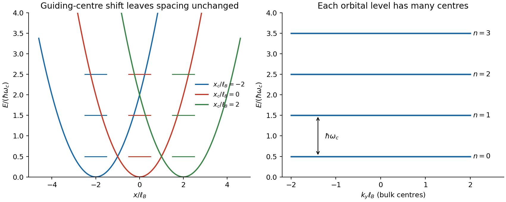

<h1 id="2/b/solution">Solution</h1>

↑ **Parent:** [B](../b.md)

For a particle of charge $q$ and [mass](../../../../../mass.md) $m$ in a uniform [magnetic field](../../../../../magnetic-field-split.md) $\mathbf B=B\hat z$, [minimal coupling](../../../../../minimal-coupling.md) replaces [momentum](../../../../../momentum-split.md) by $\mathbf p-q\mathbf A$. Choose [Landau gauge](../../../../../landau-gauge-for-a-uniform-magnetic-field.md) $\mathbf A=(0,Bx,0)$ and first restrict motion to the $xy$ plane. Since $p_y=\hbar k_y$ is conserved,

$$
H=\frac{p_x^2}{2m}+\frac{(\hbar k_y-qBx)^2}{2m}
=\frac{p_x^2}{2m}+\frac12m\omega_c^2(x-x_c)^2,
$$

$$
\omega_c=\frac{|qB|}{m},\qquad x_c=\frac{\hbar k_y}{qB},\qquad
\boxed{E_n=\hbar\omega_c(n+\tfrac12),\quad n=0,1,2,\ldots.}
$$

These [Landau levels](../../../../../landau-level.md) quantize the classical cyclotron motion. The [wavefunctions](../../../../../wave-function-split.md) are harmonic-oscillator functions centred at $x_c$, multiplied by $e^{ik_yy}$. Changing $k_y$ shifts the [guiding centre](../../../../../guiding-center.md) without changing the [energy](../../../../../energy-split.md). Gauge-dependent labels such as $k_y$ are not themselves observables; the level spacing and degeneracy are gauge independent. The [magnetic length](../../../../../magnetic-length.md) $\ell_B=\sqrt{\hbar/|qB|}$ is the transverse orbital scale.

For a large rectangle of sides $L_x,L_y$, periodicity along $y$ gives $\Delta k_y=2\pi/L_y$. Requiring centres inside the sample gives, for each orbital level and each specified [spin](../../../../../spin.md) state,

$$
\boxed{D=\frac{L_xL_y}{2\pi\ell_B^2}
=\frac{|qB|A}{h}=\frac{|\Phi|}{h/|q|}.}
$$

Thus each [magnetic flux quantum](../../../../../magnetic-flux-quantum.md) supplies one guiding-centre state. The continuum bulk count neglects boundary corrections; magnetic periodic conditions on a torus require integer flux count. A finite confining edge lifts the simple flat guiding-centre [spectrum](../../../../../spectrum-functional-analysis.md) near that edge.

**[Figure 2](#2/b/image-translated-oscillator-centres-and-degenerate-orbital-landau-levels-in-a-uniform-field). Translated oscillator centres and degenerate orbital Landau levels in a uniform field**.

[spin](../../../../../spin.md) adds a Zeeman term. For [electrons](../../../../../electron.md) with gyromagnetic factor $g$, its contribution is $g\mu_B Bm_s$, with $m_s=\pm1/2$ and $\mu_B=e\hbar/(2m_e)$. If $g=2$ and the orbital [mass](../../../../../mass.md) is $m_e$, the branches become $\hbar\omega_c n$ and $\hbar\omega_c(n+1)$: the lowest combined level has one [spin](../../../../../spin.md) branch, while positive levels coincide in pairs. In a material, effective [mass](../../../../../mass.md) and effective $g$ need not give that coincidence.

In three dimensions, free motion parallel to $B$ adds $\hbar^2k_z^2/(2m)$, so each orbital index labels a one-dimensional continuum rather than an isolated three-dimensional [energy](../../../../../energy-split.md). Resolved magnetic quantization requires the spacing to exceed substantial thermal and disorder broadening. The changing occupation of these levels underlies magnetic quantum oscillations; in two dimensions their degeneracy and filling are central to the [integer quantum Hall effect](../../../../../integer-quantum-hall-effect.md). These statements assume nonrelativistic, approximately independent particles, rather than arbitrary interacting or disordered spectra.

## ↑ Ancestors (14)

1. [B](../b.md)
2. [2](../../2.md)
3. [Paper 1](../../../paper-1-split.md)
4. [2015](../../../split.md)
5. [Past exam of the advanced quantum physics course of the University of Cambridge](../../../../split.md)
6. [Advanced Quantum Physics course of the University of Cambridge](../../../../../advanced-quantum-physics-course-of-the-university-of-cambridge.md)
7. [Physics course of the year 3 of the natural sciences course of the University of Cambridge](../../../../../physics-course-of-the-year-3-of-the-natural-sciences-course-of-the-university-of-cambridge.md)
8. [Year 3 of the natural sciences course of the University of Cambridge](../../../../../year-3-of-the-natural-sciences-course-of-the-university-of-cambridge.md)
9. [Year of the natural sciences course of the University of Cambridge](../../../../../year-of-the-natural-sciences-course-of-the-university-of-cambridge.md)
10. [Natural sciences course of the University of Cambridge](../../../../../natural-sciences-course-of-the-university-of-cambridge.md)
11. [Course of the University of Cambridge](../../../../../course-of-the-university-of-cambridge.md)
12. [University of Cambridge](../../../../../university-of-cambridge-split.md)
13. [List of universities](../../../../../list-of-universities.md)
14. [Codex Wiki](../../../../../split.md)
