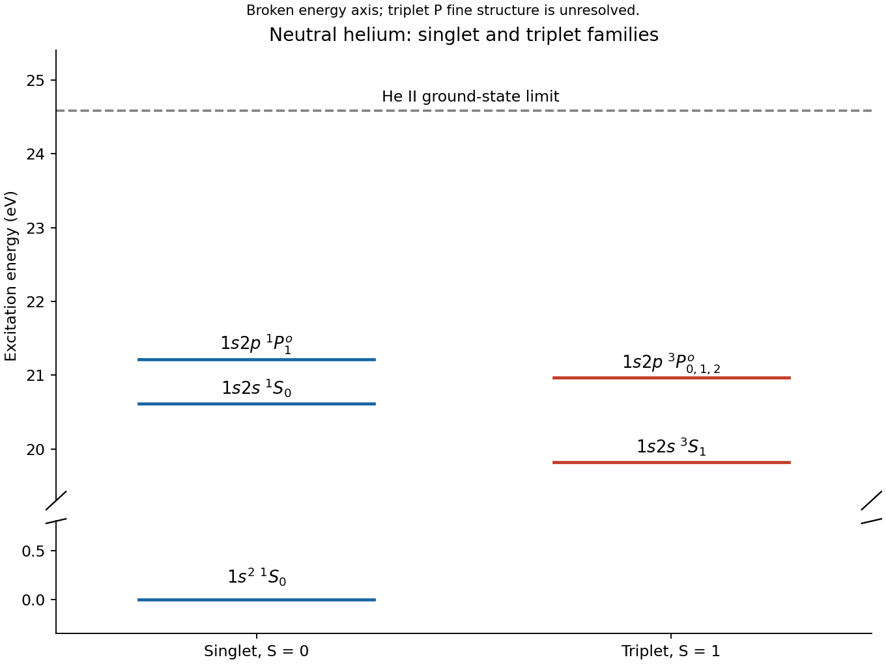

<h1 id="2/c/solution">Solution</h1>

↑ **Parent:** [C](../c.md)

A [helium atom](../../../../../helium-atom.md) has two [electrons](../../../../../electron.md) bound to nuclear charge $+2e$. In the nonrelativistic fixed-nucleus approximation, using [atomic units](../../../../../atomic-units.md),

$$
H=-\frac12\nabla_1^2-\frac12\nabla_2^2-\frac2{r_1}-\frac2{r_2}+\frac1{r_{12}}.
$$

The last term couples the [electrons](../../../../../electron.md), so a product of independent hydrogenic orbitals is not an exact solution. The dominant ground configuration is $1s^2$. Its spatial [wavefunction](../../../../../wave-function-split.md) is symmetric, so Fermi antisymmetry requires the [spin](../../../../../spin.md) singlet

$$
\chi_{00}=\frac{|\uparrow\downarrow\rangle-|\downarrow\uparrow\rangle}{\sqrt2},\qquad
\boxed{\text{helium ground level }1s^2\;{}^1S_0.}
$$

A triplet cannot put both [electrons](../../../../../electron.md) in the same $1s$ spatial orbital. Correlation changes the exact spatial function, including its dependence on $r_{12}$, while preserving this ground-state symmetry.

A useful [helium variational effective charge](../../../../../helium-variational-effective-charge.md) takes normalized orbitals $\phi_\zeta(\mathbf r)=(\zeta^3/\pi)^{1/2}e^{-\zeta r}$ for both [electrons](../../../../../electron.md) and multiplies their product by $\chi_{00}$. The [energy](../../../../../energy-split.md) in Hartree units is

$$
E(\zeta)=\zeta^2-4\zeta+\frac58\zeta,\qquad
\boxed{\zeta_{\rm opt}=\frac{27}{16},\quad E_{\rm var}=-\frac{729}{256}E_h\simeq-77.5\,\mathrm{eV}.}
$$

The reduced effective charge expresses screening. Neglecting repulsion gives $-4E_h$, while its expectation in the unscreened $\zeta=2$ product gives $-2.75E_h$; optimizing the orbital improves that trial estimate. The exact ground [energy](../../../../../energy-split.md) is lower than the optimized product [energy](../../../../../energy-split.md), since the product omits explicit [electron correlation](../../../../../electron-correlation.md). This calculation keeps nuclear charge two in $H$; only the trial orbital parameter is varied.

For a [singly excited helium state](../../../../../singly-excited-helium-state.md) with distinct orthonormal orbitals $a=1s$ and $b=n\ell$, the spatial combinations are

$$
\Phi_\pm=\frac{a(1)b(2)\pm b(1)a(2)}{\sqrt2}.
$$

The symmetric $\Phi_+$ pairs with the antisymmetric [spin](../../../../../spin.md) singlet, while antisymmetric $\Phi_-$ pairs with the symmetric [spin](../../../../../spin.md) triplet. With the same orbitals, their leading energies are

$$
E_\pm=\epsilon_a+\epsilon_b+J_{ab}\pm K_{ab},\qquad
\boxed{E_{\rm singlet}-E_{\rm triplet}=2K_{ab}.}
$$

Here $J_{ab}$ is the direct [Coulomb integral](../../../../../coulomb-integral.md) and $K_{ab}$ is the [exchange integral](../../../../../exchange-integral.md). The latter is positive for the [Coulomb interaction](../../../../../coulomb-interaction.md), so the triplet is lower for this fixed-orbital comparison. [singlet-triplet exchange splitting in helium](../../../../../singlet-triplet-exchange-splitting-in-helium.md) arises from antisymmetry and spatial correlation in the [Coulomb interaction](../../../../../coulomb-interaction.md), not from inserting a separate classical spin-spin force. Spin-singlet [helium](../../../../../helium.md) states are [parahelium](../../../../../singlet-helium-state.md); spin-triplet [helium](../../../../../helium.md) states are [orthohelium](../../../../../triplet-helium-state.md). The two spectra approximately form separate families because the leading electric dipole operator does not change total [spin](../../../../../spin.md).[§3.2.2, Helium and the Exchange Energy, printed pp. 91–96: spatial/spin symmetry and exchange splitting](../../../../../topics-in-quantum-mechanics-by-david-tong.md)

The lowest $1s2s$ terms are $ {}^3S_1$ and $ {}^1S_0$, with the triplet lower. The $1s2p$ configuration gives $ {}^3P_{0,1,2}^{\rm o}$ and $ {}^1P_1^{\rm o}$, where the odd [parity](../../../../../parity.md) allows singlet $P$ to connect to the even-parity ground singlet by an [electric dipole transition](../../../../../electric-dipole-transition.md). Both $1s2s$ levels lack an allowed direct electric dipole decay to $1s^2$: the triplet is [spin](../../../../../spin.md) forbidden, and singlet $S\to S$ is forbidden by [orbital angular momentum](../../../../../orbital-angular-momentum.md) and [parity](../../../../../parity.md). This explains [helium metastability](../../../../../helium-metastability.md) without implying an infinite lifetime once weaker radiative processes or collisions are allowed.

**[Figure 3](#2/c/image-low-neutral-helium-singlet-and-triplet-levels-plotted-from-independently-cited-tabulated-energies). Low neutral-helium singlet and triplet levels, plotted from independently cited tabulated energies**.

The observed first $1s2s$ excitation energies are approximately $19.82$ and $20.62\,\mathrm{eV}$ for the triplet and singlet, respectively. Higher singly excited Rydberg series approach the He II ground-state ionization threshold; doubly excited states above that threshold can autoionize and are not all stable bound excited levels.[1s2s and 1s2p configuration rows; He II ground-state limit at 198310.6691 inverse centimetres](../../../../../energy-levels-of-neutral-helium-by-national-institute-of-standards-and-technology.md)

## ↑ Ancestors (14)

1. [C](../c.md)
2. [2](../../2.md)
3. [Paper 1](../../../paper-1-split.md)
4. [2015](../../../split.md)
5. [Past exam of the advanced quantum physics course of the University of Cambridge](../../../../split.md)
6. [Advanced Quantum Physics course of the University of Cambridge](../../../../../advanced-quantum-physics-course-of-the-university-of-cambridge.md)
7. [Physics course of the year 3 of the natural sciences course of the University of Cambridge](../../../../../physics-course-of-the-year-3-of-the-natural-sciences-course-of-the-university-of-cambridge.md)
8. [Year 3 of the natural sciences course of the University of Cambridge](../../../../../year-3-of-the-natural-sciences-course-of-the-university-of-cambridge.md)
9. [Year of the natural sciences course of the University of Cambridge](../../../../../year-of-the-natural-sciences-course-of-the-university-of-cambridge.md)
10. [Natural sciences course of the University of Cambridge](../../../../../natural-sciences-course-of-the-university-of-cambridge.md)
11. [Course of the University of Cambridge](../../../../../course-of-the-university-of-cambridge.md)
12. [University of Cambridge](../../../../../university-of-cambridge-split.md)
13. [List of universities](../../../../../list-of-universities.md)
14. [Codex Wiki](../../../../../split.md)
