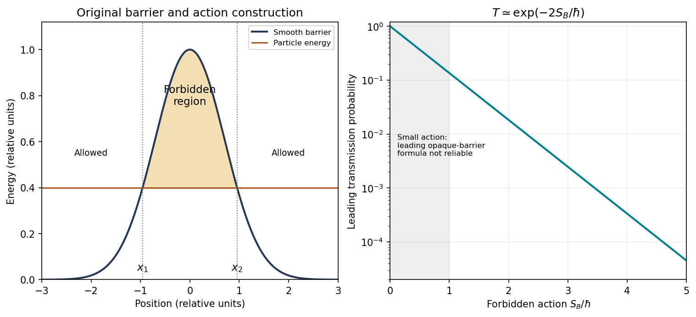

<h1 id="2/a/solution">Solution</h1>

↑ **Parent:** [A](../a.md)

**The [WKB approximation](../../../../../wkb-approximation.md) describes a wave whose local [wavelength](../../../../../wavelength.md) changes slowly compared with one [wavelength](../../../../../wavelength.md).** For the one-dimensional stationary [Schrödinger equation](../../../../../schrodinger-equation.md), put $p(x)=\sqrt{2m[E-V(x)]}$. In a [classically allowed region](../../../../../classically-allowed-region.md),

$$
\psi(x)\simeq\frac{C_+}{\sqrt{p(x)}}\exp\!\left[\frac{i}{\hbar}\int^x p(s)\,\mathrm ds\right]
+\frac{C_-}{\sqrt{p(x)}}\exp\!\left[-\frac{i}{\hbar}\int^x p(s)\,\mathrm ds\right].
$$

The [phase](../../../../../phase-waves.md) is the classical action divided by $\hbar$. The amplitude varies as $p^{-1/2}$ so that a single travelling component has constant [probability current](../../../../../probability-current.md). A useful local validity condition is $|\hbar p'/p^2|\ll1$.

For $V>E$, write $\kappa=\sqrt{2m(V-E)}/\hbar$. The wave instead has growing and decaying components proportional to $\kappa^{-1/2}\exp(\pm\int\kappa\,\mathrm dx)$. At a simple [turning point](../../../../../turning-point.md), $p$ vanishes and neither local WKB expression is valid. Linearizing the potential gives an Airy-function solution that connects the two sides and supplies the turning-point [phase](../../../../../phase-waves.md) shift. It is not legitimate to carry the divergent WKB amplitude straight through the [turning point](../../../../../turning-point.md).[§2.2, semiclassical expansion and linear-potential matching](../../../../../topics-in-quantum-mechanics-by-david-tong.md)

**A useful application is tunnelling through a smooth opaque barrier.** With [turning points](../../../../../turning-point.md) $x_1,x_2$, the leading [transmission probability](../../../../../transmission-probability.md) is

$$
\boxed{T\simeq\exp\!\left[-2\int_{x_1}^{x_2}\kappa(x)\,\mathrm dx\right].}
$$

The exponent is twice the forbidden-region action in units of $\hbar$, because transmission is a [probability](../../../../../probability.md) rather than a wave amplitude. For an ideal rectangular barrier of height $V_0>E$ and width $d$, the same leading exponential is $\exp[-2d\sqrt{2m(V_0-E)}/\hbar]$; matching at the abrupt edges supplies an additional prefactor.

**[Figure 1](#2/a/image-original-smooth-barrier-construction-and-leading-wkb-transmission-exponent-the-shaded-interval-is-classically-forbidden). Original smooth-barrier construction and leading WKB transmission exponent; the shaded interval is classically forbidden**.

For a bound state between two smooth [turning points](../../../../../turning-point.md), the related WKB quantization rule is $\int_{x_1}^{x_2}p\,\mathrm dx=(n+1/2)\pi\hbar$. In a [harmonic potential](../../../../../harmonic-potential.md) the integral equals $\pi E/\omega$, recovering $E_n=(n+1/2)\hbar\omega$. This exact agreement of energies for the harmonic oscillator does not make WKB [wavefunctions](../../../../../wave-function-split.md) uniformly exact near its [turning points](../../../../../turning-point.md).

## ↑ Ancestors (14)

1. [A](../a.md)
2. [2](../../2.md)
3. [Paper 1](../../../paper-1-split.md)
4. [2016](../../../split.md)
5. [Past exam of the advanced quantum physics course of the University of Cambridge](../../../../split.md)
6. [Advanced Quantum Physics course of the University of Cambridge](../../../../../advanced-quantum-physics-course-of-the-university-of-cambridge.md)
7. [Physics course of the year 3 of the natural sciences course of the University of Cambridge](../../../../../physics-course-of-the-year-3-of-the-natural-sciences-course-of-the-university-of-cambridge.md)
8. [Year 3 of the natural sciences course of the University of Cambridge](../../../../../year-3-of-the-natural-sciences-course-of-the-university-of-cambridge.md)
9. [Year of the natural sciences course of the University of Cambridge](../../../../../year-of-the-natural-sciences-course-of-the-university-of-cambridge.md)
10. [Natural sciences course of the University of Cambridge](../../../../../natural-sciences-course-of-the-university-of-cambridge.md)
11. [Course of the University of Cambridge](../../../../../course-of-the-university-of-cambridge.md)
12. [University of Cambridge](../../../../../university-of-cambridge-split.md)
13. [List of universities](../../../../../list-of-universities.md)
14. [Codex Wiki](../../../../../split.md)
