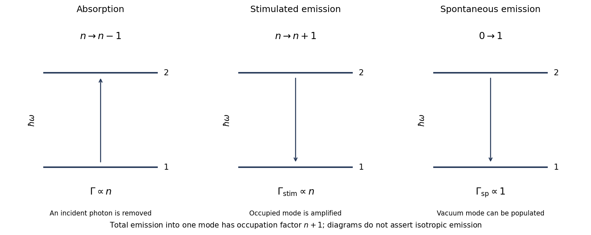

<h1 id="2/b/solution">Solution</h1>

↑ **Parent:** [B](../b.md)

**[Stimulated emission](../../../../../stimulated-emission.md) adds a [photon](../../../../../photon.md) to an already occupied radiation mode; [spontaneous emission](../../../../../spontaneous-emission.md) can occur when that mode initially contains no [photons](../../../../../photon.md).** In the [electric-dipole approximation](../../../../../electric-dipole-approximation.md) the atom-field interaction is $H_{\rm int}=-\mathbf d\cdot\mathbf E$. Quantizing the radiation field makes the emission [matrix element](../../../../../matrix-element.md) into a mode with occupation $n$ proportional to

$$
\langle n+1|a^\dagger|n\rangle=\sqrt{n+1}.
$$

This [photon occupation enhancement of emission](../../../../../photon-occupation-enhancement-of-emission.md) makes the emission rate into that mode proportional to $n+1$: the part proportional to $n$ is stimulated and the remaining part is spontaneous. Absorption is proportional to $|\langle n-1|a|n\rangle|^2=n$. The [photon](../../../../../photon.md) energy is the atomic energy difference, up to any specified recoil or line broadening.

The stimulated contribution preferentially populates the stimulating mode, including its propagation direction and [polarization](../../../../../polarization-waves.md); it provides [optical gain](../../../../../optical-gain.md). Spontaneous [photons](../../../../../photon.md) populate the available modes according to the transition's dipole [matrix elements](../../../../../matrix-element.md) and radiation environment. They are not universally isotropic. An excited bare atom with the field vacuum is not an [eigenstate](../../../../../eigenstate.md) of the fully coupled [Hamiltonian](../../../../../hamiltonian.md), which resolves the apparent paradox of a nominally stationary excited state radiating.[§4.3.2, why the electromagnetic field must be included to describe spontaneous decay](../../../../../topics-in-quantum-mechanics-by-david-tong.md)

**[Figure 2](#2/b/image-original-two-level-transition-diagrams-and-the-n-versus-n-plus-1-occupation-factors-for-photon-absorption-and-emission). Original two-level transition diagrams and the $n$ versus $n+1$ occupation factors for photon absorption and emission**.

For lower and upper levels 1 and 2, with radiation spectral [energy density](../../../../../energy-density.md) $u_\nu$ per unit ordinary frequency, the rates are

$$
R_{\rm abs}=N_1B_{12}u_\nu,\qquad
R_{\rm stim}=N_2B_{21}u_\nu,\qquad
R_{\rm sp}=N_2A_{21}.
$$

Thermal detailed balance with the [Planck spectrum](../../../../../blackbody-spectrum.md) gives

$$
\boxed{g_1B_{12}=g_2B_{21},\qquad
\frac{A_{21}}{B_{21}}=\frac{8\pi h\nu^3}{c^3}.}
$$

The statistical weights $g_i$ here are level degeneracies, not [Landé g-factors](../../../../../lande-g-factor.md). A definition of $B$ multiplying intensity or angular-frequency density would change the normalization factors.

For a specified free-space electric-dipole transition, summing radiation modes gives

$$
A_{21}=\frac{\omega_{21}^3|\mathbf d_{12}|^2}
{3\pi\epsilon_0\hbar c^3},
\qquad \omega_{21}=2\pi\nu.
$$

Appropriate sums over final magnetic substates and averages over initial substates are needed for an unresolved degenerate level. The radiative lifetime is $1/A_{21}$ only when this is the sole decay channel. In a [laser](../../../../../laser-split.md), net stimulated gain requires $N_2/g_2>N_1/g_1$, as well as sufficient gain to overcome cavity loss; [population inversion](../../../../../population-inversion.md) alone does not specify the lasing threshold.

## ↑ Ancestors (14)

1. [B](../b.md)
2. [2](../../2.md)
3. [Paper 1](../../../paper-1-split.md)
4. [2016](../../../split.md)
5. [Past exam of the advanced quantum physics course of the University of Cambridge](../../../../split.md)
6. [Advanced Quantum Physics course of the University of Cambridge](../../../../../advanced-quantum-physics-course-of-the-university-of-cambridge.md)
7. [Physics course of the year 3 of the natural sciences course of the University of Cambridge](../../../../../physics-course-of-the-year-3-of-the-natural-sciences-course-of-the-university-of-cambridge.md)
8. [Year 3 of the natural sciences course of the University of Cambridge](../../../../../year-3-of-the-natural-sciences-course-of-the-university-of-cambridge.md)
9. [Year of the natural sciences course of the University of Cambridge](../../../../../year-of-the-natural-sciences-course-of-the-university-of-cambridge.md)
10. [Natural sciences course of the University of Cambridge](../../../../../natural-sciences-course-of-the-university-of-cambridge.md)
11. [Course of the University of Cambridge](../../../../../course-of-the-university-of-cambridge.md)
12. [University of Cambridge](../../../../../university-of-cambridge-split.md)
13. [List of universities](../../../../../list-of-universities.md)
14. [Codex Wiki](../../../../../split.md)
