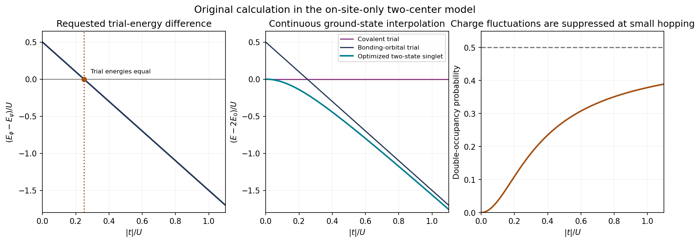

<h1 id="3/solution">Solution</h1>

↑ **Parent:** [3](../3.md)

**[Spin](../../../../spin.md) and spatial exchange symmetry.** Write the normalized [spin](../../../../spin.md) singlet and [triplet states](../../../../spin-one-half-triplet-state.md) as

$$
\chi_{00}=\frac{|\uparrow\downarrow\rangle-|\downarrow\uparrow\rangle}{\sqrt2},
\qquad
\chi_{11}=|\uparrow\uparrow\rangle,\quad
\chi_{10}=\frac{|\uparrow\downarrow\rangle+|\downarrow\uparrow\rangle}{\sqrt2},
\quad\chi_{1,-1}=|\downarrow\downarrow\rangle.
$$

The singlet is antisymmetric under exchange and has total [spin](../../../../spin.md) zero; the triplet is symmetric and has total [spin](../../../../spin.md) one. For orthogonal orbitals define

$$
C=\frac{|ab\rangle+|ba\rangle}{\sqrt2},\qquad
A=\frac{|ab\rangle-|ba\rangle}{\sqrt2}.
$$

Identical [spin one-half](../../../../spin-one-half.md) particles are [fermions](../../../../fermion.md), so the complete state must be antisymmetric. Thus **$C\chi_{00}$ is allowed, and $A\chi_{1M}$ is allowed for each triplet component**. The spatially symmetric same-orbital states $|aa\rangle,|bb\rangle$ also require the singlet. A same-orbital triplet vanishes by the [Pauli exclusion principle](../../../../pauli-exclusion-principle.md).

These products give a spin-adapted basis. More generally the physical state can be written

$$
|\Psi\rangle=(c_a|aa\rangle+c_b|bb\rangle+c_C C)\chi_{00}
+A\sum_{M=-1}^{1}d_M\chi_{1M}.
$$

A superposition of the singlet and triplet sectors need not factor into one spatial function times one [spin](../../../../spin.md) function. Factorization holds for a definite-spin sector, as used in the subsequent model. If the original normalized orbitals are not orthogonal, the corresponding $ab\pm ba$ normalization is $\sqrt{2(1\pm|\langle a|b\rangle|^2)}$; the remainder of this calculation uses the stipulated orthogonal orbitals.

**Integral [matrix elements](../../../../matrix-element.md) and positivity.** Let $a(\mathbf r)$ and $b(\mathbf r)$ denote the localized [spatial orbitals](../../../../spatial-orbital.md). With fixed [proton](../../../../proton.md) positions, the one-electron electronic operator is

$$
h=-\frac{\hbar^2}{2m_e}\nabla^2
-\frac{e^2}{4\pi\epsilon_0}
\left(\frac1{|\mathbf r-\mathbf R_a|}+
\frac1{|\mathbf r-\mathbf R_b|}\right).
$$

The proton-proton repulsion is a separate common nuclear energy. The requested one-electron and direct two-electron elements are

$$
\langle a|h|a\rangle=\int a^*(\mathbf r)\,h\,a(\mathbf r)\,\mathrm d^3r,
$$

$$
J_{ab}=\langle ab|H_{1,2}|ab\rangle
=\frac{e^2}{4\pi\epsilon_0}
\iint\frac{|a(\mathbf r_1)|^2|b(\mathbf r_2)|^2}
{|\mathbf r_1-\mathbf r_2|}\,\mathrm d^3r_1\,\mathrm d^3r_2.
$$

Since $H_1=h\otimes I$,

$$
\boxed{\langle aa|H_1|ab\rangle
=\langle a|h|a\rangle\langle a|b\rangle=0.}
$$

Likewise,

$$
\boxed{U=\frac{e^2}{4\pi\epsilon_0}
\iint\frac{|a(\mathbf r_1)|^2|a(\mathbf r_2)|^2}
{|\mathbf r_1-\mathbf r_2|}\,\mathrm d^3r_1\,\mathrm d^3r_2>0.}
$$

The integrand is nonnegative and is positive on a set of nonzero measure. This is the repulsion cost of [double occupancy](../../../../double-occupancy.md); the coincidence singularity is integrable for ordinary smooth localized orbitals.

**One [electron](../../../../electron.md) on each center.** Suppress the normalized singlet [spin](../../../../spin.md) factor and use $|\psi\rangle=C$. For each of the spatial products $ab$ and $ba$, the one-body sum has expectation $2E_0$. The cross terms vanish because a one-body hop leaves an orthogonal spectator orbital. The interaction contribution is the direct integral plus the [exchange integral](../../../../exchange-integral.md), both neglected in the model. Consequently

$$
\boxed{E_\psi=\langle C|H|C\rangle=2E_0.}
$$

This state has no same-center [double occupancy](../../../../double-occupancy.md), but remains an exchange-symmetric spatial superposition rather than assigning a distinguishable [electron](../../../../electron.md) permanently to each [proton](../../../../proton.md).

**Two [electrons](../../../../electron.md) in the bonding orbital.** The normalized one-electron bonding orbital is $g=(a+b)/\sqrt2$. The trial spatial state is $|\phi\rangle=|gg\rangle$, whose one-body expectation is

$$
2\langle g|h|g\rangle
=2\left[\frac{E_0+E_0+t+t}{2}\right]
=2E_0+2t.
$$

Expanding the product gives $|\phi\rangle=(|aa\rangle+|ab\rangle+|ba\rangle+|bb\rangle)/2$. The total [probability](../../../../probability.md) of [double occupancy](../../../../double-occupancy.md) is therefore $1/2$. Keeping only [on-site Coulomb repulsion](../../../../on-site-coulomb-repulsion.md) gives the intended interaction truncation,

$$
H_{1,2}\simeq U\bigl(|aa\rangle\langle aa|+|bb\rangle\langle bb|\bigr),
$$

and the interaction expectation is $U/2$. Hence

$$
\boxed{E_\phi=2E_0+2t+\frac U2.}
$$

This truncation must be stated. In particular, mixed Coulomb elements such as $X=\langle aa|H_{1,2}|ab\rangle$ do not vanish merely by orbital [orthogonality](../../../../orthogonal-vectors.md) or inversion symmetry. The printed list does not explicitly name them. If they are retained and are equal and real by site symmetry, their contribution to $E_\phi$ is $2X$; the requested expression uses their neglect along with the other off-site interaction terms. No numerical value of $X$ is supplied or invented.

**Energy comparison and the bond.** Put $x=|t|/U$ with $U>0$ and $t=-|t|$. Then

$$
\boxed{\frac{E_\phi-E_\psi}{U}=\frac12-2x.}
$$

The straight line starts at $1/2$ and crosses zero at $x=1/4$. The purely bonding-orbital trial state is better for $x>1/4$, while the singly occupied covalent trial state is better for $x<1/4$.

**[Figure 3](#3/image-original-two-site-singlet-calculation-trial-energy-comparison-continuous-optimized-energy-and-double-occupancy-crossover-in-the-stated-on-site-model). Original two-site singlet calculation: trial-energy comparison, continuous optimized energy and double-occupancy crossover in the stated on-site model**.

For localized orbitals of approximately fixed atomic size, the hopping magnitude $|t|$ decreases rapidly, typically exponentially times a polynomial, as the [proton](../../../../proton.md) separation grows. The on-site integral $U$ remains of atomic Coulomb scale and tends to the isolated-orbital value; it does not decay as the intersite repulsion $1/R$. If the orbitals themselves are allowed to relax, $U$ also changes, so no universal monotonic law for $U(R)$ follows from the data.

At small $|t|/U$, [electron correlation](../../../../electron-correlation.md) suppresses the ionic configurations $aa$ and $bb$, favoring a singlet with roughly one [electron](../../../../electron.md) on each center. A single doubly occupied bonding orbital has an artificial finite ionic weight even as the centers separate. At large $|t|/U$, delocalization gains enough [kinetic energy](../../../../kinetic-energy.md) that the bonding-orbital description becomes useful and charge fluctuations are substantial.

The crossing of two restricted trial energies is **not a sharp transition of the actual two-site [ground state](../../../../ground-state.md)**. To see this without adding empirical data, include both $C$ and the symmetric ionic state $I_+=(|aa\rangle+|bb\rangle)/\sqrt2$. This [two-site Hubbard dimer](../../../../two-site-hubbard-dimer.md) reduces to

$$
H-2E_0I=\begin{pmatrix}0&2t\\2t&U\end{pmatrix}_{C,I_+},
\qquad
\boxed{E_g=2E_0+\frac{U-\sqrt{U^2+16t^2}}2.}
$$

Its [ground state](../../../../ground-state.md) is $\cos\theta\,C+\sin\theta\,I_+$, with $\tan2\theta=4|t|/U$ and $0\leq\theta\leq\pi/4$. The ionic [probability](../../../../probability.md) is

$$
P_{\rm double}=\frac12\left(1-\frac{U}{\sqrt{U^2+16t^2}}\right).
$$

It changes smoothly from zero to $1/2$. At large separation, the electronic lowering is $-4t^2/U$ to leading order and vanishes as hopping vanishes. An absolute molecular binding curve would additionally require $E_0(R)$, the nuclear repulsion and the neglected intersite terms; this simplified comparison alone does not determine an equilibrium [bond length](../../../../bond-length.md).

## ↑ Ancestors (13)

1. [3](../3.md)
2. [Paper 1](../../paper-1-split.md)
3. [2016](../../split.md)
4. [Past exam of the advanced quantum physics course of the University of Cambridge](../../../split.md)
5. [Advanced Quantum Physics course of the University of Cambridge](../../../../advanced-quantum-physics-course-of-the-university-of-cambridge.md)
6. [Physics course of the year 3 of the natural sciences course of the University of Cambridge](../../../../physics-course-of-the-year-3-of-the-natural-sciences-course-of-the-university-of-cambridge.md)
7. [Year 3 of the natural sciences course of the University of Cambridge](../../../../year-3-of-the-natural-sciences-course-of-the-university-of-cambridge.md)
8. [Year of the natural sciences course of the University of Cambridge](../../../../year-of-the-natural-sciences-course-of-the-university-of-cambridge.md)
9. [Natural sciences course of the University of Cambridge](../../../../natural-sciences-course-of-the-university-of-cambridge.md)
10. [Course of the University of Cambridge](../../../../course-of-the-university-of-cambridge.md)
11. [University of Cambridge](../../../../university-of-cambridge-split.md)
12. [List of universities](../../../../list-of-universities.md)
13. [Codex Wiki](../../../../split.md)
