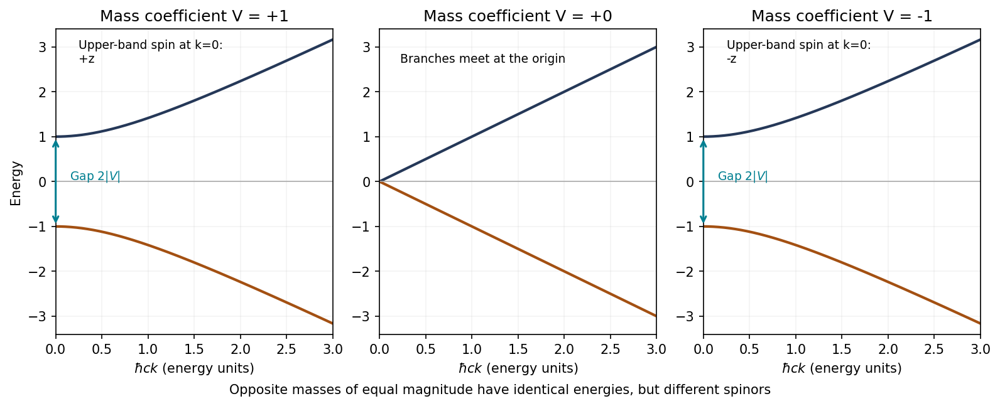
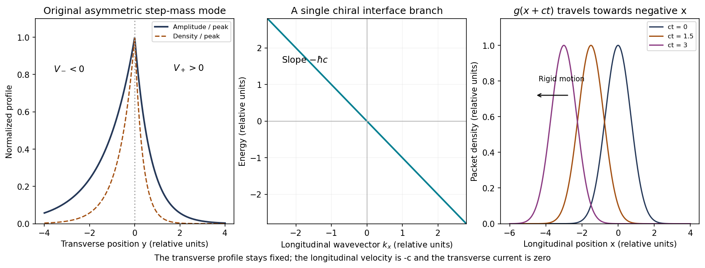

<h1 id="4/solution">Solution</h1>

↑ **Parent:** [4](../4.md)

**Uniform system and dispersion.** A [plane wave](../../../../plane-wave.md) reduces the differential [Hamiltonian](../../../../hamiltonian.md) to a two-by-two [matrix](../../../../matrix.md) acting on its [spinor](../../../../spinor.md):

$$
H(\mathbf k)=
\begin{pmatrix}
V&\hbar c(k_x-ik_y)\\
\hbar c(k_x+ik_y)&-V
\end{pmatrix}
=\mathbf d(\mathbf k)\cdot\boldsymbol\sigma,
\qquad
\mathbf d=(\hbar ck_x,\hbar ck_y,V).
$$

The Pauli anticommutation relations imply $H(\mathbf k)^2=|\mathbf d|^2I$. Choosing a [spinor](../../../../spinor.md) in one of its [eigenspaces](../../../../eigenspace.md) therefore gives

$$
\boxed{E_\pm(k)=\pm\sqrt{\hbar^2c^2k^2+V^2},\qquad k=|\mathbf k|.}
$$

An arbitrary constant [spinor](../../../../spinor.md) multiplying a [plane wave](../../../../plane-wave.md) is not necessarily an [energy eigenstate](../../../../energy-eigenstate.md); it must be an eigenvector of this [matrix](../../../../matrix.md). For example, for the upper branch and $\varepsilon=|\mathbf d|$, one can use

$$
u_+(\mathbf k)=
\frac1{\sqrt{2\varepsilon(\varepsilon+V)}}
\begin{pmatrix}\varepsilon+V\\\hbar c(k_x+ik_y)\end{pmatrix},
$$

away from the coordinate singularity $\varepsilon+V=0$, where another normalized eigenvector chart is used.

For the usual $c>0$ convention, the massless branches are $E_\pm=\pm\hbar ck$. For nonzero $V$, the two branches have a gap $2|V|$ and are quadratic near $k=0$:

$$
E_\pm\simeq\pm|V|\pm\frac{\hbar^2c^2k^2}{2|V|}.
$$

**Changing the sign of $V$ does not change these energies.** It reverses the out-of-plane [spin](../../../../spin.md) [polarization](../../../../polarization-waves.md) of a given band at the origin. The plots for equal positive and negative mass magnitudes therefore have identical dispersion curves, despite their different [spinors](../../../../spinor.md).

**[Figure 4](#4/image-original-calculated-massive-and-massless-two-dimensional-dirac-dispersions-equal-and-opposite-masses-share-energies-but-reverse-the-band-spin-at-zero-momentum). Original calculated massive and massless two-dimensional Dirac dispersions; equal and opposite masses share energies but reverse the band spin at zero momentum**.

**[Spin](../../../../spin.md) direction in the massless case.** For $k>0$ put $k_x+ik_y=ke^{i\varphi}$. The normalized eigenspinors can be chosen as

$$
u_s(\mathbf k)=\frac1{\sqrt2}
\begin{pmatrix}1\\s e^{i\varphi}\end{pmatrix},
\qquad E_s=s\hbar ck,\qquad s=\pm1.
$$

Direct multiplication gives $\langle\sigma_x\rangle=s\cos\varphi$, $\langle\sigma_y\rangle=s\sin\varphi$ and $\langle\sigma_z\rangle=0$. Since the [Pauli matrices](../../../../pauli-matrices.md) represent physical [spin](../../../../spin.md) in this question,

$$
\boxed{\langle\mathbf S\rangle_s
=s\frac{\hbar}{2}\frac{(k_x,k_y,0)}{k}.}
$$

The [spin](../../../../spin.md) is **parallel to [momentum](../../../../momentum-split.md) on the positive-energy branch and antiparallel on the negative-energy branch**. Thus the branch-independent statement is collinearity; the printed parallel claim needs the positive-branch qualification. At $k=0,V=0$, the [Hamiltonian](../../../../hamiltonian.md) is zero and [spin](../../../../spin.md) is not fixed by a [wavevector](../../../../wavevector.md) direction.

**Mass-domain-wall [eigenstate](../../../../eigenstate.md).** Assume $c>0$ for the stated normalizable wall state and write

$$
F(y)=\exp\!\left[-\frac1{\hbar c}\int_0^y V(s)\,\mathrm ds\right],
\qquad u_-=\frac1{\sqrt2}\begin{pmatrix}1\\-1\end{pmatrix}.
$$

Then $F'=-VF/(\hbar c)$, $\sigma_xu_-=-u_-$, and $(i\sigma_y+\sigma_z)u_-=0$. Applying the full operator gives

$$
H\{e^{ik_xx}F(y)u_-\}
=e^{ik_xx}F(y)
\{\hbar ck_x\sigma_x+iV(y)\sigma_y+V(y)\sigma_z\}u_-
=-\hbar ck_x\,e^{ik_xx}F(y)u_-.
$$

The transverse derivative and mass terms cancel pointwise. Hence **the specified state is an [eigenstate](../../../../eigenstate.md) with $E=-\hbar ck_x$**.

For a step mass $V(y)=V_+>0$ above the interface and $V(y)=V_-<0$ below it,

$$
F(y)=\begin{cases}
e^{-y/\xi_+},&y>0,\\
e^{y/\xi_-},&y<0,
\end{cases}
\qquad
\boxed{\xi_+=\frac{\hbar c}{V_+},\qquad
\xi_-=\frac{\hbar c}{|V_-|}.}
$$

The [Localization length at a step Dirac mass wall](../../../../localization-length-at-a-step-dirac-mass-wall.md) sets the two exponential tails. The amplitude is continuous, peaks at the interface and decays on both sides, with generally unequal decay lengths. The [probability density](../../../../probability-density.md) decays with lengths $\xi_\pm/2$. A normalized transverse function is $f(y)=\sqrt{2/(\xi_++\xi_-)}F(y)$ when multiplying the unit [spinor](../../../../spinor.md) $u_-$. The longitudinal [plane wave](../../../../plane-wave.md) can independently be box-normalized. A step in $V$ allows a step in $F'$; the first-order Dirac equation does not impose continuity of that derivative.

**[Figure 5](#4/image-original-mass-wall-solution-asymmetric-exponential-confinement-the-chiral-energy-branch-and-rigid-longitudinal-translation-of-a-localized-packet). Original mass-wall solution: asymmetric exponential confinement, the chiral energy branch and rigid longitudinal translation of a localized packet**.

**Propagation.** The interface dispersion is the straight line

$$
\boxed{E(k_x)=-\hbar ck_x,\qquad
v_x=\frac1{\hbar}\frac{\mathrm dE}{\mathrm dk_x}=-c.}
$$

Every component on this branch travels in the negative $x$ direction. A packet has the form

$$
\Psi(x,y,t)=f(y)u_-\int A(k_x)e^{ik_x(x+ct)}\,\mathrm dk_x
=f(y)u_-\,g(x+ct).
$$

This [dispersionless chiral interface wavepacket](../../../../dispersionless-chiral-interface-wavepacket.md) therefore translates rigidly with speed $c$ in that direction, without dispersion in this exactly linear model. It remains confined in $y$; there is no free transverse [group velocity](../../../../group-velocity.md), because the bound-state family is not labelled by a transverse travelling-wave [momentum](../../../../momentum-split.md).

The [continuity equation](../../../../continuity-equation.md) gives the current components $j_x=c\Psi^\dagger\sigma_x\Psi=-c|\Psi|^2$ and $j_y=c\Psi^\dagger\sigma_y\Psi=0$. This explicitly confirms absence of [probability](../../../../probability.md) transport away from the interface. For the step-mass case the profile is normalizable because its tails have positive decay constants and $c>0$. A general sign-changing profile also requires $F\in L^2(\mathbb R)$; nonzero asymptotic masses suffice, whereas signs alone do not guarantee confinement if their integrated magnitudes grow too slowly. If $c<0$, the supplied exponential instead grows at infinity; a normalizable state requires the opposite [spinor](../../../../spinor.md) and envelope sign. Reversing the wall orientation also reverses the propagation chirality.

## ↑ Ancestors (13)

1. [4](../4.md)
2. [Paper 1](../../paper-1-split.md)
3. [2016](../../split.md)
4. [Past exam of the advanced quantum physics course of the University of Cambridge](../../../split.md)
5. [Advanced Quantum Physics course of the University of Cambridge](../../../../advanced-quantum-physics-course-of-the-university-of-cambridge.md)
6. [Physics course of the year 3 of the natural sciences course of the University of Cambridge](../../../../physics-course-of-the-year-3-of-the-natural-sciences-course-of-the-university-of-cambridge.md)
7. [Year 3 of the natural sciences course of the University of Cambridge](../../../../year-3-of-the-natural-sciences-course-of-the-university-of-cambridge.md)
8. [Year of the natural sciences course of the University of Cambridge](../../../../year-of-the-natural-sciences-course-of-the-university-of-cambridge.md)
9. [Natural sciences course of the University of Cambridge](../../../../natural-sciences-course-of-the-university-of-cambridge.md)
10. [Course of the University of Cambridge](../../../../course-of-the-university-of-cambridge.md)
11. [University of Cambridge](../../../../university-of-cambridge-split.md)
12. [List of universities](../../../../list-of-universities.md)
13. [Codex Wiki](../../../../split.md)
