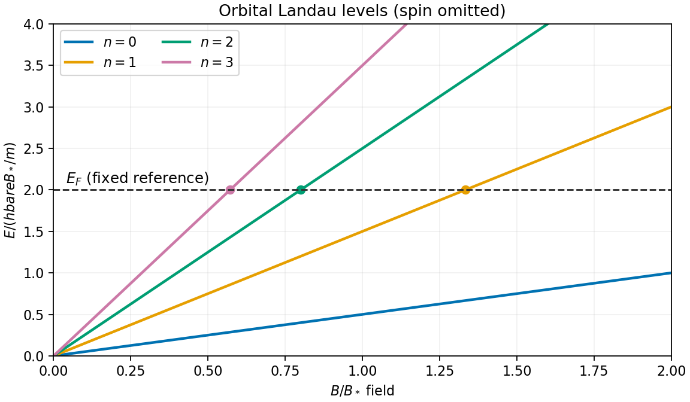

<h1 id="2/b/solution">Solution</h1>

↑ **Parent:** [B](../b.md)

A uniform [magnetic field](../../../../magnetic-field-split.md) quantizes the transverse cyclotron motion of an [electron](../../../../electron.md). With [electron](../../../../electron.md) charge $-e$ and the [Landau gauge for a uniform magnetic field](../../../../landau-gauge-for-a-uniform-magnetic-field.md) $\mathbf A=(0,Bx,0)$, [minimal coupling](../../../../minimal-coupling.md) gives

$$
H_\perp=\frac{p_x^2}{2m}+\frac{(p_y+eBx)^2}{2m}.
$$

For an [eigenstate](../../../../eigenstate.md) of $p_y$ with [eigenvalue](../../../../eigenvalue.md) $\hbar k_y$, this is a [quantum harmonic oscillator](../../../../quantum-harmonic-oscillator-split.md) centered at $x_c=-\hbar k_y/(eB)$, with [cyclotron frequency](../../../../cyclotron-frequency.md) $\omega_c=eB/m$. Its [Landau levels](../../../../landau-level.md) are

$$
\boxed{E_n=\hbar\omega_c\left(n+\frac12\right),\qquad n=0,1,2,\ldots}.
$$

The oscillator width is set by the [magnetic length](../../../../magnetic-length.md) $\ell_B=\sqrt{\hbar/(eB)}$. In three dimensions, the free motion parallel to the [magnetic field](../../../../magnetic-field-split.md) adds $\hbar^2k_z^2/(2m)$. The [electron](../../../../electron.md) [spin](../../../../spin.md) adds a [Zeeman splitting](../../../../zeeman-splitting.md) $\pm g_s\mu_BB/2$. In a crystal the appropriate [band effective mass](../../../../band-effective-mass.md) and effective [spin](../../../../spin.md) factor replace the free-electron values.

Changing $k_y$ moves the orbit center without changing the [energy](../../../../energy-split.md). In a rectangle $L_xL_y$, adjacent allowed centers differ by $2\pi\ell_B^2/L_y$. Requiring the center to lie in the sample gives the [degeneracy of a Landau level](../../../../degeneracy-of-a-landau-level.md), per [spin](../../../../spin.md),

$$
N_\phi=\frac{L_xL_y}{2\pi\ell_B^2}=\frac{eBL_xL_y}{h},\qquad
\boxed{\frac{N_\phi}{L_xL_y}=\frac{eB}{h}}.
$$

This large [state degeneracy](../../../../state-degeneracy.md), together with the increasing level spacing, rearranges the occupied states as the [magnetic field](../../../../magnetic-field-split.md) changes. To resolve the [Landau levels](../../../../landau-level.md), thermal broadening $k_BT$ and disorder broadening should both be small compared with $\hbar\omega_c$.

**[Figure 1](#2/b/image-landau-levels-rise-with-magnetic-field-and-pass-through-a-fixed-reference-fermi-energy). Landau levels rise with magnetic field and pass through a fixed reference Fermi energy**.

The [de Haas-van Alphen effect](../../../../de-haas-van-alphen-effect.md) is an oscillation of [magnetization](../../../../magnetization.md) as successive [Landau levels](../../../../landau-level.md) pass the [Fermi energy](../../../../fermi-energy.md). The [Shubnikov-de Haas effect](../../../../shubnikov-de-haas-effect.md) is the corresponding oscillation in longitudinal [magnetoresistance](../../../../magnetoresistance.md). For a simple orbit, successive crossings occur periodically in $1/B$; the general relation to the extremal orbit area is [Onsager quantization](../../../../onsager-quantization.md). These measurements reveal the geometry and effective masses of a [Fermi surface](../../../../fermi-surface.md).

In a two-dimensional [electron](../../../../electron.md) system, filling an integer number $\nu$ of resolved levels leads to the [integer quantum Hall effect](../../../../integer-quantum-hall-effect.md), with

$$
|\sigma_{xy}|=\nu\frac{e^2}{h},\qquad |\rho_{xy}|=\frac{h}{\nu e^2},
$$

and very small longitudinal resistivity on a plateau. Disorder localization helps produce finite plateau widths. [Cyclotron resonance](../../../../cyclotron-resonance.md) provides another direct signature: radiation is absorbed at the adjacent-level spacing $\hbar\omega_c$.

## ↑ Ancestors (13)

1. [B](../b.md)
2. [2](../../2.md)
3. [2017](../../../2017-split.md)
4. [Past exam of the advanced quantum physics course of the University of Cambridge](../../../split.md)
5. [Advanced Quantum Physics course of the University of Cambridge](../../../../advanced-quantum-physics-course-of-the-university-of-cambridge.md)
6. [Physics course of the year 3 of the natural sciences course of the University of Cambridge](../../../../physics-course-of-the-year-3-of-the-natural-sciences-course-of-the-university-of-cambridge.md)
7. [Year 3 of the natural sciences course of the University of Cambridge](../../../../year-3-of-the-natural-sciences-course-of-the-university-of-cambridge.md)
8. [Year of the natural sciences course of the University of Cambridge](../../../../year-of-the-natural-sciences-course-of-the-university-of-cambridge.md)
9. [Natural sciences course of the University of Cambridge](../../../../natural-sciences-course-of-the-university-of-cambridge.md)
10. [Course of the University of Cambridge](../../../../course-of-the-university-of-cambridge.md)
11. [University of Cambridge](../../../../university-of-cambridge-split.md)
12. [List of universities](../../../../list-of-universities.md)
13. [Codex Wiki](../../../../split.md)
