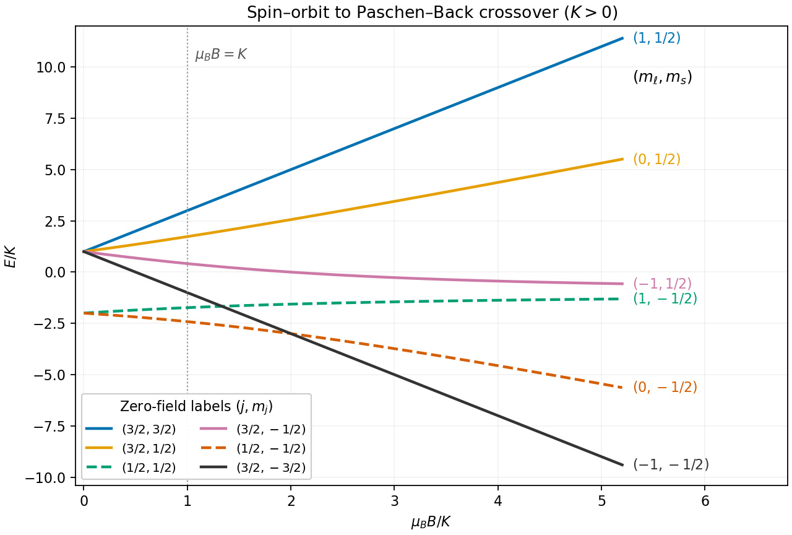

<h1 id="3/solution">Solution</h1>

↑ **Parent:** [3](../3.md)

The [Zeeman effect](../../../zeeman-splitting.md) comes from $-\boldsymbol\mu\cdot\mathbf B$. For an [electron](../../../electron.md), the orbital and [spin](../../../spin.md) [magnetic moments](../../../magnetic-dipole-moment.md) are approximately $-\mu_B\mathbf L/\hbar$ and $-2\mu_B\mathbf S/\hbar$, respectively. This explains both the sign and the relative factor two in the term linear in $B$. The second term is the [spin-orbit interaction](../../../spin-orbit-interaction.md): the [electron](../../../electron.md)'s motion through the atomic [electric field](../../../electric-field-split.md) produces a magnetic interaction in its rest frame. The relativistic correction, including [Thomas precession](../../../thomas-precession.md), and the radial [expectation value](../../../expectation-value.md) are incorporated into $K$. This effective [Hamiltonian](../../../hamiltonian.md) retains the linear [Zeeman splitting](../../../zeeman-splitting.md) and [spin-orbit coupling](../../../spin-orbit-interaction.md), while omitting diamagnetic and [hyperfine structure](../../../hyperfine-structure.md) corrections.

Define the [angular momentum ladder operators](../../../angular-momentum-ladder-operator.md) by $L_\pm=L_x\pm iL_y$ and similarly for $S_\pm$. Direct expansion gives

$$
\frac12(L_+S_-+L_-S_+)=L_xS_x+L_yS_y,
$$

so adding $L_zS_z$ gives the required scalar product. The off-diagonal terms change $m_\ell$ and $m_s$ in opposite directions. Consequently $J_z=L_z+S_z$ commutes with $H$, and $m_j$ remains a good [quantum number](../../../quantum-number.md) at every [magnetic field](../../../magnetic-field-split.md).

In the given product [eigenbasis](../../../eigenbasis.md), the diagonal [matrix elements](../../../matrix-element.md) are

$$
\langle m_\ell,m_s|H|m_\ell,m_s\rangle
=\mu_BB(m_\ell+2m_s)+2Km_\ell m_s.
$$

For $\ell=1$ and $s=1/2$, the only off-diagonal couplings are between $(1,-1/2)$ and $(0,1/2)$, and between $(0,-1/2)$ and $(-1,1/2)$. Each relevant orbital ladder factor is $\hbar\sqrt2$ and each [spin](../../../spin.md) ladder factor is $\hbar$. Multiplying by $K/\hbar^2$ gives $\sqrt2K$. Therefore

$$
\boxed{a=\mu_BB,\qquad b=K,\qquad c=\sqrt2K}.
$$

All other off-diagonal entries vanish either by the ladder endpoints or by conservation of $m_j$. This derives every entry of the displayed matrix.

The stretched states have no mixing and yield

$$
\boxed{E_{m_j=3/2}=K+2a,\qquad E_{m_j=-3/2}=K-2a}.
$$

The $m_j=1/2$ block is $\begin{pmatrix}-K&\sqrt2K\\\sqrt2K&a\end{pmatrix}$, while the $m_j=-1/2$ block is $\begin{pmatrix}-a&\sqrt2K\\\sqrt2K&-K\end{pmatrix}$. Taking the trace and determinant of each $2\times2$ block gives the remaining four [energy eigenvalues](../../../energy-eigenvalue-split.md):

$$
\boxed{E_{+}^{(\pm)}=\frac{a-K}{2}\pm\frac12\sqrt{(a+K)^2+8K^2}},
$$

$$
\boxed{E_{-}^{(\pm)}=\frac{-a-K}{2}\pm\frac12\sqrt{(a-K)^2+8K^2}}.
$$

The subscripts indicate $m_j=\pm1/2$ and the superscripts indicate the upper or lower root. These formulas are the [Zeeman spectrum for orbital angular momentum one](../../../zeeman-spectrum-for-orbital-angular-momentum-one.md) and remain valid for either sign of $K$.

For the usual ordering $K>0$, including sodium, the zero-field states follow from

$$
\mathbf L\cdot\mathbf S=\frac12(J^2-L^2-S^2),\qquad
E_j=K\left[j(j+1)-\ell(\ell+1)-s(s+1)\right].
$$

The $j=3/2$ quartet lies at $K$ and the $j=1/2$ doublet at $-2K$, separated by $3K$. In a weak [magnetic field](../../../magnetic-field-split.md), the [Landé g-factors](../../../lande-g-factor.md) give

$$
E_{3/2,m_j}=K+\frac43am_j+O(a^2/K),\qquad
E_{1/2,m_j}=-2K+\frac23am_j+O(a^2/K).
$$

These label the curves near $B=0$. In a strong [magnetic field](../../../magnetic-field-split.md), the [Paschen-Back effect](../../../paschen-back-effect.md) makes $(m_\ell,m_s)$ the appropriate approximate labels:

$$
E_{m_\ell,m_s}=a(m_\ell+2m_s)+2Km_\ell m_s+O(K^2/a)
$$

for the mixed states, with the stretched-state formulas already exact. The branch connections for $B>0$ are

$$
\begin{array}{c|c}
\text{zero-field label }(j,m_j)&\text{strong-field label }(m_\ell,m_s)\\\hline
(3/2,3/2)&(1,1/2)\\
(3/2,1/2)&(0,1/2)\\
(1/2,1/2)&(1,-1/2)\\
(3/2,-1/2)&(-1,1/2)\\
(1/2,-1/2)&(0,-1/2)\\
(3/2,-3/2)&(-1,-1/2)
\end{array}
$$

Within a fixed $m_j$, the nonzero coupling prevents a crossing; this is an [avoided crossing](../../../avoided-crossing.md). Curves with different $m_j$ may cross because the [Hamiltonian](../../../hamiltonian.md) does not couple them.

**[Figure 2](#3/image-exact-spin-orbit-and-zeeman-energies-for-orbital-angular-momentum-one-and-positive-spin-orbit-constant). Exact spin-orbit and Zeeman energies for orbital angular momentum one and positive spin-orbit constant**.

For the sodium estimate, the zero-field frequency separation fixes

$$
3K=h\delta f,\qquad K=1.14\times10^{-22}\ \mathrm J.
$$

The lower $3s$ doublet has shifts $\pm a$. The [Sodium D-line Zeeman pattern](../../../sodium-d-line-zeeman-pattern.md) gives photon-frequency shifts $a/h$ times $\{\pm2/3,\pm4/3\}$ for D$_1$ and $\{\pm1/3,\pm1,\pm5/3\}$ for D$_2$. Thus the highest-frequency D$_1$ component and lowest-frequency D$_2$ component approach each other by $3a/h$. Extrapolating the [weak-field Zeeman splitting](../../../weak-field-zeeman-splitting.md) gives

$$
\boxed{B_{\rm cross}\sim\frac{h\delta f}{3\mu_B}=12.3\ \mathrm T},
$$

so the crossover occurs at a field of order $10\ \mathrm T$, where $a\sim K$ and the weak-field approximation is becoming marginal.

The exact [eigenvalues](../../../eigenvalue.md) refine the estimate within this [Hamiltonian](../../../hamiltonian.md). The relevant photon energies, with a common zero-field reference omitted, are $E_+^{(-)}+a$ and $E_-^{(+)}-a$. The corresponding [electric dipole transitions](../../../electric-dipole-transition.md) have $\Delta m_j=+1$ and $-1$, respectively. Equating them gives

$$
6a=\sqrt{(a+K)^2+8K^2}+\sqrt{(a-K)^2+8K^2}.
$$

Its positive solution is $a/K=\sqrt{10}/3$, hence

$$
\boxed{B_{\rm cross}=\frac{\sqrt{10}\,h\delta f}{9\mu_B}\simeq13.0\ \mathrm T}
$$

in the retained model. The crossing is between optical transition frequencies; the participating upper states themselves need not be degenerate.

## ↑ Ancestors (12)

1. [3](../3.md)
2. [2017](../../2017-split.md)
3. [Past exam of the advanced quantum physics course of the University of Cambridge](../../split.md)
4. [Advanced Quantum Physics course of the University of Cambridge](../../../advanced-quantum-physics-course-of-the-university-of-cambridge.md)
5. [Physics course of the year 3 of the natural sciences course of the University of Cambridge](../../../physics-course-of-the-year-3-of-the-natural-sciences-course-of-the-university-of-cambridge.md)
6. [Year 3 of the natural sciences course of the University of Cambridge](../../../year-3-of-the-natural-sciences-course-of-the-university-of-cambridge.md)
7. [Year of the natural sciences course of the University of Cambridge](../../../year-of-the-natural-sciences-course-of-the-university-of-cambridge.md)
8. [Natural sciences course of the University of Cambridge](../../../natural-sciences-course-of-the-university-of-cambridge.md)
9. [Course of the University of Cambridge](../../../course-of-the-university-of-cambridge.md)
10. [University of Cambridge](../../../university-of-cambridge-split.md)
11. [List of universities](../../../list-of-universities.md)
12. [Codex Wiki](../../../split.md)
