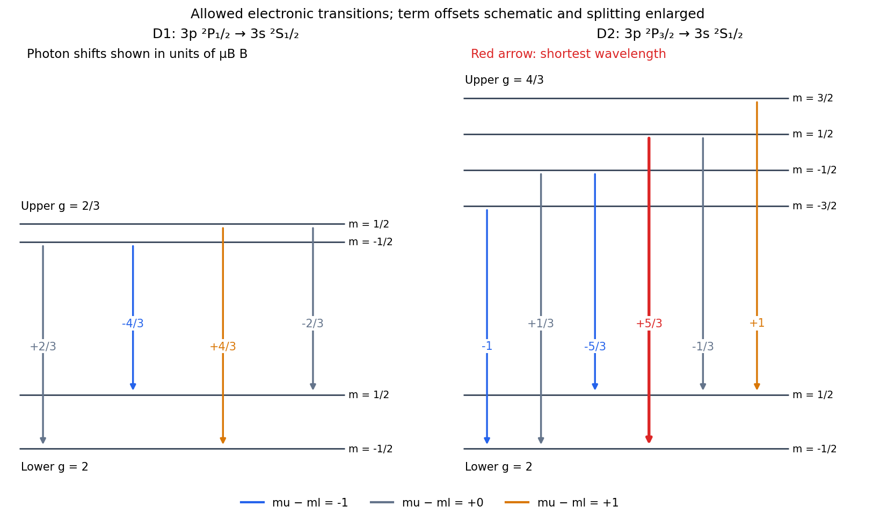
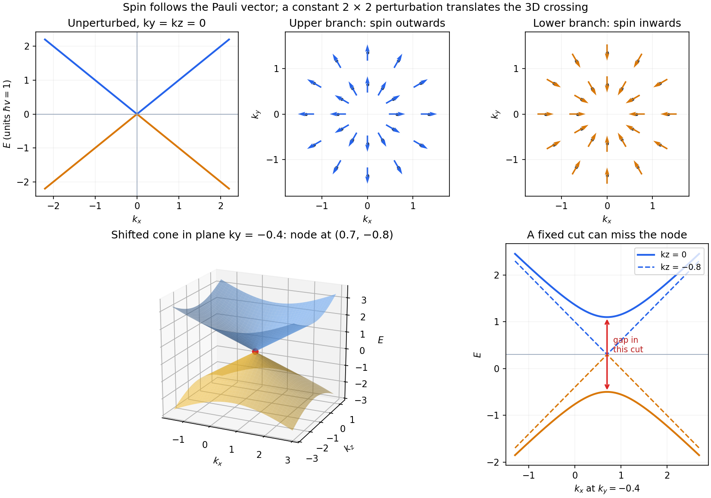
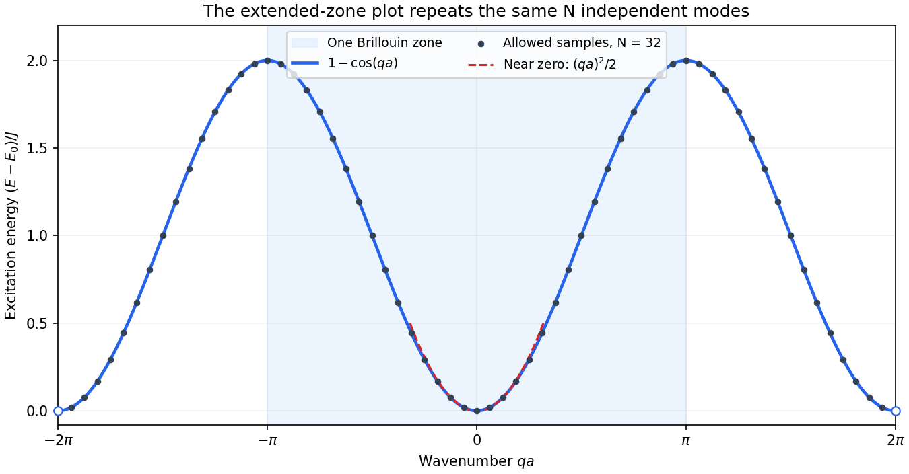

# 2018

↑ **Parent:** [Past exam of the advanced quantum physics course of the University of Cambridge](../past-exam-of-the-advanced-quantum-physics-course-of-the-university-of-cambridge.md)

[Original paper, released PDF pages 311–315](https://www.whatdotheyknow.com/request/natural_science_tripos_physics_e/response/2127325/attach/3/FOI%202022%20639%20Sullivan%20materials.pdf?cookie_passthrough=1#page=311)

**Table of contents**

- [Section A](#section-a)
  - [1](#section-a/1)
    - [a](#section-a/1/a)
      - [Solution](#section-a/1/a/solution)
    - [b](#section-a/1/b)
      - [Solution](#section-a/1/b/solution)
    - [c](#section-a/1/c)
      - [Solution](#section-a/1/c/solution)
- [Section B](#section-b)
  - [B2](#section-b/b2)
    - [Solution](#section-b/b2/solution)
  - [B3](#section-b/b3)
    - [Solution](#section-b/b3/solution)
  - [B4](#section-b/b4)
    - [Solution](#section-b/b4/solution)

## Section A

↑ **Parent:** [2018](2018.md)

<h3 id="section-a/1">1</h3>

↑ **Parent:** [Section A](#section-a)

<h4 id="section-a/1/a">a</h4>

↑ **Parent:** [1](#section-a/1)

<h5 id="section-a/1/a/solution">Solution</h5>

↑ **Parent:** [A](#section-a/1/a)

Use $|m_1,m_2\rangle$ for a product of the two individual spin-one [spin eigenstates](../angular-momentum-operator.md#spin-eigenstate), with [magnetic quantum numbers](../quantum-mechanics.md#magnetic-quantum-number) $m_i=-1,0,1$. Total $S_z=0$ requires $m_1+m_2=0$, leaving precisely

$$
\boxed{|1,-1\rangle,\qquad |0,0\rangle,\qquad |-1,1\rangle.}
$$

Here these are product labels, not labels of the total [angular momentum](../momentum.md#angular-momentum). Write their coefficients in this order as $\alpha,\beta,\gamma$. With physical [spin ladder operators](../angular-momentum-operator.md#spin-ladder-operator) $S_\pm=S_{1\pm}+S_{2\pm}$, each nonzero individual step has [amplitude](../wave.md#wave-amplitude) $\sqrt2\hbar$, so

$$
S_+|\psi\rangle=\sqrt2\hbar[(\alpha+\beta)|1,0\rangle+(\beta+\gamma)|0,1\rangle],
$$

$$
S_-|\psi\rangle=\sqrt2\hbar[(\alpha+\beta)|0,-1\rangle+(\beta+\gamma)|-1,0\rangle].
$$

Both must vanish for a [singlet state](../angular-momentum-operator.md#singlet-state). The independent [product states](../bell-state.md#product-state) therefore require $\alpha=\gamma=-\beta$. [Wavefunction normalization](../wave-function.md#wavefunction-normalization) gives the [spin-one singlet state](../angular-momentum-operator.md#spin-one-singlet-state)

$$
\boxed{|S=0,M=0\rangle=\frac{|1,-1\rangle-|0,0\rangle+|-1,1\rangle}{\sqrt3},}
$$

up to an overall [quantum phase](../quantum-system.md#quantum-phase). Conversely, $S_z|\psi\rangle=S_+|\psi\rangle=0$ implies $S^2|\psi\rangle=0$ through $S^2=S_-S_++S_z^2+\hbar S_z$, so these conditions really select total [spin](../angular-momentum-operator.md#spin) zero. Distinguishability imposes no additional exchange restriction. The ladder hint uses dimensionless [angular momentum](../momentum.md#angular-momentum) units; restoring its common factor $\hbar$ does not change the coefficient ratios.

<h4 id="section-a/1/b">b</h4>

↑ **Parent:** [1](#section-a/1)

<h5 id="section-a/1/b/solution">Solution</h5>

↑ **Parent:** [B](#section-a/1/b)

For a bound [energy eigenstate](../energy-eigenvalue.md#energy-eigenstate) with a [nondegenerate energy eigenvalue](../quantum-mechanics.md#nondegenerate-energy-eigenvalue) of an even one-dimensional potential, the [wavefunction](../wave-function.md) can be chosen with definite [parity](../quantum-mechanics.md#parity). A uniform [electric field](../electric-field.md) $\mathcal E$ gives the [electric-dipole interaction](../quantum-mechanics.md#electric-dipole-interaction) $H'=-q\mathcal E x$, which is odd under reflection. Hence

$$
\Delta E_n^{(1)}=-q\mathcal E\langle n|x|n\rangle=0,
$$

since $x|\psi_n(x)|^2$ is odd. [Second-order nondegenerate perturbation theory](../quantum-mechanics.md#second-order-nondegenerate-perturbation-theory) then gives the leading allowed [Stark effect](../mathematical-physics.md#stark-effect) shift:

$$
\boxed{\Delta E_n=q^2\mathcal E^2\sum_{r\ne n}\frac{|\langle r|x|n\rangle|^2}{E_n^{(0)}-E_r^{(0)}}+O(\mathcal E^4).}
$$

Only opposite-[parity](../quantum-mechanics.md#parity) intermediate states have nonzero [position](../classical-mechanics.md#position) [matrix elements](../vector-space.md#matrix-element). More generally, reflection maps $H(\mathcal E)$ to $H(-\mathcal E)$, so an analytic nondegenerate [energy level](../quantum-mechanics.md#energy-level) is an even function of the field. This explains the absence of all odd orders and the usual [quadratic Stark effect](../mathematical-physics.md#quadratic-stark-effect).

A level separation changes by the difference of the two quadratic coefficients. Symmetry alone does not guarantee a nonzero differential shift: in a [displaced quantum harmonic oscillator](../quantum-harmonic-oscillator.md#displaced-quantum-harmonic-oscillator) every level moves by the same $-q^2\mathcal E^2/(2m\omega^2)$, leaving every spacing unchanged. Degenerate states would instead require [degenerate perturbation theory](../quantum-mechanics.md#degenerate-perturbation-theory) and can split linearly; the [nondegeneracy of one-dimensional bound states](../mathematical-physics.md#nondegeneracy-of-one-dimensional-bound-states) applies to ordinary isolated well levels.

<h4 id="section-a/1/c">c</h4>

↑ **Parent:** [1](#section-a/1)

<h5 id="section-a/1/c/solution">Solution</h5>

↑ **Parent:** [C](#section-a/1/c)

Neglect [hyperfine structure](../quantum-mechanics.md#hyperfine-structure) and use the electronic weak-field [Zeeman splitting](../atomic-physics.md#zeeman-splitting) regime, where $\mu_BB$ is small compared with the [spin-orbit interaction](../atomic-physics.md#spin-orbit-interaction) splitting. The [sodium](../chemical-substance.md#sodium) levels are $3s\,{}^2S_{1/2}$, $3p\,{}^2P_{1/2}$ and $3p\,{}^2P_{3/2}$. The [Landé g-factor](../atomic-physics.md#lande-g-factor) formula gives

$$
\boxed{g(3s\,{}^2S_{1/2})=2,\qquad g(3p\,{}^2P_{1/2})=\frac23,\qquad g(3p\,{}^2P_{3/2})=\frac43.}
$$

For example, inserting $L=1,S=1/2,J=1/2$ gives $3/2+(3/4-2)/(2\cdot3/4)=2/3$. Each sublevel with [magnetic quantum number](../quantum-mechanics.md#magnetic-quantum-number) $m_J$ shifts by $g_Jm_J\mu_BB$. Thus the lower level has shifts $\pm\mu_BB$, the upper $J=1/2$ level has shifts $\pm\mu_BB/3$, and the upper $J=3/2$ level has shifts $\pm2\mu_BB$ and $\pm2\mu_BB/3$.

The [electric-dipole selection rule](../quantum-mechanics.md#electric-dipole-selection-rule) allows $\Delta J=0,\pm1$ except $0\leftrightarrow0$, and $m_u-m_l=0,\pm1$. Both [fine structure](../atomic-physics.md#fine-structure) branches are allowed. The emitted [photon](../quantum-mechanics.md#photon) [energy](../energy.md) is

$$
E_\gamma=E_u^{(0)}-E_l^{(0)}+\mu_BB(g_um_u-2m_l).
$$

All the allowed components of the [sodium D-line Zeeman pattern](../atomic-physics.md#sodium-d-line-zeeman-pattern) are listed below; the last column is the [photon](../quantum-mechanics.md#photon) shift in units of $\mu_BB$:

$$
\begin{array}{c|r|r|r}
\text{upper term}&m_u&m_l&\delta E_\gamma/(\mu_BB)\\ \hline
{}^2P_{1/2}&-1/2&-1/2&+2/3\\
&-1/2&+1/2&-4/3\\
&+1/2&-1/2&+4/3\\
&+1/2&+1/2&-2/3\\ \hline
{}^2P_{3/2}&-3/2&-1/2&-1\\
&-1/2&-1/2&+1/3\\
&-1/2&+1/2&-5/3\\
&+1/2&-1/2&+5/3\\
&+1/2&+1/2&-1/3\\
&+3/2&+1/2&+1
\end{array}
$$

These are four components of D1 and six of D2. Their strengths need not be equal; the table and arrows specify allowed transitions, not intensities.

**[Figure 1](#section-a/1/c/image-all-ten-electronic-dipole-transitions-of-the-weak-field-sodium-d-doublet). All ten electronic dipole transitions of the weak-field sodium D doublet**.

The $3p\,{}^2P_{3/2}$ level lies above $3p\,{}^2P_{1/2}$, so D2 has the larger zero-field [photon](../quantum-mechanics.md#photon) [energy](../energy.md). [NIST, [Energy levels](../quantum-mechanics.md#energy-level) of Neutral [Sodium](../chemical-substance.md#sodium), 3p fine-structure ordering](https://physics.nist.gov/PhysRefData/Handbook/Tables/sodiumtable5.htm) In the stated weak-field regime its most positive shift is $5\mu_BB/3$. Since $\lambda=hc/E_\gamma$, the shortest [wavelength](../wave-equation.md#wavelength) is therefore produced by

$$
\boxed{3p\,{}^2P_{3/2},\ m_J=+\frac12\ \longrightarrow\ 3s\,{}^2S_{1/2},\ m_J=-\frac12.}
$$

The tempting $m_u=3/2\to m_l=-1/2$ pair has a larger difference of level shifts but is forbidden because $|m_u-m_l|=2$.

## Section B

↑ **Parent:** [2018](2018.md)

<h3 id="section-b/b2">B2</h3>

↑ **Parent:** [Section B](#section-b)

<h4 id="section-b/b2/solution">Solution</h4>

↑ **Parent:** [B2](#section-b/b2)

For the [quantum harmonic oscillator](../quantum-harmonic-oscillator.md), the [canonical commutation relation](../quantum-mechanics.md#canonical-commutation-relation) $[x,p]=i\hbar$ gives $[a,a^\dagger]=1$ and $H_0=\hbar\omega_0(a^\dagger a+1/2)$. Inverting the definition of the [annihilation operator](../quantum-harmonic-oscillator.md#annihilation-operator) gives

$$
x=\sqrt{\frac{\hbar}{2m\omega_0}}(a+a^\dagger).
$$

With normalized [energy eigenstates](../energy-eigenvalue.md#energy-eigenstate) and consistent phases, $a|0\rangle=0$ and $a^\dagger|0\rangle=|1\rangle$. Their [orthogonality](../inner-product.md#orthogonal-vectors) therefore gives

$$
\boxed{|\langle1|x|0\rangle|=\sqrt{\frac{\hbar}{2m\omega_0}}\equiv x_{01}.}
$$

More generally, $\langle n|x|0\rangle=x_{01}\delta_{n1}$, the oscillator [electric-dipole selection rule](../quantum-mechanics.md#electric-dipole-selection-rule) out of the [ground state](../quantum-mechanics.md#ground-state).

To derive the transition [amplitude](../wave.md#wave-amplitude), insert the expansion in stationary [energy eigenstates](../energy-eigenvalue.md#energy-eigenstate) into the [Schrödinger equation](../mathematical-physics.md#schrodinger-equation) with $H=H_0+V_1(t)$. The derivatives of the explicit phases cancel the $H_0$ terms. Projection onto $\langle n|$ leaves the exact coefficient equations

$$
i\hbar\dot c_n(t)=\sum_r e^{i(E_n-E_r)t/\hbar}\langle n|V_1(t)|r\rangle c_r(t).
$$

The initial conditions are $c_0(-\infty)=1$ and $c_{n\ne0}(-\infty)=0$. To first order in the perturbation, replace the [amplitudes](../wave.md#wave-amplitude) on the right by these initial values. Since $E_n-E_0=n\hbar\omega_0$, integration gives [time-dependent perturbation theory](../quantum-mechanics.md#time-dependent-perturbation-theory) in the form

$$
\boxed{c_n^{(1)}(t)=\frac1{i\hbar}\int_{-\infty}^t e^{in\omega_0t'}\langle n|V_1(t')|0\rangle\,dt'\qquad(n\ne0).}
$$

This neglects depletion and higher-order transitions; it is justified when the total transition [probability](../probability-theory.md#probability) is small. Here $\langle0|x|0\rangle=0$, so there is also no first-order diagonal [amplitude](../wave.md#wave-amplitude) change from this particular perturbation.

For the exponential [electric field](../electric-field.md), the [electric-dipole interaction](../quantum-mechanics.md#electric-dipole-interaction) is $V_1=-qEx e^{t/\tau}$, with $\tau>0$. Only $n=1$ couples directly to the initial state, and

$$
c_1^{(1)}(0)=\frac{iqEx_{01}}\hbar\int_{-\infty}^0e^{(1/\tau+i\omega_0)t'}\,dt'.
$$

The [Born rule](../wave-function.md#born-rule) gives

$$
\boxed{p_1(0)\simeq\frac{q^2E^2}{2\hbar m\omega_0}\left|\int_{-\infty}^0e^{i\omega_0t'}e^{t'/\tau}\,dt'\right|^2.}
$$

The real part $1/\tau>0$ makes the lower-limit contribution vanish. Thus

$$
\int_{-\infty}^0e^{(1/\tau+i\omega_0)t'}\,dt'=\frac1{1/\tau+i\omega_0},\qquad \boxed{p_1(0)\simeq\frac{q^2E^2\tau^2}{2\hbar m\omega_0[1+\omega_0^2\tau^2]}.}
$$

Set $u=\omega_0\tau$ and $\eta=qEx_{01}/(\hbar\omega_0)$. The dimensionless form is $p_1/\eta^2=u^2/(1+u^2)$, increasing monotonically from zero to one, with half the asymptotic value at $u=1$. A sufficient weak-field condition for the entire curve is $|\eta|\ll1$.

**[Figure 2](#section-b/b2/image-original-basis-excitation-approaches-a-finite-limit-during-slow-oscillator-displacement). Original-basis excitation approaches a finite limit during slow oscillator displacement**.

For $\omega_0\tau\ll1$, the force has acted for too little time to appreciably change the state at the instant of measurement. The short-time [amplitude](../wave.md#wave-amplitude) is approximately $iqEx_{01}\tau/\hbar$, so

$$
\boxed{p_1(0)\simeq\frac{q^2E^2\tau^2}{2\hbar m\omega_0}\quad(\omega_0\tau\ll1).}
$$

For $\omega_0\tau\gg1$, instead,

$$
\boxed{p_1(0)\longrightarrow\frac{q^2E^2}{2\hbar m\omega_0^3}=\eta^2.}
$$

The nonzero slow-switch limit is a [probability](../probability-theory.md#probability) in the original $H_0$ basis. It does not contradict the [adiabatic theorem](../quantum-theory.md#adiabatic-theorem). At $t=0$ the instantaneous oscillator is displaced by $d=qE/(m\omega_0^2)$:

$$
H(0)=\frac{p^2}{2m}+\frac12m\omega_0^2(x-d)^2-\frac{q^2E^2}{2m\omega_0^2}.
$$

Its [ground state](../quantum-mechanics.md#ground-state) is $|0_E\rangle=|0\rangle+\eta|1\rangle+O(\eta^2)$ in the original basis. Adiabatic following therefore predicts exactly the finite original-basis limit found above.

The [exponential switch-on of a driven quantum oscillator](../quantum-harmonic-oscillator.md#exponential-switch-on-of-a-driven-quantum-oscillator) also permits an exact check. A linear force preserves a [coherent state](../quantum-theory.md#coherent-state), with original-basis displacement $\alpha(0)=i\eta u/(1+iu)$. Thus the exact original-basis [probability](../probability-theory.md#probability) is $|\alpha|^2e^{-|\alpha|^2}$, whose weak-field limit is the expression above. In the instantaneous displaced basis the mean excitation is instead $|\alpha-\eta|^2=\eta^2/(1+u^2)$ and does tend to zero for slow switching. The two bases measure different notions of excitation.

<h3 id="section-b/b3">B3</h3>

↑ **Parent:** [Section B](#section-b)

<h4 id="section-b/b3/solution">Solution</h4>

↑ **Parent:** [B3](#section-b/b3)

Take a normalized [spin one-half](../angular-momentum-operator.md#spin-one-half) state in the $S_z$ [eigenbasis](../linear-operator-theory.md#eigenbasis). Since $\mathbf S=(\hbar/2)\boldsymbol\sigma$, direct multiplication of the [Pauli matrices](../algebra.md#pauli-matrices) gives

$$
\langle S_x\rangle=\frac\hbar2(\alpha^*\beta+\beta^*\alpha),\quad \langle S_y\rangle=\frac\hbar2(-i\alpha^*\beta+i\beta^*\alpha),\quad \langle S_z\rangle=\frac\hbar2(|\alpha|^2-|\beta|^2).
$$

Substitution of the half-angle parametrization gives

$$
\boxed{\langle\mathbf S\rangle=\frac\hbar2(\sin\theta\cos\phi,\sin\theta\sin\phi,\cos\theta).}
$$

Thus $\theta$ and $\phi$ are precisely the polar and azimuthal angles of the mean [spin](../angular-momentum-operator.md#spin). Two complex coefficients contain four real parameters; normalization removes one and an unobservable common [quantum phase](../quantum-system.md#quantum-phase) removes another. The resulting pure states form the [Bloch sphere](../density-matrix.md#bloch-sphere). One may choose $\alpha$ real and nonnegative away from the patch where $\alpha=0$. At the poles the azimuth is redundant. The length $|\langle\mathbf S\rangle|=\hbar/2$ should not be confused with $\sqrt{\langle S^2\rangle}=\sqrt3\hbar/2$.

For a spatial [plane wave](../wave-function.md#plane-wave), $-i\hbar\boldsymbol\nabla$ becomes $\hbar\mathbf k$, so the [Hamiltonian operator](../quantum-system.md#hamiltonian-quantum-mechanics) reduces to the [Weyl Hamiltonian](../relativistic-quantum-field.md#weyl-hamiltonian) [matrix](../vector-space.md#matrix)

$$
H(\mathbf k)=\hbar v\,\boldsymbol\sigma\cdot\mathbf k.
$$

Define $\mathbf n=(\sin\theta\cos\phi,\sin\theta\sin\phi,\cos\theta)$ and $\chi_+=(\cos(\theta/2),e^{i\phi}\sin(\theta/2))^{\mathsf T}$. The [matrix](../vector-space.md#matrix)

$$
\boldsymbol\sigma\cdot\mathbf n=\begin{pmatrix}\cos\theta&e^{-i\phi}\sin\theta\\e^{i\phi}\sin\theta&-\cos\theta\end{pmatrix}
$$

satisfies $(\boldsymbol\sigma\cdot\mathbf n)\chi_+=\chi_+$ by the angle-addition identities. Consequently the displayed [spinor](../algebra-over-a-field.md#spinor) is an [energy eigenstate](../energy-eigenvalue.md#energy-eigenstate) for either $\mathbf k=+k\mathbf n$ or $\mathbf k=-k\mathbf n$, with respective energies $+\hbar vk$ and $-\hbar vk$, for $k\geq0$. Equivalently, at each fixed nonzero [wavevector](../elasticity-physics.md#wavevector) the two branches are

$$
\boxed{E_\pm(\mathbf k)=\pm\hbar v|\mathbf k|\quad(v>0).}
$$

If $v<0$, the two [energy](../energy.md) labels exchange; the ordered [eigenvalues](../linear-operator-theory.md#eigenvalue) are $\pm\hbar|v||\mathbf k|$. Taking $v>0$ sets the convention in the sketches. An [orthogonal](../inner-product.md#orthogonal-vectors) [spinor](../algebra-over-a-field.md#spinor) $\chi_-=(-e^{-i\phi}\sin(\theta/2),\cos(\theta/2))^{\mathsf T}$ obeys $(\boldsymbol\sigma\cdot\mathbf n)\chi_-=-\chi_-$ and supplies the other branch at $+k\mathbf n$.

The [Pauli matrix multiplication law](../algebra.md#pauli-matrix-multiplication-law) independently gives $H(\mathbf k)^2=(\hbar v)^2|\mathbf k|^2I$. The [dispersion relation](../dispersion-relation.md) is therefore a pair of cones touching at zero [energy](../energy.md) and [momentum](../momentum.md); a signed straight-line cut has upper and lower branches $\pm\hbar v|k_x|$. In the $k_z=0$ plane, $\theta=\pi/2$, and the upper-branch mean [spin](../angular-momentum-operator.md#spin) points radially outwards, the lower-branch [spin](../angular-momentum-operator.md#spin) radially inwards. This is [spin-momentum locking](../atomic-physics.md#spin-momentum-locking), not a tangential [spin](../angular-momentum-operator.md#spin) texture. At the touching point the two states are degenerate and the [spin](../angular-momentum-operator.md#spin) direction is not selected by the [Hamiltonian operator](../quantum-system.md#hamiltonian-quantum-mechanics).

**[Figure 3](#section-b/b3/image-radial-spin-locking-and-a-shifted-weyl-cone-including-a-plane-that-misses-its-node). Radial spin locking and a shifted Weyl cone, including a plane that misses its node**.

Now let a spatially constant perturbation have [matrix](../vector-space.md#matrix) $V=\begin{pmatrix}u&w\\w^*&z\end{pmatrix}$, with $u,z$ real. The [Hermitian two-by-two matrix in the Pauli basis](../algebra.md#hermitian-two-by-two-matrix-in-the-pauli-basis) decomposition follows explicitly from

$$
\begin{pmatrix}u&w\\w^*&z\end{pmatrix}=dI+a\sigma_x+b\sigma_y+c\sigma_z=\begin{pmatrix}d+c&a-ib\\a+ib&d-c\end{pmatrix},
$$

where $d=(u+z)/2$, $c=(u-z)/2$, $a=\operatorname{Re}w$, and $b=-\operatorname{Im}w$ are real. Equivalently, $d=\operatorname{tr}V/2$ and $(a,b,c)_i=\operatorname{tr}(V\sigma_i)/2$. The four [matrices](../vector-space.md#matrix) are [linearly independent](../vector-space.md#linear-independence) under the [trace](../linear-algebra.md#matrix-trace) [inner product](../inner-product.md) and span the four-dimensional [real vector space](../vector-space.md#real-vector-space) of Hermitian two-by-two [matrices](../vector-space.md#matrix).

Spatial constancy means the perturbation does not mix different [wavevectors](../elasticity-physics.md#wavevector), so each [momentum](../momentum.md) sector can still be diagonalized independently. Write $\mathbf b=(a,b,c)$. The full [matrix](../vector-space.md#matrix) and its exact [eigenvalues](../linear-operator-theory.md#eigenvalue) are

$$
H'(\mathbf k)=dI+(\hbar v\mathbf k+\mathbf b)\cdot\boldsymbol\sigma,\qquad \boxed{E_\pm(\mathbf k)=d\pm\sqrt{(\hbar vk_x+a)^2+(\hbar vk_y+b)^2+(\hbar vk_z+c)^2}.}
$$

This [constant matrix perturbation of a Weyl Hamiltonian](../relativistic-quantum-field.md#constant-matrix-perturbation-of-a-weyl-hamiltonian) translates the cone to

$$
\boxed{\mathbf k_*=-\frac{(a,b,c)}{\hbar v},\qquad E_*=d.}
$$

In three-dimensional [momentum space](../momentum.md#momentum-space) the [energy bands](../bloch-s-theorem.md#energy-band) still touch; the perturbation produces no full [spectral gap](../linear-operator-theory.md#spectral-gap). The new branch [spin](../angular-momentum-operator.md#spin) directions are parallel and antiparallel to $\hbar v\mathbf k+\mathbf b$, so their radial texture is centered on the shifted point.

A restricted cut must be distinguished from the full [dispersion relation](../dispersion-relation.md). In the fixed plane $k_z=0$, the energies are $d\pm\sqrt{(\hbar vk_x+a)^2+(\hbar vk_y+b)^2+c^2}$, with minimum branch separation $2|c|$. This plane misses the crossing if $c\ne0$. Along any line through $\mathbf k_*$ the [dispersion relation](../dispersion-relation.md) still crosses linearly. Thus a sketch of a gapped fixed-plane cut alone would not describe the gapless three-dimensional [Hamiltonian operator](../quantum-system.md#hamiltonian-quantum-mechanics). The cone after a general perturbation is also no longer a function of $|\mathbf k|$ about the old origin alone.

<h3 id="section-b/b4">B4</h3>

↑ **Parent:** [Section B](#section-b)

<h4 id="section-b/b4/solution">Solution</h4>

↑ **Parent:** [B4](#section-b/b4)

For physical [spin ladder operators](../angular-momentum-operator.md#spin-ladder-operator), $S_j^\pm=S_j^x\pm iS_j^y$. Operators at distinct sites commute. Expanding the two products cancels their cross terms and gives

$$
\frac12(S_j^+S_{j+1}^-+S_j^-S_{j+1}^+)=S_j^xS_{j+1}^x+S_j^yS_{j+1}^y.
$$

Adding the remaining component proves

$$
\boxed{\mathbf S_j\cdot\mathbf S_{j+1}=\frac12(S_j^+S_{j+1}^-+S_j^-S_{j+1}^+)+S_j^zS_{j+1}^z.}
$$

For [spin one-half](../angular-momentum-operator.md#spin-one-half), $S^+|\downarrow\rangle=\hbar|\uparrow\rangle$, $S^-|\uparrow\rangle=\hbar|\downarrow\rangle$, and raising an up [spin](../angular-momentum-operator.md#spin) or lowering a down [spin](../angular-momentum-operator.md#spin) gives zero. These formulas restore the physical $\hbar$ factors implicit in the dimensionless ladder hint.

Let $|n\rangle$ abbreviate the state with the only down [spin](../angular-momentum-operator.md#spin) at site $n$, keeping $|\psi_0\rangle$ for the fully up state. If $n$ lies on neither end of bond $(j,j+1)$, that bond contains two up [spins](../angular-momentum-operator.md#spin). The ladder terms vanish, while $S_j^zS_{j+1}^z$ gives $\hbar^2/4$. Thus

$$
\mathbf S_j\cdot\mathbf S_{j+1}|n\rangle=\frac{\hbar^2}{4}|n\rangle\qquad(n\ne j,j+1).
$$

For a down [spin](../angular-momentum-operator.md#spin) at $j$, the $z$ product is instead $-\hbar^2/4$, and $S_j^+S_{j+1}^-$ moves it to $j+1$ with [amplitude](../wave.md#wave-amplitude) $\hbar^2$. For a down [spin](../angular-momentum-operator.md#spin) at $j+1$, the other ladder product moves it back. Therefore

$$
\boxed{\mathbf S_j\cdot\mathbf S_{j+1}|j\rangle=\frac{\hbar^2}{4}(2|j+1\rangle-|j\rangle),\qquad \mathbf S_j\cdot\mathbf S_{j+1}|j+1\rangle=\frac{\hbar^2}{4}(2|j\rangle-|j+1\rangle).}
$$

Every bond in $|\psi_0\rangle$ is aligned, so summing its $N$ bond energies gives

$$
\boxed{H|\psi_0\rangle=E_0|\psi_0\rangle,\qquad E_0=-\frac{NJ}{4}.}
$$

This is indeed a [ground-state energy](../quantum-mechanics.md#ground-state-energy): a pair of spin-one-half particles has $\mathbf S_j\cdot\mathbf S_{j+1}$ [eigenvalues](../linear-operator-theory.md#eigenvalue) $\hbar^2/4$ and $-3\hbar^2/4$, so each ferromagnetic bond is bounded below by $-J/4$, simultaneously attained by the fully aligned state. The isotropic [Heisenberg model](../angular-momentum-operator.md#heisenberg-model) has a whole maximum-total-spin ground multiplet, not a unique all-up [ground state](../quantum-mechanics.md#ground-state).

In the [single-excitation subspace](../angular-momentum-operator.md#single-excitation-subspace), only the two bonds adjacent to the down [spin](../angular-momentum-operator.md#spin) differ from the aligned background. Their diagonal [energy](../energy.md) increase is $J$, and each neighboring hop has [amplitude](../wave.md#wave-amplitude) $-J/2$. Hence, with periodic site indices,

$$
\boxed{H|n\rangle=(E_0+J)|n\rangle-\frac J2(|n-1\rangle+|n+1\rangle).}
$$

This is an exact finite-dimensional hopping problem. Choose the active one-site translation convention $T|n\rangle=|n+1\rangle$. A periodic plane-wave coefficient pattern requires $e^{iq(n+N)a}=e^{iqna}$, so

$$
\boxed{q=\frac{2\pi\ell}{Na},\qquad \ell\in\mathbb Z,\qquad q\ \text{identified modulo }\frac{2\pi}{a}.}
$$

There are $N$ independent such [wavevectors](../elasticity-physics.md#wavevector), for example one set of $N$ consecutive integers $\ell$ in a [Brillouin zone](../bloch-s-theorem.md#brillouin-zone). The normalized [one-magnon Bloch states on a ring](../statistical-physics.md#one-magnon-bloch-states-on-a-ring) are $|q\rangle=N^{-1/2}\sum_{n=1}^Ne^{iqna}|n\rangle$. Reindexing with the periodic coefficient condition gives $T|q\rangle=e^{-iqa}|q\rangle$ and hence $T^N|q\rangle=|q\rangle$.

There is a logical qualification to the condition stated in the paper. On an $N$-site ring $T^N=I$ already holds for every state. In particular, the finite sum written with an arbitrary real $q$ also returns to itself after $N$ translations; that condition alone does not quantize $q$. The displayed allowed values are the ones for which the ansatz is a single one-site translation [eigenstate](../energy-eigenvalue.md#eigenstate), equivalently a consistently periodic [plane wave](../wave-function.md#plane-wave). This is the additional condition needed for the subsequent energy-eigenstate argument. Other $q$ values generally describe superpositions of the allowed [momentum](../momentum.md) modes.

Apply the hopping [Hamiltonian operator](../quantum-system.md#hamiltonian-quantum-mechanics) and shift the summation index using [periodic boundary condition](../differential-equation.md#periodic-boundary-conditions). The coefficients from $|n-1\rangle$ and $|n+1\rangle$ are respectively $e^{iqa}$ and $e^{-iqa}$ times the original coefficient. Thus

$$
H|q\rangle=\left(E_0+J-\frac J2e^{iqa}-\frac J2e^{-iqa}\right)|q\rangle,
$$

and the [nearest-neighbour ferromagnetic magnon dispersion](../statistical-physics.md#nearest-neighbour-ferromagnetic-magnon-dispersion) is

$$
\boxed{E(q)=E_0+J[1-\cos(qa)]=E_0+2J\sin^2\frac{qa}{2}.}
$$

The unnormalized state in the question has the same [energy](../energy.md). Distinct allowed [momenta](../momentum.md) are [orthogonal](../inner-product.md#orthogonal-vectors), since $N^{-1}\sum_ne^{i(q-q')na}=\delta_{qq'}$ over one set of representatives.

**[Figure 4](#section-b/b4/image-exact-one-magnon-dispersion-and-its-discrete-ring-momenta-over-two-reciprocal-periods). Exact one-magnon dispersion and its discrete ring momenta over two reciprocal periods**.

For large $N$ the sampled [wavevectors](../elasticity-physics.md#wavevector) become dense, and the requested sketch is the periodic curve $[E(q)-E_0]/J=1-\cos(qa)$ over $-2\pi<qa<2\pi$. It has a zero at $q=0$ and tends to the equivalent zero at either open endpoint; maxima $2J$ occur at $q=\pm\pi/a$. Near any equivalent zero,

$$
\boxed{E(q)-E_0=\frac{Ja^2q^2}{2}+O(q^4),}
$$

using $q$ measured from that zero. The low-momentum [ferromagnetic magnon](../statistical-physics.md#ferromagnetic-magnon) is quadratic, with [group velocity](../dispersion-relation.md#group-velocity) $\hbar^{-1}dE/dq=(Ja/\hbar)\sin(qa)$. The $q=0$ state is proportional to the total [spin lowering operator](../angular-momentum-operator.md#spin-lowering-operator) acting on $|\psi_0\rangle$, so it belongs to the same ground multiplet and has exactly zero excitation [energy](../energy.md). Extending the plot beyond one reciprocal period repeats states rather than adding new independent modes. The lattice spacing $a$ is the nearest-neighbor chord length specified in the paper; $Na$ is the translation length in this lattice description, not necessarily the continuous circumference of a circular arrangement.

## ↑ Ancestors (10)

1. [Past exam of the advanced quantum physics course of the University of Cambridge](../past-exam-of-the-advanced-quantum-physics-course-of-the-university-of-cambridge.md)
2. [Advanced Quantum Physics course of the University of Cambridge](../university-of-cambridge.md#advanced-quantum-physics-course-of-the-university-of-cambridge)
3. [Physics course of the year 3 of the natural sciences course of the University of Cambridge](../university-of-cambridge.md#physics-course-of-the-year-3-of-the-natural-sciences-course-of-the-university-of-cambridge)
4. [Year 3 of the natural sciences course of the University of Cambridge](../university-of-cambridge.md#year-3-of-the-natural-sciences-course-of-the-university-of-cambridge)
5. [Year of the natural sciences course of the University of Cambridge](../university-of-cambridge.md#year-of-the-natural-sciences-course-of-the-university-of-cambridge)
6. [Natural sciences course of the University of Cambridge](../university-of-cambridge.md#natural-sciences-course-of-the-university-of-cambridge)
7. [Course of the University of Cambridge](../university-of-cambridge.md#course-of-the-university-of-cambridge)
8. [University of Cambridge](../university-of-cambridge.md)
9. [List of universities](../README.md#list-of-universities)
10. [Codex Wiki](../README.md)
