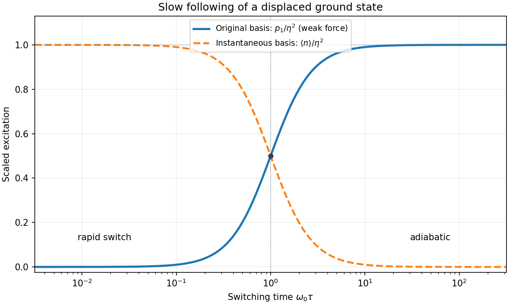

<h1 id="section-b/b2/solution">Solution</h1>

↑ **Parent:** [B2](../b2.md)

For the [quantum harmonic oscillator](../../../../quantum-harmonic-oscillator-split.md), the [canonical commutation relation](../../../../canonical-commutation-relation.md) $[x,p]=i\hbar$ gives $[a,a^\dagger]=1$ and $H_0=\hbar\omega_0(a^\dagger a+1/2)$. Inverting the definition of the [annihilation operator](../../../../annihilation-operator.md) gives

$$
x=\sqrt{\frac{\hbar}{2m\omega_0}}(a+a^\dagger).
$$

With normalized [energy eigenstates](../../../../energy-eigenstate.md) and consistent phases, $a|0\rangle=0$ and $a^\dagger|0\rangle=|1\rangle$. Their [orthogonality](../../../../orthogonal-vectors.md) therefore gives

$$
\boxed{|\langle1|x|0\rangle|=\sqrt{\frac{\hbar}{2m\omega_0}}\equiv x_{01}.}
$$

More generally, $\langle n|x|0\rangle=x_{01}\delta_{n1}$, the oscillator [electric-dipole selection rule](../../../../electric-dipole-selection-rule.md) out of the [ground state](../../../../ground-state.md).

To derive the transition [amplitude](../../../../wave-amplitude.md), insert the expansion in stationary [energy eigenstates](../../../../energy-eigenstate.md) into the [Schrödinger equation](../../../../schrodinger-equation.md) with $H=H_0+V_1(t)$. The derivatives of the explicit phases cancel the $H_0$ terms. Projection onto $\langle n|$ leaves the exact coefficient equations

$$
i\hbar\dot c_n(t)=\sum_r e^{i(E_n-E_r)t/\hbar}\langle n|V_1(t)|r\rangle c_r(t).
$$

The initial conditions are $c_0(-\infty)=1$ and $c_{n\ne0}(-\infty)=0$. To first order in the perturbation, replace the [amplitudes](../../../../wave-amplitude.md) on the right by these initial values. Since $E_n-E_0=n\hbar\omega_0$, integration gives [time-dependent perturbation theory](../../../../time-dependent-perturbation-theory.md) in the form

$$
\boxed{c_n^{(1)}(t)=\frac1{i\hbar}\int_{-\infty}^t e^{in\omega_0t'}\langle n|V_1(t')|0\rangle\,dt'\qquad(n\ne0).}
$$

This neglects depletion and higher-order transitions; it is justified when the total transition [probability](../../../../probability.md) is small. Here $\langle0|x|0\rangle=0$, so there is also no first-order diagonal [amplitude](../../../../wave-amplitude.md) change from this particular perturbation.

For the exponential [electric field](../../../../electric-field-split.md), the [electric-dipole interaction](../../../../electric-dipole-interaction.md) is $V_1=-qEx e^{t/\tau}$, with $\tau>0$. Only $n=1$ couples directly to the initial state, and

$$
c_1^{(1)}(0)=\frac{iqEx_{01}}\hbar\int_{-\infty}^0e^{(1/\tau+i\omega_0)t'}\,dt'.
$$

The [Born rule](../../../../born-rule.md) gives

$$
\boxed{p_1(0)\simeq\frac{q^2E^2}{2\hbar m\omega_0}\left|\int_{-\infty}^0e^{i\omega_0t'}e^{t'/\tau}\,dt'\right|^2.}
$$

The real part $1/\tau>0$ makes the lower-limit contribution vanish. Thus

$$
\int_{-\infty}^0e^{(1/\tau+i\omega_0)t'}\,dt'=\frac1{1/\tau+i\omega_0},\qquad \boxed{p_1(0)\simeq\frac{q^2E^2\tau^2}{2\hbar m\omega_0[1+\omega_0^2\tau^2]}.}
$$

Set $u=\omega_0\tau$ and $\eta=qEx_{01}/(\hbar\omega_0)$. The dimensionless form is $p_1/\eta^2=u^2/(1+u^2)$, increasing monotonically from zero to one, with half the asymptotic value at $u=1$. A sufficient weak-field condition for the entire curve is $|\eta|\ll1$.

**[Figure 2](#section-b/b2/image-original-basis-excitation-approaches-a-finite-limit-during-slow-oscillator-displacement). Original-basis excitation approaches a finite limit during slow oscillator displacement**.

For $\omega_0\tau\ll1$, the force has acted for too little time to appreciably change the state at the instant of measurement. The short-time [amplitude](../../../../wave-amplitude.md) is approximately $iqEx_{01}\tau/\hbar$, so

$$
\boxed{p_1(0)\simeq\frac{q^2E^2\tau^2}{2\hbar m\omega_0}\quad(\omega_0\tau\ll1).}
$$

For $\omega_0\tau\gg1$, instead,

$$
\boxed{p_1(0)\longrightarrow\frac{q^2E^2}{2\hbar m\omega_0^3}=\eta^2.}
$$

The nonzero slow-switch limit is a [probability](../../../../probability.md) in the original $H_0$ basis. It does not contradict the [adiabatic theorem](../../../../adiabatic-theorem.md). At $t=0$ the instantaneous oscillator is displaced by $d=qE/(m\omega_0^2)$:

$$
H(0)=\frac{p^2}{2m}+\frac12m\omega_0^2(x-d)^2-\frac{q^2E^2}{2m\omega_0^2}.
$$

Its [ground state](../../../../ground-state.md) is $|0_E\rangle=|0\rangle+\eta|1\rangle+O(\eta^2)$ in the original basis. Adiabatic following therefore predicts exactly the finite original-basis limit found above.

The [exponential switch-on of a driven quantum oscillator](../../../../exponential-switch-on-of-a-driven-quantum-oscillator.md) also permits an exact check. A linear force preserves a [coherent state](../../../../coherent-state.md), with original-basis displacement $\alpha(0)=i\eta u/(1+iu)$. Thus the exact original-basis [probability](../../../../probability.md) is $|\alpha|^2e^{-|\alpha|^2}$, whose weak-field limit is the expression above. In the instantaneous displaced basis the mean excitation is instead $|\alpha-\eta|^2=\eta^2/(1+u^2)$ and does tend to zero for slow switching. The two bases measure different notions of excitation.

## ↑ Ancestors (13)

1. [B2](../b2.md)
2. [Section B](../../section-b.md)
3. [2018](../../../2018-split.md)
4. [Past exam of the advanced quantum physics course of the University of Cambridge](../../../split.md)
5. [Advanced Quantum Physics course of the University of Cambridge](../../../../advanced-quantum-physics-course-of-the-university-of-cambridge.md)
6. [Physics course of the year 3 of the natural sciences course of the University of Cambridge](../../../../physics-course-of-the-year-3-of-the-natural-sciences-course-of-the-university-of-cambridge.md)
7. [Year 3 of the natural sciences course of the University of Cambridge](../../../../year-3-of-the-natural-sciences-course-of-the-university-of-cambridge.md)
8. [Year of the natural sciences course of the University of Cambridge](../../../../year-of-the-natural-sciences-course-of-the-university-of-cambridge.md)
9. [Natural sciences course of the University of Cambridge](../../../../natural-sciences-course-of-the-university-of-cambridge.md)
10. [Course of the University of Cambridge](../../../../course-of-the-university-of-cambridge.md)
11. [University of Cambridge](../../../../university-of-cambridge-split.md)
12. [List of universities](../../../../list-of-universities.md)
13. [Codex Wiki](../../../../split.md)
