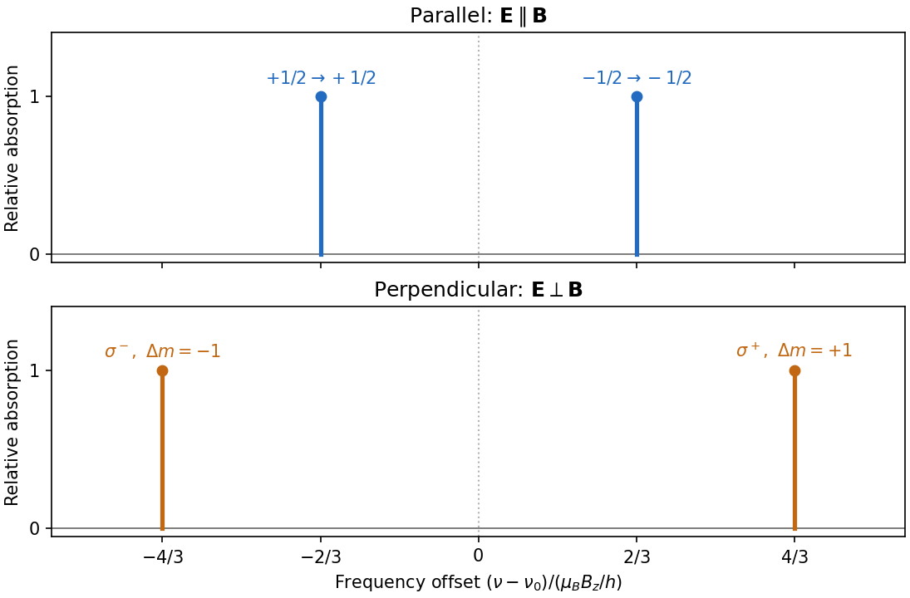

<h1 id="section-a/3/solution">Solution</h1>

↑ **Parent:** [3](../3.md)

Use the electronic weak-field [Zeeman splitting](../../../../zeeman-splitting.md) model, neglecting [hyperfine structure](../../../../hyperfine-structure.md). The [Landé g-factor](../../../../lande-g-factor.md) is $g_g=2$ for $3S_{1/2}$ and $g_e=2/3$ for $3P_{1/2}$. The shift of an absorption [frequency](../../../../frequency.md) is therefore

$$
\delta\nu=\frac{\mu_BB_z}{h}(g_em_e-g_gm_g),\qquad m_g,m_e=\pm\frac12.
$$

Here the [magnetic field](../../../../magnetic-field-split.md) is weak relative to [spin-orbit coupling](../../../../spin-orbit-interaction.md), so $J$ remains a useful [quantum number](../../../../quantum-number.md), but the [spectral line](../../../../spectral-line.md) widths are small enough to resolve its magnetic substates.

For [linear polarization](../../../../linear-polarization.md) parallel to $z$, the optical [electric field](../../../../electric-field-split.md) has only the field-axis $\pi$ component. The [electric-dipole selection rule](../../../../electric-dipole-selection-rule.md) is $\Delta m=0$. Its two allowed transitions are $m_g=m_e=\pm1/2$, giving

$$
\boxed{\mathbf E\parallel\mathbf B:\qquad
\nu=\nu_0\pm\frac{2\mu_BB_z}{3h}.}
$$

For propagation perpendicular to $z$ with [linear polarization](../../../../linear-polarization.md) also perpendicular to $z$, the optical [electric field](../../../../electric-field-split.md) is an equal-amplitude combination of the two field-axis circular components. It drives $\sigma^\pm$ transitions with $\Delta m=\pm1$. These connect $-1/2\to+1/2$ and $+1/2\to-1/2$, giving

$$
\boxed{\mathbf E\perp\mathbf B:\qquad
\nu=\nu_0\pm\frac{4\mu_BB_z}{3h}.}
$$

Thus each orientation selects two lines, with twice the separation in the perpendicular-polarization case. Neither pair has an unshifted central component. This is [polarization-selective Zeeman splitting of an alkali D1 line](../../../../polarization-selective-zeeman-splitting-of-an-alkali-d1-line.md), an [anomalous Zeeman effect](../../../../anomalous-zeeman-effect.md) rather than a normal orbital triplet.

**[Figure 1](#section-a/3/image-polarization-selects-two-different-sodium-d1-zeeman-doublets). Polarization selects two different sodium D1 Zeeman doublets**. Original electronic-level prediction in units $\mu_BB_z/h$. Equal heights within each pair illustrate an initially unpolarized lower level and a weak probe; optical pumping can alter populations and hence strengths. Hyperfine structure is omitted, as in the stated electronic $J$-level model.

## ↑ Ancestors (13)

1. [3](../3.md)
2. [Section A](../../section-a.md)
3. [2019](../../../2019-split.md)
4. [Past exam of the advanced quantum physics course of the University of Cambridge](../../../split.md)
5. [Advanced Quantum Physics course of the University of Cambridge](../../../../advanced-quantum-physics-course-of-the-university-of-cambridge.md)
6. [Physics course of the year 3 of the natural sciences course of the University of Cambridge](../../../../physics-course-of-the-year-3-of-the-natural-sciences-course-of-the-university-of-cambridge.md)
7. [Year 3 of the natural sciences course of the University of Cambridge](../../../../year-3-of-the-natural-sciences-course-of-the-university-of-cambridge.md)
8. [Year of the natural sciences course of the University of Cambridge](../../../../year-of-the-natural-sciences-course-of-the-university-of-cambridge.md)
9. [Natural sciences course of the University of Cambridge](../../../../natural-sciences-course-of-the-university-of-cambridge.md)
10. [Course of the University of Cambridge](../../../../course-of-the-university-of-cambridge.md)
11. [University of Cambridge](../../../../university-of-cambridge-split.md)
12. [List of universities](../../../../list-of-universities.md)
13. [Codex Wiki](../../../../split.md)
