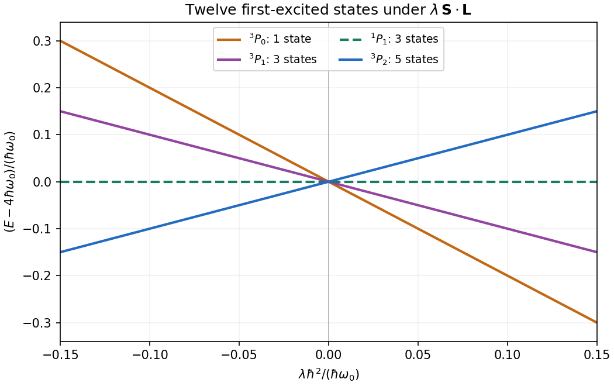

<h1 id="section-b/5/solution">Solution</h1>

↑ **Parent:** [5](../5.md)

The single-electron isotropic [quantum harmonic oscillator](../../../../quantum-harmonic-oscillator-split.md) has energies

$$
\epsilon_{n_xn_yn_z}=\hbar\omega_0\left(n_x+n_y+n_z+\frac32\right).
$$

Its lowest spatial orbital, denoted $s$, is unique, with energy $3\hbar\omega_0/2$. Including [spin one-half](../../../../spin-one-half.md) gives two spin orbitals. Two identical [electrons](../../../../electron.md) can occupy both only with opposite spin in the unique [singlet state](../../../../singlet-state.md). Thus the two-electron [ground state](../../../../ground-state.md) has energy $3\hbar\omega_0$ and multiplicity one.

The first excited spatial shell consists of $p_x,p_y,p_z$, each of energy $5\hbar\omega_0/2$, giving six spin orbitals. A first-excited two-electron [Slater determinant](../../../../slater-determinant.md) occupies one of the two ground-shell spin orbitals and one of these six excited-shell spin orbitals. Hence

$$
\boxed{E_{\rm ground}=3\hbar\omega_0,\quad d_{\rm ground}=1;
\qquad E_{\rm first}=4\hbar\omega_0,\quad d_{\rm first}=2\times6=12.}
$$

No further factor of two is inserted for interchanging the electrons, since the [fermionic exchange symmetry](../../../../fermi-dirac-statistics.md) is already built into a [Slater determinant](../../../../slater-determinant.md).

The spatial [Hamiltonian operator](../../../../hamiltonian-quantum-mechanics.md) is invariant under simultaneous rotations of both positions, so $[H_0,L_k]=0$ for each component of the total [orbital angular momentum](../../../../orbital-angular-momentum.md). It is also spin independent, so $[H_0,S_k]=0$ for each total [spin](../../../../spin.md) component. Therefore

$$
\boxed{[H_0,L^2]=[H_0,S^2]=0,}
$$

expressing [conservation of angular momentum](../../../../conservation-of-angular-momentum.md) and conservation of the total spin magnitude for this model. The [Pauli exclusion principle](../../../../pauli-exclusion-principle.md) restricts which states occur but does not break either symmetry.

To change the first-shell basis, take normalized real Cartesian orbitals $\phi_x,\phi_y,\phi_z$. Using [spherical coordinates](../../../../spherical-coordinate-system.md), $z=r\cos\theta$ and $x\pm iy=r\sin\theta e^{\pm i\varphi}$. Comparison with the [spherical harmonics](../../../../spherical-harmonic.md) gives the [Cartesian and spherical bases of the first oscillator shell](../../../../cartesian-and-spherical-bases-of-the-first-oscillator-shell.md):

$$
\boxed{\phi_{+1}=-\frac{\phi_x+i\phi_y}{\sqrt2},\qquad
\phi_0=\phi_z,\qquad
\phi_{-1}=\frac{\phi_x-i\phi_y}{\sqrt2}.}
$$

Each is a common radial factor $R_p(r)$ times $Y_{1m}(\theta,\varphi)$, so $l=1$ and $m=1,0,-1$. Their normalizations and mutual orthogonality follow because this is a [unitary](../../../../unitary-connection.md) change of basis. The ground spatial orbital has $l=0$.

For two ground-shell electrons, [addition of angular momentum](../../../../addition-of-angular-momentum.md) gives $L=0$, and their symmetric spatial state requires $S=0$. For one electron in each shell, $0\otimes1$ gives only $L=1$. For each $m=-1,0,1$, form the normalized spatial combinations

$$
\Phi_m^\pm(1,2)=\frac{s(1)\phi_m(2)\pm\phi_m(1)s(2)}{\sqrt2}.
$$

The [exchange symmetry of two identical spin-one-half fermions](../../../../exchange-symmetry-of-two-identical-spin-one-half-fermions.md) permits $\Phi_m^+$ with the [singlet state](../../../../singlet-state.md) $\chi_{00}$ and $\Phi_m^-$ with each [triplet state](../../../../spin-one-half-triplet-state.md) $\chi_{1M}$. In [term symbol](../../../../term-symbol.md) notation the manifolds are therefore

$$
\boxed{\begin{array}{c|c|c|c}
\text{energy}&(L,S)&\text{term}&\text{multiplicity}\\ \hline
3\hbar\omega_0&(0,0)&{}^1S&1\\
4\hbar\omega_0&(1,0)&{}^1P&3\\
4\hbar\omega_0&(1,1)&{}^3P&9
\end{array}}
$$

The count $(2L+1)(2S+1)$ reproduces $1$ and $3+9=12$, as required. Both exchange symmetries are possible for the distinct occupied orbitals; dropping either spin sector would undercount the [two-electron states in the first two shells of an isotropic oscillator](../../../../two-electron-states-in-the-first-two-shells-of-an-isotropic-oscillator.md).

For the specified [spin-orbit interaction](../../../../spin-orbit-interaction.md), $\mathbf S$ and $\mathbf L$ are the total two-electron operators. Set $\mathbf J=\mathbf L+\mathbf S$. The [spin-dot-product eigenvalue](../../../../spin-dot-product-eigenvalue.md) identity gives

$$
\Delta E_{LSJ}=\frac{\lambda\hbar^2}{2}[J(J+1)-L(L+1)-S(S+1)].
$$

For the $L=1,S=0$ singlet, $J=1$ and the shift is zero. For the $L=S=1$ triplet, $J=0,1,2$. The [spin-orbit splitting of the first excited two-electron oscillator level](../../../../spin-orbit-splitting-of-the-first-excited-two-electron-oscillator-level.md) is consequently

$$
\boxed{\begin{array}{c|c|c}
\text{level}&\Delta E&\text{multiplicity}\\ \hline
{}^3P_0&-2\lambda\hbar^2&1\\
{}^3P_1&-\lambda\hbar^2&3\\
{}^1P_1&0&3\\
{}^3P_2&+\lambda\hbar^2&5
\end{array}}
$$

Add each shift to $4\hbar\omega_0$. The multiplicities sum to twelve and their weighted shift sums to zero. For positive $\lambda$ the table is ordered in energy; for negative $\lambda$ the ordering reverses. Weak coupling means $|\lambda|\hbar^2\ll\hbar\omega_0$. Since this total-spin interaction commutes with $H_0$, $L^2$ and $S^2$, the shifts within this invariant manifold are in fact exact for the specified model, although only first order was requested.

**[Figure 2](#section-b/5/image-spin-orbit-splitting-of-the-twelve-state-first-excited-two-electron-oscillator-manifold). Spin-orbit splitting of the twelve-state first-excited two-electron oscillator manifold**. Original plot of shifts from the common unperturbed energy $4\hbar\omega_0$. Labels give the [term symbol](../../../../term-symbol.md) and number of magnetic substates. Both signs of the coupling are shown; the singlet branch remains unshifted.

## ↑ Ancestors (13)

1. [5](../5.md)
2. [Section B](../../section-b.md)
3. [2019](../../../2019-split.md)
4. [Past exam of the advanced quantum physics course of the University of Cambridge](../../../split.md)
5. [Advanced Quantum Physics course of the University of Cambridge](../../../../advanced-quantum-physics-course-of-the-university-of-cambridge.md)
6. [Physics course of the year 3 of the natural sciences course of the University of Cambridge](../../../../physics-course-of-the-year-3-of-the-natural-sciences-course-of-the-university-of-cambridge.md)
7. [Year 3 of the natural sciences course of the University of Cambridge](../../../../year-3-of-the-natural-sciences-course-of-the-university-of-cambridge.md)
8. [Year of the natural sciences course of the University of Cambridge](../../../../year-of-the-natural-sciences-course-of-the-university-of-cambridge.md)
9. [Natural sciences course of the University of Cambridge](../../../../natural-sciences-course-of-the-university-of-cambridge.md)
10. [Course of the University of Cambridge](../../../../course-of-the-university-of-cambridge.md)
11. [University of Cambridge](../../../../university-of-cambridge-split.md)
12. [List of universities](../../../../list-of-universities.md)
13. [Codex Wiki](../../../../split.md)
