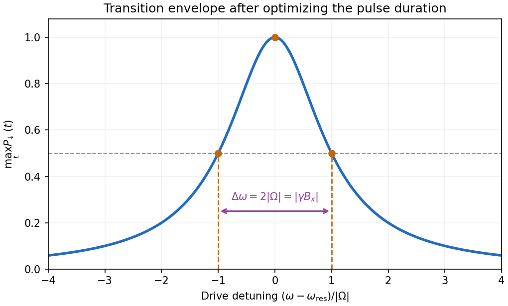

<h1 id="section-b/4/c/solution">Solution</h1>

↑ **Parent:** [C](../c.md)

With $\Omega=\gamma B_x/2$, the [Born rule](../../../../../born-rule.md) applied to the supplied down-spin [probability amplitude](../../../../../probability-amplitude.md) gives

$$
P_\downarrow(t)=\frac{\Omega^2}{\delta^2+\Omega^2}
\sin^2\left(\frac{\sqrt{\delta^2+\Omega^2}\,t}{2}\right).
$$

For nonzero transverse field, the maxima occur at

$$
\boxed{t_j=\frac{(2j+1)\pi}{\omega_R},\quad j=0,1,\ldots,
\qquad P_{\max}(\omega)=\frac{\Omega^2}{(\omega-\omega_z)^2+\Omega^2}.}
$$

The first maximum is reached at $\pi/\omega_R$; on resonance this is a [Rabi pi pulse](../../../../../rabi-pi-pulse.md). The [resonance envelope of a Rabi transition](../../../../../resonance-envelope-of-a-rabi-transition.md) is a [Lorentzian line shape](../../../../../lorentzian-line-shape.md), centred on $\omega_{\mathrm{res}}=\omega_z$ under the orientation convention above. It has half its peak value at $|\omega-\omega_z|=|\Omega|$, so its [full width at half maximum](../../../../../full-width-at-half-maximum.md) is

$$
\boxed{\Delta\omega=2|\Omega|=|\gamma B_x|,
\qquad\frac{\omega_{\mathrm{res}}}{\Delta\omega}=\frac{|B_z|}{|B_x|}.}
$$

If resonance width is instead defined as the half-width, the ratio differs by a factor of two but has the same requested proportionality. The [quality factor](../../../../../q-factor.md) is large precisely in the regime where the [rotating-wave approximation](../../../../../rotating-wave-approximation.md) is justified. The envelope is obtained by choosing the best time separately at each drive frequency; a measurement at one fixed pulse duration has a different line profile.

**[Figure 1](#section-b/4/c/image-maximum-spin-flip-probability-versus-drive-detuning). Maximum spin-flip probability versus drive detuning**. Original [rotating-wave approximation](../../../../../rotating-wave-approximation.md) envelope, with the two half-height detunings marked. The maximum is over interaction time independently at each drive frequency.

## ↑ Ancestors (14)

1. [C](../c.md)
2. [4](../../4.md)
3. [Section B](../../../section-b.md)
4. [2021](../../../../2021-split.md)
5. [Past exam of the advanced quantum physics course of the University of Cambridge](../../../../split.md)
6. [Advanced Quantum Physics course of the University of Cambridge](../../../../../advanced-quantum-physics-course-of-the-university-of-cambridge.md)
7. [Physics course of the year 3 of the natural sciences course of the University of Cambridge](../../../../../physics-course-of-the-year-3-of-the-natural-sciences-course-of-the-university-of-cambridge.md)
8. [Year 3 of the natural sciences course of the University of Cambridge](../../../../../year-3-of-the-natural-sciences-course-of-the-university-of-cambridge.md)
9. [Year of the natural sciences course of the University of Cambridge](../../../../../year-of-the-natural-sciences-course-of-the-university-of-cambridge.md)
10. [Natural sciences course of the University of Cambridge](../../../../../natural-sciences-course-of-the-university-of-cambridge.md)
11. [Course of the University of Cambridge](../../../../../course-of-the-university-of-cambridge.md)
12. [University of Cambridge](../../../../../university-of-cambridge-split.md)
13. [List of universities](../../../../../list-of-universities.md)
14. [Codex Wiki](../../../../../split.md)
