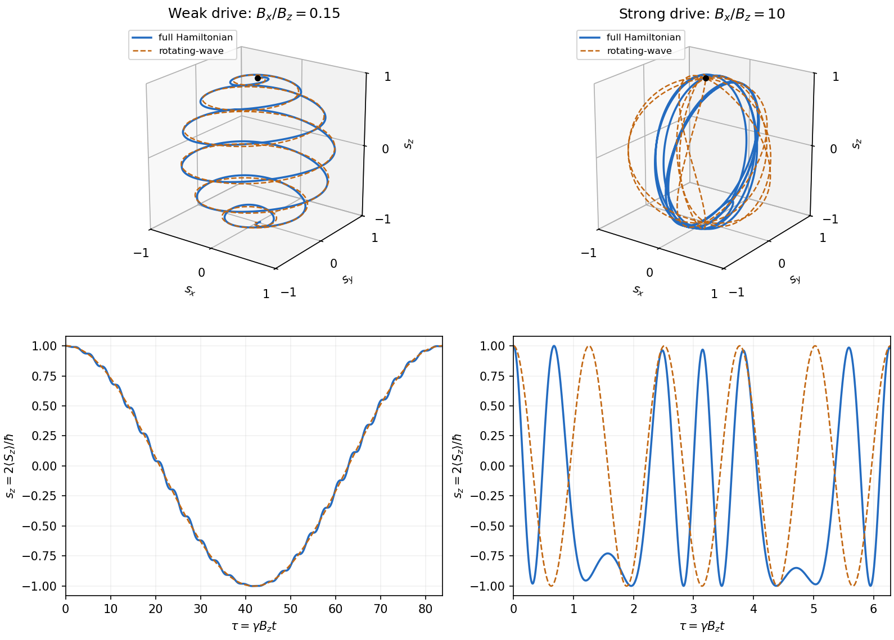

<h1 id="section-b/4/d/solution">Solution</h1>

↑ **Parent:** [D](../d.md)

At resonance, retain the signed coupling $\Omega=\gamma B_x/2$. In the [interaction picture](../../../../../interaction-picture.md), the given solution reduces to $c_1=\cos(\Omega t/2)$ and $c_2=i\sin(\Omega t/2)$. Returning to the [Schrödinger picture](../../../../../schrodinger-picture.md) gives

$$
|\psi(t)\rangle=e^{i\omega_zt/2}\cos(\Omega t/2)|\uparrow\rangle
+i e^{-i\omega_zt/2}\sin(\Omega t/2)|\downarrow\rangle.
$$

For a normalized spinor $(a,b)^T$, the [Pauli matrices](../../../../../pauli-matrices.md) give $\langle\boldsymbol\sigma\rangle=(2\operatorname{Re}a^*b,2\operatorname{Im}a^*b,|a|^2-|b|^2)$. Therefore the [spin](../../../../../spin.md) [expectation value](../../../../../expectation-value.md) within the [rotating-wave approximation](../../../../../rotating-wave-approximation.md) is

$$
\boxed{\langle\mathbf S\rangle_t=\frac\hbar2
\begin{pmatrix}
\sin(\Omega t)\sin(\omega_zt)\\
\sin(\Omega t)\cos(\omega_zt)\\
\cos(\Omega t)
\end{pmatrix}.}
$$

Its magnitude is $\hbar/2$: the [Bloch vector](../../../../../bloch-vector.md) stays on the unit sphere. In a frame rotating about $z$ at angular velocity $-\omega_z$, it makes a uniform rotation in the $yz$ plane. For $|B_x|\ll|B_z|$, this gives slow [Rabi oscillations](../../../../../rabi-cycle.md) between the poles, accompanied by rapid laboratory [Larmor precession](../../../../../larmor-precession.md) about $z$.

If the same formula is formally used for $|B_z|\ll|B_x|$, it predicts fast meridional rotations whose plane turns slowly about $z$. However, the original PDF really does ask for this opposite limit, and it lies outside the assumption used in part (b). That formal description is not a controlled prediction for the stated linearly driven [Hamiltonian operator](../../../../../hamiltonian-quantum-mechanics.md).

A valid strong-drive description starts from the exact equation for the [Bloch vector](../../../../../bloch-vector.md) $\mathbf s=2\langle\mathbf S\rangle/\hbar$:

$$
\frac{d\mathbf s}{dt}=\gamma\mathbf s\times\bigl(B_x\cos(\omega t),0,B_z\bigr).
$$

For times $|\gamma B_z|t\ll1$, neglecting the weak bias gives a controlled leading approximation, since the time integral of the omitted [Hamiltonian operator](../../../../../hamiltonian-quantum-mechanics.md) has small norm. The remaining field has a fixed $x$ axis, so its generators commute at different times and

$$
\mathbf s(t)\simeq\bigl(0,\sin\Theta(t),\cos\Theta(t)\bigr),
\qquad\Theta(t)=\frac{\gamma B_x}{\omega}\sin(\omega t).
$$

At the nominal resonance $\omega=\gamma B_z$ and on the early spin-rotation scale $t\sim1/|\gamma B_x|$, this becomes $\Theta\simeq\gamma B_xt$. The initial rotation rate is consequently $\gamma B_x$, twice the rate predicted by extrapolating the [rotating-wave approximation](../../../../../rotating-wave-approximation.md). For longer times the exact differential equation must be retained. The following original calculation illustrates both regimes rather than asserting an exact strong-drive Rabi formula.

**[Figure 2](#section-b/4/d/image-laboratory-spin-trajectories-for-weak-and-strong-transverse-driving). Laboratory spin trajectories for weak and strong transverse driving**. Original solutions of the full time-dependent spin equation at nominal resonance, compared with the [rotating-wave approximation](../../../../../rotating-wave-approximation.md). Top panels show the [Bloch vector](../../../../../bloch-vector.md) trajectory (the first half-cycle for weak driving); bottom panels compare its $z$ component. Time is $\tau=\gamma B_zt$. The weak-drive case agrees closely over a Rabi cycle; the strong-drive case demonstrates why the approximation cannot be extrapolated to $|B_x|\gg|B_z|$.

## ↑ Ancestors (14)

1. [D](../d.md)
2. [4](../../4.md)
3. [Section B](../../../section-b.md)
4. [2021](../../../../2021-split.md)
5. [Past exam of the advanced quantum physics course of the University of Cambridge](../../../../split.md)
6. [Advanced Quantum Physics course of the University of Cambridge](../../../../../advanced-quantum-physics-course-of-the-university-of-cambridge.md)
7. [Physics course of the year 3 of the natural sciences course of the University of Cambridge](../../../../../physics-course-of-the-year-3-of-the-natural-sciences-course-of-the-university-of-cambridge.md)
8. [Year 3 of the natural sciences course of the University of Cambridge](../../../../../year-3-of-the-natural-sciences-course-of-the-university-of-cambridge.md)
9. [Year of the natural sciences course of the University of Cambridge](../../../../../year-of-the-natural-sciences-course-of-the-university-of-cambridge.md)
10. [Natural sciences course of the University of Cambridge](../../../../../natural-sciences-course-of-the-university-of-cambridge.md)
11. [Course of the University of Cambridge](../../../../../course-of-the-university-of-cambridge.md)
12. [University of Cambridge](../../../../../university-of-cambridge-split.md)
13. [List of universities](../../../../../list-of-universities.md)
14. [Codex Wiki](../../../../../split.md)
