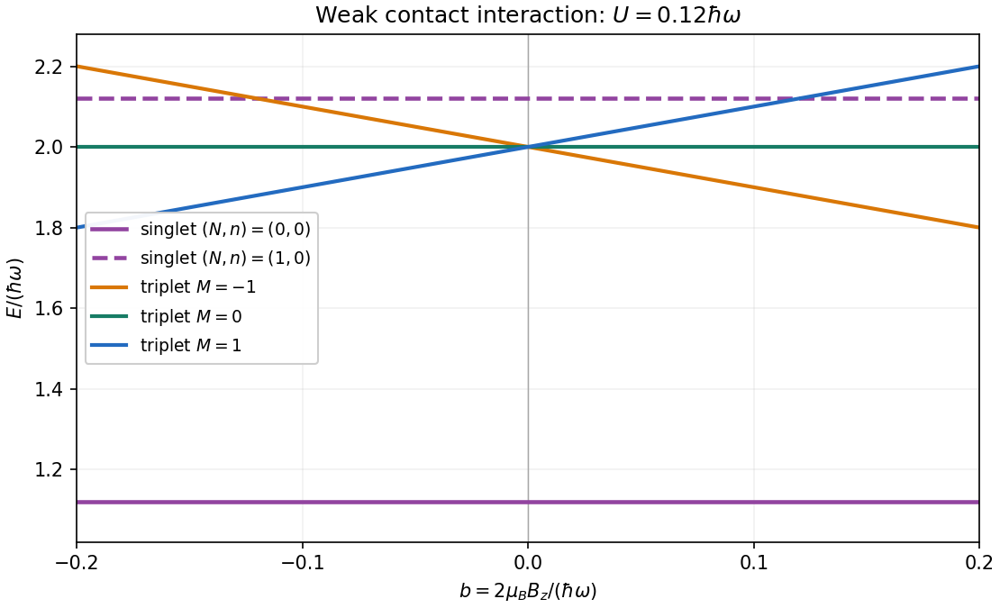

# 2022

↑ **Parent:** [Past exam of the advanced quantum physics course of the University of Cambridge](../past-exam-of-the-advanced-quantum-physics-course-of-the-university-of-cambridge.md)

[Original paper, released PDF pages 462–467](https://www.whatdotheyknow.com/request/natural_science_tripos_physics_e/response/2127325/attach/3/FOI%202022%20639%20Sullivan%20materials.pdf?cookie_passthrough=1#page=462)

**Table of contents**

- [Section A](#section-a)
  - [1](#section-a/1)
    - [Solution](#section-a/1/solution)
  - [2](#section-a/2)
    - [Solution](#section-a/2/solution)
  - [3](#section-a/3)
    - [Solution](#section-a/3/solution)
- [Section B](#section-b)
  - [4](#section-b/4)
    - [a](#section-b/4/a)
      - [Solution](#section-b/4/a/solution)
    - [b](#section-b/4/b)
      - [Solution](#section-b/4/b/solution)
    - [c](#section-b/4/c)
      - [Solution](#section-b/4/c/solution)
    - [d](#section-b/4/d)
      - [Solution](#section-b/4/d/solution)
    - [e](#section-b/4/e)
      - [Solution](#section-b/4/e/solution)
  - [5](#section-b/5)
    - [a](#section-b/5/a)
      - [Solution](#section-b/5/a/solution)
    - [b](#section-b/5/b)
      - [Solution](#section-b/5/b/solution)
    - [c](#section-b/5/c)
      - [Solution](#section-b/5/c/solution)
    - [d](#section-b/5/d)
      - [Solution](#section-b/5/d/solution)
  - [6](#section-b/6)
    - [a](#section-b/6/a)
      - [Solution](#section-b/6/a/solution)
    - [b](#section-b/6/b)
      - [Solution](#section-b/6/b/solution)
    - [c](#section-b/6/c)
      - [Solution](#section-b/6/c/solution)
    - [d](#section-b/6/d)
      - [Solution](#section-b/6/d/solution)
    - [e](#section-b/6/e)
      - [Solution](#section-b/6/e/solution)

## Section A

↑ **Parent:** [2022](2022.md)

<h3 id="section-a/1">1</h3>

↑ **Parent:** [Section A](#section-a)

<h4 id="section-a/1/solution">Solution</h4>

↑ **Parent:** [1](#section-a/1)

By [addition of angular momentum](../angular-momentum-operator.md#addition-of-angular-momentum), combining the first two [spin one-half](../angular-momentum-operator.md#spin-one-half) particles gives $0\oplus1$. Adding the third gives the [three spin-one-half angular-momentum decomposition](../angular-momentum-operator.md#three-spin-one-half-angular-momentum-decomposition)

$$
\left(\frac12\right)^{\otimes3}
=\left(0\oplus1\right)\otimes\frac12
=\frac12\oplus\frac12\oplus\frac32.
$$

Thus there is one $S=3/2$ [total-spin sector](../angular-momentum-operator.md#total-spin-sector) and two independent $S=1/2$ sectors. Since the particles are distinguishable, no [fermionic exchange symmetry](../tensor-product-of-quantum-systems.md#fermi-dirac-statistics) restriction removes either copy. In a simultaneous [angular momentum eigenstate](../angular-momentum-operator.md#angular-momentum-eigenstate), $\hat S^2$ and $\hat S^{(z)}$ have [eigenvalues](../linear-operator-theory.md#eigenvalue) $\hbar^2S(S+1)$ and $\hbar M$, so

$$
\boxed{E_{S,M}=\epsilon_t S(S+1)+\epsilon_z M.}
$$

The [energy levels](../quantum-mechanics.md#energy-level) and their generic multiplicities are

$$
\begin{array}{c|c|c|c}
S&M&E_{S,M}&\text{multiplicity}\\ \hline
3/2&-3/2,-1/2,1/2,3/2&15\epsilon_t/4+\epsilon_zM&1\text{ for each }M\\
1/2&-1/2,1/2&3\epsilon_t/4+\epsilon_zM&2\text{ for each }M
\end{array}
$$

The count $4+2\times2=8$ agrees with the [dimension](../vector-space.md#dimension-vector-space) of the three-particle [tensor product](../multilinear-algebra.md#tensor-product). These multiplicities must be added whenever numerical [energy eigenvalues](../energy-eigenvalue.md) coincide. In particular, for $\epsilon_z=0$ and $\epsilon_t\ne0$, there are two fourfold [degenerate energy levels](../quantum-mechanics.md#degenerate-energy-levels), $15\epsilon_t/4$ and $3\epsilon_t/4$. For $\epsilon_t=0$ and $\epsilon_z\ne0$, the multiplicities at $M=-3/2,-1/2,1/2,3/2$ are $1,3,3,1$. If both coefficients vanish, the single [energy level](../quantum-mechanics.md#energy-level) has multiplicity eight. Other coincidences between the two [total-spin sectors](../angular-momentum-operator.md#total-spin-sector) occur when $3\epsilon_t+(M-m)\epsilon_z=0$, with $M$ from the quartet and $m=\pm1/2$ from a doublet.

<h3 id="section-a/2">2</h3>

↑ **Parent:** [Section A](#section-a)

<h4 id="section-a/2/solution">Solution</h4>

↑ **Parent:** [2](#section-a/2)

A [density matrix](../density-matrix.md) has unit [trace](../linear-algebra.md#matrix-trace). The [Pauli matrices](../algebra.md#pauli-matrices) are traceless, so $\operatorname{Tr}\hat\rho=C$ and hence $C=1$. Using $\operatorname{Tr}(\sigma_i\sigma_j)=2\delta_{ij}$ in the [expectation value](../quantum-system.md#expectation-value) gives

$$
\langle\sigma_j\rangle=\operatorname{Tr}(\rho\sigma_j)=r_j.
$$

Consequently the required [Bloch vector](../density-matrix.md#bloch-vector) and [density matrix](../density-matrix.md) are

$$
\boxed{C=1,\qquad \mathbf r=\left(\frac12,0,0\right),\qquad
\rho=\begin{pmatrix}1/2&1/4\\1/4&1/2\end{pmatrix}.}
$$

The two [eigenvalues](../linear-operator-theory.md#eigenvalue) are $3/4$ and $1/4$, both positive, so this is a valid [density operator](../density-matrix.md). Its [purity of a density operator](../density-matrix.md#purity-of-a-density-operator) is

$$
\operatorname{Tr}\rho^2=\left(\frac34\right)^2+\left(\frac14\right)^2=\frac58<1.
$$

Therefore it is a [mixed state](../density-matrix.md#mixed-state). Equivalently, its [spectral decomposition](../linear-operator-theory.md#spectral-decomposition) is $\rho=(3/4)|+x\rangle\langle+x|+(1/4)|-x\rangle\langle-x|$, an ensemble of the two distinct [spin one-half along an axis](../angular-momentum-operator.md#spin-one-half-along-an-axis) states, rather than a single [pure state](../quantum-theory.md#pure-state).

<h3 id="section-a/3">3</h3>

↑ **Parent:** [Section A](#section-a)

<h4 id="section-a/3/solution">Solution</h4>

↑ **Parent:** [3](#section-a/3)

Write the trap [angular frequency](../lagrangian-mechanics.md#angular-frequency) as $\omega$ and the single-particle [oscillator length](../quantum-harmonic-oscillator.md#oscillator-length) as $\ell=\sqrt{\hbar/(m\omega)}$. The [center of mass](../classical-mechanics.md#center-of-mass) coordinate $X=(x_1+x_2)/2$ and relative coordinate $r=x_1-x_2$ give independent [quantum harmonic oscillators](../quantum-harmonic-oscillator.md), both of frequency $\omega$, with masses $2m$ and [reduced mass](../classical-mechanics.md#reduced-mass) $m/2$. Label their excitation numbers by $N$ and $n$. The unperturbed [energy eigenvalue](../energy-eigenvalue.md) is $\hbar\omega(N+n+1)$.

Particle exchange leaves $X$ unchanged and sends $r$ to $-r$. The [exchange symmetry of two identical spin-one-half fermions](../tensor-product-of-quantum-systems.md#exchange-symmetry-of-two-identical-spin-one-half-fermions) therefore requires even $n$ to accompany the [spin-one-half singlet state](../angular-momentum-operator.md#spin-one-half-singlet-state), and odd $n$ to accompany a [spin-one-half triplet state](../angular-momentum-operator.md#spin-one-half-triplet-state). For the [contact shifts of two spin-one-half fermions in a harmonic trap](../tensor-product-of-quantum-systems.md#contact-shifts-of-two-spin-one-half-fermions-in-a-harmonic-trap), the [delta potential](../quantum-mechanics.md#delta-potential) depends only on $r$. For odd $n$, the relative [wavefunction](../wave-function.md) vanishes at $r=0$, so its contact shift is zero. Within the first-excited manifold, both perturbations are diagonal in the labels $(N,n,S,M)$: this is a [perturbation diagonal within a degenerate eigenspace](../quantum-mechanics.md#perturbation-diagonal-within-a-degenerate-eigenspace). For $n=0$, the relative [oscillator length](../quantum-harmonic-oscillator.md#oscillator-length) is $\sqrt2\ell$, giving the [first-order nondegenerate perturbation theory](../quantum-mechanics.md#first-order-nondegenerate-perturbation-theory) shift

$$
U=\lambda|\varphi_{\mathrm{rel},0}(0)|^2
=\frac{\lambda}{\sqrt{2\pi}\ell}.
$$

The [Zeeman splitting](../atomic-physics.md#zeeman-splitting) is $2\mu_BB_zM$ for total [spin](../angular-momentum-operator.md#spin) projection $\hbar M$. Thus the five lowest states, counted with multiplicity, have

$$
\boxed{\begin{array}{c|c|c|c}
(N,n)&S&M&E\text{ to first order}\\ \hline
(0,0)&0&0&\hbar\omega+U\\
(0,1)&1&-1,0,1&2\hbar\omega+2\mu_BB_zM\\
(1,0)&0&0&2\hbar\omega+U
\end{array}}
$$

under the assumed conditions $|U|,2\mu_B|B_z|\ll\hbar\omega$. The three [triplet states](../angular-momentum-operator.md#spin-one-half-triplet-state) have slopes $-2\mu_B,0,2\mu_B$, while both [singlet states](../angular-momentum-operator.md#singlet-state) are field independent at this order. The three [triplet state](../angular-momentum-operator.md#spin-one-half-triplet-state) branches coincide at zero [magnetic field](../magnetic-field.md). Their crossing with the excited [singlet state](../angular-momentum-operator.md#singlet-state) is allowed because the [total-spin sectors](../angular-momentum-operator.md#total-spin-sector) do not mix. The odd relative [wavefunctions](../wave-function.md) are in fact unaffected by this [delta potential](../quantum-mechanics.md#delta-potential) at any coupling; the displayed [singlet state](../angular-momentum-operator.md#singlet-state) shifts retain only first order.

**[Figure 1](#section-a/3/image-five-lowest-two-fermion-states-in-a-weakly-interacting-harmonic-trap). Five lowest two-fermion states in a weakly interacting harmonic trap**. Original plot for repulsive contact shift $U=0.12\hbar\omega$, with $b=2\mu_BB_z/(\hbar\omega)$. The two horizontal [singlet state](../angular-momentum-operator.md#singlet-state) branches and three [triplet state](../angular-momentum-operator.md#spin-one-half-triplet-state) branches count five states; coincident energies count as fewer distinct [energy levels](../quantum-mechanics.md#energy-level). An attractive coupling reverses the sign of $U$ and moves both [singlet state](../angular-momentum-operator.md#singlet-state) branches downward.

## Section B

↑ **Parent:** [2022](2022.md)

<h3 id="section-b/4">4</h3>

↑ **Parent:** [Section B](#section-b)

<h4 id="section-b/4/a">a</h4>

↑ **Parent:** [4](#section-b/4)

<h5 id="section-b/4/a/solution">Solution</h5>

↑ **Parent:** [A](#section-b/4/a)

Let the [electric charge](../electric-charge.md) be $q=-e$, where $e>0$ is the [elementary charge](../electric-charge.md#elementary-charge). [Minimal coupling](../quantum-theory.md#minimal-coupling) to a tangential [magnetic vector potential](../electromagnetism.md#magnetic-vector-potential) gives

$$
H=\frac{(p-qA_x)^2}{2m}.
$$

A constant tangential [magnetic vector potential](../electromagnetism.md#magnetic-vector-potential) is an available gauge on the ring, so $a=qA_x$. By [Stokes theorem](../multivariable-calculus.md#stokes-theorem), its circulation is the oriented [magnetic flux](../magnetic-field.md#magnetic-flux)

$$
\Phi_C=\oint_{+x}\mathbf A\cdot d\boldsymbol\ell=LA_x,
\qquad \boxed{aL=q\Phi_C=-e\Phi_C.}
$$

The orientation matters here. In the original diagram, increasing $x$ goes anticlockwise, whose associated positive normal points out of the page, whereas the indicated positive [magnetic flux](../magnetic-field.md#magnetic-flux) $\Phi$ points into the page. Hence $\Phi_C=-\Phi$ for that diagram, and its convention gives $\boxed{aL=e\Phi}$. If instead $\Phi$ is defined with the normal associated to $+x$, the relation is $aL=-e\Phi$.

There is no requirement that the [magnetic field](../magnetic-field.md) be nonzero on the ring: it can be confined to a [solenoid](../magnetic-field.md#solenoid) inside it. The nonzero circulation of the [magnetic vector potential](../electromagnetism.md#magnetic-vector-potential) still affects the [electron](../physics.md#electron) through the [Aharonov-Bohm effect](../topological-quantum-matter.md#aharonov-bohm-effect).

<h4 id="section-b/4/b">b</h4>

↑ **Parent:** [4](#section-b/4)

<h5 id="section-b/4/b/solution">Solution</h5>

↑ **Parent:** [B](#section-b/4/b)

Define a transformed [wavefunction](../wave-function.md) by

$$
\boxed{\widetilde\psi(x)=e^{-iax/\hbar}\psi(x).}
$$

Indeed, writing $\psi=e^{iax/\hbar}\widetilde\psi$ gives

$$
(p-a)\psi=e^{iax/\hbar}p\widetilde\psi,
\qquad H_a\psi=e^{iax/\hbar}\frac{p^2}{2m}\widetilde\psi.
$$

This is the electromagnetic [gauge transformation](../electromagnetism.md#gauge-transformation) generated by $\chi(x)=-A_xx$: $A_x'=A_x+\partial_x\chi=0$ and $\psi'=e^{iq\chi/\hbar}\psi$. The transformed [Hamiltonian operator](../quantum-system.md#hamiltonian-quantum-mechanics) is consequently $p^2/(2m)$, but the original [periodic boundary condition](../differential-equation.md#periodic-boundary-conditions) becomes the [twisted boundary condition](../differential-equation.md#twisted-boundary-condition)

$$
\boxed{\widetilde\psi(x+L)=e^{-iaL/\hbar}\widetilde\psi(x).}
$$

For the domain of the [self-adjoint](../linear-operator-theory.md#self-adjoint-operator) kinetic [Hamiltonian operator](../quantum-system.md#hamiltonian-quantum-mechanics), the derivative has the same twist, $\widetilde\psi'(x+L)=e^{-iaL/\hbar}\widetilde\psi'(x)$. Thus the [magnetic flux](../magnetic-field.md#magnetic-flux) has moved into the [boundary condition](../differential-equation.md#boundary-condition). The transformation is a single-valued gauge on periodic representatives only when $aL/\hbar$ is an integer multiple of $2\pi$; otherwise it is understood on the cut interval with the displayed identification of its endpoints.

<h4 id="section-b/4/c">c</h4>

↑ **Parent:** [4](#section-b/4)

<h5 id="section-b/4/c/solution">Solution</h5>

↑ **Parent:** [C](#section-b/4/c)

For the [magnetic flux spectrum of a quantum ring](../topological-quantum-matter.md#magnetic-flux-spectrum-of-a-quantum-ring), the [periodic boundary condition](../differential-equation.md#periodic-boundary-conditions) permits the normalized [plane waves](../wave-function.md#plane-wave) $L^{-1/2}e^{2\pi inx/L}$, with $n\in\mathbb Z$. Their [energy eigenvalues](../energy-eigenvalue.md) are

$$
E_n(a)=\frac1{2m}\left(\frac{2\pi\hbar n}{L}-a\right)^2
=E_L(n-\alpha)^2,\qquad
E_L=\frac{2\pi^2\hbar^2}{mL^2},\quad
\alpha=\frac{aL}{2\pi\hbar}.
$$

Shifting $\alpha$ by an integer relabels $n$, so the ordered [energy levels](../quantum-mechanics.md#energy-level) have period one in $\alpha$, or $2\pi\hbar/L$ in $a$. For $-1/2\leq\alpha\leq1/2$, the lowest two are

$$
\boxed{\epsilon_0=E_L\alpha^2,\qquad
\epsilon_1=E_L(1-|\alpha|)^2,}
$$

extended periodically. The lowest branches cross at every half-integer $\alpha$, with energy $E_L/4$. At integer $\alpha$, the first excited [energy level](../quantum-mechanics.md#energy-level) has multiplicity two. The corresponding [magnetic flux](../magnetic-field.md#magnetic-flux) period is the electron [magnetic flux quantum](../quantum-theory.md#magnetic-flux-quantum) $h/e$.

**[Figure 2](#section-b/4/c/image-two-lowest-ring-energies-from-free-motion-to-a-deep-cosine-potential). Two lowest ring energies from free motion to a deep cosine potential**. Original calculations in a [plane wave](../wave-function.md#plane-wave) basis. From left to right: the free spectrum, a weak cosine potential with $\lambda/E_L=0.18$, and a deep potential with $\lambda/E_L=8$. The middle panel shows an [avoided crossing](../bloch-s-theorem.md#avoided-crossing) at half-integer $\alpha=aL/(2\pi\hbar)$; the deep-potential branches are almost horizontal and well separated. The dashed levels in the final panel are the [parabolic approximation](../calculus.md#parabolic-approximation), whose leading anharmonic errors are visible at this finite depth.

<h4 id="section-b/4/d">d</h4>

↑ **Parent:** [4](#section-b/4)

<h5 id="section-b/4/d/solution">Solution</h5>

↑ **Parent:** [D](#section-b/4/d)

In the normalized [plane wave](../wave-function.md#plane-wave) basis, the only nonzero potential [matrix elements](../vector-space.md#matrix-element) are

$$
V_{mn}=-\frac\lambda2\bigl(\delta_{m,n+1}+\delta_{m,n-1}\bigr).
$$

Thus a useful small parameter is $|\lambda|/E_L\ll1$, which suppresses admixture of well-separated [energy levels](../quantum-mechanics.md#energy-level). [First-order nondegenerate perturbation theory](../quantum-mechanics.md#first-order-nondegenerate-perturbation-theory) further requires $|\lambda|/2\ll|E_n-E_{n\pm1}|$ for the coupled states. This latter condition fails near a half-integer $\alpha$ even for very small $\lambda$; there one must use [degenerate perturbation theory](../quantum-mechanics.md#degenerate-perturbation-theory) in the nearly degenerate pair. Smallness is measured against the gaps to the other states, not the vanishing gap inside this pair.

Near $\alpha=1/2$, keep $n=0,1$. The resulting [Hamiltonian operator](../quantum-system.md#hamiltonian-quantum-mechanics) matrix and its [eigenvalues](../linear-operator-theory.md#eigenvalue) are

$$
H_{\mathrm{pair}}=\begin{pmatrix}E_L\alpha^2&-\lambda/2\\-\lambda/2&E_L(1-\alpha)^2\end{pmatrix},
$$

$$
\widetilde\epsilon_{0,1}\simeq E_L\left[(\alpha-1/2)^2+\frac14\right]
\mp\sqrt{E_L^2(\alpha-1/2)^2+\frac{\lambda^2}{4}}.
$$

In particular,

$$
\boxed{\widetilde\epsilon_{0,1}(\pi\hbar/L)
=\frac{\pi^2\hbar^2}{2mL^2}\mp\frac{|\lambda|}{2}
+O(\lambda^2/E_L).}
$$

For positive $\lambda$, the lower [quantum state](../quantum-system.md#quantum-state) at the crossing is the symmetric combination of $n=0,1$, and the upper state is the antisymmetric combination. A negative $\lambda$ exchanges these combinations but leaves the ordered [energy eigenvalues](../energy-eigenvalue.md) unchanged.

This [cosine-potential gap in a quantum ring](../topological-quantum-matter.md#cosine-potential-gap-in-a-quantum-ring) appears in the middle panel above: each lowest-branch crossing opens into an [avoided crossing](../bloch-s-theorem.md#avoided-crossing) of gap $|\lambda|$ to first order. Away from these crossings, the diagonal [matrix elements](../vector-space.md#matrix-element) vanish, so the leading shifts are second order. At integer $\alpha$, the two first-excited [plane waves](../wave-function.md#plane-wave) differ by two units of $n$ and therefore have no first-order coupling; their smaller splitting begins at second order. The numerical plot includes that splitting.

<h4 id="section-b/4/e">e</h4>

↑ **Parent:** [4](#section-b/4)

<h5 id="section-b/4/e/solution">Solution</h5>

↑ **Parent:** [E](#section-b/4/e)

Put $\Lambda=|\lambda|\gg E_L$. Changing the sign of $\lambda$ translates the potential by $L/2$ without changing its [energy eigenvalues](../energy-eigenvalue.md), so take a minimum at $x=0$ and expand there. The [parabolic approximation](../calculus.md#parabolic-approximation) gives

$$
V(x)\simeq-\Lambda+\frac\Lambda2\left(\frac{2\pi x}{L}\right)^2
=-\Lambda+\frac12m\omega_{\mathrm{loc}}^2x^2,
\qquad \omega_{\mathrm{loc}}=\frac{2\pi}{L}\sqrt{\frac\Lambda m}.
$$

The low-lying [wavefunctions](../wave-function.md) are localized well inside one period. A local [gauge transformation](../electromagnetism.md#gauge-transformation) removes $a$ from their [quantum harmonic oscillator](../quantum-harmonic-oscillator.md) equation, giving

$$
\widetilde\epsilon_n(a)\simeq-\Lambda+\hbar\omega_{\mathrm{loc}}\left(n+\frac12\right).
$$

Consequently,

$$
\boxed{\widetilde\epsilon_1(0)-\widetilde\epsilon_0(0)
\simeq\frac{2\pi\hbar}{L}\sqrt{\frac{|\lambda|}{m}}
=\sqrt{2|\lambda|E_L}.}
$$

The sketch consists of two nearly horizontal branches, separated by this gap, as in the right panel above. The [parabolic approximation](../calculus.md#parabolic-approximation) makes them completely independent of [magnetic flux](../magnetic-field.md#magnetic-flux); in the actual ring they retain exponentially small periodic dependence through [quantum tunnelling](../quantum-mechanics.md#quantum-tunnelling) around the ring. Corrections from the nonquadratic part of the potential shift the mean energies and gap by relative order $\sqrt{E_L/\Lambda}$, whereas the tunnelling dependence is smaller than every power of that parameter.

<h3 id="section-b/5">5</h3>

↑ **Parent:** [Section B](#section-b)

<h4 id="section-b/5/a">a</h4>

↑ **Parent:** [5](#section-b/5)

<h5 id="section-b/5/a/solution">Solution</h5>

↑ **Parent:** [A](#section-b/5/a)

The unperturbed [infinite square well](../quantum-mechanics.md#infinite-square-well) is invariant under the [parity operator](../quantum-mechanics.md#parity-operator). Its one-dimensional [energy eigenvalues](../energy-eigenvalue.md) are nondegenerate, so each [energy eigenstate](../energy-eigenvalue.md#energy-eigenstate) has definite parity. Its position [expectation value](../quantum-system.md#expectation-value) therefore vanishes: $|\phi_n(x)|^2$ is even, while $x$ is odd. The [first-order nondegenerate perturbation theory](../quantum-mechanics.md#first-order-nondegenerate-perturbation-theory) correction is consequently

$$
\delta\epsilon_n^{(1)}=eE\langle\phi_n|x|\phi_n\rangle=0.
$$

The [electric field](../electric-field.md) does mix opposite-parity [quantum states](../quantum-system.md#quantum-state), and [second-order nondegenerate perturbation theory](../quantum-mechanics.md#second-order-nondegenerate-perturbation-theory) contains two factors of $eEx$. Its leading contribution is thus proportional to $E^2$: this is a [quadratic Stark effect](../mathematical-physics.md#quadratic-stark-effect). More generally, applying the [parity operator](../quantum-mechanics.md#parity-operator) changes $H(E)$ into $H(-E)$, so their corresponding [energy eigenvalues](../energy-eigenvalue.md) agree. An analytic expansion about zero [electric field](../electric-field.md) contains only even powers of $E$. We assume $e|E|a$ is small compared with the unperturbed excitation scale.

<h4 id="section-b/5/b">b</h4>

↑ **Parent:** [5](#section-b/5)

<h5 id="section-b/5/b/solution">Solution</h5>

↑ **Parent:** [B](#section-b/5/b)

Use zero-based labels to agree with $\phi_0$ in the later parts. The normalized [infinite square well](../quantum-mechanics.md#infinite-square-well) [energy eigenstates](../energy-eigenvalue.md#energy-eigenstate) and [energy eigenvalues](../energy-eigenvalue.md) are

$$
\phi_n(x)=\frac1{\sqrt a}\sin\left[\frac{(n+1)\pi(x+a)}{2a}\right],
\qquad \epsilon_n^{(0)}=K(n+1)^2,\quad
K=\frac{\pi^2\hbar^2}{8ma^2},\quad n=0,1,\ldots.
$$

The [position matrix elements in a symmetric infinite square well](../quantum-mechanics.md#position-matrix-elements-in-a-symmetric-infinite-square-well), obtained by integrating the product of the two [wavefunctions](../wave-function.md) against $x$, are

$$
x_{kn}=\langle\phi_k|x|\phi_n\rangle
=\frac{8a(k+1)(n+1)[(-1)^{k+n}-1]}
{\pi^2[(k+1)^2-(n+1)^2]^2}\quad(k\ne n),\qquad x_{nn}=0.
$$

The integral in the question uses positive integer labels; replacing them by $k+1,n+1$ is essential here. Only opposite-parity states, $k+n$ odd, contribute, as also follows from the [parity operator](../quantum-mechanics.md#parity-operator) [selection rule](../atomic-physics.md#selection-rule).

[Second-order nondegenerate perturbation theory](../quantum-mechanics.md#second-order-nondegenerate-perturbation-theory) now gives the requested infinite sum:

$$
\boxed{\delta\epsilon_n^{(2)}=e^2E^2\sum_{k\ne n}
\frac{|x_{kn}|^2}{\epsilon_n^{(0)}-\epsilon_k^{(0)}}.}
$$

In fully explicit form this is

$$
\boxed{\delta\epsilon_n^{(2)}=
-\frac{2048me^2E^2a^4}{\pi^6\hbar^2}(n+1)^2
\sum_{\substack{k\geq0\\k+n\ \mathrm{odd}}}
\frac{(k+1)^2}{[(k+1)^2-(n+1)^2]^5}.}
$$

The symbol $m$ here denotes the electron mass, not a summation index. For the [ground state](../quantum-mechanics.md#ground-state) $n=0$, every denominator in the first form is negative, so the ground [energy level](../quantum-mechanics.md#energy-level) moves downward. For excited states, contributions from lower and higher [energy levels](../quantum-mechanics.md#energy-level) have opposite signs.

<h4 id="section-b/5/c">c</h4>

↑ **Parent:** [5](#section-b/5)

<h5 id="section-b/5/c/solution">Solution</h5>

↑ **Parent:** [C](#section-b/5/c)

The electron's [electric dipole moment](../electrostatics.md#electric-dipole-moment) is $\mathbf d=-e\langle x\rangle\hat{\mathbf x}$. It vanishes in the unperturbed ground [energy eigenstate](../energy-eigenvalue.md#energy-eigenstate). The first correction to the [wavefunction](../wave-function.md) is linear in the [electric field](../electric-field.md) and has the opposite parity; its interference with the unperturbed state therefore gives a nonzero position [expectation value](../quantum-system.md#expectation-value) of first order.

In detail, the normalized ground [quantum state](../quantum-system.md#quantum-state), to the order needed, is

$$
|g\rangle=|\phi_0\rangle+
 eE\sum_{k\geq1}\frac{x_{k0}}{\epsilon_0^{(0)}-\epsilon_k^{(0)}}|\phi_k\rangle+O(E^2).
$$

The normalization correction starts at second order and does not affect the linear term below. The two cross terms give

$$
\langle x\rangle=2eE\sum_{k\geq1}
\frac{|x_{k0}|^2}{\epsilon_0^{(0)}-\epsilon_k^{(0)}}+O(E^3).
$$

The absence of an $E^2$ term follows from the [parity operator](../quantum-mechanics.md#parity-operator): $\langle x\rangle$ changes sign under field reversal. Comparing with the [second-order nondegenerate perturbation theory](../quantum-mechanics.md#second-order-nondegenerate-perturbation-theory) energy sum yields

$$
\boxed{\mathbf d=-\frac{2\delta\epsilon_0^{(2)}}{E^2}\mathbf E+O(E^3)
=\alpha_{\mathrm{pol}}\mathbf E+O(E^3),\qquad
\alpha_{\mathrm{pol}}=-\frac{2\delta\epsilon_0^{(2)}}{E^2}>0.}
$$

Thus the induced [electric dipole moment](../electrostatics.md#electric-dipole-moment) points along the [electric field](../electric-field.md), with positive [electric polarizability](../electrostatics.md#electric-polarizability). The [induced dipole moment and quadratic energy shift](../electrostatics.md#induced-dipole-moment-and-quadratic-energy-shift) obey $\delta\epsilon_0^{(2)}=-\alpha_{\mathrm{pol}}E^2/2$. This factor of one half accounts for the energy needed to induce the dipole. As a check, the [Hellmann–Feynman theorem](../quantum-mechanics.md#hellmann-feynman-theorem) gives $d_x=-\partial\epsilon_0/\partial E$, with the same result.

<h4 id="section-b/5/d">d</h4>

↑ **Parent:** [5](#section-b/5)

<h5 id="section-b/5/d/solution">Solution</h5>

↑ **Parent:** [D](#section-b/5/d)

Normalize the trial [quantum state](../quantum-system.md#quantum-state) as $(|\phi_0\rangle+c|\phi_1\rangle)/\sqrt{1+c^2}$. With the phases used above, the off-diagonal position [matrix element](../vector-space.md#matrix-element) is $x_{01}=-32a/(9\pi^2)$. Define

$$
\Delta=\epsilon_1^{(0)}-\epsilon_0^{(0)}=3K,
\qquad W=eEx_{01}=-\frac{32eEa}{9\pi^2}.
$$

The diagonal perturbation [matrix elements](../vector-space.md#matrix-element) vanish by parity, so the [Rayleigh quotient](../linear-operator-theory.md#rayleigh-quotient) is

$$
\mathcal E(c)=\frac{\epsilon_0^{(0)}+2cW+c^2\epsilon_1^{(0)}}{1+c^2}.
$$

The stationarity equation is $W+\Delta c-Wc^2=0$. The minimum continuously connected to the unperturbed ground [energy eigenstate](../energy-eigenvalue.md#energy-eigenstate) has

$$
\boxed{c_{\min}=-\frac W\Delta+O(E^3)
=\frac{256meEa^3}{27\pi^4\hbar^2}+O(E^3).}
$$

Equivalently, diagonalize the [Hamiltonian operator](../quantum-system.md#hamiltonian-quantum-mechanics) matrix in this two-dimensional trial space. Its lower [eigenvalue](../linear-operator-theory.md#eigenvalue) is

$$
\mathcal E_{\min}=\frac{\epsilon_0^{(0)}+\epsilon_1^{(0)}}2
-\sqrt{\left(\frac\Delta2\right)^2+W^2}
=\epsilon_0^{(0)}-\frac{W^2}\Delta+O(E^4).
$$

Therefore

$$
\boxed{\mathcal E_{\min}=\frac{\pi^2\hbar^2}{8ma^2}
-\frac{8192me^2E^2a^4}{243\pi^6\hbar^2}+O(E^4).}
$$

This retains exactly the $k=1$ term of the full ground-state [second-order nondegenerate perturbation theory](../quantum-mechanics.md#second-order-nondegenerate-perturbation-theory) sum. Every omitted term is negative, so the full quadratic correction is more negative than this restricted one. This is consistent with the [Rayleigh-Ritz variational principle](../linear-operator-theory.md#rayleigh-ritz-variational-principle): minimizing over a two-state subspace gives an upper bound on the exact ground energy. The bound applies to the unexpanded two-state minimum; a truncated series is to be compared order by order.

<h3 id="section-b/6">6</h3>

↑ **Parent:** [Section B](#section-b)

<h4 id="section-b/6/a">a</h4>

↑ **Parent:** [6](#section-b/6)

<h5 id="section-b/6/a/solution">Solution</h5>

↑ **Parent:** [A](#section-b/6/a)

For this [spin-boson model](../tensor-product-of-quantum-systems.md#spin-boson-model), take $H_0=H_1+H_2$. Since $[H_0,\sigma_z]=0$, the [interaction picture](../quantum-system.md#interaction-picture) observable is

$$
\sigma_z^I(t)=e^{iH_0t/\hbar}\sigma_ze^{-iH_0t/\hbar}=\sigma_z.
$$

The normalized vectors $|\phi_\uparrow\rangle$ and $|\phi_\downarrow\rangle$ belong to different [eigenspaces](../linear-operator-theory.md#eigenspace) of the [Hermitian operator](../hilbert-space.md#hermitian-operator) $\sigma_z$, and are therefore orthogonal. This remains true even though each vector includes the oscillator degrees of freedom. Hence all cross terms in the [expectation value](../quantum-system.md#expectation-value) vanish, while the diagonal terms have [eigenvalues](../linear-operator-theory.md#eigenvalue) $+1$ and $-1$:

$$
\boxed{\langle\psi_\sigma^I(t)|\sigma_z^I(t)|\psi_\sigma^I(t)\rangle
=|c_{\uparrow\sigma}(t)|^2-|c_{\downarrow\sigma}(t)|^2.}
$$

Normalization also gives $|c_{\uparrow\sigma}|^2+|c_{\downarrow\sigma}|^2=1$, so these are the [probabilities](../probability-theory.md#probability) of the two [spin](../angular-momentum-operator.md#spin) outcomes.

<h4 id="section-b/6/b">b</h4>

↑ **Parent:** [6](#section-b/6)

<h5 id="section-b/6/b/solution">Solution</h5>

↑ **Parent:** [B](#section-b/6/b)

The [orthogonal projection](../hilbert-space.md#orthogonal-projection) onto the full spin-$\eta$ subspace is

$$
\Pi_\eta=|\eta\rangle\langle\eta|\otimes I_{\mathrm{osc}}
=\sum_{\{n'\}}|\eta,\{n'\}\rangle\langle\eta,\{n'\}|.
$$

Here the identity acts on all oscillator states. The finite-time [scattering operator](../quantum-scattering.md#s-matrix) $S(t)$ in the question is the [interaction picture](../quantum-system.md#interaction-picture) [time-evolution operator](../quantum-system.md#time-evolution-operator), so $|\psi_\sigma^I(t)\rangle=S(t)|\sigma,\{n\}\rangle$. Projecting its two orthogonal spin components yields

$$
\boxed{c_{\eta\sigma}(t)|\phi_\eta(t)\rangle
=\Pi_\eta S(t)|\sigma,\{n\}\rangle.}
$$

Expand the right-hand side in the [orthonormal basis](../inner-product.md#orthonormal-basis) $|\eta,\{n'\}\rangle$. Taking its squared [norm](../normed-vector-space.md#norm), and using the normalization of $|\phi_\eta\rangle$, gives

$$
\boxed{|c_{\eta\sigma}(t)|^2
=\sum_{\{n'\}}|\langle\eta,\{n'\}|S(t)|\sigma,\{n\}\rangle|^2
=\sum_{\{n'\}}P_{\sigma,\{n\}\to\eta,\{n'\}}.}
$$

Thus one sums [probabilities](../probability-theory.md#probability) over unobserved final oscillator states, not their [probability amplitudes](../wave-function.md#probability-amplitude). [Unitarity](../vector-space.md#unitary-operator) of $S(t)$ makes the sum over both $\eta$ equal to one.

<h4 id="section-b/6/c">c</h4>

↑ **Parent:** [6](#section-b/6)

<h5 id="section-b/6/c/solution">Solution</h5>

↑ **Parent:** [C](#section-b/6/c)

The [Pauli matrix](../algebra.md#pauli-matrices) $\sigma_x$ flips the [spin](../angular-momentum-operator.md#spin) with unit [matrix element](../vector-space.md#matrix-element). A nonzero oscillator [matrix element](../vector-space.md#matrix-element) changes exactly one [occupation number](../quantum-field-theory.md#occupation-number), through a [creation operator](../quantum-harmonic-oscillator.md#creation-operator) or an [annihilation operator](../quantum-harmonic-oscillator.md#annihilation-operator):

$$
\langle n_j+1|a_j^\dagger|n_j\rangle=\sqrt{n_j+1},\qquad
\langle n_j-1|a_j|n_j\rangle=\sqrt{n_j}.
$$

For a [spin](../angular-momentum-operator.md#spin) flip, the spin energy change divided by $\hbar$ is $-s_\sigma\Omega$. Thus creation and annihilation in mode $j$ have total frequency changes $\omega_j-s_\sigma\Omega$ and $-\omega_j-s_\sigma\Omega$, respectively. Distinct modes or different occupation changes lead to orthogonal final [quantum states](../quantum-system.md#quantum-state), so their [probabilities](../probability-theory.md#probability) add. [Fermi's golden rule](../quantum-mechanics.md#fermi-s-golden-rule) consequently gives

$$
|c_{\eta\sigma}(t)|^2=\frac{2\pi\lambda^2t}{\hbar^2}
\sum_j\left[(n_j+1)\delta(\omega_j-s_\sigma\Omega)
+n_j\delta(\omega_j+s_\sigma\Omega)\right],\quad \eta\ne\sigma.
$$

The [Dirac delta function](../distribution-theory.md#dirac-delta-function) is even, accounting for the sign in the annihilation term. Since all $\omega_j,\Omega>0$, an initially up spin can only emit an oscillator quantum, while an initially down spin can only absorb one. Writing the oscillator [density of states](../quantum-ideal-gas-statistics.md#density-of-states) per unit angular frequency as $g(\omega)=\sum_j\delta(\omega-\omega_j)$, the continuum limit gives

$$
\boxed{|c_{\eta\sigma}(t)|^2=\frac{2\pi\lambda^2t}{\hbar^2}
\begin{cases}g(\Omega)(n_\Omega+1),&\sigma=\uparrow,\\
g(\Omega)n_\Omega,&\sigma=\downarrow,
\end{cases}\quad\eta\ne\sigma.}
$$

The $+1$ permits emission even from the oscillator vacuum; absorption requires a quantum already present. The notation $n_\Omega$ assumes a common or smoothly specified occupation at the resonant frequency. If several resonant modes have different occupations, it denotes their [density of states](../quantum-ideal-gas-statistics.md#density-of-states) weighted mean, so that $g(\Omega)n_\Omega=\sum_j n_j\delta(\Omega-\omega_j)$ after continuum smoothing. This is the [golden-rule relaxation of a spin coupled to an oscillator bath](../tensor-product-of-quantum-systems.md#golden-rule-relaxation-of-a-spin-coupled-to-an-oscillator-bath).

<h4 id="section-b/6/d">d</h4>

↑ **Parent:** [6](#section-b/6)

<h5 id="section-b/6/d/solution">Solution</h5>

↑ **Parent:** [D](#section-b/6/d)

In first-order [time-dependent perturbation theory](../quantum-mechanics.md#time-dependent-perturbation-theory), the resonant time factor before taking the [Fermi's golden rule](../quantum-mechanics.md#fermi-s-golden-rule) limit is

$$
\left|\int_0^t e^{i\nu t'}\,dt'\right|^2
=\frac{4\sin^2(\nu t/2)}{\nu^2}.
$$

Its central frequency width is of order $1/t$, and its total area is $2\pi t$. To replace it by $2\pi t\delta(\nu)$, the oscillator [density of states](../quantum-ideal-gas-statistics.md#density-of-states) and relevant occupations must be approximately constant over that width. Thus $t\Delta\omega\gg1$. At the same time, the perturbative flip [probability](../probability-theory.md#probability) must remain much smaller than one.

Define $\Gamma_0=2\pi\lambda^2g(\Omega)/\hbar^2$, so the two flip rates are $\Gamma_0(n_\Omega+1)$ and $\Gamma_0n_\Omega$. A sufficient common time window for both initial spins is

$$
\boxed{\frac1{\Delta\omega}\ll t\ll
\frac1{\Gamma_0(n_\Omega+1)}.}
$$

For a specified initial spin, the upper condition is simply its own flip rate times $t\ll1$. Such a window requires weak enough coupling. The continuum approximation also presumes times shorter than recurrences from a resolved finite oscillator spectrum, and long enough to resolve the positive-frequency resonance from its nonresonant counterpart.

<h4 id="section-b/6/e">e</h4>

↑ **Parent:** [6](#section-b/6)

<h5 id="section-b/6/e/solution">Solution</h5>

↑ **Parent:** [E](#section-b/6/e)

The thermal oscillator occupation is the [Bose-Einstein distribution](../quantum-ideal-gas-statistics.md#bose-einstein-distribution). With the rate notation $\Gamma_{\eta\sigma}$ for a transition from $\sigma$ to $\eta$, the [master equation](../continuous-time-markov-chain.md#master-equation) for the up population is

$$
\frac{dp_\uparrow}{dt}=\Gamma_{\uparrow\downarrow}p_\downarrow
-\Gamma_{\downarrow\uparrow}p_\uparrow
=\Gamma_0\left[n_\Omega p_\downarrow-(n_\Omega+1)p_\uparrow\right].
$$

At [thermal equilibrium](../thermal-equilibrium.md), assuming $\Gamma_0>0$, vanishing time derivative is [detailed balance](../markov-chain.md#detailed-balance) between the two spin states. Hence

$$
\frac{p_\uparrow}{p_\downarrow}=\frac{n_\Omega}{n_\Omega+1}
=\frac{1/(e^{\beta\hbar\Omega}-1)}{e^{\beta\hbar\Omega}/(e^{\beta\hbar\Omega}-1)}
=e^{-\beta\hbar\Omega},
$$

or

$$
\boxed{p_\uparrow=e^{-\beta\hbar\Omega}p_\downarrow.}
$$

Together with normalization, this gives $p_\uparrow=1/(1+e^{\beta\hbar\Omega})$ and $p_\downarrow=e^{\beta\hbar\Omega}/(1+e^{\beta\hbar\Omega})$, the [Boltzmann distribution](../thermodynamics.md#boltzmann-distribution) for the [energy eigenvalues](../energy-eigenvalue.md) $\pm\hbar\Omega/2$. At zero temperature, absorption vanishes and emission relaxes the spin into its down ground state.

The nonzero-rate condition is necessary: if $\lambda=0$ or $g(\Omega)=0$, both rates vanish, so every initial pair of populations is stationary within this approximation. In that case stationarity alone cannot imply a thermal distribution. The equilibrium conclusion therefore presumes coupling to resonant oscillator modes.

## ↑ Ancestors (10)

1. [Past exam of the advanced quantum physics course of the University of Cambridge](../past-exam-of-the-advanced-quantum-physics-course-of-the-university-of-cambridge.md)
2. [Advanced Quantum Physics course of the University of Cambridge](../university-of-cambridge.md#advanced-quantum-physics-course-of-the-university-of-cambridge)
3. [Physics course of the year 3 of the natural sciences course of the University of Cambridge](../university-of-cambridge.md#physics-course-of-the-year-3-of-the-natural-sciences-course-of-the-university-of-cambridge)
4. [Year 3 of the natural sciences course of the University of Cambridge](../university-of-cambridge.md#year-3-of-the-natural-sciences-course-of-the-university-of-cambridge)
5. [Year of the natural sciences course of the University of Cambridge](../university-of-cambridge.md#year-of-the-natural-sciences-course-of-the-university-of-cambridge)
6. [Natural sciences course of the University of Cambridge](../university-of-cambridge.md#natural-sciences-course-of-the-university-of-cambridge)
7. [Course of the University of Cambridge](../university-of-cambridge.md#course-of-the-university-of-cambridge)
8. [University of Cambridge](../university-of-cambridge.md)
9. [List of universities](../README.md#list-of-universities)
10. [Codex Wiki](../README.md)
