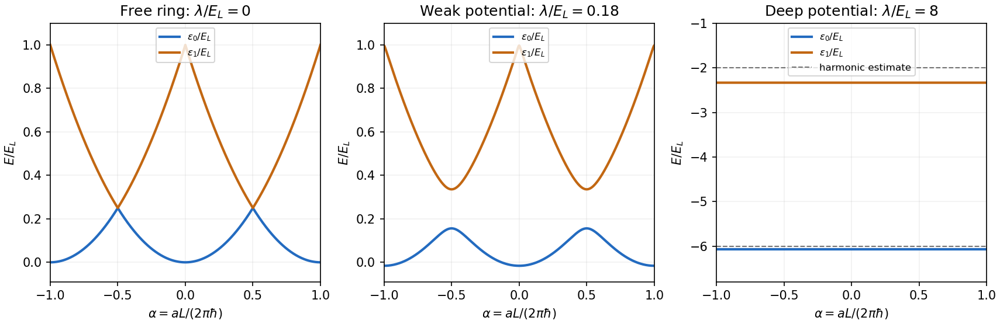

<h1 id="section-b/4/c/solution">Solution</h1>

↑ **Parent:** [C](../c.md)

For the [magnetic flux spectrum of a quantum ring](../../../../../magnetic-flux-spectrum-of-a-quantum-ring.md), the [periodic boundary condition](../../../../../periodic-boundary-conditions.md) permits the normalized [plane waves](../../../../../plane-wave.md) $L^{-1/2}e^{2\pi inx/L}$, with $n\in\mathbb Z$. Their [energy eigenvalues](../../../../../energy-eigenvalue-split.md) are

$$
E_n(a)=\frac1{2m}\left(\frac{2\pi\hbar n}{L}-a\right)^2
=E_L(n-\alpha)^2,\qquad
E_L=\frac{2\pi^2\hbar^2}{mL^2},\quad
\alpha=\frac{aL}{2\pi\hbar}.
$$

Shifting $\alpha$ by an integer relabels $n$, so the ordered [energy levels](../../../../../energy-level.md) have period one in $\alpha$, or $2\pi\hbar/L$ in $a$. For $-1/2\leq\alpha\leq1/2$, the lowest two are

$$
\boxed{\epsilon_0=E_L\alpha^2,\qquad
\epsilon_1=E_L(1-|\alpha|)^2,}
$$

extended periodically. The lowest branches cross at every half-integer $\alpha$, with energy $E_L/4$. At integer $\alpha$, the first excited [energy level](../../../../../energy-level.md) has multiplicity two. The corresponding [magnetic flux](../../../../../magnetic-flux.md) period is the electron [magnetic flux quantum](../../../../../magnetic-flux-quantum.md) $h/e$.

**[Figure 2](#section-b/4/c/image-two-lowest-ring-energies-from-free-motion-to-a-deep-cosine-potential). Two lowest ring energies from free motion to a deep cosine potential**. Original calculations in a [plane wave](../../../../../plane-wave.md) basis. From left to right: the free spectrum, a weak cosine potential with $\lambda/E_L=0.18$, and a deep potential with $\lambda/E_L=8$. The middle panel shows an [avoided crossing](../../../../../avoided-crossing.md) at half-integer $\alpha=aL/(2\pi\hbar)$; the deep-potential branches are almost horizontal and well separated. The dashed levels in the final panel are the [parabolic approximation](../../../../../parabolic-approximation.md), whose leading anharmonic errors are visible at this finite depth.

## ↑ Ancestors (14)

1. [C](../c.md)
2. [4](../../4.md)
3. [Section B](../../../section-b.md)
4. [2022](../../../../2022-split.md)
5. [Past exam of the advanced quantum physics course of the University of Cambridge](../../../../split.md)
6. [Advanced Quantum Physics course of the University of Cambridge](../../../../../advanced-quantum-physics-course-of-the-university-of-cambridge.md)
7. [Physics course of the year 3 of the natural sciences course of the University of Cambridge](../../../../../physics-course-of-the-year-3-of-the-natural-sciences-course-of-the-university-of-cambridge.md)
8. [Year 3 of the natural sciences course of the University of Cambridge](../../../../../year-3-of-the-natural-sciences-course-of-the-university-of-cambridge.md)
9. [Year of the natural sciences course of the University of Cambridge](../../../../../year-of-the-natural-sciences-course-of-the-university-of-cambridge.md)
10. [Natural sciences course of the University of Cambridge](../../../../../natural-sciences-course-of-the-university-of-cambridge.md)
11. [Course of the University of Cambridge](../../../../../course-of-the-university-of-cambridge.md)
12. [University of Cambridge](../../../../../university-of-cambridge-split.md)
13. [List of universities](../../../../../list-of-universities.md)
14. [Codex Wiki](../../../../../split.md)
