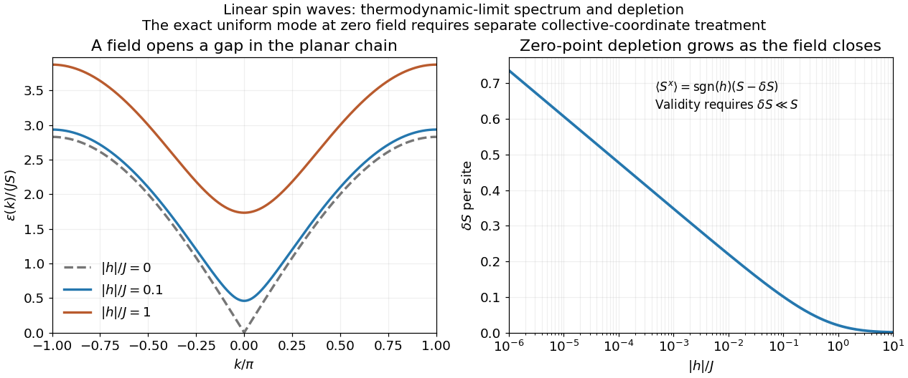

# 2017

↑ **Parent:** [Past exam of the advanced quantum theory: path integrals and many-particle physics course of the University of Oxford](../past-exam-of-the-advanced-quantum-theory-path-integrals-and-many-particle-physics-course-of-the-university-of-oxford.md)

Source paper: [https://www.whatdotheyknow.com/request/physics_past_papers_21/response/3037379/attach/2/FOI%20202505%20441%20Response.pdf?cookie_passthrough=1.](https://www.whatdotheyknow.com/request/physics_past_papers_21/response/3037379/attach/2/FOI%20202505%20441%20Response.pdf?cookie_passthrough=1.) The original cover dates this paper to 13 June 2017. We use $\hbar=1$ and lattice spacing one. Both printed interaction sums omit grouping parentheses; the solutions explicitly use the symmetric nearest-neighbour interpretation. The unused $h$ in question 1 is not treated as an additional interaction.

**Table of contents**

- [1](#1)
  - [a](#1/a)
    - [Solution](#1/a/solution)
  - [b](#1/b)
    - [Solution](#1/b/solution)
  - [c](#1/c)
    - [Solution](#1/c/solution)
  - [d](#1/d)
    - [Solution](#1/d/solution)
- [2](#2)
  - [a](#2/a)
    - [Solution](#2/a/solution)
  - [b](#2/b)
    - [Solution](#2/b/solution)
  - [c](#2/c)
    - [Solution](#2/c/solution)
  - [d](#2/d)
    - [Solution](#2/d/solution)
  - [e](#2/e)
    - [Solution](#2/e/solution)

## 1

↑ **Parent:** [2017](2017.md)

<h3 id="1/a">a</h3>

↑ **Parent:** [1](#1)

<h4 id="1/a/solution">Solution</h4>

↑ **Parent:** [A](#1/a)

Put $\beta=(k_BT)^{-1}$ and label the two [spin values](../angular-momentum-operator.md#spin) in the order $+1,-1$. Assign each bond its [Boltzmann weight](../canonical-ensemble.md#boltzmann-factor),

$$
V_{st}=e^{-\beta E_0(s,t)},\qquad
V=\begin{pmatrix}a&b\\b&d\end{pmatrix},\qquad s,t\in\{+1,-1\}.
$$

The [symmetry](../physics.md#symmetry-physics) of the [bond energy](../energy.md) makes $V$ a [real symmetric matrix](../linear-algebra.md#symmetric-matrix). For a fixed configuration the product of successive [matrix](../vector-space.md#matrix) entries is its [Boltzmann weight](../canonical-ensemble.md#boltzmann-factor). Summing over all [spins](../angular-momentum-operator.md#spin) and identifying the last index with the first therefore gives

$$
\boxed{Z_L=\sum_{\sigma_1,\ldots,\sigma_L}V_{\sigma_1\sigma_2}\cdots V_{\sigma_L\sigma_1}=\operatorname{tr}V^L=\lambda_+^L+\lambda_-^L,}
$$

where

$$
\lambda_\pm=\frac{a+d\pm\sqrt{(a-d)^2+4b^2}}2.
$$

This replaces a sum over $2^L$ configurations by the powers of a two-by-two [matrix](../vector-space.md#matrix). For finite bond [energies](../energy.md) at $T>0$, every [matrix](../vector-space.md#matrix) entry is positive, so the [Perron–Frobenius theorem](../vector-space.md#perron-frobenius-theorem) gives $\lambda_+>0$ and $|\lambda_-|<\lambda_+$. Hence the [Helmholtz free energy](../thermodynamic-potential.md#helmholtz-free-energy) per [spin](../angular-momentum-operator.md#spin) tends to $-k_BT\log\lambda_+$. A diagonal local [observable](../quantum-system.md#observable) $O$ can be inserted at one site: $\langle O_1\rangle=\operatorname{tr}(OV^L)/Z_L$. Its limiting average is the [expectation](../expected-value.md) in the [normalized](../mathematics.md#normalization) [eigenvector](../linear-operator-theory.md#eigenvector) of $\lambda_+$.

<h3 id="1/b">b</h3>

↑ **Parent:** [1](#1)

<h4 id="1/b/solution">Solution</h4>

↑ **Parent:** [B](#1/b)

**The sum needs a stated interpretation.** The original equation leaves the second bond outside explicit parentheses, with its index then formally free. The natural [translation-invariant](../physics.md#translation-invariance), equal-bond interpretation used here is the [energy](../energy.md) $-J\sum_j\tau_j(\sigma_j+\sigma_{j+1})$. The subsequently mentioned $h$ has no term in that [energy](../energy.md), so no [magnetic field](../magnetic-field.md) or [single-ion anisotropy](../spin-model.md#single-ion-anisotropy) is added. Such an extra term would define another model and change the answer.

Let $K=\beta J$. Sum over each decorating [spin](../angular-momentum-operator.md#spin) before summing over the remaining [spins](../angular-momentum-operator.md#spin). The [decimation of an alternating mixed-spin chain](../spin-model.md#decimation-of-an-alternating-mixed-spin-chain) gives the effective [transfer matrix](../combinatorics.md#transfer-matrix):

$$
V_{st}=\sum_{t_0=-1}^{1}e^{Kt_0(s+t)}=1+2\cosh[K(s+t)]
=\begin{pmatrix}1+2\cosh2K&3\\3&1+2\cosh2K\end{pmatrix}_{st}.
$$

No on-site entropy has been omitted: the term $1$ is the weight of the zero decorating [spin](../angular-momentum-operator.md#spin). The [normalized](../mathematics.md#normalization) [eigenvectors](../linear-operator-theory.md#eigenvector) are $v_\pm=(1,\pm1)^{\mathsf T}/\sqrt2$, with [eigenvalues](../linear-operator-theory.md#eigenvalue)

$$
\boxed{\lambda_+=4+2\cosh2K=2+4\cosh^2K,\qquad \lambda_-=2\cosh2K-2=4\sinh^2K.}
$$

There are $L$ transfer steps but $2L$ physical sites, so

$$
\boxed{Z_L=\lambda_+^L+\lambda_-^L,\qquad
f=\lim_{L\to\infty}\frac{-k_BT\log Z_L}{2L}=-\frac{k_BT}{2}\log(4+2\cosh2\beta J).}
$$

The [free energy](../thermodynamic-potential.md#thermodynamic-free-energy) per two-site [unit cell](../quantum-scattering.md#unit-cell) is twice this value. At $J=0$, the formula gives $Z_L=6^L$, as required by two states on one sublattice and three on the other. As $T\to0$, the [free energy](../thermodynamic-potential.md#thermodynamic-free-energy) per physical site tends to $-J$, the [energy](../energy.md) of an aligned chain with two satisfied bonds per [unit cell](../quantum-scattering.md#unit-cell). These checks also fix the factor of two in the site count.

<h3 id="1/c">c</h3>

↑ **Parent:** [1](#1)

<h4 id="1/c/solution">Solution</h4>

↑ **Parent:** [C](#1/c)

Insert $D=\operatorname{diag}(1,-1)$ at the first undecorated site. In the [eigenbasis](../linear-operator-theory.md#eigenbasis) of the [transfer matrix](../combinatorics.md#transfer-matrix), $D$ exchanges $v_+$ and $v_-$, and both diagonal [matrix elements](../vector-space.md#matrix-element) vanish. Explicitly,

$$
\boxed{\langle\sigma_1\rangle_L=\frac{\operatorname{tr}(DV^L)}{\operatorname{tr}V^L}
=\frac{\lambda_+^L v_+^{\mathsf T}Dv_++\lambda_-^L v_-^{\mathsf T}Dv_-}{\lambda_+^L+\lambda_-^L}=0.}
$$

Thus its large-$L$ limit is zero at every fixed $T>0$. The result is exact even before taking that limit. Equivalently, simultaneous reversal of all [spins](../angular-momentum-operator.md#spin) pairs configurations of equal [energy](../energy.md) and opposite $\sigma_1$. Positivity of the [transfer matrix](../combinatorics.md#transfer-matrix) at fixed [positive temperature](../temperature.md) prevents a degenerate dominant [eigenvalue](../linear-operator-theory.md#eigenvalue) and [spontaneous magnetization](../spin-model.md#spontaneous-magnetization) in this one-dimensional zero-field chain. Selecting one aligned state at strictly [zero temperature](../temperature.md#absolute-zero) is a different order of limits.

<h3 id="1/d">d</h3>

↑ **Parent:** [1](#1)

<h4 id="1/d/solution">Solution</h4>

↑ **Parent:** [D](#1/d)

Insert the decorating-spin [observable](../quantum-system.md#observable) into the one bond that contains it. The [decorated-spin occupation insertion](../spin-model.md#decorated-spin-occupation-insertion) uses the [matrix](../vector-space.md#matrix):

$$
Q_{st}=\sum_{t_0=-1}^{1}t_0^2e^{Kt_0(s+t)}=2\cosh[K(s+t)]
=\begin{pmatrix}2\cosh2K&2\\2&2\cosh2K\end{pmatrix}_{st}.
$$

The [partition function](../canonical-ensemble.md#canonical-partition-function) still contains $L$ decorating-spin sums; one of them has been replaced by this weighted sum. Hence

$$
\langle\tau_1^2\rangle_L=\frac{\operatorname{tr}(QV^{L-1})}{Z_L}
=\frac{q_+\lambda_+^{L-1}+q_-\lambda_-^{L-1}}{\lambda_+^L+\lambda_-^L},
\qquad q_+=2\cosh2K+2,\quad q_-=2\cosh2K-2.
$$

Taking the dominant [eigenvector](../linear-operator-theory.md#eigenvector) gives

$$
\boxed{\lim_{L\to\infty}\langle\tau_1^2\rangle_L=\frac{q_+}{\lambda_+}
=\frac{\cosh2K+1}{\cosh2K+2}=\frac{2\cosh^2K}{1+2\cosh^2K}.}
$$

This is the [probability](../probability-theory.md#probability) that the decorating site is in either nonzero state. It tends to $2/3$ at high [temperature](../temperature.md), when its three states are equally likely, and to one at low [temperature](../temperature.md), when the nonzero aligned states gain [bond energy](../energy.md). Unlike the [magnetization](../electromagnetism.md#magnetization), this even [observable](../quantum-system.md#observable) is not forced to vanish by [spin](../angular-momentum-operator.md#spin) reversal.

## 2

↑ **Parent:** [2017](2017.md)

<h3 id="2/a">a</h3>

↑ **Parent:** [2](#2)

<h4 id="2/a/solution">Solution</h4>

↑ **Parent:** [A](#2/a)

Interpret the two displayed exchange components as belonging to the common nearest-neighbour sum with coefficient $-J$. Write $H_f=|h|$ and, for $h\ne0$, $s=\operatorname{sgn}h$. The source explicitly fixes $J>0$ but does not separately constrain $h$ in this question; keeping $H_f$ covers either [field](../magnetic-field.md) direction.

For [classical vectors](../vector-space.md#vector) of length $S$, define $\mathbf q_j=(S_j^x,S_j^y)$. The [Cauchy-Schwarz inequality](../probability-and-statistics.md#cauchy-schwarz-inequality) gives $\mathbf q_j\cdot\mathbf q_{j+1}\le|\mathbf q_j||\mathbf q_{j+1}|\le S^2$, and $hS_j^x\le H_fS$. Each term is therefore bounded below, so

$$
E_{\mathrm{cl}}\ge-LJS^2-LH_fS^2.
$$

Uniform alignment along the [field](../magnetic-field.md) saturates every bound:

$$
\boxed{\mathbf S_j=(sS,0,0),\qquad E_{\mathrm{cl,min}}=-L(J+H_f)S^2\quad(h\ne0).}
$$

Equality requires all planar [vectors](../vector-space.md#vector) to be parallel with length $S$, and the nonzero [field](../magnetic-field.md) then fixes their direction. At $h=0$, every uniformly oriented [vector](../vector-space.md#vector) in the $xy$ plane is a [classical ground state](../quantum-mechanics.md#ground-state):

$$
\boxed{\mathbf S_j=S(\cos\phi,\sin\phi,0),\qquad E_{\mathrm{cl,min}}=-LJS^2.}
$$

A nonuniform configuration cannot improve these simultaneously saturated bond bounds, including on the periodic ring.

<h3 id="2/b">b</h3>

↑ **Parent:** [2](#2)

<h4 id="2/b/solution">Solution</h4>

↑ **Parent:** [B](#2/b)

The [Holstein–Primakoff transformation](../angular-momentum-operator.md#holstein-primakoff-transformation) realizes a [spin algebra](../angular-momentum-operator.md#spin-commutation-relations) using [bosonic creation operators](../quantum-harmonic-oscillator.md#bosonic-creation-operator) and [bosonic annihilation operators](../quantum-harmonic-oscillator.md#bosonic-annihilation-operator). A [boson](../tensor-product-of-quantum-systems.md#boson) counts a unit of [spin](../angular-momentum-operator.md#spin) deviation from the local positive quantization axis: $\widetilde S^z=S-n$ with $n=a^\dagger a$. The square root in $\widetilde S^+$ supplies the correct [spin-ladder](../angular-momentum-operator.md#spin-ladder-operator) [matrix elements](../vector-space.md#matrix-element). In particular,

$$
\widetilde S^+|n\rangle=\sqrt{n(2S-n+1)}|n-1\rangle,\qquad
\widetilde S^-|n\rangle=\sqrt{(n+1)(2S-n)}|n+1\rangle.
$$

Their [commutator](../lie-algebra.md#commutator) is $2(S-n)$ on every physical [number state](../quantum-field-theory.md#fock-state), reproducing the [Spin commutation relations](../angular-momentum-operator.md#spin-commutation-relations). Although the [oscillator Fock space](../quantum-field-theory.md#bosonic-fock-space) is infinite, the [physical subspace](../angular-momentum-operator.md#holstein-primakoff-occupation-constraint) is only

$$
\boxed{n=0,1,\ldots,2S.}
$$

The order of the square root and oscillator [operator](../vector-space.md#linear-operator) matters in obtaining these coefficients.

When the [spin deviations](../critical-phenomenon.md#magnon) are dilute, expand the square root in $n/(2S)$. The leading transverse [operators](../vector-space.md#linear-operator) are linear in the [bosonic creation operators](../quantum-harmonic-oscillator.md#bosonic-creation-operator) and [bosonic annihilation operators](../quantum-harmonic-oscillator.md#bosonic-annihilation-operator) and turn [exchange interactions](../electromagnetism.md#exchange-interaction) into a [quadratic Hamiltonian](../quantum-field-theory.md#quadratic-bosonic-hamiltonian), which can be diagonalized. Higher powers describe interactions between [spin waves](../critical-phenomenon.md#spin-wave). The method therefore organizes corrections by inverse powers of $S$ about an ordered classical configuration. Large $S$ alone is insufficient: the average [depletion](../critical-phenomenon.md#one-dimensional-planar-spin-wave-depletion) must remain small compared with $S$. Possible problems include the [occupation](../quantum-field-theory.md#bosonic-occupation-number) constraint after truncation, noncollinear order requiring site-dependent axis [rotations](../riemannian-geometry.md#rotation-mathematics), [zero modes](../linear-operator-theory.md#zero-mode), and [infrared fluctuations](../quantum-field-theory.md#infrared-divergence) that destroy the assumed dilute expansion.

<h3 id="2/c">c</h3>

↑ **Parent:** [2](#2)

<h4 id="2/c/solution">Solution</h4>

↑ **Parent:** [C](#2/c)

Choose the local positive $\widetilde z$ axis along the [classical spin](../angular-momentum-operator.md#classical-spin). For nonzero [field](../magnetic-field.md), a [proper rotation](../riemannian-geometry.md#rotation-mathematics) is

$$
\boxed{S_j^x=s\widetilde S_j^z,\qquad S_j^y=\widetilde S_j^y,\qquad S_j^z=-s\widetilde S_j^x.}
$$

It preserves the [Spin commutation relations](../angular-momentum-operator.md#spin-commutation-relations) and turns the [field](../magnetic-field.md) term into $-H_fS\sum_j\widetilde S_j^z$. At zero [field](../magnetic-field.md) choose the classical direction $+x$, so $s=1$. Expanding about the original $z$ axis without this [rotation](../riemannian-geometry.md#rotation-mathematics) would put the reference state away from the classical minimum and would not give a controlled small-deviation expansion.

To the required order,

$$
\widetilde S_j^z=S-n_j,\qquad
\widetilde S_j^x=\sqrt{\frac S2}(a_j+a_j^\dagger)+O(S^{-1/2}),\qquad
\widetilde S_j^y=-i\sqrt{\frac S2}(a_j-a_j^\dagger)+O(S^{-1/2}).
$$

The longitudinal exchange gives $-JS^2+JS(n_j+n_{j+1})+O(S^0)$ on each bond. The transverse exchange gives

$$
-J\widetilde S_j^y\widetilde S_{j+1}^y
=\frac{JS}{2}\left[a_ja_{j+1}+a_j^\dagger a_{j+1}^\dagger-a_j^\dagger a_{j+1}-a_{j+1}^\dagger a_j\right]+O(S^0).
$$

Finally the [field](../magnetic-field.md) contributes its classical constant and $H_fSn_j$. Each site belongs to two bonds, so after removing the order-$S^2$ constant,

$$
\boxed{A=-\frac{JS}{2},\qquad B=\frac{JS}{2},\qquad C=S(2J+H_f).}
$$

These are the order-$S$ terms; the discarded products of [number operators](../quantum-harmonic-oscillator.md#number-operator) and the next square-root terms are order $S^0$ for [occupations](../quantum-field-theory.md#bosonic-occupation-number) held fixed as $S\to\infty$. A different transverse-axis phase can reverse the sign of $B$ without changing the [spectrum](../energy-eigenvalue.md), but the sign above follows from the stated [rotation](../riemannian-geometry.md#rotation-mathematics) and oscillator convention.

<h3 id="2/d">d</h3>

↑ **Parent:** [2](#2)

<h4 id="2/d/solution">Solution</h4>

↑ **Parent:** [D](#2/d)

Use the [unitary discrete Fourier transform](../discrete-fourier-transform.md)

$$
a_j=\frac1{\sqrt L}\sum_ke^{ikj}a_k,\qquad k=\frac{2\pi n}{L},\quad n=0,\ldots,L-1.
$$

The transformed [operators](../vector-space.md#linear-operator) obey $[a_k,a_q^\dagger]=\delta_{kq}$. The hopping terms contribute $2A\cos k$ to the number coefficient. In the pairing sum, the odd sine part cancels between $k$ and $-k$. Thus

$$
H_{\mathrm{LSW}}=\sum_k\left[\alpha_k a_k^\dagger a_k+\frac{\Delta_k}{2}(a_ka_{-k}+a_k^\dagger a_{-k}^\dagger)\right],
$$

where

$$
\alpha_k=S(H_f+2J-J\cos k),\qquad \Delta_k=JS\cos k.
$$

The factor one half in the full [momentum sum](../arithmetic.md#sum) avoids counting an [anomalous pair](../quantum-field-theory.md#bosonic-bogoliubov-diagonalization) twice. For $H_f>0$, $\alpha_k>|\Delta_k|$ for every allowed [momentum](../momentum.md). Set

$$
a_k=\cosh\theta_k\,b_k-\sinh\theta_k\,b_{-k}^\dagger,\qquad
\tanh2\theta_k=\frac{\Delta_k}{\alpha_k}.
$$

Real even [angles](../geometry-and-topology.md#angle) ensure consistency between opposite [momenta](../momentum.md), and $\cosh^2\theta_k-\sinh^2\theta_k=1$ preserves the [canonical commutation relations](../quantum-mechanics.md#canonical-commutation-relation). The anomalous coefficient becomes $\Delta_k\cosh2\theta_k-\alpha_k\sinh2\theta_k=0$. [Normal ordering](../perturbative-quantum-field-theory.md#normal-ordering) then gives

$$
\boxed{H_{\mathrm{LSW}}=\sum_k\epsilon(k)b_k^\dagger b_k+\frac12\sum_k[\epsilon(k)-\alpha_k],}
$$

with

$$
\boxed{\epsilon(k)=\sqrt{\alpha_k^2-\Delta_k^2}=S\sqrt{(H_f+2J)[H_f+2J(1-\cos k)]}.}
$$

The [field-polarized planar ferromagnetic spin wave](../critical-phenomenon.md#field-polarized-planar-ferromagnetic-spin-wave) has [energy gap](../linear-operator-theory.md#energy-gap) $\epsilon(0)=S\sqrt{H_f(H_f+2J)}$. The [momenta](../momentum.md) run over the whole [Brillouin zone](../bloch-s-theorem.md#brillouin-zone) once, including the self-inverse [momenta](../momentum.md) $0$ and, for even $L$, $\pi$; these use [single-mode squeezing](../quantum-harmonic-oscillator.md#single-mode-squeeze-operator) rather than introducing an extra independent partner.

**The zero-field case has a [zero-mode obstruction to bosonic Bogoliubov diagonalization](../quantum-field-theory.md#zero-mode-obstruction-to-bosonic-bogoliubov-diagonalization).** Its nonzero-momentum modes have $\epsilon(k)=2\sqrt2JS|\sin(k/2)|$, but $\alpha_0=\Delta_0=JS$, so no finite [squeezing angle](../quantum-field-theory.md#bogoliubov-transformation) exists for the uniform mode. With $Q_0=(a_0+a_0^\dagger)/\sqrt2$, its [Hamiltonian](../hamiltonian-mechanics.md#hamiltonian) is $JSQ_0^2-JS/2$, not an identically zero oscillator. For example, its [matrix element](../vector-space.md#matrix-element) between the [vacuum](../quantum-field-theory.md#fock-vacuum) and the two-boson [number state](../quantum-field-theory.md#fock-state) is $JS/\sqrt2$, whereas $\epsilon(0)b_0^\dagger b_0$ would vanish. Consequently the requested oscillator diagonalization is literal for nonzero [field](../magnetic-field.md); at zero [field](../magnetic-field.md) treat the collective orientation separately or introduce a [field](../magnetic-field.md) regulator before taking a limit.

<h3 id="2/e">e</h3>

↑ **Parent:** [2](#2)

<h4 id="2/e/solution">Solution</h4>

↑ **Parent:** [E](#2/e)

For nonzero [field](../magnetic-field.md), the [spin-wave](../critical-phenomenon.md#spin-wave) [ground state](../quantum-mechanics.md#ground-state) is the [vacuum](../quantum-field-theory.md#fock-vacuum) of all $b_k$. The [inverse Bogoliubov transformation](../quantum-field-theory.md#bogoliubov-transformation) gives $\langle a_k^\dagger a_q\rangle=\delta_{kq}\sinh^2\theta_k$ and vanishing one-point oscillator averages. [Translational invariance](../physics.md#translation-invariance) therefore gives the [depletion](../critical-phenomenon.md#one-dimensional-planar-spin-wave-depletion)

$$
\boxed{\delta S=\langle n_j\rangle=\frac1L\sum_k\sinh^2\theta_k
=\frac1{2L}\sum_k\left[\frac{H_f+2J-J\cos k}{\sqrt{(H_f+2J)[H_f+2J(1-\cos k)]}}-1\right].}
$$

Rotating back to the physical axes yields, to the retained [spin-wave](../critical-phenomenon.md#spin-wave) order,

$$
\boxed{\langle S_j^x\rangle=s(S-\delta S),\qquad \langle S_j^y\rangle=0,\qquad\langle S_j^z\rangle=0.}
$$

The zero transverse components also follow from [rotation](../riemannian-geometry.md#rotation-mathematics) by $\pi$ about the physical $x$ axis in a symmetry-preserving [ground state](../quantum-mechanics.md#ground-state). The nonzero [depletion](../critical-phenomenon.md#one-dimensional-planar-spin-wave-depletion) describes [zero-point quantum fluctuations](../quantum-theory.md#quantum-fluctuation): the original [boson](../tensor-product-of-quantum-systems.md#boson) [vacuum](../quantum-field-theory.md#fock-vacuum) is not the [ground state](../quantum-mechanics.md#ground-state) because the [anomalous terms](../quantum-field-theory.md#bosonic-bogoliubov-diagonalization) create pairs. It is nonnegative and must satisfy $\delta S\ll S$ for the expansion to be reliable. At strong [field](../magnetic-field.md) it tends to zero, with $\delta S\sim J^2/(8H_f^2)$ in the infinite-chain limit.

For fixed $H_f>0$, the [momentum sum](../arithmetic.md#sum) has a finite [thermodynamic limit](../statistical-physics.md#thermodynamic-limit) obtained by $L^{-1}\sum_k\to(2\pi)^{-1}\int_{-\pi}^{\pi}dk$. At zero [field](../magnetic-field.md) the uniform mode already has no oscillator [vacuum](../quantum-field-theory.md#fock-vacuum), as explained in part d. Even after removing that mode, the nonzero modes behave as

$$
\sinh^2\theta_k=\frac{1}{2\sqrt2|k|}-\frac12+O(|k|),\qquad
\delta S\sim\frac{\log L}{2\pi\sqrt2}+O(1).
$$

Thus assigning a finite ordered moment by simply setting $h=0$ in the infinite [momentum sum](../arithmetic.md#sum) is invalid. The divergence indicates failure of this expansion about a fixed planar orientation; it is not a negative physical [magnetization](../electromagnetism.md#magnetization). At finite size an exact zero-field state chosen to have definite total $S^z$ has zero planar one-point [magnetization](../electromagnetism.md#magnetization) by the [continuous rotation symmetry](../angular-momentum-operator.md#global-spin-rotation-symmetry-about-one-axis). Establishing its full [correlations](../variance.md#pearson-correlation-coefficient) requires a treatment beyond the divergent ordered-state approximation.

**[Figure 1](#2/e/image-spin-wave-dispersion-and-zero-point-depletion-for-the-planar-ferromagnetic-chain-in-a-longitudinal-field). Spin-wave dispersion and zero-point depletion for the planar ferromagnetic chain in a longitudinal field**.

## ↑ Ancestors (9)

1. [Past exam of the advanced quantum theory: path integrals and many-particle physics course of the University of Oxford](../past-exam-of-the-advanced-quantum-theory-path-integrals-and-many-particle-physics-course-of-the-university-of-oxford.md)
2. [Advanced quantum theory: path integrals and many-particle physics course of the University of Oxford](../university-of-oxford.md#advanced-quantum-theory-path-integrals-and-many-particle-physics-course-of-the-university-of-oxford)
3. [Year 4 of the mathematical and theoretical physics course of the University of Oxford](../university-of-oxford.md#year-4-of-the-mathematical-and-theoretical-physics-course-of-the-university-of-oxford)
4. [Mathematical and theoretical physics course of the University of Oxford](../university-of-oxford.md#mathematical-and-theoretical-physics-course-of-the-university-of-oxford)
5. [Undergraduate course of the University of Oxford](../university-of-oxford.md#undergraduate-course-of-the-university-of-oxford)
6. [Course of the University of Oxford](../university-of-oxford.md#course-of-the-university-of-oxford)
7. [University of Oxford](../university-of-oxford.md)
8. [List of universities](../README.md#list-of-universities)
9. [Codex Wiki](../README.md)
