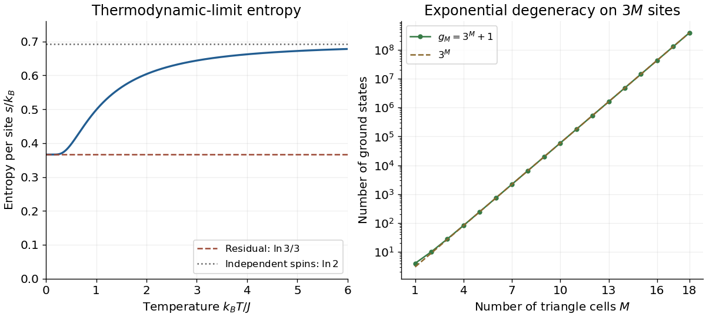

# 2018

↑ **Parent:** [Past exam of the advanced quantum theory: path integrals and many-particle physics course of the University of Oxford](../past-exam-of-the-advanced-quantum-theory-path-integrals-and-many-particle-physics-course-of-the-university-of-oxford.md)

Source paper: [https://www.whatdotheyknow.com/request/physics_past_papers_21/response/3037379/attach/2/FOI%20202505%20441%20Response.pdf?cookie_passthrough=1.](https://www.whatdotheyknow.com/request/physics_past_papers_21/response/3037379/attach/2/FOI%20202505%20441%20Response.pdf?cookie_passthrough=1.) The held cover dates this paper to 12 June 2018. We use $\hbar=1$, consistent with the source's momentum quantization, and take the pairing parameter $\Delta$ real so that the [Hamiltonian](../hamiltonian-mechanics.md#hamiltonian) is [Hermitian](../hilbert-space.md#hermitian-operator).

**Table of contents**

- [1](#1)
  - [a](#1/a)
    - [Solution](#1/a/solution)
  - [b](#1/b)
    - [Solution](#1/b/solution)
  - [c](#1/c)
    - [Solution](#1/c/solution)
  - [d](#1/d)
    - [Solution](#1/d/solution)
- [2](#2)
  - [a](#2/a)
    - [Solution](#2/a/solution)
  - [b](#2/b)
    - [Solution](#2/b/solution)
  - [c](#2/c)
    - [Solution](#2/c/solution)
  - [d](#2/d)
    - [Solution](#2/d/solution)

## 1

↑ **Parent:** [2018](2018.md)

<h3 id="1/a">a</h3>

↑ **Parent:** [1](#1)

<h4 id="1/a/solution">Solution</h4>

↑ **Parent:** [A](#1/a)

With no pairing, the [Hamiltonian](../hamiltonian-mechanics.md#hamiltonian) is diagonal in the [fermionic occupation numbers](../quantum-field-theory.md#fermionic-occupation-number). The [Pauli exclusion principle](../tensor-product-of-quantum-systems.md#pauli-exclusion-principle) allows each momentum mode to be either empty or occupied once. Without a fixed [fermion number](../relativistic-quantum-field.md#fermion-number) constraint, occupying a mode lowers the [energy](../energy.md) precisely when its single-particle [energy](../energy.md) is negative. Therefore, with $|0\rangle$ the [Fock vacuum](../quantum-field-theory.md#fock-vacuum), a [ground state](../quantum-mechanics.md#ground-state) is

$$
\boxed{|\mathrm{GS}\rangle=\prod_{p:\,\epsilon(p)<0}c_p^\dagger|0\rangle,\qquad E_{\mathrm{GS}}=\sum_{p:\,\epsilon(p)<0}\epsilon(p).}
$$

Choose a fixed ordering of the [fermionic creation operators](../relativistic-quantum-field.md#fermionic-creation-operator); changing it alters only the overall [phase](../wave.md#phase-waves). Any zero-energy modes may be occupied or empty without changing the [ground-state energy](../quantum-mechanics.md#ground-state-energy).

To identify the occupied modes, complete the square:

$$
\frac{\epsilon(p)}\alpha=\left(p^2-\frac\beta2\right)^2+\mu-\frac{\beta^2}{4}.
$$

Here $\beta$ is the dispersion parameter, not [inverse temperature](../temperature.md#inverse-temperature). If $\beta^2<4\mu$, every mode has positive [energy](../energy.md) and the unique [ground state](../quantum-mechanics.md#ground-state) is the [Fock vacuum](../quantum-field-theory.md#fock-vacuum), with $E_{\mathrm{GS}}=0$. If $\beta^2=4\mu$, there are still no negative-energy modes, but $p=\pm\sqrt{\beta/2}$ have zero [energy](../energy.md) if they lie on the allowed momentum grid. Each such mode doubles the [ground-state degeneracy](../quantum-mechanics.md#ground-state-degeneracy).

For $\beta^2>4\mu$, define

$$
p_-^2=\frac{\beta-\sqrt{\beta^2-4\mu}}2,\qquad
p_+^2=\frac{\beta+\sqrt{\beta^2-4\mu}}2.
$$

Both are positive, and the occupied [Fermi sea](../quantum-ideal-gas-statistics.md#fermi-sea) consists of the two intervals $p_-<|p|<p_+$. With $p=2\pi n/L$, the requested finite-size [ground-state energy](../quantum-mechanics.md#ground-state-energy) is explicitly

$$
\boxed{E_{\mathrm{GS}}=2\alpha\!\sum_{\substack{n\in\mathbb Z_{>0}\\ Lp_-/(2\pi)<n<Lp_+/(2\pi)}}\left[\left(\frac{2\pi n}L\right)^4-\beta\left(\frac{2\pi n}L\right)^2+\mu\right].}
$$

The factor two counts opposite momenta. Endpoints are excluded from this [sum](../arithmetic.md#sum) because they have zero [energy](../energy.md); when an endpoint is allowed, its optional occupation adds [ground-state degeneracy](../quantum-mechanics.md#ground-state-degeneracy). A narrow negative-energy interval can contain no allowed finite-size momenta, in which case the [sum](../arithmetic.md#sum) is empty. The zero-momentum mode is always empty since $\epsilon(0)=\alpha\mu>0$.

<h3 id="1/b">b</h3>

↑ **Parent:** [1](#1)

<h4 id="1/b/solution">Solution</h4>

↑ **Parent:** [B](#1/b)

For real angles write $u_p=\cos\theta_p$ and $v_p=\sin\theta_p$. For one independent pair $p>0$, the transformation and its conjugate read

$$
c_p=u_p\alpha_p+i v_p\alpha_{-p}^\dagger,\qquad
c_{-p}=u_p\alpha_{-p}-i v_p\alpha_p^\dagger.
$$

Using the [canonical anticommutation relations](../supersymmetric-quantum-mechanics.md#canonical-anticommutation-relations) for the $\alpha$ modes gives

$$
\begin{aligned}
\{c_p,c_p^\dagger\}&=u_p^2+v_p^2=1,\\
\{c_{-p},c_{-p}^\dagger\}&=u_p^2+v_p^2=1,\\
\{c_p,c_{-p}\}&=-i u_pv_p+i v_pu_p=0,\\
\{c_p,c_{-p}^\dagger\}&=0.
\end{aligned}
$$

The remaining [anticommutators](../vector-space.md#anticommutator) vanish for independent momentum pairs. The displayed two-by-two [matrix](../vector-space.md#matrix) is [unitary](../vector-bundle.md#unitary-connection) and its inverse is obtained by changing $i$ to $-i$.

When the same formula is indexed over both signs of momentum, its first row at $-p$ must agree with the conjugate of its second row at $p$. Thus a consistent global convention requires

$$
\boxed{u_{-p}=u_p,\qquad v_{-p}=-v_p,\qquad \theta_{-p}=-\theta_p\pmod{2\pi}.}
$$

This is the [odd-momentum fermionic Bogoliubov angle](../quantum-field-theory.md#odd-momentum-fermionic-bogoliubov-angle) convention. If one checks only the first-row formulas, their cross [anticommutator](../vector-space.md#anticommutator) is $i\sin(\theta_p+\theta_{-p})$; its vanishing gives the condition modulo $\pi$, with possible signs absorbable in the $\alpha$ modes. Requiring both rows to describe the same operators fixes the convention above. Merely checking a separate [unitary matrix](../linear-operator-theory.md#unitary-matrix) at each momentum misses this redundancy: choosing $\theta_p=\theta_{-p}=\pi/4$ in both first rows would give $\{c_p,c_{-p}\}=i$.

At $p=0$, the [annihilation operator](../quantum-harmonic-oscillator.md#annihilation-operator) and its conjugate belong to one mode. The full displayed formula is consistent only with $v_0=0$; choose $\theta_0=0$ and $\alpha_0=c_0$. This mode is not a two-mode pair.

<h3 id="1/c">c</h3>

↑ **Parent:** [1](#1)

<h4 id="1/c/solution">Solution</h4>

↑ **Parent:** [C](#1/c)

Group the nonzero modes into independent pairs $p>0$. For one pair set $\varepsilon=\epsilon(p)=p^2/(2m)+\mu$, and introduce the [Nambu spinor](../quantum-field-theory.md#nambu-spinor) $\Psi_p=(c_p,c_{-p}^\dagger)^{\mathsf T}$. [Normal ordering](../perturbative-quantum-field-theory.md#normal-ordering) using $c_{-p}c_{-p}^\dagger=1-c_{-p}^\dagger c_{-p}$ gives

$$
H_p=\Psi_p^\dagger\begin{pmatrix}\varepsilon&i\Delta\\-i\Delta&-\varepsilon\end{pmatrix}\Psi_p+\varepsilon.
$$

This exactly contains both kinetic terms and the pairing terms once; there is no additional factor of one half because only $p>0$ is summed.

Insert $\Psi_p=U_p\mathcal A_p$, where $\mathcal A_p=(\alpha_p,\alpha_{-p}^\dagger)^{\mathsf T}$ and $U_p$ is the [Bogoliubov transformation](../quantum-field-theory.md#bogoliubov-transformation) [matrix](../vector-space.md#matrix). Direct [matrix multiplication](../vector-space.md#matrix-multiplication) yields

$$
U_p^\dagger h_pU_p=\begin{pmatrix}
\varepsilon\cos2\theta_p-\Delta\sin2\theta_p&i(\varepsilon\sin2\theta_p+\Delta\cos2\theta_p)\\
-i(\varepsilon\sin2\theta_p+\Delta\cos2\theta_p)&-\varepsilon\cos2\theta_p+\Delta\sin2\theta_p
\end{pmatrix}.
$$

Choose the diagonalizing branch

$$
\boxed{\cos2\theta_p=\frac{\varepsilon}{E_p},\qquad \sin2\theta_p=-\frac\Delta{E_p},\qquad E_p=\sqrt{\varepsilon^2+\Delta^2},\quad p>0.}
$$

Then the off-diagonal terms vanish and the upper diagonal entry is $E_p>0$. Extend the angle to negative momenta as in part b; the sine relation just written applies to the positive representative of each pair. The [BCS coherence factors](../fermi-liquid.md#bcs-coherence-factors) can be chosen as

$$
u_p=\sqrt{\frac{E_p+\varepsilon}{2E_p}},\qquad
v_p=-\frac{\Delta}{\sqrt{2E_p(E_p+\varepsilon)}}.
$$

Here $u_p$ denotes $\cos\theta_p$, and $v_p$ denotes $\sin\theta_p$; these expressions are nonsingular because $\mu>0$ and $m>0$. The minus sign of $v_p$ for positive $\Delta$ is fixed by the pairing [phase](../wave.md#phase-waves) in this [Hamiltonian](../hamiltonian-mechanics.md#hamiltonian).

A second use of the [canonical anticommutation relations](../supersymmetric-quantum-mechanics.md#canonical-anticommutation-relations) gives

$$
H_p=E_p\left(\alpha_p^\dagger\alpha_p-\alpha_{-p}\alpha_{-p}^\dagger\right)+\varepsilon
=E_p\left(\alpha_p^\dagger\alpha_p+\alpha_{-p}^\dagger\alpha_{-p}\right)+\varepsilon-E_p.
$$

The zero-momentum term was never paired and is simply $\mu\alpha_0^\dagger\alpha_0$. Hence

$$
\boxed{H=\sum_pE(p)\alpha_p^\dagger\alpha_p+C,\qquad
C=\sum_{p>0}\bigl[\epsilon(p)-\sqrt{\epsilon(p)^2+\Delta^2}\bigr],}
$$

with

$$
\boxed{E(0)=\mu,\qquad E(p)=\sqrt{\epsilon(p)^2+\Delta^2}\quad(p\ne0).}
$$

The constant is the [ground-state energy](../quantum-mechanics.md#ground-state-energy). At fixed $L$, its ultraviolet tail converges: $\epsilon(p)-E(p)=-\Delta^2/[\epsilon(p)+E(p)]\sim-m\Delta^2/p^2$ in one dimension. Replacing $E(0)$ by $\sqrt{\mu^2+\Delta^2}$ would incorrectly pair a spinless mode with itself.

<h3 id="1/d">d</h3>

↑ **Parent:** [1](#1)

<h4 id="1/d/solution">Solution</h4>

↑ **Parent:** [D](#1/d)

Since every [quasiparticle](../quantum-mechanics.md#quasiparticle) [energy](../energy.md) is positive, the [ground state](../quantum-mechanics.md#ground-state) is the vacuum of all the $\alpha_p$ [annihilation operators](../quantum-harmonic-oscillator.md#annihilation-operator), including $\alpha_0=c_0$. Its zero-momentum mode is therefore empty. For each positive momentum, the inverse [Bogoliubov transformation](../quantum-field-theory.md#bogoliubov-transformation) gives

$$
\alpha_p=u_pc_p-i v_pc_{-p}^\dagger,\qquad
\alpha_{-p}=u_pc_{-p}+i v_pc_p^\dagger.
$$

Both annihilate the normalized pair state $(u_p+i v_pc_p^\dagger c_{-p}^\dagger)|0\rangle$. For example, applying $\alpha_p$ produces the two cancelling terms $i u_pv_pc_{-p}^\dagger|0\rangle$. Thus

$$
\boxed{|\Omega\rangle=\prod_{p>0}\left(u_p+i v_pc_p^\dagger c_{-p}^\dagger\right)|0\rangle,\qquad c_0|\Omega\rangle=0.}
$$

The factors have even [fermion parity](../topological-quantum-matter.md#fermion-parity) and commute for disjoint momentum pairs. Each normalized factor is a [superposition](../vector-space.md#superposition-principle) of zero and two [fermions](../tensor-product-of-quantum-systems.md#fermion), whose pair-occupation [probability](../probability-theory.md#probability) is $v_p^2$. Therefore

$$
\boxed{\langle\Omega|\widehat N|\Omega\rangle=2\sum_{p>0}v_p^2=\sum_{p>0}\left(1-\frac{\epsilon(p)}{E_p}\right).}
$$

There is no zero-mode contribution. For fixed $L$, the [sum](../arithmetic.md#sum) converges since $v_p^2=O(p^{-4})$.

A normalized simple excited state is $|k\rangle=\alpha_k^\dagger|\Omega\rangle$ for $k>0$. Its [excitation energy](../quantum-mechanics.md#excitation-energy) is $E_k$, and its total [momentum](../momentum.md) is $k$: both terms in $\alpha_k^\dagger=u_kc_k^\dagger+i v_kc_{-k}$ add momentum $k$. Acting on the $k,-k$ pair gives

$$
\alpha_k^\dagger\left(u_k+i v_kc_k^\dagger c_{-k}^\dagger\right)|0\rangle
=(u_k^2+v_k^2)c_k^\dagger|0\rangle=c_k^\dagger|0\rangle.
$$

The affected pair now contains exactly one [fermion](../tensor-product-of-quantum-systems.md#fermion) instead of mean number $2v_k^2$; all other pairs are unchanged. Consequently

$$
\boxed{\langle k|\widehat N|k\rangle=\langle\widehat N\rangle_\Omega+1-2v_k^2
=\langle\widehat N\rangle_\Omega+\frac{\epsilon(k)}{E_k}.}
$$

This is the [fermion number of a Bogoliubov excitation](../quantum-mechanics.md#fermion-number-of-a-bogoliubov-excitation). Its change in mean [fermion number](../relativistic-quantum-field.md#fermion-number) lies between zero and one for $\mu>0$, with the value one at $\Delta=0$. The [Bogoliubov quasiparticle](../quantum-mechanics.md#bogoliubov-quasiparticle) coherently mixes adding a [fermion](../tensor-product-of-quantum-systems.md#fermion) and removing the opposite-momentum [fermion](../tensor-product-of-quantum-systems.md#fermion); it is not an eigen-excitation of the original [fermion number operator](../supersymmetric-quantum-mechanics.md#fermion-number-operator). Indeed,

$$
[\widehat N,H]=2i\Delta\sum_{p>0}\left(c_p^\dagger c_{-p}^\dagger+c_{-p}c_p\right),
$$

so [fermion number](../relativistic-quantum-field.md#fermion-number) is not conserved when $\Delta\ne0$, while [fermion parity](../topological-quantum-matter.md#fermion-parity) is conserved. The generally noninteger change is an [expectation value](../quantum-system.md#expectation-value) in a coherent paired background, rather than a fractional eigenvalue of the [fermion number operator](../supersymmetric-quantum-mechanics.md#fermion-number-operator). In the weak-pairing limit at fixed $k$, it tends to one, as expected for an ordinary added [fermion](../tensor-product-of-quantum-systems.md#fermion).

## 2

↑ **Parent:** [2018](2018.md)

<h3 id="2/a">a</h3>

↑ **Parent:** [2](#2)

<h4 id="2/a/solution">Solution</h4>

↑ **Parent:** [A](#2/a)

Let $\beta=1/(k_BT)$ and use the two spin values $+1,-1$ as row and column labels. Define the [spin-chain transfer matrix](../spin-model.md#transfer-matrix-for-a-classical-spin-chain)

$$
W_{st}=e^{-\beta E_0(s,t)},\qquad s,t\in\{+1,-1\}.
$$

It is a real [symmetric matrix](../linear-algebra.md#symmetric-matrix) because $E_0(s,t)=E_0(t,s)$; every entry is strictly positive for finite bond [energies](../energy.md) at $T>0$. The [Boltzmann factor](../canonical-ensemble.md#boltzmann-factor) of a spin configuration factorizes into the product $W_{\sigma_1\sigma_2}\cdots W_{\sigma_L\sigma_1}$. Summing the intermediate spin labels is exactly [matrix multiplication](../vector-space.md#matrix-multiplication), and the final closure imposes [periodic boundary conditions](../differential-equation.md#periodic-boundary-conditions). Thus

$$
\boxed{Z_L=\sum_{\sigma_1,\ldots,\sigma_L}\prod_{j=1}^LW_{\sigma_j\sigma_{j+1}}=\operatorname{Tr}W^L.}
$$

Writing $W=\left(\begin{smallmatrix}a&b\\b&d\end{smallmatrix}\right)$, its [eigenvalues](../linear-operator-theory.md#eigenvalue) are

$$
\lambda_\pm=\frac{a+d\pm\sqrt{(a-d)^2+4b^2}}2,
\qquad \boxed{Z_L=\lambda_+^L+\lambda_-^L.}
$$

A positive-entry [matrix](../vector-space.md#matrix) need not have two positive [eigenvalues](../linear-operator-theory.md#eigenvalue); $\lambda_-$ can be negative. The [Perron–Frobenius theorem](../vector-space.md#perron-frobenius-theorem) ensures $\lambda_+>|\lambda_-|$ here. Therefore the [Helmholtz free energy](../thermodynamic-potential.md#helmholtz-free-energy) is $F_L=-k_BT\ln Z_L$, and its value per spin in the [thermodynamic limit](../statistical-physics.md#thermodynamic-limit) is $-k_BT\ln\lambda_+$.

<h3 id="2/b">b</h3>

↑ **Parent:** [2](#2)

<h4 id="2/b/solution">Solution</h4>

↑ **Parent:** [B](#2/b)

For an open chain there are $L-1$ bonds, with both endpoint [Ising spins](../spin-model.md#ising-spin-variable) independently summed. Retain the same [spin-chain transfer matrix](../spin-model.md#transfer-matrix-for-a-classical-spin-chain), but replace the trace by endpoint vectors. With $\mathbf1=(1,1)^{\mathsf T}$,

$$
\boxed{Z_L^{\mathrm{open}}=\mathbf1^{\mathsf T}W^{L-1}\mathbf1.}
$$

This follows directly by expanding the product of $L-1$ [Boltzmann factors](../canonical-ensemble.md#boltzmann-factor). If $\mathbf v_\pm$ are orthonormal [eigenvectors](../linear-operator-theory.md#eigenvector) of the [symmetric matrix](../linear-algebra.md#symmetric-matrix) $W$, the equivalent [spectral decomposition](../linear-operator-theory.md#spectral-decomposition) is

$$
Z_L^{\mathrm{open}}=\sum_{\nu=\pm}(\mathbf1^{\mathsf T}\mathbf v_\nu)^2\lambda_\nu^{L-1}.
$$

Fixed endpoint [Ising spins](../spin-model.md#ising-spin-variable) replace the corresponding $\mathbf1$ by a basis vector; extra endpoint [energies](../energy.md) replace its entries by the corresponding [Boltzmann factors](../canonical-ensemble.md#boltzmann-factor). The leading bulk [Helmholtz free energy](../thermodynamic-potential.md#helmholtz-free-energy) per spin agrees with the periodic result, because the boundary changes only subextensive terms. In particular, $L=1$ gives $Z_1^{\mathrm{open}}=\mathbf1^{\mathsf T}\mathbf1=2$, as required for one free [Ising spin](../spin-model.md#ising-spin-variable).

<h3 id="2/c">c</h3>

↑ **Parent:** [2](#2)

<h4 id="2/c/solution">Solution</h4>

↑ **Parent:** [C](#2/c)

Let $M=L/2$, so that the total number of [Ising spins](../spin-model.md#ising-spin-variable) is $3M$. Write $K=\beta J$ and group each triangle's two base spins and its apex into one cell. The [Ising chain with alternating triangular decorations](../spin-model.md#ising-chain-with-alternating-triangular-decorations) has a triangle bond followed by an undecorated connecting bond. Summing an apex [Ising spin](../spin-model.md#ising-spin-variable) first gives a decorated-bond [Boltzmann weight](../canonical-ensemble.md#boltzmann-factor)

$$
A_{st}=\sum_{\tau=\pm1}e^{-K[st+(s+t)\tau]}=2e^{-Kst}\cosh[K(s+t)].
$$

The undecorated bridge has [Boltzmann weight](../canonical-ensemble.md#boltzmann-factor) $B_{ts'}=e^{-Kts'}$. In the basis $+1,-1$,

$$
A=\begin{pmatrix}e^K+e^{-3K}&2e^K\\2e^K&e^K+e^{-3K}\end{pmatrix},\qquad
B=\begin{pmatrix}e^{-K}&e^K\\e^K&e^{-K}\end{pmatrix}.
$$

Each cell contributes $T=AB$, so [periodic boundary conditions](../differential-equation.md#periodic-boundary-conditions) give

$$
\boxed{Z_L=\operatorname{Tr}(AB)^M.}
$$

The two [matrices](../vector-space.md#matrix) have common normalized [eigenvectors](../linear-operator-theory.md#eigenvector) $(1,1)^{\mathsf T}/\sqrt2$ and $(1,-1)^{\mathsf T}/\sqrt2$, expressing [spin inversion symmetry](../spin-model.md#spin-inversion-symmetry). Their respective [eigenvalues](../linear-operator-theory.md#eigenvalue) are

$$
a_+=3e^K+e^{-3K},\quad a_-=e^{-3K}-e^K,\qquad
b_+=e^{-K}+e^K,\quad b_-=e^{-K}-e^K.
$$

Consequently the cell [transfer matrix](../combinatorics.md#transfer-matrix) has [eigenvalues](../linear-operator-theory.md#eigenvalue)

$$
\begin{aligned}
\lambda_+&=(3e^K+e^{-3K})(e^{-K}+e^K)=3+e^{-4K}+e^{-2K}+3e^{2K},\\
\lambda_-&=(e^{-3K}-e^K)(e^{-K}-e^K)=e^{-4K}-e^{-2K}-1+e^{2K},
\end{aligned}
$$

and the finite-size [partition function](../canonical-ensemble.md#canonical-partition-function) is

$$
\boxed{Z_L=\lambda_+^{L/2}+\lambda_-^{L/2}.}
$$

For $K>0$, $\lambda_-\geq0$ and $\lambda_+-\lambda_-=4+2e^{-2K}+2e^{2K}>0$, so only $\lambda_+$ survives in the [thermodynamic limit](../statistical-physics.md#thermodynamic-limit). Divide the [Helmholtz free energy](../thermodynamic-potential.md#helmholtz-free-energy) by $3M$, the number of sites rather than the number of cells or base spins:

$$
\boxed{f(T)=-\frac{k_BT}{3}\ln\lambda_+
=-\frac{k_BT}{3}\ln\!\left(3+e^{-4\beta J}+e^{-2\beta J}+3e^{2\beta J}\right).}
$$

As a counting check, $K=0$ gives $\lambda_+=8$, $\lambda_-=0$, hence $Z_L=8^M=2^{3M}$, exactly the number of independent [Ising spin](../spin-model.md#ising-spin-variable) configurations. This model has separated decorated bonds and should not be confused with the corner-sharing [sawtooth Ising chain](../spin-model.md#sawtooth-ising-chain), which has a different site count.

<h3 id="2/d">d</h3>

↑ **Parent:** [2](#2)

<h4 id="2/d/solution">Solution</h4>

↑ **Parent:** [D](#2/d)

For low [temperature](../temperature.md), factor out the largest [Boltzmann factor](../canonical-ensemble.md#boltzmann-factor) from the dominant [eigenvalue](../linear-operator-theory.md#eigenvalue):

$$
\lambda_+=3e^{2K}\left(1+e^{-2K}+\frac13e^{-4K}+\frac13e^{-6K}\right).
$$

Thus the [Helmholtz free energy](../thermodynamic-potential.md#helmholtz-free-energy) per site has the expansion

$$
f=-\frac{2J}{3}-\frac{k_BT}{3}\ln3-\frac{k_BT}{3}e^{-2K}+O\!\left(k_BT e^{-4K}\right).
$$

Differentiate at fixed $J$, remembering that $K=J/(k_BT)$. The [entropy](../entropy.md) per site is

$$
s=\frac{k_B}{3}\ln3+\frac{k_B}{3}(1+2K)e^{-2K}+O\!\left(k_B(1+K)e^{-4K}\right),
\qquad \boxed{\lim_{T\to0^+}s(T)=\frac{k_B}{3}\ln3.}
$$

The nonzero [residual entropy](../entropy.md#residual-entropy) comes from an exponentially large [ground-state degeneracy](../quantum-mechanics.md#ground-state-degeneracy), generated by [geometrical frustration](../statistical-physics.md#geometrical-frustration). A triangle with antiferromagnetic [energy](../energy.md) $J[st+(s+t)\tau]$ has minimum [energy](../energy.md) $-J$: if $s=t$, the apex must have the opposite sign; if $s=-t$, either apex sign is permitted. The two all-equal configurations instead have [energy](../energy.md) $3J$. Thus exactly one of a minimum-energy triangle's bonds is frustrated. The bridge can simultaneously minimize its [energy](../energy.md) at $-J$ by requiring $t=-s'$, where $s'$ is the next cell's first base spin.

For fixed $s$ and $s'$, the number of allowed apex choices is therefore two when $s=s'$ and one when $s=-s'$. The zero-temperature counting [transfer matrix](../combinatorics.md#transfer-matrix) on successive first base spins is

$$
G=\begin{pmatrix}2&1\\1&2\end{pmatrix},\qquad
\boxed{g_M=\operatorname{Tr}G^M=3^M+1,\qquad E_{\mathrm{GS}}=-2JM=-JL.}
$$

The [eigenvalues](../linear-operator-theory.md#eigenvalue) of $G$ are $3$ and $1$. Dividing $k_B\ln g_M$ by the $3M$ sites and taking the [thermodynamic limit](../statistical-physics.md#thermodynamic-limit) gives $k_B\ln3/3$, independently confirming the derivative calculation. This does not assert a unique ordered [ground state](../quantum-mechanics.md#ground-state): the extensive choice of frustrated bonds is precisely what leaves [entropy](../entropy.md) at zero [temperature](../temperature.md). At high [temperature](../temperature.md), all [Ising spins](../spin-model.md#ising-spin-variable) become independent and $s\to k_B\ln2$ per site.

**[Figure 1](#2/d/image-entropy-of-the-ising-chain-with-alternating-triangular-decorations-and-its-ground-state-degeneracy). Entropy of the Ising chain with alternating triangular decorations and its ground-state degeneracy**.

## ↑ Ancestors (9)

1. [Past exam of the advanced quantum theory: path integrals and many-particle physics course of the University of Oxford](../past-exam-of-the-advanced-quantum-theory-path-integrals-and-many-particle-physics-course-of-the-university-of-oxford.md)
2. [Advanced quantum theory: path integrals and many-particle physics course of the University of Oxford](../university-of-oxford.md#advanced-quantum-theory-path-integrals-and-many-particle-physics-course-of-the-university-of-oxford)
3. [Year 4 of the mathematical and theoretical physics course of the University of Oxford](../university-of-oxford.md#year-4-of-the-mathematical-and-theoretical-physics-course-of-the-university-of-oxford)
4. [Mathematical and theoretical physics course of the University of Oxford](../university-of-oxford.md#mathematical-and-theoretical-physics-course-of-the-university-of-oxford)
5. [Undergraduate course of the University of Oxford](../university-of-oxford.md#undergraduate-course-of-the-university-of-oxford)
6. [Course of the University of Oxford](../university-of-oxford.md#course-of-the-university-of-oxford)
7. [University of Oxford](../university-of-oxford.md)
8. [List of universities](../README.md#list-of-universities)
9. [Codex Wiki](../README.md)
