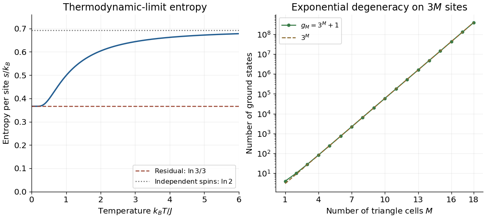

<h1 id="2/d/solution">Solution</h1>

↑ **Parent:** [D](../d.md)

For low [temperature](../../../../temperature-split.md), factor out the largest [Boltzmann factor](../../../../boltzmann-factor.md) from the dominant [eigenvalue](../../../../eigenvalue.md):

$$
\lambda_+=3e^{2K}\left(1+e^{-2K}+\frac13e^{-4K}+\frac13e^{-6K}\right).
$$

Thus the [Helmholtz free energy](../../../../helmholtz-free-energy.md) per site has the expansion

$$
f=-\frac{2J}{3}-\frac{k_BT}{3}\ln3-\frac{k_BT}{3}e^{-2K}+O\!\left(k_BT e^{-4K}\right).
$$

Differentiate at fixed $J$, remembering that $K=J/(k_BT)$. The [entropy](../../../../entropy-split.md) per site is

$$
s=\frac{k_B}{3}\ln3+\frac{k_B}{3}(1+2K)e^{-2K}+O\!\left(k_B(1+K)e^{-4K}\right),
\qquad \boxed{\lim_{T\to0^+}s(T)=\frac{k_B}{3}\ln3.}
$$

The nonzero [residual entropy](../../../../residual-entropy.md) comes from an exponentially large [ground-state degeneracy](../../../../ground-state-degeneracy.md), generated by [geometrical frustration](../../../../geometrical-frustration.md). A triangle with antiferromagnetic [energy](../../../../energy-split.md) $J[st+(s+t)\tau]$ has minimum [energy](../../../../energy-split.md) $-J$: if $s=t$, the apex must have the opposite sign; if $s=-t$, either apex sign is permitted. The two all-equal configurations instead have [energy](../../../../energy-split.md) $3J$. Thus exactly one of a minimum-energy triangle's bonds is frustrated. The bridge can simultaneously minimize its [energy](../../../../energy-split.md) at $-J$ by requiring $t=-s'$, where $s'$ is the next cell's first base spin.

For fixed $s$ and $s'$, the number of allowed apex choices is therefore two when $s=s'$ and one when $s=-s'$. The zero-temperature counting [transfer matrix](../../../../transfer-matrix.md) on successive first base spins is

$$
G=\begin{pmatrix}2&1\\1&2\end{pmatrix},\qquad
\boxed{g_M=\operatorname{Tr}G^M=3^M+1,\qquad E_{\mathrm{GS}}=-2JM=-JL.}
$$

The [eigenvalues](../../../../eigenvalue.md) of $G$ are $3$ and $1$. Dividing $k_B\ln g_M$ by the $3M$ sites and taking the [thermodynamic limit](../../../../thermodynamic-limit.md) gives $k_B\ln3/3$, independently confirming the derivative calculation. This does not assert a unique ordered [ground state](../../../../ground-state.md): the extensive choice of frustrated bonds is precisely what leaves [entropy](../../../../entropy-split.md) at zero [temperature](../../../../temperature-split.md). At high [temperature](../../../../temperature-split.md), all [Ising spins](../../../../ising-spin-variable.md) become independent and $s\to k_B\ln2$ per site.

**[Figure 1](#2/d/image-entropy-of-the-ising-chain-with-alternating-triangular-decorations-and-its-ground-state-degeneracy). Entropy of the Ising chain with alternating triangular decorations and its ground-state degeneracy**.

## ↑ Ancestors (12)

1. [D](../d.md)
2. [2](../../2.md)
3. [2018](../../../2018-split.md)
4. [Past exam of the advanced quantum theory: path integrals and many-particle physics course of the University of Oxford](../../../split.md)
5. [Advanced quantum theory: path integrals and many-particle physics course of the University of Oxford](../../../../advanced-quantum-theory-path-integrals-and-many-particle-physics-course-of-the-university-of-oxford.md)
6. [Year 4 of the mathematical and theoretical physics course of the University of Oxford](../../../../year-4-of-the-mathematical-and-theoretical-physics-course-of-the-university-of-oxford.md)
7. [Mathematical and theoretical physics course of the University of Oxford](../../../../mathematical-and-theoretical-physics-course-of-the-university-of-oxford.md)
8. [Undergraduate course of the University of Oxford](../../../../undergraduate-course-of-the-university-of-oxford.md)
9. [Course of the University of Oxford](../../../../course-of-the-university-of-oxford.md)
10. [University of Oxford](../../../../university-of-oxford-split.md)
11. [List of universities](../../../../list-of-universities.md)
12. [Codex Wiki](../../../../split.md)
