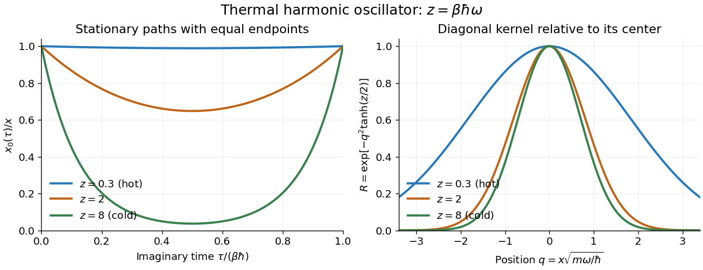

<h1 id="1/c/solution">Solution</h1>

↑ **Parent:** [C](../c.md)

Because $S[x_0]=0$ at $x=0$, the factor $Z$ cancels from the ratio. Write $z=\beta\hbar\omega$ and $q=\sqrt{m\omega/\hbar}\,x$. The exact answer is

$$
\boxed{R=\exp[-q^2\tanh(z/2)].}
$$

At high [temperature](../../../../temperature-split.md), $z\ll1$. Expanding the [hyperbolic tangent](../../../../hyperbolic-tangent.md) gives

$$
\log R=-q^2\left(\frac z2-\frac{z^3}{24}+O(z^5)\right),
\qquad
\boxed{R\simeq\exp\!\left(-\frac{\beta m\omega^2x^2}{2}\right).}
$$

The displayed leading expression is the ratio of classical [Boltzmann factors](../../../../boltzmann-factor.md) for [potential energy](../../../../potential-energy.md) $V(x)=m\omega^2x^2/2$ and $V(0)=0$. Indeed the classical [canonical ensemble](../../../../canonical-ensemble-split.md) gives

$$
p_{\rm cl}(x)\ \propto\ \int_{-\infty}^{\infty}dp\,
e^{-\beta[p^2/(2m)+V(x)]}
\ \propto\ e^{-\beta V(x)}.
$$

The [momentum](../../../../momentum-split.md) [Gaussian integral](../../../../gaussian-integral.md) is independent of $x$ and cancels in the ratio. This is the [classical phase-space limit of the thermal kernel](../../../../classical-phase-space-limit-of-the-thermal-kernel.md). Here $\beta=1/(k_BT)$, with $k_B$ the [Boltzmann constant](../../../../boltzmann-constant.md); the associated classical position [variance](../../../../variance-split.md) is $1/(\beta m\omega^2)$. At fixed $x$, $R$ ultimately tends to one as [temperature](../../../../temperature-split.md) tends to infinity, while its width grows.

At low [temperature](../../../../temperature-split.md), $z\gg1$. Now $\tanh(z/2)=1-2e^{-z}+O(e^{-2z})$, so at fixed $q$

$$
R=e^{-q^2}\left[1+2q^2e^{-z}+O(e^{-2z})\right],
\qquad
\boxed{R\simeq\exp\!\left(-\frac{m\omega x^2}{\hbar}\right).}
$$

Unlike the classical high-[temperature](../../../../temperature-split.md) expression, this limiting width remains nonzero at zero [temperature](../../../../temperature-split.md), reflecting the [ground state](../../../../ground-state.md) of the [quantum harmonic oscillator](../../../../quantum-harmonic-oscillator-split.md).

**[Figure 1](#1/c/image-imaginary-time-stationary-paths-and-the-crossover-of-the-diagonal-thermal-kernel). Imaginary-time stationary paths and the crossover of the diagonal thermal kernel**. Original plots of the [equal-endpoint Euclidean oscillator path](../../../../equal-endpoint-euclidean-oscillator-path.md) and the [diagonal thermal kernel of a quantum harmonic oscillator](../../../../diagonal-thermal-kernel-of-a-quantum-harmonic-oscillator.md), divided by its value at zero. Increasing $z=\beta\hbar\omega$ lowers the [temperature](../../../../temperature-split.md): the path spends more of its interior near zero, and the ratio approaches the finite-width [ground state](../../../../ground-state.md) profile.

## ↑ Ancestors (12)

1. [C](../c.md)
2. [1](../../1.md)
3. [2024](../../../2024-split.md)
4. [Past exam of the advanced quantum theory: path integrals and many-particle physics course of the University of Oxford](../../../split.md)
5. [Advanced quantum theory: path integrals and many-particle physics course of the University of Oxford](../../../../advanced-quantum-theory-path-integrals-and-many-particle-physics-course-of-the-university-of-oxford.md)
6. [Year 4 of the mathematical and theoretical physics course of the University of Oxford](../../../../year-4-of-the-mathematical-and-theoretical-physics-course-of-the-university-of-oxford.md)
7. [Mathematical and theoretical physics course of the University of Oxford](../../../../mathematical-and-theoretical-physics-course-of-the-university-of-oxford.md)
8. [Undergraduate course of the University of Oxford](../../../../undergraduate-course-of-the-university-of-oxford.md)
9. [Course of the University of Oxford](../../../../course-of-the-university-of-oxford.md)
10. [University of Oxford](../../../../university-of-oxford-split.md)
11. [List of universities](../../../../list-of-universities.md)
12. [Codex Wiki](../../../../split.md)
