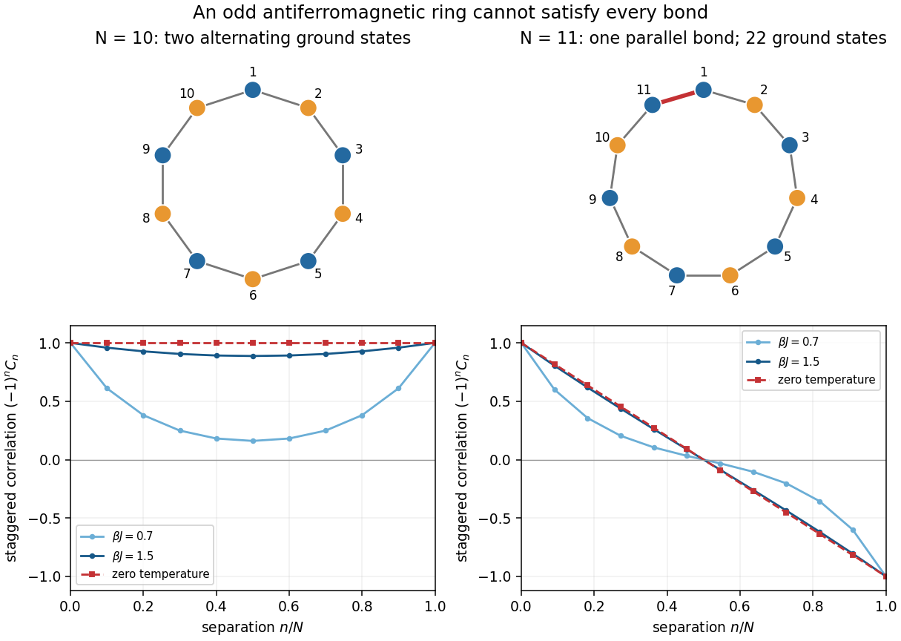
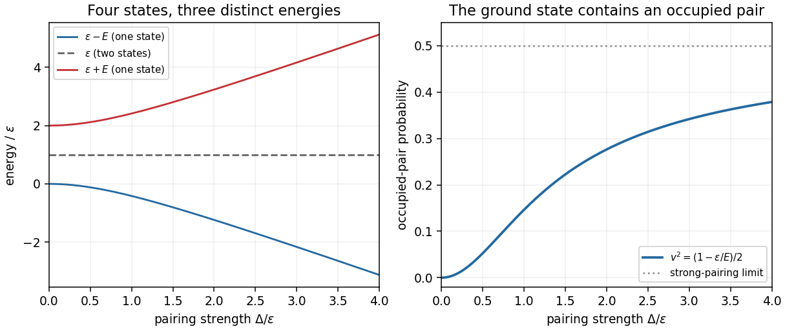

# 2025

↑ **Parent:** [Past exam of the advanced quantum theory: path integrals and many-particle physics course of the University of Oxford](../past-exam-of-the-advanced-quantum-theory-path-integrals-and-many-particle-physics-course-of-the-university-of-oxford.md)

Source PDF: [https://mmathphys.physics.ox.ac.uk/sites/g/files/vzsiac2991/files/mmathphys/documents/media/a15757h1.pdf](https://mmathphys.physics.ox.ac.uk/sites/g/files/vzsiac2991/files/mmathphys/documents/media/a15757h1.pdf)

**Table of contents**

- [1](#1)
  - [a](#1/a)
    - [i](#1/a/i)
      - [Solution](#1/a/i/solution)
    - [ii](#1/a/ii)
      - [Solution](#1/a/ii/solution)
  - [b](#1/b)
    - [Solution](#1/b/solution)
  - [c](#1/c)
    - [Solution](#1/c/solution)
  - [d](#1/d)
    - [Solution](#1/d/solution)
- [2](#2)
  - [a](#2/a)
    - [Solution](#2/a/solution)
  - [b](#2/b)
    - [Solution](#2/b/solution)
  - [c](#2/c)
    - [Solution](#2/c/solution)
  - [d](#2/d)
    - [Solution](#2/d/solution)

## 1

↑ **Parent:** [2025](2025.md)

<h3 id="1/a">a</h3>

↑ **Parent:** [1](#1)

<h4 id="1/a/i">i</h4>

↑ **Parent:** [A](#1/a)

<h5 id="1/a/i/solution">Solution</h5>

↑ **Parent:** [I](#1/a/i)

Each neighboring pair of [Ising spins](../spin-model.md#ising-spin-variable) contributes at least $-J$ to the [energy](../energy.md), with equality exactly when the two [Ising spins](../spin-model.md#ising-spin-variable) are opposite. For even $N$, alternation closes consistently under the [periodic boundary conditions](../differential-equation.md#periodic-boundary-conditions). The [ground states](../quantum-mechanics.md#ground-state) are therefore

$$
S_j=\sigma(-1)^{j-1},\qquad \sigma\in\{+1,-1\},
\qquad \boxed{E_0=-JN,\quad g_0=2.}
$$

Here $g_0$ is the [ground-state degeneracy](../quantum-mechanics.md#ground-state-degeneracy). Choosing $S_1$ fixes every other [Ising spin](../spin-model.md#ising-spin-variable), so these are all the [ground states](../quantum-mechanics.md#ground-state); translations do not give additional [spin configurations](../spin-model.md#spin-configuration). The two [ground states](../quantum-mechanics.md#ground-state) are exchanged by [spin inversion symmetry](../spin-model.md#spin-inversion-symmetry).

<h4 id="1/a/ii">ii</h4>

↑ **Parent:** [A](#1/a)

<h5 id="1/a/ii/solution">Solution</h5>

↑ **Parent:** [Ii](#1/a/ii)

Let $m$ count the parallel neighboring pairs, or [frustrated bonds in an antiferromagnetic Ising ring](../spin-model.md#frustrated-bond-in-an-antiferromagnetic-ising-ring). The [periodic boundary conditions](../differential-equation.md#periodic-boundary-conditions) imply

$$
\prod_{j=1}^N(S_jS_{j+1})=\prod_{j=1}^NS_j^2=1.
$$

There are $N-m$ antiparallel pairs, so $(-1)^{N-m}=1$: the number of antiparallel pairs must be even. For odd $N$, $m$ must consequently be odd. Each [frustrated bond in an antiferromagnetic Ising ring](../spin-model.md#frustrated-bond-in-an-antiferromagnetic-ising-ring) raises the [energy](../energy.md) by $2J$ relative to a satisfied pair, giving

$$
H=-JN+2Jm.
$$

The minimum is attained at $m=1$. Choose its position among the $N$ labeled bonds, choose either orientation of one [Ising spin](../spin-model.md#ising-spin-variable), then alternate across every other bond. This constructs exactly two [spin configurations](../spin-model.md#spin-configuration) per position. Thus

$$
\boxed{E_0=-J(N-2),\qquad g_0=2N\quad(N\text{ odd}).}
$$

This is [geometric frustration](../statistical-physics.md#geometrical-frustration): every local interaction prefers opposite [Ising spins](../spin-model.md#ising-spin-variable), but the closed odd ring prevents all preferences being satisfied at once. No particular location is preferred for the single [frustrated bond in an antiferromagnetic Ising ring](../spin-model.md#frustrated-bond-in-an-antiferromagnetic-ising-ring).

<h3 id="1/b">b</h3>

↑ **Parent:** [1](#1)

<h4 id="1/b/solution">Solution</h4>

↑ **Parent:** [B](#1/b)

Write $K=\beta J$, where $\beta=1/(k_BT)$ is the [inverse temperature](../temperature.md#inverse-temperature), $T$ is [temperature](../temperature.md) and $k_B$ is the [Boltzmann constant](../thermodynamics.md#boltzmann-constant). In the [canonical ensemble](../canonical-ensemble.md), each [spin configuration](../spin-model.md#spin-configuration) has [probability](../probability-theory.md#probability) $e^{-\beta H}/Z_N$. The nearest-neighbor [Boltzmann factors](../canonical-ensemble.md#boltzmann-factor) multiply, so the [spin-chain transfer matrix](../spin-model.md#transfer-matrix-for-a-classical-spin-chain), in the order $+1,-1$, is

$$
\mathsf T_{ss'}=e^{-Kss'},\qquad
\mathsf T=\begin{pmatrix}e^{-K}&e^K\\e^K&e^{-K}\end{pmatrix}.
$$

Multiplying its entries around the ring and summing over every [Ising spin](../spin-model.md#ising-spin-variable) yields the [partition function](../canonical-ensemble.md#canonical-partition-function):

$$
Z_N=\sum_{S_1,\ldots,S_N}\mathsf T_{S_1S_2}\cdots\mathsf T_{S_NS_1}
=\operatorname{tr}\mathsf T^N.
$$

The [trace](../linear-algebra.md#matrix-trace) implements the [periodic boundary conditions](../differential-equation.md#periodic-boundary-conditions); replacing it by an endpoint sum would describe a different [partition function](../canonical-ensemble.md#canonical-partition-function). The normalized [eigenvectors](../linear-operator-theory.md#eigenvector) and corresponding [eigenvalues](../linear-operator-theory.md#eigenvalue) are

$$
|+\rangle=\frac1{\sqrt2}\binom11,\quad
|-\rangle=\frac1{\sqrt2}\binom1{-1},\qquad
\lambda_+=2\cosh K,\quad \lambda_-=-2\sinh K.
$$

The negative [eigenvalue](../linear-operator-theory.md#eigenvalue) is essential for the [antiferromagnetic Ising model](../spin-model.md#antiferromagnetic-ising-model). Introduce their ratio

$$
t=\frac{\lambda_-}{\lambda_+}=-\tanh K.
$$

The exact finite-$N$ [partition function](../canonical-ensemble.md#canonical-partition-function) and [Helmholtz free energy](../thermodynamic-potential.md#helmholtz-free-energy) are

$$
\boxed{Z_N=(2\cosh K)^N+( -2\sinh K)^N
=(2\cosh K)^N(1+t^N),}
$$

$$
\boxed{F_N=-\frac1\beta\log Z_N
=-\frac N\beta\log(2\cosh K)-\frac1\beta\log(1+t^N).}
$$

For finite $K>0$, $|t|<1$, so $Z_N>0$ for both even and odd $N$. The last term retains the finite-ring effect of [geometric frustration](../statistical-physics.md#geometrical-frustration).

To insert an [Ising spin](../spin-model.md#ising-spin-variable) into this [trace](../linear-algebra.md#matrix-trace), use the [diagonal matrix](../linear-algebra.md#diagonal-matrix) $\mathsf S=\operatorname{diag}(1,-1)$. In the [eigenbasis](../linear-operator-theory.md#eigenbasis) of $\mathsf T$, it exchanges $|+\rangle$ and $|-\rangle$, and hence has vanishing diagonal entries. The [one-point correlation function](../critical-phenomenon.md#one-point-correlation-function) is therefore

$$
\boxed{\langle S_1\rangle=
\frac{\operatorname{tr}(\mathsf S\mathsf T^N)}{Z_N}=0.}
$$

The same conclusion follows directly from [spin inversion symmetry](../spin-model.md#spin-inversion-symmetry): reversing every [Ising spin](../spin-model.md#ising-spin-variable) preserves the [energy](../energy.md) and the [Boltzmann factor](../canonical-ensemble.md#boltzmann-factor) while reversing $S_1$.

For the [two-point correlation function](../critical-phenomenon.md#two-point-correlation-function), the two insertions divide the ring into paths of $n$ and $N-n$ bonds. Thus

$$
C_n\equiv\langle S_1S_{n+1}\rangle
=\frac{\operatorname{tr}(\mathsf S\mathsf T^n\mathsf S\mathsf T^{N-n})}{Z_N}
=\frac{\lambda_-^n\lambda_+^{N-n}+\lambda_+^n\lambda_-^{N-n}}
{\lambda_+^N+\lambda_-^N}.
$$

In particular, the exact [finite-ring antiferromagnetic Ising correlation](../spin-model.md#finite-ring-antiferromagnetic-ising-correlation) is

$$
\boxed{C_n=\frac{t^n+t^{N-n}}{1+t^N},\qquad t=-\tanh(\beta J),\quad0\le n\le N-1.}
$$

Because the [one-point correlation functions](../critical-phenomenon.md#one-point-correlation-function) vanish, this is also the [connected correlation function](../critical-phenomenon.md#connected-correlation-function). It gives $C_0=1$ and $C_n=C_{N-n}$, as required by $S_1^2=1$ and exchanging the two paths around the ring. At $K=0$, distinct [Ising spins](../spin-model.md#ising-spin-variable) are independent and $C_n=0$ for $1\le n\le N-1$; $C_0=1$ is understood separately if a power $0^0$ occurs in the displayed expression.

<h3 id="1/c">c</h3>

↑ **Parent:** [1](#1)

<h4 id="1/c/solution">Solution</h4>

↑ **Parent:** [C](#1/c)

Take the [thermodynamic limit](../statistical-physics.md#thermodynamic-limit) $N\to\infty$ at fixed separation $n$ and fixed finite $K=\beta J>0$. Since $|t|=\tanh K<1$, the terms $t^{N-n}$ and $t^N$ in the [finite-ring antiferromagnetic Ising correlation](../spin-model.md#finite-ring-antiferromagnetic-ising-correlation) vanish, through either even or odd $N$. Therefore

$$
C_n\longrightarrow t^n=(-1)^n(\tanh K)^n
=(-1)^n\exp\bigl[n\log(\tanh K)\bigr].
$$

Matching the decaying [exponential function](../calculus.md#exponential-function) gives the [correlation length](../critical-phenomenon.md#correlation-length), in units of the site spacing:

$$
\boxed{\langle S_1S_{n+1}\rangle=(-1)^ne^{-n/\xi},\qquad
\xi=-\frac1{\log\tanh(\beta J)}
=\frac1{\log\coth(\beta J)}.}
$$

If the physical spacing is $a$, the physical [correlation length](../critical-phenomenon.md#correlation-length) is $a\xi$. The alternating sign records the preferred opposite orientation of neighboring [Ising spins](../spin-model.md#ising-spin-variable); the finite [correlation length](../critical-phenomenon.md#correlation-length) shows that this preference does not maintain long-range [Néel order](../statistical-physics.md#neel-state) at positive [temperature](../temperature.md).

For large $K$, $\tanh K=1-2e^{-2K}+O(e^{-4K})$, so $\xi\sim e^{2K}/2$: the [correlation length](../critical-phenomenon.md#correlation-length) becomes large on cooling, but diverges only at zero [temperature](../temperature.md). At infinite [temperature](../temperature.md), $K\to0^+$ and $\xi\to0$; the separate equal-site [two-point correlation function](../critical-phenomenon.md#two-point-correlation-function) remains $C_0=1$.

<h3 id="1/d">d</h3>

↑ **Parent:** [1](#1)

<h4 id="1/d/solution">Solution</h4>

↑ **Parent:** [D](#1/d)

Keep $N$ fixed and put $q=\tanh K$, so $q\to1^-$ as [temperature](../temperature.md) tends to zero. For even $N$, the [finite-ring antiferromagnetic Ising correlation](../spin-model.md#finite-ring-antiferromagnetic-ising-correlation) becomes

$$
C_n=(-1)^n\frac{q^n+q^{N-n}}{1+q^N}
\longrightarrow\boxed{(-1)^n\quad(N\text{ even}).}
$$

Both alternating [ground states](../quantum-mechanics.md#ground-state) have $S_1S_{n+1}=(-1)^n$, so their equal-weight [canonical ensemble](../canonical-ensemble.md) has the same [two-point correlation function](../critical-phenomenon.md#two-point-correlation-function) despite its zero [one-point correlation function](../critical-phenomenon.md#one-point-correlation-function).

For odd $N$, the signs instead give

$$
C_n=(-1)^n\frac{q^n-q^{N-n}}{1-q^N}.
$$

Direct substitution gives an indeterminate ratio. Expanding at fixed $N,n$ with $q=1-\delta$,

$$
q^n-q^{N-n}=(N-2n)\delta+O(\delta^2),\qquad
1-q^N=N\delta+O(\delta^2).
$$

Consequently the [zero-temperature correlation of an odd antiferromagnetic Ising ring](../spin-model.md#zero-temperature-correlation-of-an-odd-antiferromagnetic-ising-ring) is

$$
\boxed{\lim_{\beta J\to\infty}\langle S_1S_{n+1}\rangle
=\begin{cases}
(-1)^n,&N\text{ even},\\
(-1)^n\left(1-\dfrac{2n}{N}\right),&N\text{ odd}.
\end{cases}}
$$

The odd-ring factor has a direct [probability](../probability-theory.md#probability) interpretation. At zero [temperature](../temperature.md), the [canonical ensemble](../canonical-ensemble.md) gives equal weight to its $2N$ [ground states](../quantum-mechanics.md#ground-state). The single [frustrated bond in an antiferromagnetic Ising ring](../spin-model.md#frustrated-bond-in-an-antiferromagnetic-ising-ring) is uniformly located, with [probability](../probability-theory.md#probability) $n/N$ of lying on the chosen $n$-bond path. If it is absent from that path, $S_1S_{n+1}=(-1)^n$; if it is present, this product is $-(-1)^n$. Averaging gives $(-1)^n[(1-n/N)-n/N]$.

Thus the decay with separation here comes from averaging a movable, compulsory [frustrated bond in an antiferromagnetic Ising ring](../spin-model.md#frustrated-bond-in-an-antiferromagnetic-ising-ring), even after additional thermally excited [frustrated bonds in an antiferromagnetic Ising ring](../spin-model.md#frustrated-bond-in-an-antiferromagnetic-ising-ring) disappear. In particular $C_1=-1+2/N$ for odd $N$, and $JN C_1=-J(N-2)$ reproduces the [ground-state energy](../quantum-mechanics.md#ground-state-energy). The formula also respects $C_n=C_{N-n}$, although its factor $1-2n/N$ changes sign halfway around the ring.

**[Figure 1](#1/d/image-ring-parity-unavoidable-frustration-and-the-zero-temperature-correlation). Ring parity, unavoidable frustration, and the zero-temperature correlation**. Original [Ising spin](../spin-model.md#ising-spin-variable) configurations show satisfied bonds in gray and the unavoidable odd-ring parallel bond in red. The plots show the exact [finite-ring antiferromagnetic Ising correlation](../spin-model.md#finite-ring-antiferromagnetic-ising-correlation), with its alternating sign removed, and the zero-[temperature](../temperature.md) limits for even and odd rings.

The order and scale of limits matter. Taking the [thermodynamic limit](../statistical-physics.md#thermodynamic-limit) first at positive [temperature](../temperature.md) gives the [exponential function](../calculus.md#exponential-function) in part (c). Cooling an odd finite ring first leaves the linear factor $1-2n/N$. Both orders subsequently give $(-1)^n$ at fixed $n$, but this agreement is not uniform in separation: when $n/N$ stays nonzero, the odd-ring linear factor survives in the zero-[temperature](../temperature.md) expression.

## 2

↑ **Parent:** [2025](2025.md)

<h3 id="2/a">a</h3>

↑ **Parent:** [2](#2)

<h4 id="2/a/solution">Solution</h4>

↑ **Parent:** [A](#2/a)

Use the standard [canonical anticommutation relations](../supersymmetric-quantum-mechanics.md#canonical-anticommutation-relations) for the two distinct [fermionic](../tensor-product-of-quantum-systems.md#fermion) orbitals. In particular $\{a,b^\dagger\}=\{a^\dagger,b\}=0$, in addition to the relations explicitly listed in the paper; these mixed relations are part of the usual two-orbital [fermionic Fock space](../supersymmetric-quantum-mechanics.md#fermionic-fock-space) interpretation. Normalize the original [vacuum state](../quantum-field-theory.md#vacuum-state) by $\langle0|0\rangle=1$ and fix the ordering

$$
|n_a n_b\rangle=(a^\dagger)^{n_a}(b^\dagger)^{n_b}|0\rangle.
$$

The [canonical anticommutation relations](../supersymmetric-quantum-mechanics.md#canonical-anticommutation-relations) give $a^2=(a^\dagger)^2=0$ and $aa^\dagger=1-a^\dagger a$. Consequently the [number operator](../quantum-harmonic-oscillator.md#number-operator) is an [orthogonal projector](../hilbert-space.md#orthogonal-projection):

$$
N_a^2=a^\dagger aa^\dagger a
=a^\dagger(1-a^\dagger a)a=N_a.
$$

The same holds for $N_b$. Hence each [eigenvalue](../linear-operator-theory.md#eigenvalue) obeys $n^2=n$ and is either $0$ or $1$, expressing the [Pauli exclusion principle](../tensor-product-of-quantum-systems.md#pauli-exclusion-principle). Also $[N_a,N_b]=0$, so the two [number operators](../quantum-harmonic-oscillator.md#number-operator) have a simultaneous [orthonormal basis](../inner-product.md#orthonormal-basis) of [Fock states](../quantum-field-theory.md#fock-state):

$$
\begin{array}{c|c|c}
\text{state}&N_a\text{ eigenvalue}&N_b\text{ eigenvalue}\\\hline
|00\rangle=|0\rangle&0&0\\
|10\rangle=a^\dagger|0\rangle&1&0\\
|01\rangle=b^\dagger|0\rangle&0&1\\
|11\rangle=a^\dagger b^\dagger|0\rangle&1&1
\end{array}
$$

**Each [number operator](../quantum-harmonic-oscillator.md#number-operator) has [eigenvalues](../linear-operator-theory.md#eigenvalue) $0,1$, each with [state degeneracy](../statistical-physics.md#state-degeneracy) two.** For $N_a$, the zero [eigenspace](../linear-operator-theory.md#eigenspace) is spanned by $|00\rangle,|01\rangle$ and the unit [eigenspace](../linear-operator-theory.md#eigenspace) by $|10\rangle,|11\rangle$; for $N_b$, these are respectively $|00\rangle,|10\rangle$ and $|01\rangle,|11\rangle$. Any normalized [linear combination](../vector-space.md#linear-combination) within one such [eigenspace](../linear-operator-theory.md#eigenspace) is also an [eigenstate](../energy-eigenvalue.md#eigenstate) of that [number operator](../quantum-harmonic-oscillator.md#number-operator).

The ordering convention will matter below: $b^\dagger a^\dagger|0\rangle=-|11\rangle$ and

$$
ab|11\rangle=aba^\dagger b^\dagger|0\rangle
=-aa^\dagger bb^\dagger|0\rangle=-|0\rangle.
$$

<h3 id="2/b">b</h3>

↑ **Parent:** [2](#2)

<h4 id="2/b/solution">Solution</h4>

↑ **Parent:** [B](#2/b)

Writing the [Bogoliubov transformation](../quantum-field-theory.md#bogoliubov-transformation) componentwise, together with its [Hermitian adjoint](../hilbert-space.md#adjoint-operator), gives

$$
a=uc+vd^\dagger,\qquad b=-vc^\dagger+ud,\qquad
a^\dagger=uc^\dagger+vd,\qquad b^\dagger=-vc+ud^\dagger.
$$

The full [canonical anticommutation relations](../supersymmetric-quantum-mechanics.md#canonical-anticommutation-relations) for $c,d$ imply

$$
\{a,a^\dagger\}=u^2\{c,c^\dagger\}+v^2\{d^\dagger,d\}=u^2+v^2,
\qquad \{b,b^\dagger\}=u^2+v^2.
$$

Equal-type [anticommutators](../vector-space.md#anticommutator) vanish because $c^2=d^2=0$ and $\{c,d^\dagger\}=\{c^\dagger,d\}=0$:

$$
\{a,a\}=\{b,b\}=0.
$$

For the mixed [anticommutators](../vector-space.md#anticommutator), the only potentially nonzero terms cancel:

$$
\{a,b\}=-uv\{c,c^\dagger\}+uv\{d^\dagger,d\}
=-uv+uv=0,
$$

while $\{a,b^\dagger\}=0$ follows from $\{c,c\}=\{d^\dagger,d^\dagger\}=\{c,d^\dagger\}=0$. Taking the [Hermitian adjoint](../hilbert-space.md#adjoint-operator) supplies the remaining relations. Thus the necessary and sufficient condition is

$$
\boxed{u^2+v^2=1.}
$$

Equivalently, the [matrix](../vector-space.md#matrix) $R=\begin{pmatrix}u&v\\-v&u\end{pmatrix}$ is an [orthogonal matrix](../linear-algebra.md#orthogonal-matrix), $R^{\mathsf T}R=I$, giving a [canonical rotation of two fermionic modes](../quantum-field-theory.md#canonical-rotation-of-two-fermionic-modes). Its inverse is therefore

$$
\boxed{c=ua-vb^\dagger,\qquad d=va^\dagger+ub.}
$$

<h3 id="2/c">c</h3>

↑ **Parent:** [2](#2)

<h4 id="2/c/solution">Solution</h4>

↑ **Parent:** [C](#2/c)

Let $N_c=c^\dagger c$, $N_d=d^\dagger d$ and $P=cd+d^\dagger c^\dagger$. Substitution of the [Bogoliubov transformation](../quantum-field-theory.md#bogoliubov-transformation), with [normal ordering](../perturbative-quantum-field-theory.md#normal-ordering) using $dd^\dagger=1-d^\dagger d$ and $cc^\dagger=1-c^\dagger c$, gives

$$
\begin{aligned}
a^\dagger a+b^\dagger b
&=(u^2-v^2)(N_c+N_d)+2v^2-2uvP,\\
ab+b^\dagger a^\dagger
&=2uv(N_c+N_d)-2uv+(u^2-v^2)P.
\end{aligned}
$$

For example, the $v^2dd^\dagger$ term in $a^\dagger a$ contributes $v^2-v^2N_d$; these constants must be retained to obtain the [ground-state energy](../quantum-mechanics.md#ground-state-energy). The [two-orbital fermionic pairing Hamiltonian](../topological-quantum-matter.md#two-orbital-fermionic-pairing-hamiltonian) is consequently

$$
\begin{aligned}
H={}&[\varepsilon(u^2-v^2)+2\Delta uv](N_c+N_d)\\
&+[\Delta(u^2-v^2)-2\varepsilon uv]P
+2\varepsilon v^2-2\Delta uv.
\end{aligned}
$$

To eliminate the pairing term, choose a [canonical rotation of two fermionic modes](../quantum-field-theory.md#canonical-rotation-of-two-fermionic-modes) satisfying

$$
2\varepsilon uv=\Delta(u^2-v^2).
$$

With $u=\cos\theta$, $v=\sin\theta$, take $0<\theta<\pi/4$, so $\tan2\theta=\Delta/\varepsilon$. Setting $E=\sqrt{\varepsilon^2+\Delta^2}>0$ gives

$$
u^2-v^2=\frac\varepsilon E,\qquad 2uv=\frac\Delta E,\qquad
\boxed{u=\sqrt{\frac{E+\varepsilon}{2E}},\qquad
v=\sqrt{\frac{E-\varepsilon}{2E}}.}
$$

This positive choice fixes a convenient convention for the [vacuum state](../quantum-field-theory.md#vacuum-state) in part (d). It yields

$$
\boxed{H=E(N_c+N_d)+\varepsilon-E,\qquad
\lambda=\sqrt{\varepsilon^2+\Delta^2},\quad
\mu=\varepsilon-\sqrt{\varepsilon^2+\Delta^2}.}
$$

Both [number operators](../quantum-harmonic-oscillator.md#number-operator) independently have [eigenvalues](../linear-operator-theory.md#eigenvalue) $0,1$. Hence the [energy eigenvalues](../energy-eigenvalue.md) and [state degeneracies](../statistical-physics.md#state-degeneracy) are

$$
\boxed{\begin{array}{c|c|c}
N_c+N_d&\text{energy}&\text{degeneracy}\\\hline
0&\varepsilon-E&1\\
1&\varepsilon&2\\
2&\varepsilon+E&1
\end{array}}
$$

There is one [fermionic Bogoliubov quasiparticle](../fermi-liquid.md#fermionic-bogoliubov-quasiparticle) of [energy](../energy.md) $E$ per occupied transformed orbital. The two [Nambu spinor](../quantum-field-theory.md#nambu-spinor) [matrix](../vector-space.md#matrix) [eigenvalues](../linear-operator-theory.md#eigenvalue) $\pm E$ should not be mistaken for two independently occupiable levels of opposite [energy](../energy.md); the [normal ordering](../perturbative-quantum-field-theory.md#normal-ordering) constant and the two positive [quasiparticle](../quantum-mechanics.md#quasiparticle) excitation costs give the four physical [energy eigenvalues](../energy-eigenvalue.md) above.

An independent [diagonalization of a matrix](../linear-operator-theory.md#diagonalization-of-a-matrix) checks both the pairing sign and the additive constant. In the ordered [orthonormal basis](../inner-product.md#orthonormal-basis) $|0\rangle,|11\rangle$, the even-[fermion parity](../topological-quantum-matter.md#fermion-parity) block is

$$
H_{\mathrm{even}}=\begin{pmatrix}0&-\Delta\\-\Delta&2\varepsilon\end{pmatrix},
$$

because $ab|11\rangle=-|0\rangle$ and $b^\dagger a^\dagger|0\rangle=-|11\rangle$. Its [characteristic polynomial](../linear-operator-theory.md#characteristic-polynomial) is $x^2-2\varepsilon x-\Delta^2$, giving $x=\varepsilon\pm E$. The odd-[fermion parity](../topological-quantum-matter.md#fermion-parity) [Fock states](../quantum-field-theory.md#fock-state) $a^\dagger|0\rangle,b^\dagger|0\rangle$ are unaffected by pairing and both have [energy](../energy.md) $\varepsilon$.

Equivalently, with the [Nambu spinor](../quantum-field-theory.md#nambu-spinor) $\Psi=(a,b^\dagger)^{\mathsf T}$,

$$
H=\Psi^\dagger h\Psi+\varepsilon,\qquad
h=\begin{pmatrix}\varepsilon&-\Delta\\-\Delta&-\varepsilon\end{pmatrix},\qquad
R^{\mathsf T}hR=\operatorname{diag}(E,-E).
$$

Replacing $\Psi$ by $R(c,d^\dagger)^{\mathsf T}$ gives $E c^\dagger c-Edd^\dagger+\varepsilon=E(N_c+N_d)+\varepsilon-E$, reproducing the result by [normal ordering](../perturbative-quantum-field-theory.md#normal-ordering).

**[Figure 2](#2/c/image-pairing-splits-the-even-parity-levels-and-mixes-the-original-vacuum-with-the-occupied-pair). Pairing splits the even-parity levels and mixes the original vacuum with the occupied pair**. Original exact [energy eigenvalues](../energy-eigenvalue.md) in units of $\varepsilon$, and the [probability](../probability-theory.md#probability) $v^2$ of finding both original orbitals occupied in the [two-mode fermionic paired vacuum](../quantum-field-theory.md#two-mode-fermionic-paired-vacuum). The middle [energy level](../quantum-mechanics.md#energy-level) remains twofold degenerate; both outside [energy levels](../quantum-mechanics.md#energy-level) are nondegenerate.

<h3 id="2/d">d</h3>

↑ **Parent:** [2](#2)

<h4 id="2/d/solution">Solution</h4>

↑ **Parent:** [D](#2/d)

The [canonical anticommutation relations](../supersymmetric-quantum-mechanics.md#canonical-anticommutation-relations) make $(a^\dagger b^\dagger)^2=0$, so the proposed [exponential function](../calculus.md#exponential-function) terminates exactly:

$$
|\widetilde0\rangle=A\bigl(|0\rangle+B|11\rangle\bigr).
$$

Use the inverse [Bogoliubov transformation](../quantum-field-theory.md#bogoliubov-transformation) $c=ua-vb^\dagger$, $d=va^\dagger+ub$, and the actions $a|11\rangle=b^\dagger|0\rangle$ and $b|11\rangle=-a^\dagger|0\rangle$. The two [vacuum state](../quantum-field-theory.md#vacuum-state) conditions become

$$
c|\widetilde0\rangle=A(uB-v)b^\dagger|0\rangle=0,\qquad
d|\widetilde0\rangle=A(v-uB)a^\dagger|0\rangle=0.
$$

Both therefore require $B=v/u$. Normalizing this [quantum state](../quantum-system.md#quantum-state) gives $1=A^2(1+B^2)$. Choosing positive $A$, which fixes an irrelevant overall [global phase](../quantum-system.md#global-phase), yields $A=u$ because $u^2+v^2=1$. Thus the [two-mode fermionic paired vacuum](../quantum-field-theory.md#two-mode-fermionic-paired-vacuum) is

$$
\boxed{|\widetilde0\rangle=u|0\rangle+v a^\dagger b^\dagger|0\rangle,\qquad
A=\sqrt{\frac{E+\varepsilon}{2E}},\qquad
B=\frac\Delta{E+\varepsilon}
=\sqrt{\frac{E-\varepsilon}{E+\varepsilon}},\quad
E=\sqrt{\varepsilon^2+\Delta^2}.}
$$

The other sign for $A$ describes the same physical [quantum state](../quantum-system.md#quantum-state). The positive relative coefficient is fixed by the paper's pairing order and the convention $|11\rangle=a^\dagger b^\dagger|0\rangle$.

As a direct [eigenvector](../linear-operator-theory.md#eigenvector) check, $\Delta v=(E-\varepsilon)u$ and $\Delta u=(E+\varepsilon)v$ imply

$$
\begin{pmatrix}0&-\Delta\\-\Delta&2\varepsilon\end{pmatrix}
\binom uv=(\varepsilon-E)\binom uv.
$$

It is therefore the unique [ground state](../quantum-mechanics.md#ground-state), as also follows from positive [quasiparticle](../quantum-mechanics.md#quasiparticle) excitation [energy](../energy.md) $E$. It has definite even [fermion parity](../topological-quantum-matter.md#fermion-parity) but is not an [eigenstate](../energy-eigenvalue.md#eigenstate) of the original total [number operator](../quantum-harmonic-oscillator.md#number-operator): the empty-pair and occupied-pair [probabilities](../probability-theory.md#probability) are $u^2$ and $v^2$. In particular $\langle N_a\rangle=\langle N_b\rangle=v^2$. The pair amplitude is $\langle ab\rangle=-uv$, consistently with $ab|11\rangle=-|0\rangle$.

For the limiting check $\Delta\to0^+$ at fixed positive $\varepsilon$, $A\to1$, $B\to0$, so $|\widetilde0\rangle\to|0\rangle$. For $\varepsilon\to0^+$ at fixed positive $\Delta$, $A\to1/\sqrt2$, $B\to1$, giving equal amplitudes for the empty and occupied pair. These checks also fix which branch of the [Bogoliubov transformation](../quantum-field-theory.md#bogoliubov-transformation) produces the [ground state](../quantum-mechanics.md#ground-state).

## ↑ Ancestors (9)

1. [Past exam of the advanced quantum theory: path integrals and many-particle physics course of the University of Oxford](../past-exam-of-the-advanced-quantum-theory-path-integrals-and-many-particle-physics-course-of-the-university-of-oxford.md)
2. [Advanced quantum theory: path integrals and many-particle physics course of the University of Oxford](../university-of-oxford.md#advanced-quantum-theory-path-integrals-and-many-particle-physics-course-of-the-university-of-oxford)
3. [Year 4 of the mathematical and theoretical physics course of the University of Oxford](../university-of-oxford.md#year-4-of-the-mathematical-and-theoretical-physics-course-of-the-university-of-oxford)
4. [Mathematical and theoretical physics course of the University of Oxford](../university-of-oxford.md#mathematical-and-theoretical-physics-course-of-the-university-of-oxford)
5. [Undergraduate course of the University of Oxford](../university-of-oxford.md#undergraduate-course-of-the-university-of-oxford)
6. [Course of the University of Oxford](../university-of-oxford.md#course-of-the-university-of-oxford)
7. [University of Oxford](../university-of-oxford.md)
8. [List of universities](../README.md#list-of-universities)
9. [Codex Wiki](../README.md)
