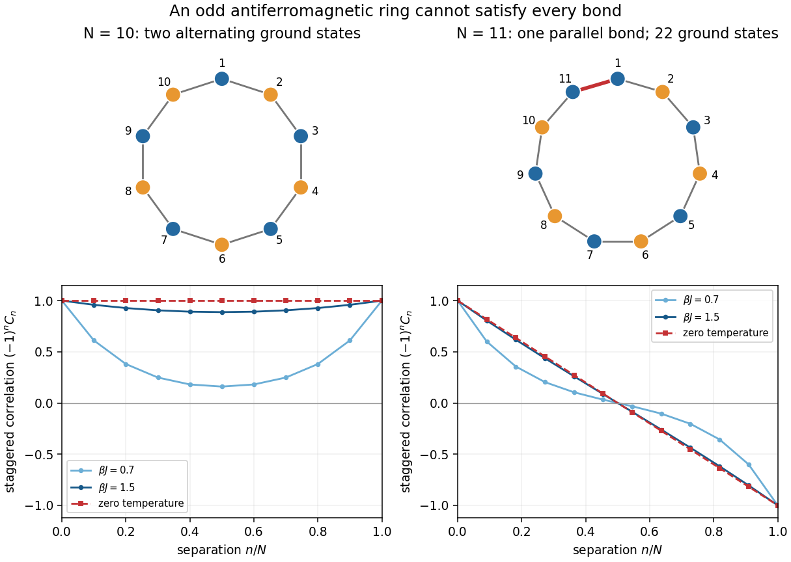

<h1 id="1/d/solution">Solution</h1>

↑ **Parent:** [D](../d.md)

Keep $N$ fixed and put $q=\tanh K$, so $q\to1^-$ as [temperature](../../../../temperature-split.md) tends to zero. For even $N$, the [finite-ring antiferromagnetic Ising correlation](../../../../finite-ring-antiferromagnetic-ising-correlation.md) becomes

$$
C_n=(-1)^n\frac{q^n+q^{N-n}}{1+q^N}
\longrightarrow\boxed{(-1)^n\quad(N\text{ even}).}
$$

Both alternating [ground states](../../../../ground-state.md) have $S_1S_{n+1}=(-1)^n$, so their equal-weight [canonical ensemble](../../../../canonical-ensemble-split.md) has the same [two-point correlation function](../../../../two-point-correlation-function.md) despite its zero [one-point correlation function](../../../../one-point-correlation-function.md).

For odd $N$, the signs instead give

$$
C_n=(-1)^n\frac{q^n-q^{N-n}}{1-q^N}.
$$

Direct substitution gives an indeterminate ratio. Expanding at fixed $N,n$ with $q=1-\delta$,

$$
q^n-q^{N-n}=(N-2n)\delta+O(\delta^2),\qquad
1-q^N=N\delta+O(\delta^2).
$$

Consequently the [zero-temperature correlation of an odd antiferromagnetic Ising ring](../../../../zero-temperature-correlation-of-an-odd-antiferromagnetic-ising-ring.md) is

$$
\boxed{\lim_{\beta J\to\infty}\langle S_1S_{n+1}\rangle
=\begin{cases}
(-1)^n,&N\text{ even},\\
(-1)^n\left(1-\dfrac{2n}{N}\right),&N\text{ odd}.
\end{cases}}
$$

The odd-ring factor has a direct [probability](../../../../probability.md) interpretation. At zero [temperature](../../../../temperature-split.md), the [canonical ensemble](../../../../canonical-ensemble-split.md) gives equal weight to its $2N$ [ground states](../../../../ground-state.md). The single [frustrated bond in an antiferromagnetic Ising ring](../../../../frustrated-bond-in-an-antiferromagnetic-ising-ring.md) is uniformly located, with [probability](../../../../probability.md) $n/N$ of lying on the chosen $n$-bond path. If it is absent from that path, $S_1S_{n+1}=(-1)^n$; if it is present, this product is $-(-1)^n$. Averaging gives $(-1)^n[(1-n/N)-n/N]$.

Thus the decay with separation here comes from averaging a movable, compulsory [frustrated bond in an antiferromagnetic Ising ring](../../../../frustrated-bond-in-an-antiferromagnetic-ising-ring.md), even after additional thermally excited [frustrated bonds in an antiferromagnetic Ising ring](../../../../frustrated-bond-in-an-antiferromagnetic-ising-ring.md) disappear. In particular $C_1=-1+2/N$ for odd $N$, and $JN C_1=-J(N-2)$ reproduces the [ground-state energy](../../../../ground-state-energy.md). The formula also respects $C_n=C_{N-n}$, although its factor $1-2n/N$ changes sign halfway around the ring.

**[Figure 1](#1/d/image-ring-parity-unavoidable-frustration-and-the-zero-temperature-correlation). Ring parity, unavoidable frustration, and the zero-temperature correlation**. Original [Ising spin](../../../../ising-spin-variable.md) configurations show satisfied bonds in gray and the unavoidable odd-ring parallel bond in red. The plots show the exact [finite-ring antiferromagnetic Ising correlation](../../../../finite-ring-antiferromagnetic-ising-correlation.md), with its alternating sign removed, and the zero-[temperature](../../../../temperature-split.md) limits for even and odd rings.

The order and scale of limits matter. Taking the [thermodynamic limit](../../../../thermodynamic-limit.md) first at positive [temperature](../../../../temperature-split.md) gives the [exponential function](../../../../exponential-function.md) in part (c). Cooling an odd finite ring first leaves the linear factor $1-2n/N$. Both orders subsequently give $(-1)^n$ at fixed $n$, but this agreement is not uniform in separation: when $n/N$ stays nonzero, the odd-ring linear factor survives in the zero-[temperature](../../../../temperature-split.md) expression.

## ↑ Ancestors (12)

1. [D](../d.md)
2. [1](../../1.md)
3. [2025](../../../2025-split.md)
4. [Past exam of the advanced quantum theory: path integrals and many-particle physics course of the University of Oxford](../../../split.md)
5. [Advanced quantum theory: path integrals and many-particle physics course of the University of Oxford](../../../../advanced-quantum-theory-path-integrals-and-many-particle-physics-course-of-the-university-of-oxford.md)
6. [Year 4 of the mathematical and theoretical physics course of the University of Oxford](../../../../year-4-of-the-mathematical-and-theoretical-physics-course-of-the-university-of-oxford.md)
7. [Mathematical and theoretical physics course of the University of Oxford](../../../../mathematical-and-theoretical-physics-course-of-the-university-of-oxford.md)
8. [Undergraduate course of the University of Oxford](../../../../undergraduate-course-of-the-university-of-oxford.md)
9. [Course of the University of Oxford](../../../../course-of-the-university-of-oxford.md)
10. [University of Oxford](../../../../university-of-oxford-split.md)
11. [List of universities](../../../../list-of-universities.md)
12. [Codex Wiki](../../../../split.md)
