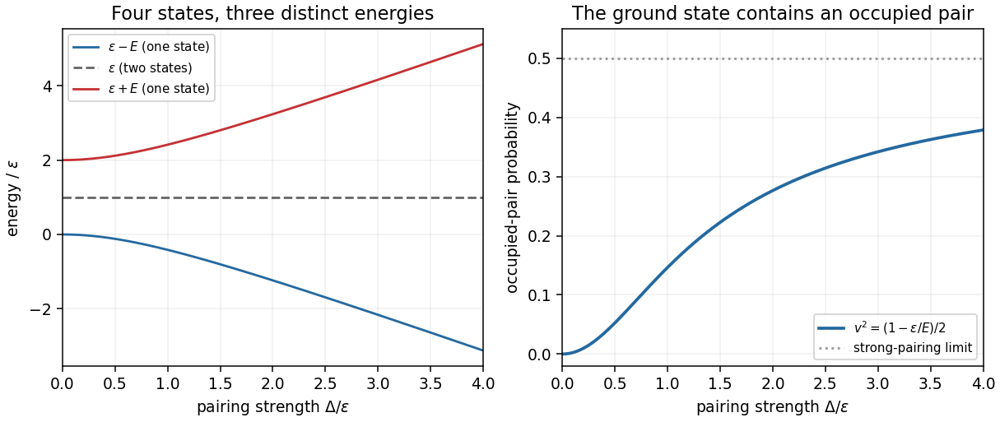

<h1 id="2/c/solution">Solution</h1>

↑ **Parent:** [C](../c.md)

Let $N_c=c^\dagger c$, $N_d=d^\dagger d$ and $P=cd+d^\dagger c^\dagger$. Substitution of the [Bogoliubov transformation](../../../../bogoliubov-transformation.md), with [normal ordering](../../../../normal-ordering.md) using $dd^\dagger=1-d^\dagger d$ and $cc^\dagger=1-c^\dagger c$, gives

$$
\begin{aligned}
a^\dagger a+b^\dagger b
&=(u^2-v^2)(N_c+N_d)+2v^2-2uvP,\\
ab+b^\dagger a^\dagger
&=2uv(N_c+N_d)-2uv+(u^2-v^2)P.
\end{aligned}
$$

For example, the $v^2dd^\dagger$ term in $a^\dagger a$ contributes $v^2-v^2N_d$; these constants must be retained to obtain the [ground-state energy](../../../../ground-state-energy.md). The [two-orbital fermionic pairing Hamiltonian](../../../../two-orbital-fermionic-pairing-hamiltonian.md) is consequently

$$
\begin{aligned}
H={}&[\varepsilon(u^2-v^2)+2\Delta uv](N_c+N_d)\\
&+[\Delta(u^2-v^2)-2\varepsilon uv]P
+2\varepsilon v^2-2\Delta uv.
\end{aligned}
$$

To eliminate the pairing term, choose a [canonical rotation of two fermionic modes](../../../../canonical-rotation-of-two-fermionic-modes.md) satisfying

$$
2\varepsilon uv=\Delta(u^2-v^2).
$$

With $u=\cos\theta$, $v=\sin\theta$, take $0<\theta<\pi/4$, so $\tan2\theta=\Delta/\varepsilon$. Setting $E=\sqrt{\varepsilon^2+\Delta^2}>0$ gives

$$
u^2-v^2=\frac\varepsilon E,\qquad 2uv=\frac\Delta E,\qquad
\boxed{u=\sqrt{\frac{E+\varepsilon}{2E}},\qquad
v=\sqrt{\frac{E-\varepsilon}{2E}}.}
$$

This positive choice fixes a convenient convention for the [vacuum state](../../../../vacuum-state.md) in part (d). It yields

$$
\boxed{H=E(N_c+N_d)+\varepsilon-E,\qquad
\lambda=\sqrt{\varepsilon^2+\Delta^2},\quad
\mu=\varepsilon-\sqrt{\varepsilon^2+\Delta^2}.}
$$

Both [number operators](../../../../number-operator.md) independently have [eigenvalues](../../../../eigenvalue.md) $0,1$. Hence the [energy eigenvalues](../../../../energy-eigenvalue-split.md) and [state degeneracies](../../../../state-degeneracy.md) are

$$
\boxed{\begin{array}{c|c|c}
N_c+N_d&\text{energy}&\text{degeneracy}\\\hline
0&\varepsilon-E&1\\
1&\varepsilon&2\\
2&\varepsilon+E&1
\end{array}}
$$

There is one [fermionic Bogoliubov quasiparticle](../../../../fermionic-bogoliubov-quasiparticle.md) of [energy](../../../../energy-split.md) $E$ per occupied transformed orbital. The two [Nambu spinor](../../../../nambu-spinor.md) [matrix](../../../../matrix.md) [eigenvalues](../../../../eigenvalue.md) $\pm E$ should not be mistaken for two independently occupiable levels of opposite [energy](../../../../energy-split.md); the [normal ordering](../../../../normal-ordering.md) constant and the two positive [quasiparticle](../../../../quasiparticle.md) excitation costs give the four physical [energy eigenvalues](../../../../energy-eigenvalue-split.md) above.

An independent [diagonalization of a matrix](../../../../diagonalization-of-a-matrix.md) checks both the pairing sign and the additive constant. In the ordered [orthonormal basis](../../../../orthonormal-basis.md) $|0\rangle,|11\rangle$, the even-[fermion parity](../../../../fermion-parity.md) block is

$$
H_{\mathrm{even}}=\begin{pmatrix}0&-\Delta\\-\Delta&2\varepsilon\end{pmatrix},
$$

because $ab|11\rangle=-|0\rangle$ and $b^\dagger a^\dagger|0\rangle=-|11\rangle$. Its [characteristic polynomial](../../../../characteristic-polynomial.md) is $x^2-2\varepsilon x-\Delta^2$, giving $x=\varepsilon\pm E$. The odd-[fermion parity](../../../../fermion-parity.md) [Fock states](../../../../fock-state.md) $a^\dagger|0\rangle,b^\dagger|0\rangle$ are unaffected by pairing and both have [energy](../../../../energy-split.md) $\varepsilon$.

Equivalently, with the [Nambu spinor](../../../../nambu-spinor.md) $\Psi=(a,b^\dagger)^{\mathsf T}$,

$$
H=\Psi^\dagger h\Psi+\varepsilon,\qquad
h=\begin{pmatrix}\varepsilon&-\Delta\\-\Delta&-\varepsilon\end{pmatrix},\qquad
R^{\mathsf T}hR=\operatorname{diag}(E,-E).
$$

Replacing $\Psi$ by $R(c,d^\dagger)^{\mathsf T}$ gives $E c^\dagger c-Edd^\dagger+\varepsilon=E(N_c+N_d)+\varepsilon-E$, reproducing the result by [normal ordering](../../../../normal-ordering.md).

**[Figure 2](#2/c/image-pairing-splits-the-even-parity-levels-and-mixes-the-original-vacuum-with-the-occupied-pair). Pairing splits the even-parity levels and mixes the original vacuum with the occupied pair**. Original exact [energy eigenvalues](../../../../energy-eigenvalue-split.md) in units of $\varepsilon$, and the [probability](../../../../probability.md) $v^2$ of finding both original orbitals occupied in the [two-mode fermionic paired vacuum](../../../../two-mode-fermionic-paired-vacuum.md). The middle [energy level](../../../../energy-level.md) remains twofold degenerate; both outside [energy levels](../../../../energy-level.md) are nondegenerate.

## ↑ Ancestors (12)

1. [C](../c.md)
2. [2](../../2.md)
3. [2025](../../../2025-split.md)
4. [Past exam of the advanced quantum theory: path integrals and many-particle physics course of the University of Oxford](../../../split.md)
5. [Advanced quantum theory: path integrals and many-particle physics course of the University of Oxford](../../../../advanced-quantum-theory-path-integrals-and-many-particle-physics-course-of-the-university-of-oxford.md)
6. [Year 4 of the mathematical and theoretical physics course of the University of Oxford](../../../../year-4-of-the-mathematical-and-theoretical-physics-course-of-the-university-of-oxford.md)
7. [Mathematical and theoretical physics course of the University of Oxford](../../../../mathematical-and-theoretical-physics-course-of-the-university-of-oxford.md)
8. [Undergraduate course of the University of Oxford](../../../../undergraduate-course-of-the-university-of-oxford.md)
9. [Course of the University of Oxford](../../../../course-of-the-university-of-oxford.md)
10. [University of Oxford](../../../../university-of-oxford-split.md)
11. [List of universities](../../../../list-of-universities.md)
12. [Codex Wiki](../../../../split.md)
