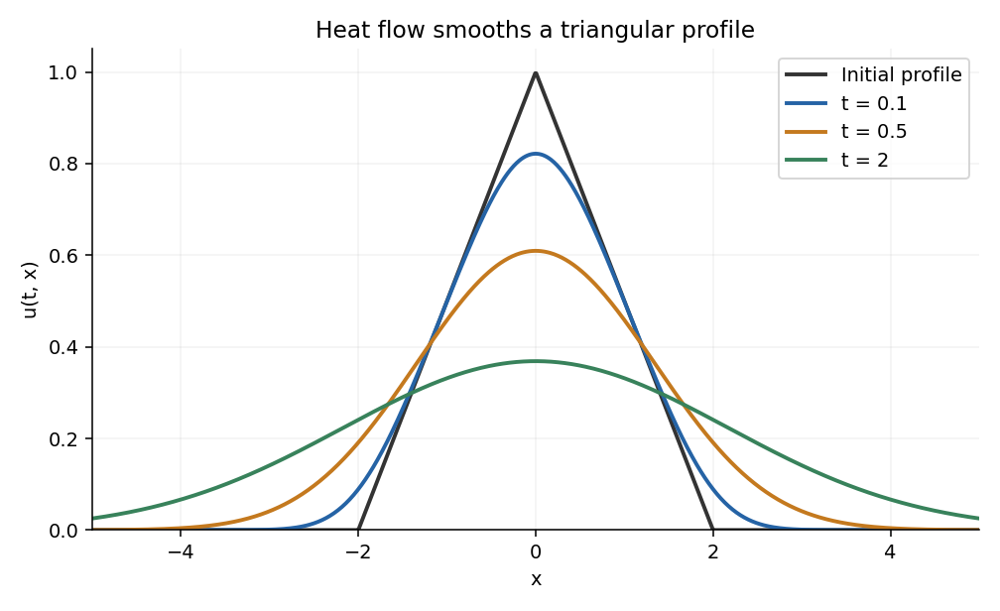

# 2014

↑ **Parent:** [Past exam of the algebra 1 and differential equations 1 course of the University of Oxford](../past-exam-of-the-algebra-1-and-differential-equations-1-course-of-the-university-of-oxford.md)

Source release: [Oxford examination archive](https://www.whatdotheyknow.com/request/maths_papers_2/response/1850333/attach/3/FOI%2020210708%201%20Data.zip?cookie_passthrough=1), member `FOI-20210708-1 - Data/4320.pdf`. The cover dates this examination to 18 June 2014, 2.30–5.30pm. The six questions have 36 leaf parts, answered in source order below.

**Table of contents**

- [1](#1)
  - [a](#1/a)
    - [i](#1/a/i)
      - [Solution](#1/a/i/solution)
    - [ii](#1/a/ii)
      - [Solution](#1/a/ii/solution)
  - [b](#1/b)
    - [i](#1/b/i)
      - [Solution](#1/b/i/solution)
    - [ii](#1/b/ii)
      - [Solution](#1/b/ii/solution)
    - [iii](#1/b/iii)
      - [Solution](#1/b/iii/solution)
- [2](#2)
  - [a](#2/a)
    - [Solution](#2/a/solution)
  - [b](#2/b)
    - [i](#2/b/i)
      - [Solution](#2/b/i/solution)
    - [ii](#2/b/ii)
      - [Solution](#2/b/ii/solution)
  - [c](#2/c)
    - [i](#2/c/i)
      - [Solution](#2/c/i/solution)
    - [ii](#2/c/ii)
      - [Solution](#2/c/ii/solution)
    - [iii](#2/c/iii)
      - [Solution](#2/c/iii/solution)
    - [iv](#2/c/iv)
      - [Solution](#2/c/iv/solution)
- [3](#3)
  - [a](#3/a)
    - [i](#3/a/i)
      - [Solution](#3/a/i/solution)
    - [ii](#3/a/ii)
      - [Solution](#3/a/ii/solution)
    - [iii](#3/a/iii)
      - [Solution](#3/a/iii/solution)
    - [iv](#3/a/iv)
      - [Solution](#3/a/iv/solution)
  - [b](#3/b)
    - [i](#3/b/i)
      - [Solution](#3/b/i/solution)
    - [ii](#3/b/ii)
      - [Solution](#3/b/ii/solution)
    - [iii](#3/b/iii)
      - [Solution](#3/b/iii/solution)
- [4](#4)
  - [a](#4/a)
    - [Solution](#4/a/solution)
  - [b](#4/b)
    - [i](#4/b/i)
      - [Solution](#4/b/i/solution)
    - [ii](#4/b/ii)
      - [Solution](#4/b/ii/solution)
    - [iii](#4/b/iii)
      - [Solution](#4/b/iii/solution)
  - [c](#4/c)
    - [i](#4/c/i)
      - [Solution](#4/c/i/solution)
    - [ii](#4/c/ii)
      - [Solution](#4/c/ii/solution)
- [5](#5)
  - [a](#5/a)
    - [Solution](#5/a/solution)
  - [b](#5/b)
    - [i](#5/b/i)
      - [Solution](#5/b/i/solution)
    - [ii](#5/b/ii)
      - [Solution](#5/b/ii/solution)
  - [c](#5/c)
    - [Solution](#5/c/solution)
  - [d](#5/d)
    - [Solution](#5/d/solution)
- [6](#6)
  - [a](#6/a)
    - [Solution](#6/a/solution)
  - [b](#6/b)
    - [Solution](#6/b/solution)
  - [c](#6/c)
    - [Solution](#6/c/solution)
  - [d](#6/d)
    - [Solution](#6/d/solution)
  - [e](#6/e)
    - [i](#6/e/i)
      - [Solution](#6/e/i/solution)
    - [ii](#6/e/ii)
      - [Solution](#6/e/ii/solution)

## 1

↑ **Parent:** [2014](2014.md)

<h3 id="1/a">a</h3>

↑ **Parent:** [1](#1)

<h4 id="1/a/i">i</h4>

↑ **Parent:** [A](#1/a)

<h5 id="1/a/i/solution">Solution</h5>

↑ **Parent:** [I](#1/a/i)

The **[minimal polynomial](../linear-operator-theory.md#minimal-polynomial)** $m_T$ is the monic [polynomial](../polynomial.md) of least [polynomial degree](../polynomial.md#degree-of-a-polynomial) such that $m_T(T)=0$. Here a [polynomial](../polynomial.md) $p(x)=\sum_jc_jx^j$ is evaluated at the [linear operator](../vector-space.md#linear-operator) by $p(T)=\sum_jc_jT^j$, with the constant term acting as $c_0I$.

An annihilating [polynomial](../polynomial.md) exists because $I,T,T^2,\ldots$ lie in the finite-dimensional [vector space](../vector-space.md) $\operatorname{End}_F(V)$ and are therefore eventually [linearly dependent](../vector-space.md#linear-dependence). Uniqueness follows by subtracting two monic annihilators of the same least degree: their difference has smaller degree and still annihilates $T$.

Equivalently,

$$
\boxed{m_T\mid p\quad\Longleftrightarrow\quad p(T)=0.}
$$

For the forward implication evaluate the factorization at $T$. For the reverse implication divide $p$ by $m_T$ using [polynomial division](../polynomial.md#polynomial-division); the remainder annihilates $T$, so minimality makes it zero. This also identifies the annihilating polynomials as the [principal ideal](../commutative-algebra.md#principal-ideal) generated by $m_T$.

<h4 id="1/a/ii">ii</h4>

↑ **Parent:** [A](#1/a)

<h5 id="1/a/ii/solution">Solution</h5>

↑ **Parent:** [Ii](#1/a/ii)

Suppose $E^2=E$. Every [vector](../vector-space.md#vector) has the decomposition

$$
v=Ev+(v-Ev),\qquad Ev\in\operatorname{im}E,\quad v-Ev\in\ker E.
$$

If $w=Ez$ also belongs to $\ker E$, then $w=E^2z=Ew=0$. Hence

$$
\boxed{V=\operatorname{im}E\oplus\ker E.}
$$

On its [image of a linear map](../vector-space.md#image-of-a-linear-map), $E$ acts as the identity; on its [kernel of a linear map](../kernel-of-a-linear-map.md), it acts as zero. Concatenate a [basis](../vector-space.md#basis) of the image with a [basis](../vector-space.md#basis) of the kernel. The resulting [matrix](../vector-space.md#matrix) is $\operatorname{diag}(I_r,0)$, where $r=\operatorname{rank}E$.

Conversely, this block [matrix](../vector-space.md#matrix) squares to itself, so any [linear map](../vector-space.md#linear-map) having that matrix in a [basis](../vector-space.md#basis) satisfies $E^2=E$. Thus **[projection operators](../vector-space.md#projection-linear-algebra) are precisely the [linear maps](../vector-space.md#linear-map) with this block form**. This is an algebraic projection; no [inner product](../inner-product.md) or orthogonality is required.

<h3 id="1/b">b</h3>

↑ **Parent:** [1](#1)

<h4 id="1/b/i">i</h4>

↑ **Parent:** [B](#1/b)

<h5 id="1/b/i/solution">Solution</h5>

↑ **Parent:** [I](#1/b/i)

Evaluate [Bézout's identity for polynomials](../polynomial.md#bezout-s-identity-for-polynomials) at $T$:

$$
a(T)p(T)+b(T)q(T)=I,\qquad p(T)q(T)=0.
$$

All these [linear operators](../vector-space.md#linear-operator) commute because they are [polynomials](../polynomial.md) in the same operator. Thus every $v\in V$ can be written

$$
v=b(T)q(T)v+a(T)p(T)v.
$$

The first summand belongs to $\ker p(T)$ and the second to $\ker q(T)$, since applying the corresponding operator introduces the product $p(T)q(T)=0$.

If $v$ lies in both [kernels](../kernel-of-a-linear-map.md), the same identity gives $v=0+0=0$. Therefore the sum is direct:

$$
\boxed{V=\ker p(T)\oplus\ker q(T).}
$$

This is the [kernel decomposition for coprime polynomials](../linear-operator-theory.md#kernel-decomposition-for-coprime-polynomials). It uses both annihilation by $pq$ and the coprimality expressed by the Bézout identity.

<h4 id="1/b/ii">ii</h4>

↑ **Parent:** [B](#1/b)

<h5 id="1/b/ii/solution">Solution</h5>

↑ **Parent:** [Ii](#1/b/ii)

Write $U=\ker p(T)$, $W=\ker q(T)$. The [linear operator](../vector-space.md#linear-operator) $E=a(T)p(T)$ vanishes on $U$. On $W$, the identity $E=I-b(T)q(T)$ gives $Ew=w$.

By the [direct sum](../vector-space.md#direct-sum) in part (i), every vector has a unique expression $u+w$, and

$$
E(u+w)=w.
$$

Consequently

$$
\boxed{E^2=E,\qquad\operatorname{im}E=\ker q(T),\qquad\ker E=\ker p(T).}
$$

The complementary [projection operator](../vector-space.md#projection-linear-algebra) is $I-E=b(T)q(T)$, onto $U$ along $W$. These are [polynomial projections for a coprime decomposition](../linear-operator-theory.md#polynomial-projections-for-a-coprime-decomposition). In particular the projection does not depend on which Bézout coefficients are chosen: its action on the two summands uniquely determines it.

<h4 id="1/b/iii">iii</h4>

↑ **Parent:** [B](#1/b)

<h5 id="1/b/iii/solution">Solution</h5>

↑ **Parent:** [Iii](#1/b/iii)

Let $P=b(T)q(T)$ and $Q=a(T)p(T)$. By part (ii), these are complementary [projection operators](../vector-space.md#projection-linear-algebra) with images $U=\ker(T-\lambda I)^\alpha$ and $W=\ker(T-\mu I)^\beta$. Thus $D=\lambda P+\mu Q$ acts as $\lambda I$ on $U$ and $\mu I$ on $W$.

The [linear operator](../vector-space.md#linear-operator) $T$ preserves both summands because it commutes with its own polynomials. Therefore $N=T-D$ preserves them too, and its restrictions satisfy

$$
N|_U=(T-\lambda I)|_U,\quad (N|_U)^\alpha=0,\qquad
N|_W=(T-\mu I)|_W,\quad (N|_W)^\beta=0.
$$

Put $k=\max(\alpha,\beta)$. Both restrictions of $N^k$ vanish, so the [direct sum](../vector-space.md#direct-sum) gives

$$
\boxed{(T-D)^k=0.}
$$

Hence **$T-D$ is a [nilpotent linear map](../linear-operator-theory.md#nilpotent-linear-map)**. The operator $D$ is [diagonalizable](../linear-operator-theory.md#diagonalizable-matrix), since its two summands are its [eigenspaces](../linear-operator-theory.md#eigenspace), and it commutes with $T$. This illustrates the [Jordan–Chevalley decomposition](../linear-operator-theory.md#jordan-chevalley-decomposition) in the case of two distinct eigenvalues.

## 2

↑ **Parent:** [2014](2014.md)

<h3 id="2/a">a</h3>

↑ **Parent:** [2](#2)

<h4 id="2/a/solution">Solution</h4>

↑ **Parent:** [A](#2/a)

Choose a [basis](../vector-space.md#basis) and let $A$ be the matrix of $T$. Use the monic convention

$$
\boxed{\chi_T(x)=\det(xI_n-A).}
$$

Under a [change of basis](../linear-algebra.md#change-of-basis), $A$ becomes $B=P^{-1}AP$ for an [invertible matrix](../linear-algebra.md#invertible-matrix) $P$. Then

$$
xI-B=P^{-1}(xI-A)P,
$$

so [multiplicativity of the determinant](../multilinear-algebra.md#multiplicativity-of-the-determinant) gives $\det(xI-B)=\det(xI-A)$. Therefore the [characteristic polynomial](../linear-operator-theory.md#characteristic-polynomial) is independent of the chosen [basis](../vector-space.md#basis) and is well-defined for the [linear transformation](../vector-space.md#linear-map) itself.

<h3 id="2/b">b</h3>

↑ **Parent:** [2](#2)

<h4 id="2/b/i">i</h4>

↑ **Parent:** [B](#2/b)

<h5 id="2/b/i/solution">Solution</h5>

↑ **Parent:** [I](#2/b/i)

The given $J$ satisfies $J^2=-I_{2m}$ and is invertible. Taking [determinants](../multilinear-algebra.md#determinant) in the defining identity of a [symplectic matrix](../symplectic-geometry.md#symplectic-matrix) gives

$$
\det(M^T)\det J\det M=\det J.
$$

Since $\det(M^T)=\det M$ and $\det J\ne0$, cancellation yields $(\det M)^2=1$. Hence

$$
\boxed{\det M=1\text{ or }-1.}
$$

In particular every [symplectic matrix](../symplectic-geometry.md#symplectic-matrix) is invertible. This argument establishes the requested alternatives; the later parts explicitly supply the determinant-one hypothesis that they use.

<h4 id="2/b/ii">ii</h4>

↑ **Parent:** [B](#2/b)

<h5 id="2/b/ii/solution">Solution</h5>

↑ **Parent:** [Ii](#2/b/ii)

The identity is symplectic because $I^TJI=J$. For two [symplectic matrices](../symplectic-geometry.md#symplectic-matrix) $M,N$,

$$
(MN)^TJ(MN)=N^T(M^TJM)N=N^TJN=J.
$$

Thus the set is closed under matrix multiplication. Every member is invertible by part (i). Multiplying $M^TJM=J$ on the left by $M^{-T}$ and on the right by $M^{-1}$ gives

$$
(M^{-1})^TJM^{-1}=J,
$$

so it is also closed under inverses. Associativity is inherited from the [general linear group](../group-theory.md#general-linear-group). These facts prove that **the [symplectic group](../symplectic-geometry.md#symplectic-group) is a [subgroup](../group.md#subgroup) of $\operatorname{GL}(2m,\mathbb R)$**.

<h3 id="2/c">c</h3>

↑ **Parent:** [2](#2)

<h4 id="2/c/i">i</h4>

↑ **Parent:** [C](#2/c)

<h5 id="2/c/i/solution">Solution</h5>

↑ **Parent:** [I](#2/c/i)

Rearrange $M^TJM=J$ as

$$
\boxed{M^{-1}=J^{-1}M^TJ.}
$$

Thus $M^{-1}$ is similar to $M^T$. Similar [matrices](../vector-space.md#matrix) have the same [characteristic polynomial](../linear-operator-theory.md#characteristic-polynomial) by part (a), and transposition also preserves it:

$$
\det(xI-M^T)=\det((xI-M)^T)=\det(xI-M).
$$

Therefore $\boxed{\chi_{M^{-1}}=\chi_M}$. This is the underlying algebraic source of the [reciprocal spectrum of a symplectic matrix](../symplectic-geometry.md#reciprocal-spectrum-of-a-symplectic-matrix).

<h4 id="2/c/ii">ii</h4>

↑ **Parent:** [C](#2/c)

<h5 id="2/c/ii/solution">Solution</h5>

↑ **Parent:** [Ii](#2/c/ii)

For $\lambda\ne0$, factor the matrix inside the [determinant](../multilinear-algebra.md#determinant):

$$
\begin{aligned}
\chi_M(\lambda)
&=\det M\,\det(\lambda M^{-1}-I)\\
&=\lambda^{2m}\det(M^{-1}-\lambda^{-1}I)\\
&=\lambda^{2m}\det(\lambda^{-1}I-M^{-1})\\
&=\lambda^{2m}\chi_M(\lambda^{-1}).
\end{aligned}
$$

The second line uses $\det M=1$; the third uses the even matrix size; the last uses part (i). Consequently

$$
\boxed{\chi_M(\lambda)=\lambda^{2m}\chi_M(\lambda^{-1}).}
$$

In other words, the [characteristic polynomial](../linear-operator-theory.md#characteristic-polynomial) equals its [reciprocal polynomial](../polynomial.md#reciprocal-polynomial).

<h4 id="2/c/iii">iii</h4>

↑ **Parent:** [C](#2/c)

<h5 id="2/c/iii/solution">Solution</h5>

↑ **Parent:** [Iii](#2/c/iii)

Let $P=\chi_M$, and suppose $P(z)=(z-\lambda)^dR(z)$ with $R(\lambda)\ne0$. The reciprocal identity gives, for $x\ne0$,

$$
P(x)=x^{2m-d}(1-\lambda x)^dR(1/x).
$$

Near $x=\lambda^{-1}$ the factor $x^{2m-d}R(1/x)$ is nonzero. Also $1-\lambda x=-\lambda(x-\lambda^{-1})$ has a simple zero there. Hence

$$
\boxed{\lambda^{-1}\text{ is a root of multiplicity exactly }d.}
$$

This proves equality of the [algebraic multiplicities](../linear-operator-theory.md#algebraic-multiplicity), not merely that the inverse is another [eigenvalue](../linear-operator-theory.md#eigenvalue). Invertibility excludes zero eigenvalues throughout.

<h4 id="2/c/iv">iv</h4>

↑ **Parent:** [C](#2/c)

<h5 id="2/c/iv/solution">Solution</h5>

↑ **Parent:** [Iv](#2/c/iv)

The fixed points of reciprocal root pairing are $1$ and $-1$, so part (iii) alone does not establish their parity. Use the polynomial identity itself.

Write $P(x)=(x-1)^rA(x)$, where $A(1)\ne0$ and allow $r=0$ if one is not a root. After substituting in $P(x)=x^{2m}P(1/x)$ and canceling $(x-1)^r$ away from $x=1$, obtain

$$
A(x)=(-1)^r x^{2m-r}A(1/x).
$$

Letting $x\to1$ yields $A(1)=(-1)^rA(1)$, so $r$ is even.

Similarly write $P(x)=(x+1)^sB(x)$ with $B(-1)\ne0$. This time cancellation gives $B(x)=x^{2m-s}B(1/x)$. Letting $x\to-1$ yields $B(-1)=(-1)^{2m-s}B(-1)$, so $s$ is even. Thus

$$
\boxed{\text{Both }1\text{ and }-1\text{ have even algebraic multiplicity.}}
$$

The conclusion includes multiplicity zero. It is a consequence of the reciprocal identity in even degree, which is stronger at these fixed points than just pairing the roots.

## 3

↑ **Parent:** [2014](2014.md)

<h3 id="3/a">a</h3>

↑ **Parent:** [3](#3)

<h4 id="3/a/i">i</h4>

↑ **Parent:** [A](#3/a)

<h5 id="3/a/i/solution">Solution</h5>

↑ **Parent:** [I](#3/a/i)

The **[rank-nullity theorem](../kernel-of-a-linear-map.md#rank-nullity-theorem)** states that for a [linear map](../vector-space.md#linear-map) $A:X\to Y$ with finite-dimensional domain,

$$
\boxed{\dim X=\dim\ker A+\dim\operatorname{im}A.}
$$

Equivalently, nullity plus rank equals the dimension of the domain. One proof extends a [basis](../vector-space.md#basis) of $\ker A$ to a [basis](../vector-space.md#basis) of $X$; the images of the added vectors form a [basis](../vector-space.md#basis) of $\operatorname{im}A$.

<h4 id="3/a/ii">ii</h4>

↑ **Parent:** [A](#3/a)

<h5 id="3/a/ii/solution">Solution</h5>

↑ **Parent:** [Ii](#3/a/ii)

The [annihilator of a vector subspace](../dual-space.md#annihilator-of-a-vector-subspace) $W\leq V^*$ is

$$
\boxed{W^\circ=\{L\in V^{**}:L(\phi)=0\text{ for every }\phi\in W\}.}
$$

If $\dim W=k$, extend a [basis](../vector-space.md#basis) of $W$ to one of $V^*$. In the resulting [dual basis](../dual-space.md#dual-basis) of $V^{**}$, the last $n-k$ coordinate functionals span $W^\circ$. Hence $\boxed{\dim W+\dim W^\circ=n}$.

The [bidual evaluation map](../dual-space.md#bidual-evaluation-map) $j:V\to V^{**}$ is $j(x)(\phi)=\phi(x)$. It is a [linear isomorphism](../vector-space.md#linear-isomorphism) in finite dimension. Its inverse image of the annihilator is

$$
\boxed{j^{-1}(W^\circ)=\{x\in V:\phi(x)=0\text{ for every }\phi\in W\}.}
$$

This identification uses evaluation only; no choice of [inner product](../inner-product.md) is involved.

<h4 id="3/a/iii">iii</h4>

↑ **Parent:** [A](#3/a)

<h5 id="3/a/iii/solution">Solution</h5>

↑ **Parent:** [Iii](#3/a/iii)

Under the [bidual evaluation map](../dual-space.md#bidual-evaluation-map), a vector $y$ lies in $(\operatorname{im}\Phi|_U)^\circ$ exactly when

$$
j(y)(\varphi_x)=\varphi_x(y)=\varphi(x,y)=0\quad\text{for all }x\in U.
$$

That is precisely membership of the [orthogonal complement for a bilinear form](../bilinear-form.md#orthogonal-complement-for-a-bilinear-form). Therefore

$$
\boxed{U^\perp=(\operatorname{im}\Phi|_U)^\circ.}
$$

The dimension formula in part (ii) gives

$$
\dim U^\perp=n-\operatorname{rank}(\Phi|_U)\geq n-\dim U,
$$

so $\boxed{\dim U+\dim U^\perp\geq n}$. More precisely, the [rank-nullity theorem](../kernel-of-a-linear-map.md#rank-nullity-theorem) gives

$$
\dim U+\dim U^\perp=n+\dim(U\cap\ker\Phi).
$$

This is the [orthogonal complement dimension for a degenerate bilinear form](../bilinear-form.md#orthogonal-complement-dimension-for-a-degenerate-bilinear-form). The possible excess comes from vectors annihilated by the form against all of $V$.

<h4 id="3/a/iv">iv</h4>

↑ **Parent:** [A](#3/a)

<h5 id="3/a/iv/solution">Solution</h5>

↑ **Parent:** [Iv](#3/a/iv)

The [dimension formula for a sum of subspaces](../vector-space.md#dimension-formula-for-a-sum-of-subspaces) and the zero intersection imply

$$
\dim(U+U^\perp)=\dim U+\dim U^\perp\geq n.
$$

But $U+U^\perp$ is a [vector subspace](../vector-space.md#vector-subspace) of the $n$-dimensional space $V$, so its dimension is at most $n$. Equality follows, and the sum is all of $V$. Since the intersection is zero, it is a [direct sum](../vector-space.md#direct-sum):

$$
\boxed{V=U\oplus U^\perp.}
$$

The argument remains valid for a degenerate ambient [symmetric bilinear form](../bilinear-form.md#symmetric-bilinear-form); it uses the stated intersection hypothesis rather than assuming nondegeneracy everywhere.

<h3 id="3/b">b</h3>

↑ **Parent:** [3](#3)

<h4 id="3/b/i">i</h4>

↑ **Parent:** [B](#3/b)

<h5 id="3/b/i/solution">Solution</h5>

↑ **Parent:** [I](#3/b/i)

Use the $m$-dimensional space $V_m$ for this [change of basis](../linear-algebra.md#change-of-basis). With the columns of $P$ recording the new basis in the old one, bilinearity gives

$$
\begin{aligned}
\varphi(f_i,f_j)
&=\varphi\left(\sum_{k=1}^mP_{ki}e_k,\sum_{\ell=1}^mP_{\ell j}e_\ell\right)\\
&=\sum_{k,\ell=1}^mP_{ki}(A_m)_{k\ell}P_{\ell j}\\
&=(P^TA_mP)_{ij}.
\end{aligned}
$$

Thus the matrices of the [bilinear form](../bilinear-form.md) satisfy

$$
\boxed{B_m=P^TA_mP.}
$$

This is [matrix congruence](../quadratic-form.md#matrix-congruence), rather than the similarity rule for an endomorphism: both arguments of the bilinear form change basis.

<h4 id="3/b/ii">ii</h4>

↑ **Parent:** [B](#3/b)

<h5 id="3/b/ii/solution">Solution</h5>

↑ **Parent:** [Ii](#3/b/ii)

The restriction of a [positive definite](../bilinear-form.md#positive-definiteness) form to each $V_m$ is positive definite. By the [spectral theorem for real symmetric matrices](../linear-algebra.md#spectral-theorem-for-real-symmetric-matrices), choose an [orthogonal matrix](../linear-algebra.md#orthogonal-matrix) $P$ such that $P^TA_mP=\operatorname{diag}(d_1,\ldots,d_m)$.

Each $d_i=\varphi(f_i,f_i)>0$, since a basis vector is nonzero. Taking [determinants](../multilinear-algebra.md#determinant) in part (i) gives

$$
\det(P^TA_mP)=(\det P)^2\det A_m=\det A_m,
$$

because an [orthogonal matrix](../linear-algebra.md#orthogonal-matrix) has determinant $\pm1$. Consequently

$$
\boxed{\det A_m=\prod_{i=1}^m d_i>0\quad(1\leq m\leq n).}
$$

These determinants are the leading [principal minors](../vector-space.md#principal-minor) in [Sylvester's criterion](../quadratic-form.md#sylvester-s-criterion).

<h4 id="3/b/iii">iii</h4>

↑ **Parent:** [B](#3/b)

<h5 id="3/b/iii/solution">Solution</h5>

↑ **Parent:** [Iii](#3/b/iii)

Work inside $V_{m+1}$, and take the [orthogonal complement for a bilinear form](../bilinear-form.md#orthogonal-complement-for-a-bilinear-form) of $U=V_m$ relative to this ambient space. If $z\in U\cap U^\perp$, then $\varphi(z,z)=0$, so positive definiteness on $U$ forces $z=0$.

Part (a)(iv) therefore gives $V_{m+1}=U\oplus U^\perp$, with $\dim U^\perp=1$. Choose $w\ne0$ spanning that complement and use the basis $e_1,\ldots,e_m,w$. Symmetry and orthogonality make its [Gram matrix](../inner-product.md#gram-matrix)

$$
B=\begin{pmatrix}A_m&0\\0&d\end{pmatrix},\qquad d=\varphi(w,w).
$$

By part (b)(i), $\det B=(\det P)^2\det A_{m+1}>0$. Part (ii) applied to the already positive definite restriction gives $\det A_m>0$. Therefore

$$
d\det A_m=\det B>0,\qquad d>0.
$$

For a nonzero vector $u+tw$ with $u\in U$,

$$
\varphi(u+tw,u+tw)=\varphi(u,u)+t^2d>0.
$$

This proves **positive definiteness on $V_{m+1}$**.

Finally $\det A_1>0$ says $\varphi(e_1,e_1)>0$, so the restriction to $V_1$ is positive definite. Induction using all successive positive leading [principal minors](../vector-space.md#principal-minor) reaches $V_n=V$. Combined with part (ii), this proves **[Sylvester's criterion](../quadratic-form.md#sylvester-s-criterion)** in both directions.

## 4

↑ **Parent:** [2014](2014.md)

<h3 id="4/a">a</h3>

↑ **Parent:** [4](#4)

<h4 id="4/a/solution">Solution</h4>

↑ **Parent:** [A](#4/a)

The **[Picard-Lindelöf theorem](../differential-equation.md#picard-lindelof-theorem)** gives local existence and uniqueness for an [initial value problem](../differential-equation.md#initial-value-problem) when $f$ is continuous on a rectangle around $(a,b)$ and is [Lipschitz continuous](../real-analysis.md#lipschitz-continuity) in its second variable there, with a constant uniform in the first variable. A sufficient hypothesis is that $f$ and $\partial f/\partial y$ are continuous on that rectangle.

More quantitatively, if the rectangle is $|x-a|\leq h_0$, $|y-b|\leq k$, and $|f|\leq M$, a sufficiently small $h>0$ with $h\leq h_0$ and $hM<k$ yields a unique differentiable solution on $[a-h,a+h]$ remaining inside the vertical strip. The proof uses the integral equation

$$
y(x)=b+\int_a^x f(t,y(t))\,dt
$$

and [Picard iteration](../differential-equation.md#picard-iteration), or the [Banach fixed-point theorem](../analysis.md#contraction-mapping-theorem) after shrinking $h$ to make the integral operator a contraction. The continuity and Lipschitz hypotheses must hold near the actual initial point.

<h3 id="4/b">b</h3>

↑ **Parent:** [4](#4)

<h4 id="4/b/i">i</h4>

↑ **Parent:** [B](#4/b)

<h5 id="4/b/i/solution">Solution</h5>

↑ **Parent:** [I](#4/b/i)

Dividing by $x^2$, which is allowed precisely away from zero, gives

$$
\boxed{f(x,y)=\frac{1-2x}{x^2}y+\frac{e^{-1/x}}{x^2(1+x^2)},\qquad x\ne0.}
$$

This [function](../function.md) is smooth on each of the two half-planes $x>0$ and $x<0$, and is affine in the dependent variable $y$. Its derivative with respect to $y$ is $(1-2x)/x^2$.

<h4 id="4/b/ii">ii</h4>

↑ **Parent:** [B](#4/b)

<h5 id="4/b/ii/solution">Solution</h5>

↑ **Parent:** [Ii](#4/b/ii)

For fixed $a\ne0$ and $B>0$, the rectangle

$$
K=[|a|/2,3|a|/2]\times[-B,B]
$$

is [compact](../topology.md#compact-space) and stays away from $x=0$. The [function](../function.md) $f$ in part (i) is continuous there. The [extreme value theorem](../real-analysis.md#extreme-value-theorem) makes $|f|$ attain a finite maximum $M_0$ on $K$; choosing $\boxed{M=M_0+1}$ gives the requested strict bound.

The absolute values make this a positive-$x$ rectangle even when $a<0$. Its boundedness is still true, but for a negative initial point the [Picard-Lindelöf theorem](../differential-equation.md#picard-lindelof-theorem) must instead be applied to a rectangle centered at that negative point, as in part (iii).

<h4 id="4/b/iii">iii</h4>

↑ **Parent:** [B](#4/b)

<h5 id="4/b/iii/solution">Solution</h5>

↑ **Parent:** [Iii](#4/b/iii)

Take **any $a\ne0$ and any $b\in\mathbb R$**. Choose $0<h_0<|a|$, so $[a-h_0,a+h_0]$ avoids zero. On

$$
R=[a-h_0,a+h_0]\times[b-1,b+1],
$$

both $f$ and $f_y=(1-2x)/x^2$ are continuous. They are bounded by [compactness](../topology.md#compact-space), and the bound on $f_y$ gives the uniform [Lipschitz continuity](../real-analysis.md#lipschitz-continuity) in $y$ required by the [Picard-Lindelöf theorem](../differential-equation.md#picard-lindelof-theorem).

If $M$ is a bound for $|f|$, shrink $h$ so $0<h<h_0$ and $hM<1$. Then the solution has $|y(x)-b|\leq hM<1$, which supplies even strict inequalities at both edges of the requested vertical strip.

At $a=0$, neither $f$ nor the original exponential expression is defined. Thus **the theorem applies exactly for $a\ne0$, with no restriction on $b$**. Failure of the hypotheses alone would not prove nonexistence; the explicit solutions below settle that issue.

<h3 id="4/c">c</h3>

↑ **Parent:** [4](#4)

<h4 id="4/c/i">i</h4>

↑ **Parent:** [C](#4/c)

<h5 id="4/c/i/solution">Solution</h5>

↑ **Parent:** [I](#4/c/i)

On either connected half-line, the [homogeneous linear differential equation](../differential-equation.md#homogeneous-linear-differential-equation) is

$$
y'+\left(\frac2x-\frac1{x^2}\right)y=0.
$$

Integration gives $\boxed{y_h=Cx^{-2}e^{-1/x}}$, including the zero solution. For the inhomogeneous equation choose the positive [integrating factor](../linear-ordinary-differential-equation.md#integrating-factor)

$$
\mu(x)=\exp\left(2\log|x|+\frac1x\right)=x^2e^{1/x}.
$$

It satisfies $\mu'/\mu=2/x-1/x^2$. Multiplication gives the exact derivative

$$
(\mu y)'=\frac1{1+x^2}.
$$

Hence all solutions on either half-line are

$$
\boxed{y(x)=\frac{e^{-1/x}}{x^2}\bigl(C+\arctan x\bigr).}
$$

For $a\ne0$, impose $y(a)=b$ to obtain $C=a^2e^{1/a}b-\arctan a$. The complete [initial value problem](../differential-equation.md#initial-value-problem) solution is therefore

$$
\boxed{y(x)=\frac{e^{-1/x}}{x^2}\left(a^2e^{1/a}b+\arctan x-\arctan a\right),\qquad ax>0.}
$$

It is smooth throughout the maximal connected interval $(0,\infty)$ if $a>0$, and $(-\infty,0)$ if $a<0$.

<h4 id="4/c/ii">ii</h4>

↑ **Parent:** [C](#4/c)

<h5 id="4/c/ii/solution">Solution</h5>

↑ **Parent:** [Ii](#4/c/ii)

For **every $a\ne0$ and every real $b$, there is exactly one solution on the maximal connected interval containing $a$**. The formula in part (i) proves existence on the entire appropriate half-line, and the initial condition fixes its sole constant uniquely. This agrees with the local [Picard-Lindelöf theorem](../differential-equation.md#picard-lindelof-theorem).

For **$a=0$, there is no classical solution on an interval containing the initial point**, whatever $b$ is: the printed equation is not defined there. Even if one only imposes the equation for $x\ne0$ and asks for a finite continuous extension across zero, the negative side rules it out. For $x\to0^-$:

- If $C\ne0$, then $C+\arctan x\to C$, while $x^{-2}e^{-1/x}$ diverges in magnitude.
- If $C=0$, then $\arctan x\sim x$, and $y(x)\sim e^{-1/x}/x$, which also diverges in magnitude.

Thus no choice of the negative-side integration constant admits a finite left limit.

There is a useful distinction with a separately extended one-sided problem. On $x>0$, every member of the solution family tends to zero with all its derivatives as $x\downarrow0$, since the exponential dominates every inverse power of $x$. If the forcing is separately defined to be zero at the right endpoint, that modified one-sided problem has infinitely many smooth solutions with $y(0)=0$, and none with $y(0)\ne0$. **Those one-sided extensions do not give solutions on the two-sided intervals in the question.**

## 5

↑ **Parent:** [2014](2014.md)

<h3 id="5/a">a</h3>

↑ **Parent:** [5](#5)

<h4 id="5/a/solution">Solution</h4>

↑ **Parent:** [A](#5/a)

The **[maximum principle for subharmonic functions](../partial-differential-equation.md#maximum-principle-for-subharmonic-functions)** here states that if $u\in C^2(D)\cap C(\overline D)$ and $\Delta u=f\geq0$ in $D$, then

$$
\boxed{\max_{\overline D}u=\max_{\partial D}u.}
$$

If $f\leq0$, apply this to $-u$ to obtain the corresponding minimum principle. In particular a [harmonic function](../partial-differential-equation.md#harmonic-function) has both its maximum and minimum on the boundary. Without a sign condition on $f$, this conclusion need not hold.

First suppose $\Delta u>0$. By [compactness](../topology.md#compact-space) and continuity, $u$ attains a maximum on $\overline D$. At an interior maximum, the first derivatives vanish and the [Hessian matrix](../multivariable-calculus.md#hessian-matrix) is negative semidefinite. Its trace is then nonpositive, contradicting $\Delta u>0$. Thus a maximum lies on the boundary.

For the non-strict case put $u_\epsilon=u+\epsilon(x^2+y^2)$, with $\epsilon>0$. Then $\Delta u_\epsilon=f+4\epsilon>0$, so the strict case yields, for $z\in\overline D$,

$$
u(z)+\epsilon|z|^2\leq\max_{\partial D}(u+\epsilon)
=\max_{\partial D}u+\epsilon.
$$

Let $\epsilon\downarrow0$. This gives $u(z)\leq\max_{\partial D}u$, proving the theorem. The argument proves the weak maximum principle; it does not claim that every maximizer must be on the boundary when $u$ is constant.

<h3 id="5/b">b</h3>

↑ **Parent:** [5](#5)

<h4 id="5/b/i">i</h4>

↑ **Parent:** [B](#5/b)

<h5 id="5/b/i/solution">Solution</h5>

↑ **Parent:** [I](#5/b/i)

Write the [elliptic differential operator](../distribution-theory.md#elliptic-differential-operator) as $L=\Delta+r\partial_x+s\partial_y$. At an interior maximum, $u_x=u_y=0$ and $u_{xx}+u_{yy}\leq0$. Therefore $Lu\leq0$ there, contradicting $Lu=f>0$.

The [extreme value theorem](../real-analysis.md#extreme-value-theorem) ensures that a maximum exists on the compact closed disk. It cannot lie in the interior, so **the maximum is attained on $\partial D$**. The drift terms disappear at a stationary point, which is why the strict-sign proof is so short.

<h4 id="5/b/ii">ii</h4>

↑ **Parent:** [B](#5/b)

<h5 id="5/b/ii/solution">Solution</h5>

↑ **Parent:** [Ii](#5/b/ii)

Use an exponential perturbation whose image under $L$ is strictly positive everywhere. The coefficient $r$ is bounded on the closed disk; put $R=\max_{\overline D}|r|$ and choose $k>R$, $k>0$. For $v(x,y)=e^{kx}$,

$$
Lv=(k^2+kr(x,y))e^{kx}\geq k(k-R)e^{kx}>0.
$$

Consequently $u_\epsilon=u+\epsilon v$ satisfies $Lu_\epsilon=f+\epsilon Lv>0$. Part (i) applies, so for every $z\in\overline D$,

$$
u(z)+\epsilon v(z)\leq\max_{\partial D}(u+\epsilon v)
\leq\max_{\partial D}u+\epsilon e^k.
$$

Letting $\epsilon\downarrow0$ gives

$$
\boxed{u(z)\leq\max_{\partial D}u.}
$$

Thus **the maximum is attained on the boundary also when $f\geq0$**. This is the [exponential perturbation proof of the weak maximum principle with drift](../elliptic-boundary-value-problem.md#exponential-perturbation-proof-of-the-weak-maximum-principle-with-drift). It does not require differentiating the continuous coefficients $r,s$.

<h3 id="5/c">c</h3>

↑ **Parent:** [5](#5)

<h4 id="5/c/solution">Solution</h4>

↑ **Parent:** [C](#5/c)

If $u_1,u_2$ satisfy the same [boundary value problem](../boundary-value-problem.md), their difference $w=u_1-u_2$ satisfies $Lw=0$ in $D$ and $w=0$ on the boundary, by linearity. Part (b)(ii) gives

$$
w\leq\max_{\partial D}w=0.
$$

Apply it again to $-w$, which also satisfies $L(-w)=0$ and zero [Dirichlet boundary conditions](../differential-equation.md#dirichlet-boundary-condition). This gives $-w\leq0$. Hence $w=0$ throughout $\overline D$, proving

$$
\boxed{u_1=u_2.}
$$

This proves uniqueness whenever a solution exists; existence is the separately supplied assumption. When the drift coefficients vanish, the same argument uses part (a).

<h3 id="5/d">d</h3>

↑ **Parent:** [5](#5)

<h4 id="5/d/solution">Solution</h4>

↑ **Parent:** [D](#5/d)

For a real solution, $u^4\geq0$, so $\Delta u\geq0$. The [maximum principle for subharmonic functions](../partial-differential-equation.md#maximum-principle-for-subharmonic-functions) gives $u\leq\max_{\partial D}u=0$. The additional nonnegativity condition gives $u\geq0$. Therefore

$$
\boxed{u\equiv0.}
$$

This function satisfies both the equation and boundary condition, so it is exactly the full set of nonnegative solutions. The sign restriction is used alongside the maximum principle, rather than treating the nonlinear equation as a linear uniqueness problem.

## 6

↑ **Parent:** [2014](2014.md)

<h3 id="6/a">a</h3>

↑ **Parent:** [6](#6)

<h4 id="6/a/solution">Solution</h4>

↑ **Parent:** [A](#6/a)

Use the [Fourier transform](../fourier-transform.md) convention

$$
\boxed{\widehat v(\omega)=\int_{-\infty}^{\infty}v(x)e^{-i\omega x}\,dx.}
$$

The [absolute integrability](../measure-theory.md#integrability) of $v$ makes this integral exist for every real $\omega$, with $|\widehat v(\omega)|\leq\|v\|_1$. With this convention the [inverse Fourier transform](../fourier-transform.md#inverse-fourier-transform) has factor $1/(2\pi)$; maintaining that normalization is essential in part (e).

<h3 id="6/b">b</h3>

↑ **Parent:** [6](#6)

<h4 id="6/b/solution">Solution</h4>

↑ **Parent:** [B](#6/b)

The profile is an even [function](../function.md), so its [Fourier transform](../fourier-transform.md) is real and

$$
\widehat T(\omega)=2\int_0^2(1-x/2)\cos(\omega x)\,dx.
$$

For $\omega\ne0$, [integration by parts](../calculus.md#integration-by-parts) gives

$$
\int_0^2(1-x/2)\cos(\omega x)\,dx
=\frac1{2\omega}\int_0^2\sin(\omega x)\,dx
=\frac{1-\cos(2\omega)}{2\omega^2}.
$$

Therefore

$$
\boxed{\widehat T(\omega)=\begin{cases}\displaystyle\frac{2\sin^2\omega}{\omega^2},&\omega\ne0,\\2,&\omega=0.\end{cases}}
$$

At zero, direct integration gives the area of the triangle, namely two; the displayed quotient has the same limit. In particular **$\widehat T(\omega)\geq0$ for every real frequency**. This is the [Fourier transform of a triangular function](../fourier-analysis.md#fourier-transform-of-a-triangular-function).

One can also see the nonnegative square structurally: $T=\tfrac12\mathbf1_{[-1,1]}*\mathbf1_{[-1,1]}$, so the [convolution theorem](../fourier-analysis.md#convolution-theorem) gives $\widehat T=\tfrac12(2\sin\omega/\omega)^2$.

<h3 id="6/c">c</h3>

↑ **Parent:** [6](#6)

<h4 id="6/c/solution">Solution</h4>

↑ **Parent:** [C](#6/c)

Complete the square inside the [Fourier transform](../fourier-transform.md) of the [Gaussian heat kernel](../diffusion-equation.md#gaussian-heat-kernel):

$$
-\frac{x^2}{4t}-i\omega x
=-\left(\frac{x}{2\sqrt t}+i\sqrt t\,\omega\right)^2-t\omega^2.
$$

After $z=x/(2\sqrt t)$,

$$
\widehat q_t(\omega)=\frac{e^{-t\omega^2}}{\sqrt\pi}
\int_{-\infty}^{\infty}e^{-(z+i\sqrt t\,\omega)^2}\,dz.
$$

The supplied shifted [Gaussian integral](../integral.md#gaussian-integral) equals $\sqrt\pi$ for real $\sqrt t\,\omega$. Hence

$$
\boxed{\widehat q_t(\omega)=e^{-t\omega^2}.}
$$

At zero this says $\int q_t=1$, so convolution with the heat kernel averages rather than rescales the initial mass. The formula is an instance of the [Fourier transform of a Gaussian](../fourier-analysis.md#fourier-transform-of-a-gaussian).

<h3 id="6/d">d</h3>

↑ **Parent:** [6](#6)

<h4 id="6/d/solution">Solution</h4>

↑ **Parent:** [D](#6/d)

Both kernels are [integrable functions](../measure-theory.md#lebesgue-integrable-function), so the [convolution theorem](../fourier-analysis.md#convolution-theorem) gives

$$
\widehat{q_t*q_s}(\omega)=\widehat q_t(\omega)\widehat q_s(\omega)
=e^{-(t+s)\omega^2}=\widehat q_{t+s}(\omega).
$$

The [uniqueness of the Fourier transform on integrable functions](../fourier-transform.md#uniqueness-of-the-fourier-transform-on-integrable-functions) gives equality almost everywhere. Both sides are continuous, so it holds at every point:

$$
\boxed{q_t*q_s=q_{t+s}.}
$$

For completeness, continuity of the convolution follows by [dominated convergence](../measure-theory.md#dominated-convergence-theorem): $q_t$ is bounded and continuous, so for $x_j\to x$ the integrands $q_t(x_j-y)q_s(y)$ converge pointwise and are dominated by $\|q_t\|_\infty q_s(y)$.

The identity is the [heat semigroup](../diffusion-equation.md#heat-semigroup) property: evolving for time $s$, then for time $t$, is the same as evolving once for time $s+t$.

<h3 id="6/e">e</h3>

↑ **Parent:** [6](#6)

<h4 id="6/e/i">i</h4>

↑ **Parent:** [E](#6/e)

<h5 id="6/e/i/solution">Solution</h5>

↑ **Parent:** [I](#6/e/i)

For fixed frequency $\omega$, the [Fourier transform of a derivative](../fourier-analysis.md#fourier-transform-of-a-derivative) gives $\widehat{u_{xx}}=-\omega^2\widehat u$. The transformed [initial value problem](../differential-equation.md#initial-value-problem) is therefore

$$
\partial_t\widehat u(t,\omega)=-\omega^2\widehat u(t,\omega),\qquad
\widehat u(0,\omega)=\widehat T(\omega).
$$

Solving this scalar [ordinary differential equation](../differential-equation.md#ordinary-differential-equation) yields

$$
\boxed{\widehat u(t,\omega)=e^{-t\omega^2}\widehat T(\omega)
=2e^{-t\omega^2}\frac{\sin^2\omega}{\omega^2},}
$$

where the value at $\omega=0$ is interpreted by continuity and equals two. Thus diffusion suppresses high frequencies by the Gaussian multiplier while preserving the zero-frequency mass.

The differentiation and transform steps are justified for the [heat kernel](../diffusion-equation.md#heat-kernel) solution $u=q_t*T$: for positive time its spatial derivatives are integrable, since Gaussian derivatives are integrable and $T$ is bounded with compact support. Alternatively, the transformed calculation first suggests the formula, and the next part verifies the resulting solution directly.

<h4 id="6/e/ii">ii</h4>

↑ **Parent:** [E](#6/e)

<h5 id="6/e/ii/solution">Solution</h5>

↑ **Parent:** [Ii](#6/e/ii)

Insert part (i) in the [inverse Fourier transform](../fourier-transform.md#inverse-fourier-transform). The factor two in $\widehat T$ cancels half of the inverse normalization:

$$
\boxed{u(t,x)=\frac1\pi\int_{-\infty}^{\infty}
e^{-t\omega^2+ix\omega}\frac{\sin^2\omega}{\omega^2}\,d\omega.}
$$

The integrand has a removable singularity at zero. For $t>0$, the Gaussian controls every polynomial factor at infinity, so differentiation under the integral is valid. Differentiation in $t$ and twice in $x$ both multiply the integrand by $-\omega^2$, proving $u_t=u_{xx}$.

There is also a direct physical-space representation:

$$
u(t,x)=(q_t*T)(x)=\frac1{\sqrt{4\pi t}}\int_{-2}^2e^{-(x-y)^2/(4t)}T(y)\,dy.
$$

Since $q_t$ has integral one, write

$$
u(t,x)-T(x)=\int_{\mathbb R}q_t(y)\bigl(T(x-y)-T(x)\bigr)\,dy.
$$

The continuous compactly supported profile $T$ is [uniformly continuous](../topological-analysis.md#uniform-continuity). Given $\epsilon>0$, choose $\delta>0$ so its change is below $\epsilon$ for $|y|<\delta$. That part of the integral is bounded by $\epsilon$. The other part is bounded by $2\|T\|_\infty\int_{|y|\geq\delta}q_t(y)\,dy$, which tends to zero by the substitution $y=2\sqrt t\,z$ and the vanishing tails of the Gaussian integral. This proves $u(t,x)\to T(x)$ uniformly as $t\downarrow0$ and verifies the initial condition.

Thus the formula supplies the full [heat evolution of a triangular profile](../diffusion-equation.md#heat-evolution-of-a-triangular-profile), including the corner points of the initial profile. Positive time immediately smooths those corners.

**[Figure 1](#6/e/ii/image-the-triangular-initial-profile-smooths-and-spreads-under-heat-flow). The triangular initial profile smooths and spreads under heat flow**. Original plots of the initial triangular profile and its convolution with the Gaussian heat kernel at three positive times. Each curve has total integral two on the real line.

## ↑ Ancestors (9)

1. [Past exam of the algebra 1 and differential equations 1 course of the University of Oxford](../past-exam-of-the-algebra-1-and-differential-equations-1-course-of-the-university-of-oxford.md)
2. [Algebra 1 and differential equations 1 course of the University of Oxford](../university-of-oxford.md#algebra-1-and-differential-equations-1-course-of-the-university-of-oxford)
3. [Year 2 of the mathematics course of the University of Oxford](../university-of-oxford.md#year-2-of-the-mathematics-course-of-the-university-of-oxford)
4. [Mathematics course of the University of Oxford](../university-of-oxford.md#mathematics-course-of-the-university-of-oxford)
5. [Undergraduate course of the University of Oxford](../university-of-oxford.md#undergraduate-course-of-the-university-of-oxford)
6. [Course of the University of Oxford](../university-of-oxford.md#course-of-the-university-of-oxford)
7. [University of Oxford](../university-of-oxford.md)
8. [List of universities](../README.md#list-of-universities)
9. [Codex Wiki](../README.md)
