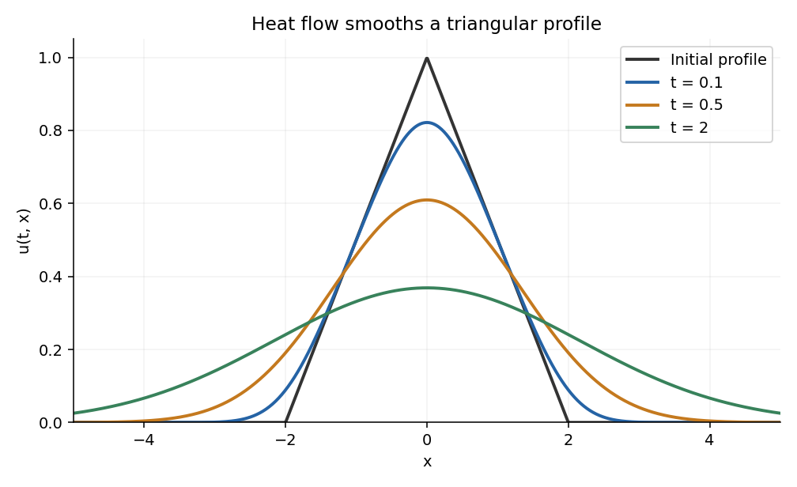

<h1 id="6/e/ii/solution">Solution</h1>

↑ **Parent:** [Ii](../ii.md)

Insert part (i) in the [inverse Fourier transform](../../../../../inverse-fourier-transform.md). The factor two in $\widehat T$ cancels half of the inverse normalization:

$$
\boxed{u(t,x)=\frac1\pi\int_{-\infty}^{\infty}
e^{-t\omega^2+ix\omega}\frac{\sin^2\omega}{\omega^2}\,d\omega.}
$$

The integrand has a removable singularity at zero. For $t>0$, the Gaussian controls every polynomial factor at infinity, so differentiation under the integral is valid. Differentiation in $t$ and twice in $x$ both multiply the integrand by $-\omega^2$, proving $u_t=u_{xx}$.

There is also a direct physical-space representation:

$$
u(t,x)=(q_t*T)(x)=\frac1{\sqrt{4\pi t}}\int_{-2}^2e^{-(x-y)^2/(4t)}T(y)\,dy.
$$

Since $q_t$ has integral one, write

$$
u(t,x)-T(x)=\int_{\mathbb R}q_t(y)\bigl(T(x-y)-T(x)\bigr)\,dy.
$$

The continuous compactly supported profile $T$ is [uniformly continuous](../../../../../uniform-continuity.md). Given $\epsilon>0$, choose $\delta>0$ so its change is below $\epsilon$ for $|y|<\delta$. That part of the integral is bounded by $\epsilon$. The other part is bounded by $2\|T\|_\infty\int_{|y|\geq\delta}q_t(y)\,dy$, which tends to zero by the substitution $y=2\sqrt t\,z$ and the vanishing tails of the Gaussian integral. This proves $u(t,x)\to T(x)$ uniformly as $t\downarrow0$ and verifies the initial condition.

Thus the formula supplies the full [heat evolution of a triangular profile](../../../../../heat-evolution-of-a-triangular-profile.md), including the corner points of the initial profile. Positive time immediately smooths those corners.

**[Figure 1](#6/e/ii/image-the-triangular-initial-profile-smooths-and-spreads-under-heat-flow). The triangular initial profile smooths and spreads under heat flow**. Original plots of the initial triangular profile and its convolution with the Gaussian heat kernel at three positive times. Each curve has total integral two on the real line.

## ↑ Ancestors (13)

1. [Ii](../ii.md)
2. [E](../../e.md)
3. [6](../../../6.md)
4. [2014](../../../../2014-split.md)
5. [Past exam of the algebra 1 and differential equations 1 course of the University of Oxford](../../../../split.md)
6. [Algebra 1 and differential equations 1 course of the University of Oxford](../../../../../algebra-1-and-differential-equations-1-course-of-the-university-of-oxford.md)
7. [Year 2 of the mathematics course of the University of Oxford](../../../../../year-2-of-the-mathematics-course-of-the-university-of-oxford.md)
8. [Mathematics course of the University of Oxford](../../../../../mathematics-course-of-the-university-of-oxford.md)
9. [Undergraduate course of the University of Oxford](../../../../../undergraduate-course-of-the-university-of-oxford.md)
10. [Course of the University of Oxford](../../../../../course-of-the-university-of-oxford.md)
11. [University of Oxford](../../../../../university-of-oxford-split.md)
12. [List of universities](../../../../../list-of-universities.md)
13. [Codex Wiki](../../../../../split.md)
