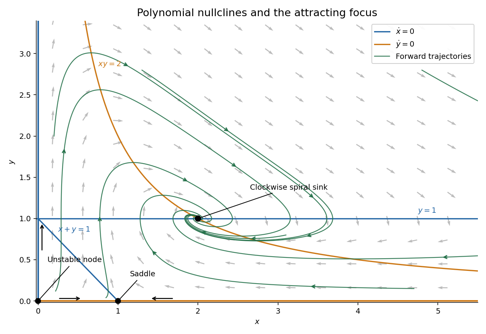

# 2015

↑ **Parent:** [Past exam of the algebra 1 and differential equations 1 course of the University of Oxford](../past-exam-of-the-algebra-1-and-differential-equations-1-course-of-the-university-of-oxford.md)

Source release: [Oxford examination archive](https://www.whatdotheyknow.com/request/maths_papers_2/response/1850333/attach/3/FOI%2020210708%201%20Data.zip?cookie_passthrough=1), member `FOI-20210708-1 - Data/a13753w1.pdf`. The cover dates this examination to 17 June 2015, 9.30am–12.30pm.

All six questions and their 38 leaf subparts are answered below. The unnumbered criterion at the start of 2(a) has its own solution before the four field cases.

**Table of contents**

- [1](#1)
  - [a](#1/a)
    - [i](#1/a/i)
      - [Solution](#1/a/i/solution)
    - [ii](#1/a/ii)
      - [Solution](#1/a/ii/solution)
    - [iii](#1/a/iii)
      - [Solution](#1/a/iii/solution)
  - [b](#1/b)
    - [i](#1/b/i)
      - [Solution](#1/b/i/solution)
    - [ii](#1/b/ii)
      - [Solution](#1/b/ii/solution)
    - [iii](#1/b/iii)
      - [Solution](#1/b/iii/solution)
  - [c](#1/c)
    - [Solution](#1/c/solution)
- [2](#2)
  - [a](#2/a)
    - [Solution](#2/a/solution)
    - [i](#2/a/i)
      - [Solution](#2/a/i/solution)
    - [ii](#2/a/ii)
      - [Solution](#2/a/ii/solution)
    - [iii](#2/a/iii)
      - [Solution](#2/a/iii/solution)
    - [iv](#2/a/iv)
      - [Solution](#2/a/iv/solution)
  - [b](#2/b)
    - [i](#2/b/i)
      - [Solution](#2/b/i/solution)
    - [ii](#2/b/ii)
      - [Solution](#2/b/ii/solution)
    - [iii](#2/b/iii)
      - [Solution](#2/b/iii/solution)
    - [iv](#2/b/iv)
      - [Solution](#2/b/iv/solution)
    - [v](#2/b/v)
      - [Solution](#2/b/v/solution)
  - [c](#2/c)
    - [Solution](#2/c/solution)
- [3](#3)
  - [a](#3/a)
    - [i](#3/a/i)
      - [Solution](#3/a/i/solution)
    - [ii](#3/a/ii)
      - [Solution](#3/a/ii/solution)
    - [iii](#3/a/iii)
      - [Solution](#3/a/iii/solution)
  - [b](#3/b)
    - [i](#3/b/i)
      - [Solution](#3/b/i/solution)
    - [ii](#3/b/ii)
      - [Solution](#3/b/ii/solution)
    - [iii](#3/b/iii)
      - [Solution](#3/b/iii/solution)
    - [iv](#3/b/iv)
      - [Solution](#3/b/iv/solution)
- [4](#4)
  - [a](#4/a)
    - [i](#4/a/i)
      - [Solution](#4/a/i/solution)
    - [ii](#4/a/ii)
      - [Solution](#4/a/ii/solution)
  - [b](#4/b)
    - [i](#4/b/i)
      - [Solution](#4/b/i/solution)
    - [ii](#4/b/ii)
      - [Solution](#4/b/ii/solution)
    - [iii](#4/b/iii)
      - [Solution](#4/b/iii/solution)
- [5](#5)
  - [a](#5/a)
    - [i](#5/a/i)
      - [Solution](#5/a/i/solution)
    - [ii](#5/a/ii)
      - [Solution](#5/a/ii/solution)
    - [iii](#5/a/iii)
      - [Solution](#5/a/iii/solution)
  - [b](#5/b)
    - [i](#5/b/i)
      - [Solution](#5/b/i/solution)
    - [ii](#5/b/ii)
      - [Solution](#5/b/ii/solution)
    - [iii](#5/b/iii)
      - [Solution](#5/b/iii/solution)
- [6](#6)
  - [a](#6/a)
    - [i](#6/a/i)
      - [Solution](#6/a/i/solution)
    - [ii](#6/a/ii)
      - [Solution](#6/a/ii/solution)
  - [b](#6/b)
    - [Solution](#6/b/solution)

## 1

↑ **Parent:** [2015](2015.md)

<h3 id="1/a">a</h3>

↑ **Parent:** [1](#1)

<h4 id="1/a/i">i</h4>

↑ **Parent:** [A](#1/a)

<h5 id="1/a/i/solution">Solution</h5>

↑ **Parent:** [I](#1/a/i)

The identity $T^2=T$ gives the decomposition

$$
v=(v-Tv)+Tv,\qquad T(v-Tv)=0.
$$

The first summand lies in the [kernel of a linear map](../kernel-of-a-linear-map.md) $\ker T$, and the second in the [image of a linear map](../vector-space.md#image-of-a-linear-map) $\operatorname{im}T$. If $w$ belongs to their intersection, write $w=Tu$; then $Tw=T^2u=Tu=w$, while $Tw=0$. Thus $w=0$, proving the [direct sum](../vector-space.md#direct-sum)

$$
\boxed{V=\ker T\oplus\operatorname{im}T.}
$$

On these two [invariant subspaces](../representation-theory.md#invariant-subspace), $T$ is respectively zero and the [identity map](../function.md#identity-function). Joining a [basis](../vector-space.md#basis) of each produces a [basis](../vector-space.md#basis) of [eigenvectors](../linear-operator-theory.md#eigenvector), with [matrix](../vector-space.md#matrix)

$$
\boxed{\operatorname{diag}(0,\ldots,0,1,\ldots,1).}
$$

Hence every [linear projection](../vector-space.md#projection-linear-algebra) is [diagonalizable](../linear-operator-theory.md#diagonalizable-matrix), over the original [field](../algebra.md#field), including in [characteristic](../algebra.md#characteristic-of-a-field) two.

<h4 id="1/a/ii">ii</h4>

↑ **Parent:** [A](#1/a)

<h5 id="1/a/ii/solution">Solution</h5>

↑ **Parent:** [Ii](#1/a/ii)

Put $n=\dim V>0$ and $r=\operatorname{rank}T$. The [direct sum](../vector-space.md#direct-sum) in part (i) gives

$$
\boxed{\chi_T(x)=x^{n-r}(x-1)^r.}
$$

The [eigenvalues](../linear-operator-theory.md#eigenvalue) are the members of $\{0,1\}$ actually present: zero occurs exactly when $r<n$, and one exactly when $r>0$. Since $T$ is [diagonalizable](../linear-operator-theory.md#diagonalizable-matrix), its [minimal polynomial](../linear-operator-theory.md#minimal-polynomial) contains each present [eigenvalue](../linear-operator-theory.md#eigenvalue) once:

$$
\boxed{m_T(x)=\begin{cases}
x,&T=0,\\
x-1,&T=I,\\
x(x-1),&T\ne0,I.
\end{cases}}
$$

In particular, a nonzero [vector space](../vector-space.md) does not force both [eigenvalues](../linear-operator-theory.md#eigenvalue) to occur. The zero and [identity maps](../function.md#identity-function) are important special cases.

<h4 id="1/a/iii">iii</h4>

↑ **Parent:** [A](#1/a)

<h5 id="1/a/iii/solution">Solution</h5>

↑ **Parent:** [Iii](#1/a/iii)

The same [invariant subspaces](../representation-theory.md#invariant-subspace) work for $S=\alpha I+\beta T$: it acts by $\alpha$ on $\ker T$ and by $\alpha+\beta$ on $\operatorname{im}T$. Its [minimal polynomial](../linear-operator-theory.md#minimal-polynomial) is therefore the product of the distinct [linear polynomials](../polynomial.md#linear-polynomial) belonging to the nonzero summands. Explicitly,

$$
\boxed{m_S(x)=\begin{cases}
x-\alpha,&\beta=0\text{ or }T=0,\\
x-(\alpha+\beta),&\beta\ne0,\ T=I,\\
(x-\alpha)(x-\alpha-\beta),&\beta\ne0,\ T\ne0,I.
\end{cases}}
$$

When $\beta\ne0$, the two candidate [eigenvalues](../linear-operator-theory.md#eigenvalue) are distinct in any [field](../algebra.md#field). This is the [minimal polynomial of an affine function of a projection](../vector-space.md#minimal-polynomial-of-an-affine-function-of-a-projection).

<h3 id="1/b">b</h3>

↑ **Parent:** [1](#1)

<h4 id="1/b/i">i</h4>

↑ **Parent:** [B](#1/b)

<h5 id="1/b/i/solution">Solution</h5>

↑ **Parent:** [I](#1/b/i)

Expand the square using $E^2=E$ and $F^2=F$:

$$
(E+F)^2-(E+F)=EF+FE.
$$

Thus

$$
\boxed{E+F\text{ is a linear projection}\quad\Longleftrightarrow\quad EF=-FE.}
$$

This [sum of two linear projections](../vector-space.md#sum-of-two-linear-projections) criterion holds in every [characteristic](../algebra.md#characteristic-of-a-field); it uses an equality of [linear maps](../vector-space.md#linear-map), not cancellation of factors in the noncommutative [associative algebra](../associative-algebra.md) of [linear endomorphisms](../algebra.md#linear-endomorphism).

<h4 id="1/b/ii">ii</h4>

↑ **Parent:** [B](#1/b)

<h5 id="1/b/ii/solution">Solution</h5>

↑ **Parent:** [Ii](#1/b/ii)

Suppose first that $E+F$ is a [linear projection](../vector-space.md#projection-linear-algebra). Part (i) gives $EF=-FE$. Multiplying on the left by $E$ gives $EF=-EFE$, and multiplying on the right by $E$ gives $EFE=-FE=EF$. Combining them yields

$$
EF=-EF,\qquad 2EF=0.
$$

In a [field](../algebra.md#field) of [characteristic](../algebra.md#characteristic-of-a-field) different from two, the nonzero [scalar](../vector-space.md#scalar) $2$ is invertible. Hence $EF=0$, and $FE=-EF=0$ too. Conversely these two zero products make the expansion in part (i) equal zero. Therefore

$$
\boxed{E+F\text{ is a linear projection}\quad\Longleftrightarrow\quad EF=FE=0.}
$$

The argument cancels a nonzero [scalar](../vector-space.md#scalar), never a possibly singular [linear map](../vector-space.md#linear-map).

<h4 id="1/b/iii">iii</h4>

↑ **Parent:** [B](#1/b)

<h5 id="1/b/iii/solution">Solution</h5>

↑ **Parent:** [Iii](#1/b/iii)

**No.** On any nonzero [vector space](../vector-space.md) over a [field](../algebra.md#field) of [characteristic](../algebra.md#characteristic-of-a-field) two, take $E=F=I$. Both are [linear projections](../vector-space.md#projection-linear-algebra), and

$$
\boxed{E+F=0\text{ is a linear projection},\qquad EF=FE=I\ne0.}
$$

The correct condition from part (i) in this [characteristic](../algebra.md#characteristic-of-a-field) is $EF=FE$, because minus and plus coincide. Vanishing of both products remains sufficient, but is no longer necessary.

<h3 id="1/c">c</h3>

↑ **Parent:** [1](#1)

<h4 id="1/c/solution">Solution</h4>

↑ **Parent:** [C](#1/c)

**The proposed equivalence is false.** On a nonzero [vector space](../vector-space.md) over any [field](../algebra.md#field) of [characteristic](../algebra.md#characteristic-of-a-field) different from two, choose

$$
E=I,\qquad F=I,\qquad G=0.
$$

These [linear projections](../vector-space.md#projection-linear-algebra) commute and satisfy $EFG=0$. Nevertheless their sum is $2I$, and

$$
\boxed{(2I)^2-2I=2I\ne0.}
$$

Thus the proposed conditions are not sufficient. For commuting [linear projections](../vector-space.md#projection-linear-algebra) the actual obstruction is the sum of the pairwise products:

$$
(E+F+G)^2-(E+F+G)=2(EF+EG+FG).
$$

The single condition on the triple product does not remove this obstruction.

## 2

↑ **Parent:** [2015](2015.md)

<h3 id="2/a">a</h3>

↑ **Parent:** [2](#2)

<h4 id="2/a/solution">Solution</h4>

↑ **Parent:** [A](#2/a)

A [linear endomorphism](../algebra.md#linear-endomorphism) is [diagonalizable](../linear-operator-theory.md#diagonalizable-matrix) over its [field](../algebra.md#field) precisely when its [minimal polynomial](../linear-operator-theory.md#minimal-polynomial) is a product of **distinct [linear polynomials](../polynomial.md#linear-polynomial) over that same [field](../algebra.md#field)**. Splitting alone is insufficient: repeated factors permit nontrivial [Jordan blocks](../linear-operator-theory.md#jordan-block).

For the displayed [matrix](../vector-space.md#matrix), a [determinant](../multilinear-algebra.md#determinant) expansion gives

$$
\chi_A(x)=x^3+3x^2+6x-10=(x-1)(x^2+4x+10).
$$

These formulas can be reduced in each requested [characteristic](../algebra.md#characteristic-of-a-field). The four cases below distinguish failure to split from failure to have distinct factors.

<h4 id="2/a/i">i</h4>

↑ **Parent:** [A](#2/a)

<h5 id="2/a/i/solution">Solution</h5>

↑ **Parent:** [I](#2/a/i)

Over the [complex numbers](../complex-analysis.md#complex-number), the three [eigenvalues](../linear-operator-theory.md#eigenvalue) are

$$
1,\qquad -2+i\sqrt6,\qquad -2-i\sqrt6.
$$

They are distinct. Each is a root of the [minimal polynomial](../linear-operator-theory.md#minimal-polynomial), so here the [minimal polynomial](../linear-operator-theory.md#minimal-polynomial) equals the [characteristic polynomial](../linear-operator-theory.md#characteristic-polynomial) and has distinct [linear polynomials](../polynomial.md#linear-polynomial). Consequently **$A$ is [diagonalizable](../linear-operator-theory.md#diagonalizable-matrix) over $\mathbb C$**.

<h4 id="2/a/ii">ii</h4>

↑ **Parent:** [A](#2/a)

<h5 id="2/a/ii/solution">Solution</h5>

↑ **Parent:** [Ii](#2/a/ii)

The [quadratic polynomial](../polynomial.md#quadratic-polynomial) $x^2+4x+10=(x+2)^2+6$ has no real [roots of a polynomial](../polynomial.md#root-of-a-polynomial). Thus the [characteristic polynomial](../linear-operator-theory.md#characteristic-polynomial) does not split over the [real numbers](../arithmetic.md#real-number). A real [diagonal matrix](../linear-algebra.md#diagonal-matrix) would have only real [eigenvalues](../linear-operator-theory.md#eigenvalue), and [similar matrices](../linear-algebra.md#matrix-similarity) have the same [characteristic polynomial](../linear-operator-theory.md#characteristic-polynomial). Therefore **$A$ is not [diagonalizable](../linear-operator-theory.md#diagonalizable-matrix) over $\mathbb R$**.

<h4 id="2/a/iii">iii</h4>

↑ **Parent:** [A](#2/a)

<h5 id="2/a/iii/solution">Solution</h5>

↑ **Parent:** [Iii](#2/a/iii)

In the [finite field](../algebra.md#finite-field) $\mathbb F_3$, reduce the [characteristic polynomial](../linear-operator-theory.md#characteristic-polynomial) to $(x-1)^3$. For $B=A-I$, reduction of the entries gives

$$
B=\begin{pmatrix}2&1&0\\0&2&1\\1&0&2\end{pmatrix},\qquad
B^2=\begin{pmatrix}1&1&1\\1&1&1\\1&1&1\end{pmatrix}\ne0,\qquad B^3=0.
$$

Hence

$$
\boxed{m_A(x)=(x-1)^3\quad\text{over }\mathbb F_3.}
$$

Its repeated [linear polynomial](../polynomial.md#linear-polynomial) prevents [diagonalizability](../linear-operator-theory.md#diagonalizable-matrix). Equivalently, a [diagonalizable](../linear-operator-theory.md#diagonalizable-matrix) map with only the [eigenvalue](../linear-operator-theory.md#eigenvalue) one would have to be $I$, and this [matrix](../vector-space.md#matrix) is not $I$.

<h4 id="2/a/iv">iv</h4>

↑ **Parent:** [A](#2/a)

<h5 id="2/a/iv/solution">Solution</h5>

↑ **Parent:** [Iv](#2/a/iv)

In the [finite field](../algebra.md#finite-field) $\mathbb F_2$, the [matrix](../vector-space.md#matrix) becomes

$$
A=\begin{pmatrix}0&1&0\\0&0&0\\0&0&1\end{pmatrix}.
$$

On the first two coordinate vectors it is a nonzero [nilpotent](../commutative-algebra.md#nilpotent) [Jordan block](../linear-operator-theory.md#jordan-block) of size two, and on the last it is the [identity map](../function.md#identity-function). Consequently

$$
\boxed{m_A(x)=x^2(x-1)\quad\text{over }\mathbb F_2.}
$$

The repeated zero root prevents [diagonalizability](../linear-operator-theory.md#diagonalizable-matrix). Directly, the only possible [eigenvalues](../linear-operator-theory.md#eigenvalue) are zero and one, so [diagonalizability](../linear-operator-theory.md#diagonalizable-matrix) would imply $A^2=A$, whereas the displayed off-diagonal entry disappears on squaring.

<h3 id="2/b">b</h3>

↑ **Parent:** [2](#2)

<h4 id="2/b/i">i</h4>

↑ **Parent:** [B](#2/b)

<h5 id="2/b/i/solution">Solution</h5>

↑ **Parent:** [I](#2/b/i)

The [primary decomposition theorem for linear maps](../linear-operator-theory.md#primary-decomposition-theorem-for-linear-maps) states that if

$$
m_T(x)=\prod_{j=1}^r p_j(x)^{e_j}
$$

with distinct monic [irreducible polynomials](../polynomial.md#irreducible-polynomial) $p_j$, then

$$
\boxed{V=\bigoplus_{j=1}^r\ker\bigl(p_j(T)^{e_j}\bigr).}
$$

Each summand is a $T$-[invariant subspace](../representation-theory.md#invariant-subspace). More generally the same [direct sum](../vector-space.md#direct-sum) conclusion holds for any factorization of an annihilating [polynomial](../polynomial.md) into pairwise [coprime polynomials](../polynomial.md#coprime-polynomials), using the corresponding kernels. The underlying mechanism is the [Bézout's identity for polynomials](../polynomial.md#bezout-s-identity-for-polynomials), which separates the mutually coprime factors.

<h4 id="2/b/ii">ii</h4>

↑ **Parent:** [B](#2/b)

<h5 id="2/b/ii/solution">Solution</h5>

↑ **Parent:** [Ii](#2/b/ii)

Since $T$ is [diagonalizable](../linear-operator-theory.md#diagonalizable-matrix), its [minimal polynomial](../linear-operator-theory.md#minimal-polynomial) is $\prod_{j=1}^r(x-\lambda_j)$ with distinct [eigenvalues](../linear-operator-theory.md#eigenvalue) $\lambda_j$ in the [field](../algebra.md#field). Apply the [primary decomposition theorem for linear maps](../linear-operator-theory.md#primary-decomposition-theorem-for-linear-maps):

$$
\boxed{V=\bigoplus_{j=1}^r\ker(T-\lambda_jI)=\bigoplus_{\lambda\in\mathbb F}V_\lambda.}
$$

For a [scalar](../vector-space.md#scalar) that is not an [eigenvalue](../linear-operator-theory.md#eigenvalue), the associated [eigenspace](../linear-operator-theory.md#eigenspace) is zero, so the sum indexed by the whole [field](../algebra.md#field) has only finitely many nonzero summands. The [eigenspaces](../linear-operator-theory.md#eigenspace) need not be one-dimensional.

<h4 id="2/b/iii">iii</h4>

↑ **Parent:** [B](#2/b)

<h5 id="2/b/iii/solution">Solution</h5>

↑ **Parent:** [Iii](#2/b/iii)

For $v\in V_\lambda$, use commutation to obtain

$$
T(Sv)=S(Tv)=S(\lambda v)=\lambda Sv.
$$

Thus $Sv\in V_\lambda$, proving that **every $T$-[eigenspace](../linear-operator-theory.md#eigenspace) is an $S$-[invariant subspace](../representation-theory.md#invariant-subspace)**. This does not assert that an arbitrary [eigenvector](../linear-operator-theory.md#eigenvector) of $T$ is already an [eigenvector](../linear-operator-theory.md#eigenvector) of $S$.

<h4 id="2/b/iv">iv</h4>

↑ **Parent:** [B](#2/b)

<h5 id="2/b/iv/solution">Solution</h5>

↑ **Parent:** [Iv](#2/b/iv)

On each nonzero [eigenspace](../linear-operator-theory.md#eigenspace) $V_\lambda$, the restricted [linear map](../vector-space.md#linear-map) $S_\lambda=S|_{V_\lambda}$ is [diagonalizable](../linear-operator-theory.md#diagonalizable-matrix). Indeed $m_S(S_\lambda)=0$, so the [minimal polynomial](../linear-operator-theory.md#minimal-polynomial) of $S_\lambda$ divides $m_S$. A divisor of a product of distinct [linear polynomials](../polynomial.md#linear-polynomial) has the same property, proving the [diagonalizable restriction lemma](../linear-operator-theory.md#diagonalizable-restriction-lemma).

Choose a [basis](../vector-space.md#basis) of $S_\lambda$-[eigenvectors](../linear-operator-theory.md#eigenvector) in each $V_\lambda$. Every chosen vector is simultaneously a $T$-[eigenvector](../linear-operator-theory.md#eigenvector), with [eigenvalue](../linear-operator-theory.md#eigenvalue) $\lambda$. The [direct sum](../vector-space.md#direct-sum) in part (ii) shows that joining these bases gives a [basis](../vector-space.md#basis) of $V$. Therefore **$S$ and $T$ have a common [eigenbasis](../linear-operator-theory.md#eigenbasis)**, which is exactly [simultaneous diagonalization](../mathematics.md#simultaneous-diagonalization).

<h4 id="2/b/v">v</h4>

↑ **Parent:** [B](#2/b)

<h5 id="2/b/v/solution">Solution</h5>

↑ **Parent:** [V](#2/b/v)

Suppose a single [basis](../vector-space.md#basis) gives the [diagonal matrices](../linear-algebra.md#diagonal-matrix) $D_S,D_T$. Entrywise multiplication gives $D_SD_T=D_TD_S$. If $P$ is the [change-of-basis matrix](../linear-algebra.md#change-of-basis-matrix), then

$$
ST=P D_SD_TP^{-1}=P D_TD_SP^{-1}=TS.
$$

Thus **[simultaneous diagonalization](../mathematics.md#simultaneous-diagonalization) implies commutation**.

<h3 id="2/c">c</h3>

↑ **Parent:** [2](#2)

<h4 id="2/c/solution">Solution</h4>

↑ **Parent:** [C](#2/c)

**Yes, provided “commute” means pairwise commute.** Necessity follows because three [diagonal matrices](../linear-algebra.md#diagonal-matrix) commute pairwise.

For sufficiency, first choose the common [eigenbasis](../linear-operator-theory.md#eigenbasis) for the first two [linear maps](../vector-space.md#linear-map), say $S,T$, obtained in part (b). Their joint [eigenspaces](../linear-operator-theory.md#eigenspace)

$$
W_{\lambda,\mu}=\ker(S-\lambda I)\cap\ker(T-\mu I)
$$

give a [direct sum](../vector-space.md#direct-sum) decomposition of $V$. The third map $U$ preserves each $W_{\lambda,\mu}$, since $SUv=USv=\lambda Uv$ and $TUv=UTv=\mu Uv$. By the [diagonalizable restriction lemma](../linear-operator-theory.md#diagonalizable-restriction-lemma), $U|_{W_{\lambda,\mu}}$ has a [basis](../vector-space.md#basis) of [eigenvectors](../linear-operator-theory.md#eigenvector) there. Every such vector already has fixed [eigenvalues](../linear-operator-theory.md#eigenvalue) for $S$ and $T$.

Joining these bases therefore gives **a common [eigenbasis](../linear-operator-theory.md#eigenbasis) for all three maps**. The same induction proves [simultaneous diagonalization](../mathematics.md#simultaneous-diagonalization) for any finite pairwise commuting family of [diagonalizable](../linear-operator-theory.md#diagonalizable-matrix) [linear endomorphisms](../algebra.md#linear-endomorphism).

## 3

↑ **Parent:** [2015](2015.md)

<h3 id="3/a">a</h3>

↑ **Parent:** [3](#3)

<h4 id="3/a/i">i</h4>

↑ **Parent:** [A](#3/a)

<h5 id="3/a/i/solution">Solution</h5>

↑ **Parent:** [I](#3/a/i)

The [dual basis](../dual-space.md#dual-basis) is the collection of [linear functionals](../dual-space.md#linear-functional) characterized by

$$
\boxed{e'_i(e_j)=\delta_{ij}.}
$$

Explicitly, $e'_i(\sum_j\alpha_je_j)=\alpha_i$. Every [linear functional](../dual-space.md#linear-functional) $\ell\in V'$ satisfies $\ell=\sum_i\ell(e_i)e'_i$, proving that the displayed functionals span the [dual space](../dual-space.md). Evaluating a zero [linear combination](../vector-space.md#linear-combination) at each $e_j$ makes all its coefficients zero, so they are also [linearly independent](../vector-space.md#linear-independence). Thus they form a [basis](../vector-space.md#basis) of $V'$.

<h4 id="3/a/ii">ii</h4>

↑ **Parent:** [A](#3/a)

<h5 id="3/a/ii/solution">Solution</h5>

↑ **Parent:** [Ii](#3/a/ii)

Define the [bidual evaluation map](../dual-space.md#bidual-evaluation-map) by evaluation:

$$
\boxed{J:V\longrightarrow V'',\qquad J(v)(\ell)=\ell(v).}
$$

For fixed $v$, this is a [linear functional](../dual-space.md#linear-functional) of $\ell$, so it belongs to the [double dual](../dual-space.md#double-dual). It is also linear as a function of $v$. If $v\ne0$, some coordinate of $v$ in a [basis](../vector-space.md#basis) is nonzero, and the corresponding [dual basis](../dual-space.md#dual-basis) functional detects it. Hence $J(v)\ne0$, proving [injectivity](../algebra.md#injective-function).

The spaces $V,V',V''$ all have the same finite [dimension](../vector-space.md#dimension-vector-space). Therefore an [injective](../algebra.md#injective-function) [linear map](../vector-space.md#linear-map) $J:V\to V''$ is [surjective](../algebra.md#surjective-function), proving the required [linear isomorphism](../vector-space.md#linear-isomorphism).

This [linear isomorphism](../vector-space.md#linear-isomorphism) is natural because evaluation requires no [basis](../vector-space.md#basis). More explicitly, for any [linear map](../vector-space.md#linear-map) $A:V\to W$, its [dual map](../dual-space.md#transpose-of-a-linear-map) satisfies

$$
\bigl(A''J_V(v)\bigr)(\ell)=J_V(v)(\ell\circ A)=\ell(Av)=J_W(Av)(\ell),
$$

so $A''J_V=J_WA$.

<h4 id="3/a/iii">iii</h4>

↑ **Parent:** [A](#3/a)

<h5 id="3/a/iii/solution">Solution</h5>

↑ **Parent:** [Iii](#3/a/iii)

Writing $u=\sum_i u_ie_i$ and $v=\sum_i v_ie_i$, evaluation against the [dual basis](../dual-space.md#dual-basis) gives

$$
\boxed{\phi(u,v)=\sum_i u_i\overline{v_i}.}
$$

**This has codomain $\mathbb C$, not the printed $\mathbb R$.** For a nonzero [vector space](../vector-space.md), take $u=ie_1$ and $v=e_1$ to obtain $\phi(u,v)=i$. Only the diagonal values $\phi(v,v)$ must be real. The displayed formula defines the intended [complex inner product](../linear-algebra.md#hermitian-inner-product).

It is linear in the first argument and conjugate-linear in the second:

$$
\phi(au+bw,v)=a\phi(u,v)+b\phi(w,v),\qquad
\phi(u,av+bw)=\overline a\phi(u,v)+\overline b\phi(u,w).
$$

It has [conjugate symmetry](../linear-algebra.md#conjugate-symmetry), since $\phi(v,u)=\overline{\phi(u,v)}$. Finally,

$$
\phi(v,v)=\sum_i|v_i|^2\geq0,
$$

with equality exactly when every coordinate vanishes, equivalently $v=0$. This proves [positive definiteness](../bilinear-form.md#positive-definiteness). Since $\phi(e_i,e_j)=\delta_{ij}$, the original [basis](../vector-space.md#basis) is [orthonormal](../inner-product.md#orthonormal-set). This is the [inner product determined by a basis](../linear-algebra.md#inner-product-determined-by-a-basis).

<h3 id="3/b">b</h3>

↑ **Parent:** [3](#3)

<h4 id="3/b/i">i</h4>

↑ **Parent:** [B](#3/b)

<h5 id="3/b/i/solution">Solution</h5>

↑ **Parent:** [I](#3/b/i)

Use the convention of part (a): the [inner product](../inner-product.md) is linear in its first argument. If $Tv=\lambda v$ with $v\ne0$, the [adjoint operator](../hilbert-space.md#adjoint-operator) identity and $T^*=-T$ give

$$
\lambda\langle v,v\rangle=\langle Tv,v\rangle
=\langle v,T^*v\rangle=-\langle v,Tv\rangle
=-\overline\lambda\langle v,v\rangle.
$$

[Positive definiteness](../bilinear-form.md#positive-definiteness) makes $\langle v,v\rangle>0$, so

$$
\boxed{\lambda=-\overline\lambda,\qquad\operatorname{Re}\lambda=0.}
$$

Thus every [eigenvalue](../linear-operator-theory.md#eigenvalue) of a [skew-adjoint operator](../functional-analysis.md#skew-adjoint-generator) is purely imaginary, including zero.

<h4 id="3/b/ii">ii</h4>

↑ **Parent:** [B](#3/b)

<h5 id="3/b/ii/solution">Solution</h5>

↑ **Parent:** [Ii](#3/b/ii)

Take $v\in U^\perp$ and $u\in U$. Because $U$ is an [invariant subspace](../representation-theory.md#invariant-subspace), $Tu\in U$. The [adjoint operator](../hilbert-space.md#adjoint-operator) relation yields

$$
\langle Tv,u\rangle=\langle v,T^*u\rangle=-\langle v,Tu\rangle=0.
$$

This holds for every $u\in U$, so $Tv\in U^\perp$. Therefore **the [orthogonal complement](../hilbert-space.md#orthogonal-complement) is also an [invariant subspace](../representation-theory.md#invariant-subspace)**.

<h4 id="3/b/iii">iii</h4>

↑ **Parent:** [B](#3/b)

<h5 id="3/b/iii/solution">Solution</h5>

↑ **Parent:** [Iii](#3/b/iii)

Proceed by induction on the [dimension](../vector-space.md#dimension-vector-space). For positive [dimension](../vector-space.md#dimension-vector-space), the [fundamental theorem of algebra](../algebra.md#fundamental-theorem-of-algebra) gives a root of the [characteristic polynomial](../linear-operator-theory.md#characteristic-polynomial), hence a nonzero [eigenvector](../linear-operator-theory.md#eigenvector) $v$. Normalize it to have [norm](../normed-vector-space.md#norm) one. Its span is an [invariant subspace](../representation-theory.md#invariant-subspace), and part (ii) makes its [orthogonal complement](../hilbert-space.md#orthogonal-complement) invariant too:

$$
V=\operatorname{span}\{v\}\oplus\operatorname{span}\{v\}^{\perp}.
$$

The restriction of $T$ to the complement remains [skew-adjoint](../functional-analysis.md#skew-adjoint-generator), since the same [inner product](../inner-product.md) identity holds there. The induction hypothesis supplies an [orthonormal eigenbasis](../linear-operator-theory.md#orthonormal-eigenbasis) for that smaller space. Adjoining $v$ gives an [orthonormal eigenbasis](../linear-operator-theory.md#orthonormal-eigenbasis) for $V$.

The zero-dimensional base case is immediate. Thus **$T$ is [diagonalizable](../linear-operator-theory.md#diagonalizable-matrix), indeed unitarily diagonalizable**. This proves the finite-dimensional case of the [spectral theorem](../hilbert-space.md#spectral-theorem) for a [skew-adjoint operator](../functional-analysis.md#skew-adjoint-generator) without assuming that distinct [eigenvalues](../linear-operator-theory.md#eigenvalue) have multiplicity one.

<h4 id="3/b/iv">iv</h4>

↑ **Parent:** [B](#3/b)

<h5 id="3/b/iv/solution">Solution</h5>

↑ **Parent:** [Iv](#3/b/iv)

Regard the real [skew-symmetric matrix](../linear-algebra.md#skew-symmetric-matrix) as acting on $\mathbb C^n$. Its [Hermitian adjoint](../hilbert-space.md#adjoint-operator) is $A^*=A^T=-A$. Parts (i) and (iii) show that its [eigenvalues](../linear-operator-theory.md#eigenvalue) are purely imaginary and its complex [minimal polynomial](../linear-operator-theory.md#minimal-polynomial) has no repeated roots.

Since $A$ has real entries, nonreal [eigenvalues](../linear-operator-theory.md#eigenvalue) occur in conjugate pairs. A nonzero pair has the form $i\alpha,-i\alpha$, with $\alpha>0$, and contributes the real [quadratic polynomial](../polynomial.md#quadratic-polynomial)

$$
(x-i\alpha)(x+i\alpha)=x^2+\alpha^2.
$$

Zero, if present, contributes one factor $x$. Hence the real [minimal polynomial](../linear-operator-theory.md#minimal-polynomial) is

$$
\boxed{m_A(x)=x^{\varepsilon}\prod_{j=1}^r(x^2+\alpha_j^2),\qquad
\varepsilon\in\{0,1\},\quad\alpha_j>0\text{ distinct}.}
$$

The product annihilates $A$ after [complexification of a real vector space](../vector-space.md#complexification-of-a-real-vector-space), so it also annihilates the original real [linear map](../vector-space.md#linear-map); no factor can be removed because each displayed complex root is an [eigenvalue](../linear-operator-theory.md#eigenvalue). This proves both the asserted form and its minimality. The case $A=0$ has $\varepsilon=1$ and an empty product.

## 4

↑ **Parent:** [2015](2015.md)

<h3 id="4/a">a</h3>

↑ **Parent:** [4](#4)

<h4 id="4/a/i">i</h4>

↑ **Parent:** [A](#4/a)

<h5 id="4/a/i/solution">Solution</h5>

↑ **Parent:** [I](#4/a/i)

An [autonomous differential equation](../dynamical-systems.md#autonomous-system-mathematics) has no explicit dependence on the independent time variable: its [vector field](../multivariable-calculus.md#vector-field) depends only on the current state. The two families of [nullclines](../dynamical-systems.md#nullcline) are

$$
\boxed{X(x,y)=0\quad\text{and}\quad Y(x,y)=0.}
$$

On the first family the horizontal velocity is zero; on the second the vertical velocity is zero. A [critical point of a dynamical system](../dynamical-systems.md#equilibrium-point-of-a-dynamical-system) is a state where both components vanish. It gives a constant solution, also called an [equilibrium](../dynamical-systems.md#equilibrium-point-of-a-dynamical-system).

<h4 id="4/a/ii">ii</h4>

↑ **Parent:** [A](#4/a)

<h5 id="4/a/ii/solution">Solution</h5>

↑ **Parent:** [Ii](#4/a/ii)

Translate the [equilibrium](../dynamical-systems.md#equilibrium-point-of-a-dynamical-system) to the origin by $z=(x-a,y-b)^T$. If the [vector field](../multivariable-calculus.md#vector-field) is continuously differentiable, its first-order [Taylor expansion](../calculus.md#taylor-expansion) is

$$
\dot z=Mz+r(z),\qquad\frac{\|r(z)\|}{\|z\|}\longrightarrow0.
$$

The [Jacobian matrix](../multivariable-calculus.md#jacobian-matrix) $M$ gives the [linearization](../algebra.md#linearization) $\dot z=Mz$, whose general solution is $z(t)=e^{tM}z(0)$ using the [matrix exponential](../linear-operator-theory.md#matrix-exponential). Its [eigenvalues](../linear-operator-theory.md#eigenvalue) determine the exponential factors, while its [eigenvectors](../linear-operator-theory.md#eigenvector) and, when necessary, [generalized eigenvectors](../linear-operator-theory.md#generalized-eigenvector) determine their directions.

For distinct [eigenvalues](../linear-operator-theory.md#eigenvalue) $\lambda_1,\lambda_2$ and corresponding [eigenvectors](../linear-operator-theory.md#eigenvector) $v_1,v_2$,

$$
\boxed{z(t)=c_1e^{\lambda_1t}v_1+c_2e^{\lambda_2t}v_2.}
$$

For a real [matrix](../vector-space.md#matrix) with nonreal conjugate [eigenvalues](../linear-operator-theory.md#eigenvalue), choose conjugate coefficients to obtain real solutions. Equivalently, if $\lambda=a+ib$ and $v=p+iq$, a real pair of independent solutions is

$$
e^{at}(p\cos bt-q\sin bt),\qquad e^{at}(p\sin bt+q\cos bt).
$$

For a repeated [eigenvalue](../linear-operator-theory.md#eigenvalue) $\lambda$, there are two cases:

- If two independent [eigenvectors](../linear-operator-theory.md#eigenvector) exist, $M=\lambda I$ and $\boxed{z(t)=e^{\lambda t}(c_1v_1+c_2v_2)}$.
- Otherwise choose a [Jordan chain](../linear-operator-theory.md#jordan-chain) $(M-\lambda I)v=0$, $(M-\lambda I)w=v$. Then $\boxed{z(t)=e^{\lambda t}\bigl[c_1v+c_2(w+tv)\bigr]}$.

The factor $t$ in the second case is essential. These are exact solutions of the [linearization](../algebra.md#linearization); the remainder describes the error for the nonlinear [differential equation](../differential-equation.md). When no [eigenvalue](../linear-operator-theory.md#eigenvalue) has zero real part, the [hyperbolic equilibrium](../dynamical-systems.md#hyperbolic-equilibrium-point) theory justifies the corresponding local qualitative classification. Zero real parts require additional nonlinear analysis.

<h3 id="4/b">b</h3>

↑ **Parent:** [4](#4)

<h4 id="4/b/i">i</h4>

↑ **Parent:** [B](#4/b)

<h5 id="4/b/i/solution">Solution</h5>

↑ **Parent:** [I](#4/b/i)

Factor each component of the [vector field](../multivariable-calculus.md#vector-field). The horizontal-velocity [nullclines](../dynamical-systems.md#nullcline) and vertical-velocity [nullclines](../dynamical-systems.md#nullcline) are, respectively,

$$
\boxed{\dot x=0:\ x=0,\ y=1,\ x+y=1;\qquad
\dot y=0:\ y=0,\ xy=2.}
$$

The last curve is a [hyperbola](../euclidean-geometry.md#hyperbola). In the nonnegative quadrant its branch is $y=2/x$ for $x>0$.

<h4 id="4/b/ii">ii</h4>

↑ **Parent:** [B](#4/b)

<h5 id="4/b/ii/solution">Solution</h5>

↑ **Parent:** [Ii](#4/b/ii)

Intersect the two [nullcline](../dynamical-systems.md#nullcline) families. The axes yield $(0,0)$ and $(1,0)$, and $y=1$ with $xy=2$ yields $(2,1)$. The possible remaining intersection would have $x+y=1$ and $xy=2$, requiring $x^2-x+2=0$, whose [discriminant](../polynomial.md#discriminant) is $-7$. Hence there are no further real [equilibria](../dynamical-systems.md#equilibrium-point-of-a-dynamical-system).

The [Jacobian matrix](../multivariable-calculus.md#jacobian-matrix) is

$$
J(x,y)=\begin{pmatrix}
(1-y)(1-2x-y)&x(x+2y-2)\\
-y^2&2-2xy
\end{pmatrix}.
$$

Evaluate it at each [equilibrium](../dynamical-systems.md#equilibrium-point-of-a-dynamical-system):

- At $(0,0)$ it is $\operatorname{diag}(1,2)$. Both [eigenvalues](../linear-operator-theory.md#eigenvalue) are positive, so the point is an **[unstable node](../dynamical-systems.md#unstable-node)**.
- At $(1,0)$ it is $\begin{pmatrix}-1&-1\\0&2\end{pmatrix}$. The [eigenvalues](../linear-operator-theory.md#eigenvalue) $-1,2$ have opposite signs, so this is a **[saddle point](../analysis.md#saddle-point)**. Its stable direction is $(1,0)$ and its unstable direction can be taken as $(-1,3)$.
- At $(2,1)$ it is $\begin{pmatrix}0&4\\-1&-2\end{pmatrix}$. Its [characteristic polynomial](../linear-operator-theory.md#characteristic-polynomial) is $\lambda^2+2\lambda+4$, so $\lambda=-1\pm i\sqrt3$. This is an **[stable focus](../dynamical-systems.md#stable-spiral)**, or spiral sink.

All three are [hyperbolic equilibria](../dynamical-systems.md#hyperbolic-equilibrium-point), so their classifications persist for the nonlinear system. Immediately to the right of $(2,1)$ on $y=1$, the velocity is vertically downward, showing that the attracting spiral turns **clockwise**.

<h4 id="4/b/iii">iii</h4>

↑ **Parent:** [B](#4/b)

<h5 id="4/b/iii/solution">Solution</h5>

↑ **Parent:** [Iii](#4/b/iii)

For $x,y>0$, the signs needed for the [phase portrait](../dynamical-systems.md#phase-portrait) follow directly from the factorizations:

$$
\begin{aligned}
\dot y&>0&&\text{when }xy<2,&\dot y&<0&&\text{when }xy>2,\\
\dot x&>0&&\text{when }y>1,\\
\dot x&>0&&\text{when }0<y<1,\ x+y<1,\\
\dot x&<0&&\text{when }0<y<1,\ x+y>1.
\end{aligned}
$$

The coordinate axes are [invariant sets](../ergodic-theory.md#invariant-set-of-a-measure-preserving-transformation). On $y=0$, the [logistic differential equation](../differential-equation.md#logistic-differential-equation) $\dot x=x(1-x)$ directs positive states toward the boundary [saddle point](../analysis.md#saddle-point) $(1,0)$. On $x=0$, $\dot y=2y$ directs positive states upward. At the three [equilibria](../dynamical-systems.md#equilibrium-point-of-a-dynamical-system), use the local directions found in part (ii); interior sample trajectories near $(2,1)$ spiral clockwise inward.

**[Figure 1](#4/b/iii/image-nullclines-and-sample-trajectories-for-the-polynomial-planar-system). Nullclines and sample trajectories for the polynomial planar system**. Blue curves have zero horizontal velocity and orange curves have zero vertical velocity. Black arrows show the vector field and green curves show forward trajectories. The origin is an unstable node, the boundary point is a saddle, and the interior point is a clockwise spiral sink.

The [nullclines](../dynamical-systems.md#nullcline) prescribe where arrows become vertical or horizontal; they are generally not themselves trajectories. The image samples the [vector field](../multivariable-calculus.md#vector-field) and several solutions, rather than assuming every [nullcline](../dynamical-systems.md#nullcline) is an [invariant set](../ergodic-theory.md#invariant-set-of-a-measure-preserving-transformation).

## 5

↑ **Parent:** [2015](2015.md)

<h3 id="5/a">a</h3>

↑ **Parent:** [5](#5)

<h4 id="5/a/i">i</h4>

↑ **Parent:** [A](#5/a)

<h5 id="5/a/i/solution">Solution</h5>

↑ **Parent:** [I](#5/a/i)

For a second-order [linear partial differential equation](../partial-differential-equation.md#linear-partial-differential-equation) written $A u_{xx}+2B u_{xy}+C u_{yy}+\cdots=0$, the discriminant is $B^2-AC$. Here

$$
A=-x^2,\qquad B=0,\qquad C=1,\qquad
\boxed{B^2-AC=x^2.}
$$

It is positive exactly when $x\ne0$, proving that the equation is a [hyperbolic partial differential equation](../partial-differential-equation.md#hyperbolic-partial-differential-equation) on each half-plane. At $x=0$ its principal part degenerates and it is not hyperbolic.

<h4 id="5/a/ii">ii</h4>

↑ **Parent:** [A](#5/a)

<h5 id="5/a/ii/solution">Solution</h5>

↑ **Parent:** [Ii](#5/a/ii)

The [characteristic curves](../transport-equation.md#characteristic-curve) satisfy

$$
-x^2(dy)^2+(dx)^2=0,\qquad\frac{dy}{dx}=\pm\frac1x.
$$

Integrating suggests the [characteristic coordinates](../partial-differential-equation.md#characteristic-coordinate)

$$
\boxed{\xi=y+\ln|x|,\qquad\eta=y-\ln|x|.}
$$

Their [Jacobian determinant](../multivariable-calculus.md#jacobian-determinant) is $2/x$, so this is an invertible local [change of variables](../multivariable-calculus.md#change-of-variables-formula) whenever $x\ne0$. Write $u(x,y)=U(\xi,\eta)$. The [chain rule](../calculus.md#chain-rule) gives

$$
\begin{aligned}
u_x&=\frac{U_\xi-U_\eta}{x},\\
x^2u_{xx}&=U_{\xi\xi}-2U_{\xi\eta}+U_{\eta\eta}-U_\xi+U_\eta,\\
u_{yy}&=U_{\xi\xi}+2U_{\xi\eta}+U_{\eta\eta}.
\end{aligned}
$$

Substitution cancels both unmixed second derivatives and both first derivatives:

$$
-x^2u_{xx}+u_{yy}-xu_x=4U_{\xi\eta}.
$$

The [canonical form of a second-order partial differential equation](../partial-differential-equation.md#canonical-form-of-a-second-order-partial-differential-equation) is therefore

$$
\boxed{U_{\xi\eta}=1.}
$$

The cancellation of the first derivatives is the key feature of these [logarithmic characteristic coordinates](../partial-differential-equation.md#logarithmic-characteristic-coordinates).

<h4 id="5/a/iii">iii</h4>

↑ **Parent:** [A](#5/a)

<h5 id="5/a/iii/solution">Solution</h5>

↑ **Parent:** [Iii](#5/a/iii)

Integrate the [canonical form of a second-order partial differential equation](../partial-differential-equation.md#canonical-form-of-a-second-order-partial-differential-equation) first in $\eta$ and then in $\xi$. The first integration gives $U_\xi=\eta+g'(\xi)$, and the second gives

$$
U(\xi,\eta)=\xi\eta+g(\xi)+h(\eta).
$$

Thus

$$
\boxed{u(x,y)=y^2-\ln^2|x|+g\bigl(y+\ln|x|\bigr)+h\bigl(y-\ln|x|\bigr).}
$$

The two arbitrary twice continuously differentiable [functions](../function.md) describe the two [characteristic](../algebra.md#characteristic-of-a-field) families. Conversely, substituting this expression into $U_{\xi\eta}=1$ verifies every such solution. The formula applies on $x>0$ or $x<0$; independent choices can be made on the two half-planes. Smooth extension across the degenerate line $x=0$ requires extra compatibility and is not supplied by the logarithmic formula alone.

<h3 id="5/b">b</h3>

↑ **Parent:** [5](#5)

<h4 id="5/b/i">i</h4>

↑ **Parent:** [B](#5/b)

<h5 id="5/b/i/solution">Solution</h5>

↑ **Parent:** [I](#5/b/i)

Use the classical regularity setting $u\in C^2(D)\cap C(\overline D)$, with $D$ bounded. Continuity on the [compact set](../topology.md#compact-space) $\overline D$ guarantees existence of a minimum. The inequality $\Delta u=f\leq0$ means that $u$ is [superharmonic function](../partial-differential-equation.md#superharmonic-function).

A strict inequality $\Delta u<0$ would immediately exclude an interior minimum, because its [Hessian matrix](../multivariable-calculus.md#hessian-matrix) there would be positive semidefinite and have nonnegative [trace](../linear-algebra.md#matrix-trace). To handle equality, introduce the [quadratic perturbation proof of the minimum principle](../partial-differential-equation.md#quadratic-perturbation-proof-of-the-minimum-principle):

$$
u_\varepsilon(x,y)=u(x,y)-\varepsilon(x^2+y^2),\qquad
\Delta u_\varepsilon=f-4\varepsilon<0.
$$

Its minimum must lie on $\partial D$. Choose $R$ so that $x^2+y^2\leq R^2$ on $\overline D$. For any $p\in D$,

$$
u_\varepsilon(p)\geq\min_{\partial D}u_\varepsilon
\geq\min_{\partial D}u-\varepsilon R^2.
$$

Letting $\varepsilon\downarrow0$ gives $u(p)\geq\min_{\partial D}u$. Therefore

$$
\boxed{\min_{\overline D}u=\min_{\partial D}u.}
$$

This asserts that a minimum is attained on the boundary, not that it cannot also be attained inside; a constant [function](../function.md) attains it everywhere.

<h4 id="5/b/ii">ii</h4>

↑ **Parent:** [B](#5/b)

<h5 id="5/b/ii/solution">Solution</h5>

↑ **Parent:** [Ii](#5/b/ii)

For a [harmonic function](../partial-differential-equation.md#harmonic-function), $\Delta u=0$ and $\Delta(-u)=0$. Apply the preceding minimum argument to $u$ and to $-u$:

$$
\boxed{\min_{\overline D}u=\min_{\partial D}u,\qquad
\max_{\overline D}u=\max_{\partial D}u.}
$$

These are the weak minimum and [maximum principle for harmonic functions](../partial-differential-equation.md#maximum-principle-for-harmonic-functions).

<h4 id="5/b/iii">iii</h4>

↑ **Parent:** [B](#5/b)

<h5 id="5/b/iii/solution">Solution</h5>

↑ **Parent:** [Iii](#5/b/iii)

The difference $w=v-u$ is a [harmonic function](../partial-differential-equation.md#harmonic-function), because the [Laplacian](../multivariable-calculus.md#laplacian) is a [linear differential operator](../analysis.md#linear-differential-operator):

$$
\Delta w=\Delta v-\Delta u=0.
$$

The boundary inequality says $w\geq0$ on $\partial D$. The minimum principle from part (ii) gives

$$
\boxed{v(p)-u(p)=w(p)\geq\min_{\partial D}w\geq0\quad(p\in D).}
$$

This is the [comparison principle for harmonic functions](../partial-differential-equation.md#comparison-principle-for-harmonic-functions). Applying it in both directions also shows why fixed [Dirichlet boundary conditions](../differential-equation.md#dirichlet-boundary-condition) determine at most one [harmonic function](../partial-differential-equation.md#harmonic-function).

## 6

↑ **Parent:** [2015](2015.md)

<h3 id="6/a">a</h3>

↑ **Parent:** [6](#6)

<h4 id="6/a/i">i</h4>

↑ **Parent:** [A](#6/a)

<h5 id="6/a/i/solution">Solution</h5>

↑ **Parent:** [I](#6/a/i)

Introduce the position and velocity variables $y_1=y$ and $y_2=y'$. Then the required [system of ordinary differential equations](../differential-equation.md#system-of-ordinary-differential-equations) and [initial condition](../differential-equation.md#initial-condition) are

$$
\boxed{\mathbf y'=\mathbf f(x,\mathbf y),\qquad
\mathbf f(x,(y_1,y_2))=\begin{pmatrix}y_2\\F(x,y_1,y_2)\end{pmatrix},\qquad
\mathbf y(a)=\begin{pmatrix}c\\d\end{pmatrix}.}
$$

Thus $f_1(x,\mathbf y)=y_2$. Conversely, the first equation identifies $y_2=y_1'$, and the second recovers the original second-order [ordinary differential equation](../differential-equation.md#ordinary-differential-equation) and both initial data.

<h4 id="6/a/ii">ii</h4>

↑ **Parent:** [A](#6/a)

<h5 id="6/a/ii/solution">Solution</h5>

↑ **Parent:** [Ii](#6/a/ii)

Work with the [L1 norm](../normed-vector-space.md#l1-norm) on $\mathbb R^2$. The scalar Lipschitz hypothesis implies

$$
\begin{aligned}
\|\mathbf f(x,\mathbf y)-\mathbf f(x,\mathbf z)\|_1
&=|y_2-z_2|+|F(x,\mathbf y)-F(x,\mathbf z)|\\
&\leq(1+L)\|\mathbf y-\mathbf z\|_1.
\end{aligned}
$$

We may take $L\geq0$. The [compact set](../topology.md#compact-space) $S$ and continuity give a finite bound $M=\max_S\|\mathbf f\|_1$. Choose

$$
\boxed{0<\eta\leq\min\left\{h,\frac{k}{M+1},\frac1{2(1+L)}\right\}.}
$$

Let $I=[a-\eta,a+\eta]$. The space $C_\eta$ of continuous maps $I\to B_k(\mathbf b)$ is complete in the [supremum norm](../normed-vector-space.md#supremum-norm): it is a closed subset of the [Banach space](../banach-space.md) $C(I,\mathbb R^2)$. Define the [Picard operator on a closed ball](../differential-equation.md#picard-operator-on-a-closed-ball) by

$$
(\mathcal P\mathbf g)(x)=\mathbf b+\int_a^x\mathbf f(t,\mathbf g(t))\,dt.
$$

For any $\mathbf g\in C_\eta$, the [integral triangle inequality](../topological-analysis.md#integral-triangle-inequality) gives

$$
\|\mathcal P\mathbf g(x)-\mathbf b\|_1\leq |x-a|M\leq\eta M<k.
$$

The integrand is continuous, so the result is continuous and remains in the prescribed [closed ball](../topological-analysis.md#closed-ball). Thus $\mathcal P$ is a self-map of the complete space. Moreover,

$$
\|\mathcal P\mathbf g-\mathcal P\mathbf h\|_\infty
\leq\eta(1+L)\|\mathbf g-\mathbf h\|_\infty
\leq\frac12\|\mathbf g-\mathbf h\|_\infty.
$$

It is a [contraction mapping](../analysis.md#contraction-mapping). The [contraction mapping theorem](../analysis.md#contraction-mapping-theorem) gives a unique [fixed point](../function.md#fixed-point) $\mathbf y$. By the [fundamental theorem of calculus](../calculus.md#fundamental-theorem-of-calculus), the fixed-point identity makes $\mathbf y$ continuously differentiable and gives $\mathbf y'=\mathbf f(x,\mathbf y)$ and $\mathbf y(a)=\mathbf b$. Its first component is twice continuously differentiable, because its derivative is the second component.

Conversely, integrating any solution that remains in the ball makes it a [fixed point](../function.md#fixed-point), so it equals $\mathbf y$. A solution starting at $\mathbf b$ cannot first reach the boundary of this ball during $I$: before such an exit the same estimate gives distance at most $\eta M<k$, contradicting distance $k$ at the first exit. This proves **existence and uniqueness on $|x-a|\leq\eta$**, not merely formal convergence of an iteration. It is the local [Picard-Lindelöf theorem](../differential-equation.md#picard-lindelof-theorem) construction.

<h3 id="6/b">b</h3>

↑ **Parent:** [6](#6)

<h4 id="6/b/solution">Solution</h4>

↑ **Parent:** [B](#6/b)

In position-velocity variables $(u,v)$, the scalar right-hand side is

$$
F(x,u,v)=\frac{v^2}{u}+2xv.
$$

Its only relevant singularity is $u=0$. The initial state $(x,u,v)=(0,1,1)$ is separated from it. For an explicit application of part (a), take $h=1$ and $k=1/2$ in the [L1 norm](../normed-vector-space.md#l1-norm). On the resulting [closed ball](../topological-analysis.md#closed-ball), $1/2\leq u,v\leq3/2$, and $|x|\leq1$.

The [partial derivatives](../multivariable-calculus.md#partial-derivative) obey

$$
|F_u|=\frac{v^2}{u^2}\leq9,\qquad
|F_v|=\left|\frac{2v}{u}+2x\right|\leq8.
$$

The ball is [convex](../real-analysis.md#convex-function), so integrating these [partial derivatives](../multivariable-calculus.md#partial-derivative) along a segment between two states gives the uniform [Lipschitz condition](../real-analysis.md#lipschitz-continuity)

$$
|F(x,u,v)-F(x,\widetilde u,\widetilde v)|
\leq9\bigl(|u-\widetilde u|+|v-\widetilde v|\bigr).
$$

Continuity holds on the whole slab, and

$$
|F|\leq\frac{(3/2)^2}{1/2}+2\cdot1\cdot\frac32=\frac{15}2,
\qquad\|(v,F)\|_1\leq9.
$$

Thus $L=9$, $M\leq9$, and the choice $\boxed{\eta=1/20}$ satisfies the self-map and contraction bounds in part (a). This proves **a unique solution on $[-1/20,1/20]$**, with $y$ bounded away from zero there.

There is also a useful exact representation. Where $y>0$, set $q=y'/y$, the [logarithmic derivative](../analytic-number-theory.md#logarithmic-derivative). Differentiation cancels the quadratic term:

$$
q'=\frac{y''}{y}-\frac{(y')^2}{y^2}=2xq,\qquad q(0)=1.
$$

Solving this [first-order linear differential equation](../linear-ordinary-differential-equation.md#first-order-linear-differential-equation) gives $q=e^{x^2}$, and a second integration yields

$$
\boxed{y(x)=\exp\left(\int_0^x e^{t^2}\,dt\right).}
$$

This [function](../function.md) is positive and smooth for every real $x$, satisfies both initial data, and verifies the original [ordinary differential equation](../differential-equation.md#ordinary-differential-equation) by direct differentiation. It therefore extends the unique local solution to the entire real line. The [logarithmic-derivative reduction of a second-order equation](../differential-equation.md#logarithmic-derivative-reduction-of-a-second-order-equation) explains why this apparently nonlinear example is explicitly integrable by [integration](../integral.md).

## ↑ Ancestors (9)

1. [Past exam of the algebra 1 and differential equations 1 course of the University of Oxford](../past-exam-of-the-algebra-1-and-differential-equations-1-course-of-the-university-of-oxford.md)
2. [Algebra 1 and differential equations 1 course of the University of Oxford](../university-of-oxford.md#algebra-1-and-differential-equations-1-course-of-the-university-of-oxford)
3. [Year 2 of the mathematics course of the University of Oxford](../university-of-oxford.md#year-2-of-the-mathematics-course-of-the-university-of-oxford)
4. [Mathematics course of the University of Oxford](../university-of-oxford.md#mathematics-course-of-the-university-of-oxford)
5. [Undergraduate course of the University of Oxford](../university-of-oxford.md#undergraduate-course-of-the-university-of-oxford)
6. [Course of the University of Oxford](../university-of-oxford.md#course-of-the-university-of-oxford)
7. [University of Oxford](../university-of-oxford.md)
8. [List of universities](../README.md#list-of-universities)
9. [Codex Wiki](../README.md)
