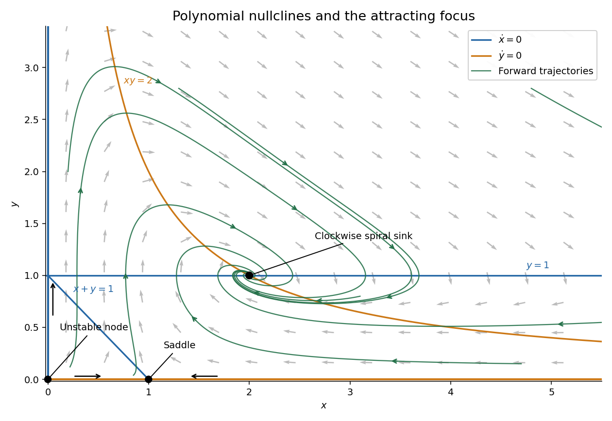

<h1 id="4/b/iii/solution">Solution</h1>

↑ **Parent:** [Iii](../iii.md)

For $x,y>0$, the signs needed for the [phase portrait](../../../../../phase-portrait.md) follow directly from the factorizations:

$$
\begin{aligned}
\dot y&>0&&\text{when }xy<2,&\dot y&<0&&\text{when }xy>2,\\
\dot x&>0&&\text{when }y>1,\\
\dot x&>0&&\text{when }0<y<1,\ x+y<1,\\
\dot x&<0&&\text{when }0<y<1,\ x+y>1.
\end{aligned}
$$

The coordinate axes are [invariant sets](../../../../../invariant-set-of-a-measure-preserving-transformation.md). On $y=0$, the [logistic differential equation](../../../../../logistic-differential-equation.md) $\dot x=x(1-x)$ directs positive states toward the boundary [saddle point](../../../../../saddle-point.md) $(1,0)$. On $x=0$, $\dot y=2y$ directs positive states upward. At the three [equilibria](../../../../../equilibrium-point-of-a-dynamical-system.md), use the local directions found in part (ii); interior sample trajectories near $(2,1)$ spiral clockwise inward.

**[Figure 1](#4/b/iii/image-nullclines-and-sample-trajectories-for-the-polynomial-planar-system). Nullclines and sample trajectories for the polynomial planar system**. Blue curves have zero horizontal velocity and orange curves have zero vertical velocity. Black arrows show the vector field and green curves show forward trajectories. The origin is an unstable node, the boundary point is a saddle, and the interior point is a clockwise spiral sink.

The [nullclines](../../../../../nullcline.md) prescribe where arrows become vertical or horizontal; they are generally not themselves trajectories. The image samples the [vector field](../../../../../vector-field.md) and several solutions, rather than assuming every [nullcline](../../../../../nullcline.md) is an [invariant set](../../../../../invariant-set-of-a-measure-preserving-transformation.md).

## ↑ Ancestors (13)

1. [Iii](../iii.md)
2. [B](../../b.md)
3. [4](../../../4.md)
4. [2015](../../../../2015-split.md)
5. [Past exam of the algebra 1 and differential equations 1 course of the University of Oxford](../../../../split.md)
6. [Algebra 1 and differential equations 1 course of the University of Oxford](../../../../../algebra-1-and-differential-equations-1-course-of-the-university-of-oxford.md)
7. [Year 2 of the mathematics course of the University of Oxford](../../../../../year-2-of-the-mathematics-course-of-the-university-of-oxford.md)
8. [Mathematics course of the University of Oxford](../../../../../mathematics-course-of-the-university-of-oxford.md)
9. [Undergraduate course of the University of Oxford](../../../../../undergraduate-course-of-the-university-of-oxford.md)
10. [Course of the University of Oxford](../../../../../course-of-the-university-of-oxford.md)
11. [University of Oxford](../../../../../university-of-oxford-split.md)
12. [List of universities](../../../../../list-of-universities.md)
13. [Codex Wiki](../../../../../split.md)
