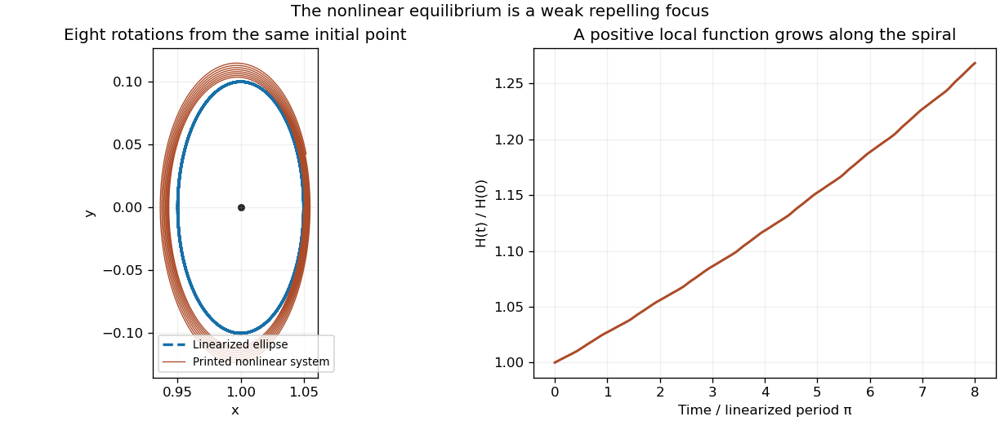

<h1 id="7/solution">Solution</h1>

↑ **Parent:** [7](../7.md)

Since the exponential factor is positive, equilibria must have $y=0$ and $x^4=1$. Thus $\boxed{(x,y)=(-1,0),\ (1,0)}$. At either point the [Jacobian matrix](../../../jacobian-matrix.md) is $\begin{pmatrix}0&1\\-4x^3&0\end{pmatrix}$. At $(-1,0)$ its [eigenvalues](../../../eigenvalue.md) are $\pm2$, so this is a [saddle point](../../../saddle-point.md). At $(1,0)$ they are $\pm2i$: the [linearization](../../../linearization.md) has a [centre equilibrium](../../../center-equilibrium.md).

The requested first-order approximation follows by putting $x=1+u$, $y=v$: $\dot u=v+O(\|(u,v)\|^2)$ and $\dot v=-4u+O(\|(u,v)\|^2)$. The linearized system conserves $4u^2+v^2$, giving the approximate ellipses

$$
\boxed{4(x-1)^2+y^2=\text{constant}.}
$$

However, **the printed nonlinear system has a weak repelling focus at $(1,0)$, rather than a centre**. [A centre in the linearization need not be a nonlinear centre](../../../a-centre-in-the-linearization-need-not-be-a-nonlinear-centre.md). Here that distinction can be proved explicitly, without relying on the numerical drift in the figure.

Put $X=2(x-1)$, $Y=y$, $\tau=2t$ and $r^2=X^2+Y^2$. The [weak focus of an exponential polynomial planar system](../../../weak-focus-of-an-exponential-polynomial-planar-system.md) has the local positive function

$$
H=\frac{X^2+Y^2}{2}+\frac7{12}X^3+\frac12XY^2+\frac13Y^3
+\frac14X^4-\frac3{16}X^3Y+\frac3{16}XY^3.
$$

Expanding the vector field through cubic order and differentiating gives

$$
\boxed{\frac{dH}{d\tau}=\frac3{16}r^4+O(r^5)>0\quad\text{for sufficiently small }r>0.}
$$

The cubic correction cancels the cubic terms in the derivative of $H$, and the quartic correction leaves the positive radial term $3r^4/16$. Since $H=r^2/2+O(r^3)$ is positive and the angular velocity stays near $-1$, small nonzero trajectories spiral outward. Equivalently the reversed system has a strict local [Lyapunov function](../../../lyapunov-function.md) and an asymptotically stable equilibrium. In particular, a periodic orbit sufficiently near the equilibrium is impossible, because $H$ would have to increase strictly and return to its starting value. This proves the failure of the printed centre assertion while retaining its correct linearized ellipse calculation.

**[Figure 1](#7/image-the-linearized-ellipses-hide-the-nonlinear-outward-spiral). The linearized ellipses hide the nonlinear outward spiral**. Original fourth-order Runge-Kutta integration of the printed vector field, compared with its linearization from the same initial point. The local polynomial calculation, rather than the plot, proves the weak instability.

## ↑ Ancestors (11)

1. [7](../7.md)
2. [2005](../../2005-split.md)
3. [Past exam of the algebra, analysis and differential equations 1 course of the University of Oxford](../../split.md)
4. [Algebra, analysis and differential equations 1 course of the University of Oxford](../../../algebra-analysis-and-differential-equations-1-course-of-the-university-of-oxford.md)
5. [Year 2 of the mathematics course of the University of Oxford](../../../year-2-of-the-mathematics-course-of-the-university-of-oxford.md)
6. [Mathematics course of the University of Oxford](../../../mathematics-course-of-the-university-of-oxford.md)
7. [Undergraduate course of the University of Oxford](../../../undergraduate-course-of-the-university-of-oxford.md)
8. [Course of the University of Oxford](../../../course-of-the-university-of-oxford.md)
9. [University of Oxford](../../../university-of-oxford-split.md)
10. [List of universities](../../../list-of-universities.md)
11. [Codex Wiki](../../../split.md)
