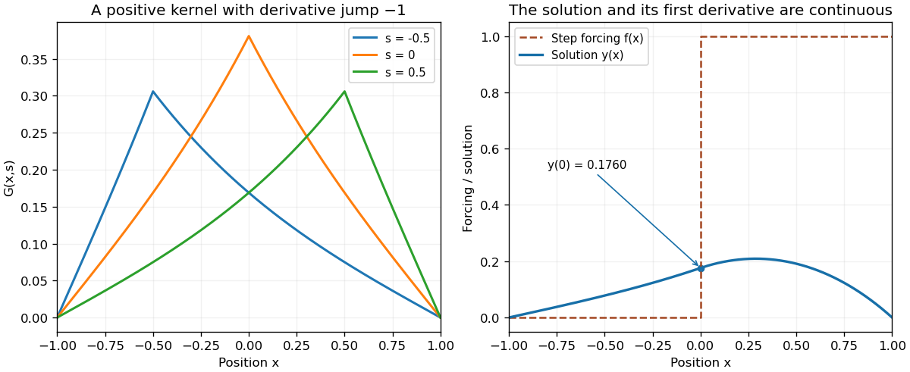

# 2006

↑ **Parent:** [Past exam of the algebra, analysis and differential equations 1 course of the University of Oxford](../past-exam-of-the-algebra-analysis-and-differential-equations-1-course-of-the-university-of-oxford.md)

Original solutions to all nine questions and all fifteen terminal parts. Source: [released Mathematics examination papers](https://www.whatdotheyknow.com/request/maths_papers_2), archive `FOI 20210708 1 Data.zip`, examination of 22 June 2006.

**Table of contents**

- [1](#1)
  - [a](#1/a)
    - [Solution](#1/a/solution)
  - [b](#1/b)
    - [Solution](#1/b/solution)
  - [c](#1/c)
    - [Solution](#1/c/solution)
  - [d](#1/d)
    - [Solution](#1/d/solution)
- [2](#2)
  - [Solution](#2/solution)
- [3](#3)
  - [i](#3/i)
    - [Solution](#3/i/solution)
  - [ii](#3/ii)
    - [Solution](#3/ii/solution)
  - [iii](#3/iii)
    - [Solution](#3/iii/solution)
  - [iv](#3/iv)
    - [Solution](#3/iv/solution)
- [4](#4)
  - [Solution](#4/solution)
- [5](#5)
  - [Solution](#5/solution)
- [6](#6)
  - [Solution](#6/solution)
- [7](#7)
  - [Solution](#7/solution)
- [8](#8)
  - [Solution](#8/solution)
- [9](#9)
  - [Solution](#9/solution)

## 1

↑ **Parent:** [2006](2006.md)

<h3 id="1/a">a</h3>

↑ **Parent:** [1](#1)

<h4 id="1/a/solution">Solution</h4>

↑ **Parent:** [A](#1/a)

**Yes.** The matrix is a [cyclic shift operator](../quantum-fourier-transform.md#cyclic-shift-operator) on three coordinates. Since $e_1,Ae_1,A^2e_1$ are the three standard [basis vectors](../vector-space.md#basis-vector), no [polynomial](../polynomial.md) of degree below three annihilates $A$. Also $A^3=I$, so its [minimal polynomial](../linear-operator-theory.md#minimal-polynomial) is $X^3-1$. Over the [complex numbers](../complex-analysis.md#complex-number) this has the distinct roots $1,\omega,\omega^2$, where $\omega=e^{2\pi i/3}$. The [minimal polynomial criterion for diagonalizability](../linear-operator-theory.md#diagonalizability-criterion-using-the-minimal-polynomial) therefore proves [diagonalizability](../linear-operator-theory.md#diagonalizable-matrix).

Explicitly, $v_\lambda=(1,\lambda^2,\lambda)^{\mathsf T}$ satisfies $Av_\lambda=\lambda v_\lambda$ when $\lambda^3=1$. These three [eigenvectors](../linear-operator-theory.md#eigenvector) form an [eigenbasis](../linear-operator-theory.md#eigenbasis). This is a special case of [diagonalization of a cyclic shift over a field](../linear-operator-theory.md#diagonalization-of-a-cyclic-shift-over-a-field).

<h3 id="1/b">b</h3>

↑ **Parent:** [1](#1)

<h4 id="1/b/solution">Solution</h4>

↑ **Parent:** [B](#1/b)

**No.** The same cyclic-vector argument gives [minimal polynomial](../linear-operator-theory.md#minimal-polynomial) $X^3-1=(X-1)(X^2+X+1)$ over the [finite field](../algebra.md#finite-field) $\mathbb F_2$. The quadratic has no root in $\mathbb F_2$: its value is one at both zero and one. Thus the [minimal polynomial](../linear-operator-theory.md#minimal-polynomial) does not split into linear factors over the specified [field](../algebra.md#field), violating the [minimal polynomial criterion for diagonalizability](../linear-operator-theory.md#diagonalizability-criterion-using-the-minimal-polynomial). It becomes diagonalizable over a suitable larger [finite field](../algebra.md#finite-field), but that is a different question.

<h3 id="1/c">c</h3>

↑ **Parent:** [1](#1)

<h4 id="1/c/solution">Solution</h4>

↑ **Parent:** [C](#1/c)

**No.** In [characteristic three](../algebra.md#characteristic-three), $X^3-1=(X-1)^3$. This is still the [minimal polynomial](../linear-operator-theory.md#minimal-polynomial), because the three cyclic [basis vectors](../vector-space.md#basis-vector) remain independent. Its repeated factor violates the [minimal polynomial criterion for diagonalizability](../linear-operator-theory.md#diagonalizability-criterion-using-the-minimal-polynomial). Equivalently, the only possible [eigenvalue](../linear-operator-theory.md#eigenvalue) is one; a diagonalizable matrix with that sole [eigenvalue](../linear-operator-theory.md#eigenvalue) would be the [identity matrix](../vector-space.md#identity-matrix), whereas this matrix is not the identity.

<h3 id="1/d">d</h3>

↑ **Parent:** [1](#1)

<h4 id="1/d/solution">Solution</h4>

↑ **Parent:** [D](#1/d)

**Yes.** In $\mathbb F_7$, the [minimal polynomial](../linear-operator-theory.md#minimal-polynomial) splits as

$$
X^3-1=(X-1)(X-2)(X-4).
$$

The three factors are distinct, so the [minimal polynomial criterion for diagonalizability](../linear-operator-theory.md#diagonalizability-criterion-using-the-minimal-polynomial) applies. For example the [eigenvectors](../linear-operator-theory.md#eigenvector) $v_\lambda=(1,\lambda^2,\lambda)^{\mathsf T}$ for $\lambda=1,2,4$ give an [eigenbasis](../linear-operator-theory.md#eigenbasis) over this [finite field](../algebra.md#finite-field). The contrast with characteristic three is that the shift polynomial now splits without repeated roots.

## 2

↑ **Parent:** [2006](2006.md)

<h3 id="2/solution">Solution</h3>

↑ **Parent:** [2](#2)

Construct the vectors inductively by the [Gram-Schmidt process](../inner-product.md#gram-schmidt-process), proving its needed properties directly. Suppose $w_1,\ldots,w_{j-1}$ form an [orthonormal basis](../inner-product.md#orthonormal-basis) of $U_{j-1}$, and put

$$
r_j=u_j-\sum_{k<j}\langle u_j,w_k\rangle w_k.
$$

For every $i<j$, taking an [inner product](../inner-product.md) with $w_i$ gives $\langle r_j,w_i\rangle=0$. Also $r_j\ne0$, because otherwise $u_j$ would lie in the [linear span](../vector-space.md#linear-span) of its predecessors, contrary to [linear independence](../vector-space.md#linear-independence). Define

$$
\boxed{w_j=r_j/\|r_j\|.}
$$

It lies in $U_j$, has unit [norm](../normed-vector-space.md#norm), and is orthogonal to every $u_i$ with $i<j$, since those vectors lie in $U_{j-1}$. Writing $u_j=r_j+\sum_{k<j}\langle u_j,w_k\rangle w_k$ gives $\langle w_j,u_j\rangle=\|r_j\|>0$. The same identity shows that $w_1,\ldots,w_j$ span $U_j$, completing the induction, including the empty sum at $j=1$.

For uniqueness, any candidate $w\in U_j$ expands in the basis $w_1,\ldots,w_{j-1},r_j$. Orthogonality to every earlier $u_i$, hence to every earlier $w_i$, makes its first $j-1$ coefficients zero. Thus $w=tr_j$. Unit norm forces $t=\pm1/\|r_j\|$, and $\langle w,u_j\rangle>0$ forces the positive sign. This proves [uniqueness in the Gram-Schmidt process with positive normalization](../inner-product.md#uniqueness-in-the-gram-schmidt-process-with-positive-normalization) without assuming a projection theorem or any other major orthogonalization result.

## 3

↑ **Parent:** [2006](2006.md)

<h3 id="3/i">i</h3>

↑ **Parent:** [3](#3)

<h4 id="3/i/solution">Solution</h4>

↑ **Parent:** [I](#3/i)

The [evaluation homomorphism](../commutative-algebra.md#evaluation-homomorphism) $\mathbb R[X]\to\mathbb R$, $p\mapsto p(0)$, is surjective and has [kernel of a ring homomorphism](../commutative-algebra.md#kernel-of-a-ring-homomorphism) $J_1=(X)$. Hence $J_1$ is an [ideal](../commutative-algebra.md#ideal), and the [first isomorphism theorem for rings](../commutative-algebra.md#first-isomorphism-theorem-for-rings) gives $\boxed{\mathbb R[X]/J_1\cong\mathbb R}$. Since this quotient is a [field](../algebra.md#field), $\boxed{J_1\text{ is maximal}}$.

<h3 id="3/ii">ii</h3>

↑ **Parent:** [3](#3)

<h4 id="3/ii/solution">Solution</h4>

↑ **Parent:** [Ii](#3/ii)

**It is not an ideal.** The constant [polynomial](../polynomial.md) one belongs to $J_2$, but its product with $X$ does not: the [derivative](../calculus.md#derivative) of $X$ at zero is one. Thus $J_2$ fails closure under multiplication by arbitrary elements of $\mathbb R[X]$, a required [ideal](../commutative-algebra.md#ideal) property. Closure under addition alone would not suffice.

<h3 id="3/iii">iii</h3>

↑ **Parent:** [3](#3)

<h4 id="3/iii/solution">Solution</h4>

↑ **Parent:** [Iii](#3/iii)

The conditions set the constant and linear [coefficients](../vector-space.md#coefficient) to zero, so $\boxed{J_3=(X^2)}$. This is a [principal ideal](../commutative-algebra.md#principal-ideal), but it is **not maximal**: there is a strict chain $(X^2)\subsetneq(X)\subsetneq\mathbb R[X]$. In the [quotient ring](../commutative-algebra.md#quotient-ring), the nonzero class of $X$ has square zero, so the quotient is not a [field](../algebra.md#field).

<h3 id="3/iv">iv</h3>

↑ **Parent:** [3](#3)

<h4 id="3/iv/solution">Solution</h4>

↑ **Parent:** [Iv](#3/iv)

Here $J_4=(X^2+1)$ is a [principal ideal](../commutative-algebra.md#principal-ideal). The [evaluation homomorphism](../commutative-algebra.md#evaluation-homomorphism) $p\mapsto p(i)$ from $\mathbb R[X]$ onto $\mathbb C$ has this [kernel of a ring homomorphism](../commutative-algebra.md#kernel-of-a-ring-homomorphism): division by $X^2+1$ leaves a remainder $a+bX$, and $a+bi=0$ with real $a,b$ forces both to vanish. Surjectivity follows because every complex number is $a+bi$. Consequently

$$
\boxed{\mathbb R[X]/J_4\cong\mathbb C,\qquad J_4\text{ is maximal}.}
$$

Equivalently, $X^2+1$ is an [irreducible polynomial](../polynomial.md#irreducible-polynomial) over the [real numbers](../arithmetic.md#real-number).

## 4

↑ **Parent:** [2006](2006.md)

<h3 id="4/solution">Solution</h3>

↑ **Parent:** [4](#4)

A [closed curve](../topology.md#closed-curve) has $\gamma(a)=\gamma(b)$. A [simple curve](../topology.md#simple-curve) has no repeated points apart from the permitted equality of its two endpoints when it is closed. A [smooth curve](../differential-geometry.md#smooth-curve), in the regular contour-integration convention, has a continuous nonzero tangent $\gamma'$; piecewise smooth contours are treated by adding the integrals over their smooth pieces. For a continuous integrand, its [contour integral](../complex-analysis.md#contour-integral) is defined by

$$
\boxed{\int_\gamma f(z)\,dz=\int_a^b f(\gamma(t))\gamma'(t)\,dt.}
$$

For the positively oriented circle, $\gamma'(t)=ire^{it}$ and $(\gamma(t)-z_0)^n=r^ne^{int}$. Direct parameter integration therefore gives

$$
\int_\gamma(z-z_0)^n\,dz=ir^{n+1}\int_0^{2\pi}e^{i(n+1)t}\,dt
=\boxed{\begin{cases}2\pi i,&n=-1,\\0,&n\ne-1.\end{cases}}
$$

For $n\ne-1$, an elementary [antiderivative](../integral.md#antiderivative) is $e^{i(n+1)t}/[i(n+1)]$ and its endpoint values agree because $n$ is an integer. For $n=-1$, the integrand of the parameter integral is the constant $i$. No integral theorem is needed.

## 5

↑ **Parent:** [2006](2006.md)

<h3 id="5/solution">Solution</h3>

↑ **Parent:** [5](#5)

Apply the [residue theorem](../analysis.md#residue-theorem) to $F(z)=(z^2+4)^{-2}$ on the upper semicircle of radius $R>2$, traversed counterclockwise. Its sole enclosed [pole](../isolated-singularity.md#pole) is the double pole at $2i$, and

$$
\operatorname{Res}_{z=2i}F
=\left.\frac d{dz}(z+2i)^{-2}\right|_{z=2i}
=-\frac2{(4i)^3}=-\frac i{32}.
$$

On the semicircular arc, $|z^2+4|\ge R^2-4$, so the [ML inequality](../complex-analysis.md#estimation-lemma) bounds its contribution by $\pi R/(R^2-4)^2\to0$. The real integral is absolutely convergent, since its integrand is $O(|x|^{-4})$ at infinity. Taking $R\to\infty$ in the contour identity yields

$$
\boxed{\int_{-\infty}^{\infty}\frac{dx}{(x^2+4)^2}=2\pi i\left(-\frac i{32}\right)=\frac\pi{16}.}
$$

## 6

↑ **Parent:** [2006](2006.md)

<h3 id="6/solution">Solution</h3>

↑ **Parent:** [6](#6)

A [holomorphic function](../holomorphic-function.md) with $f'(z)\ne0$ at every point is locally a [conformal map](../geometry-and-topology.md#conformal-map). Write $a=z_0$. Since $|a|<1$ and $|z|<1$, $1-\overline az\ne0$, and

$$
\boxed{f'(z)=\frac{|a|^2-1}{(1-\overline az)^2}\ne0.}
$$

Thus the specified [Möbius transformation](../group-theory.md#mobius-transformation) is conformal throughout the disk. Expanding the two squared absolute values gives

$$
\boxed{1-|f(z)|^2=\frac{(1-|a|^2)(1-|z|^2)}{|1-\overline az|^2}>0,}
$$

so $f$ maps the [open unit disk](../topology.md#unit-disc) into itself. Solving $w=(a-z)/(1-\overline az)$ gives $z=(a-w)/(1-\overline aw)=f(w)$. Equivalently $f(f(z))=z$. Hence $f$ is its own inverse, proving both [injectivity](../algebra.md#injective-function) and [surjectivity](../algebra.md#surjective-function) on the disk. Nonvanishing derivative establishes the local angle-preserving property; the explicit inverse supplies the separate global bijection claim.

## 7

↑ **Parent:** [2006](2006.md)

<h3 id="7/solution">Solution</h3>

↑ **Parent:** [7](#7)

The [fundamental theorem of calculus](../calculus.md#fundamental-theorem-of-calculus) first gives $y'(x)=1+\int_0^x f(y(s))\,ds$. Integrating again, or differentiating the proposed expression twice and checking its initial values, yields the [Volterra integral equation](../analysis.md#volterra-integral-equation)

$$
\boxed{y(x)=x+\int_0^x(x-s)f(y(s))\,ds.}
$$

For $f(y)=-y$, the [initial value problem](../differential-equation.md#initial-value-problem) is solved by $\boxed{y(x)=\sin x}$. Its [Picard iteration](../differential-equation.md#picard-iteration) constructs the sine series directly. The base approximation is $y_0(x)=x$. If

$$
y_n(x)=\sum_{k=0}^n(-1)^k\frac{x^{2k+1}}{(2k+1)!},
$$

then elementary integration gives

$$
\int_0^x(x-s)\frac{s^{2k+1}}{(2k+1)!}\,ds=\frac{x^{2k+3}}{(2k+3)!}.
$$

Substituting this finite sum in the next update, then shifting its index, proves the same formula with $n+1$ in place of $n$. This is the required [mathematical induction](../foundations-of-mathematics.md#mathematical-induction). The resulting partial sums converge to $\boxed{\sin x}$ for every real $x$, and uniformly on every bounded interval: the absolute terms on $|x|\le R$ are bounded by the convergent series $\sum_kR^{2k+1}/(2k+1)!$.

The printed update lists $n=1,2,\ldots$, which would leave $y_1$ unspecified if read literally. The usual [Picard iteration](../differential-equation.md#picard-iteration), and the requested induction from $y_0$, use the update starting at $n=0$; that intended convention is used here.

## 8

↑ **Parent:** [2006](2006.md)

<h3 id="8/solution">Solution</h3>

↑ **Parent:** [8](#8)

Write the equation as $Ly=f$ with $L=-d^2/dx^2+1$. Homogeneous solutions vanishing at the left and right endpoints are $u_L(x)=\sinh(1+x)$ and $u_R(x)=\sinh(1-x)$. Their [Wronskian](../linear-ordinary-differential-equation.md#wronskian) is $u_Lu_R'-u_L'u_R=-\sinh2$. The [Dirichlet Green kernel for minus second derivative plus one](../green-s-function.md#dirichlet-green-kernel-for-minus-second-derivative-plus-one) is therefore

$$
\boxed{G(x,s)=\frac{\sinh(1+\min(x,s))\sinh(1-\max(x,s))}{\sinh2}.}
$$

It vanishes at $x=\pm1$, is continuous at $x=s$, and its first derivative has jump $-1$. Thus $LG(\cdot,s)=\delta_s$ in the [distributional derivative](../distribution-theory.md#distributional-derivative) sense, with the sign appropriate to $L=-d^2/dx^2+1$. Integration against $f$ gives the required boundary-value solution. The kernel is positive and symmetric, as is also apparent in the figure.

For the specified step forcing only $0\le s\le1$ contributes at $x=0$, giving

$$
y(0)=\frac{\sinh1}{\sinh2}\int_0^1\sinh(1-s)\,ds
=\frac{\sinh1(\cosh1-1)}{2\sinh1\cosh1}
=\boxed{\frac{\cosh1-1}{2\cosh1}.}
$$

The discontinuity in $f$ gives a piecewise twice-differentiable solution with continuous value and first derivative, rather than a jump in $y$ itself.

**[Figure 1](#8/image-a-positive-dirichlet-green-kernel-smooths-step-forcing). A positive Dirichlet Green kernel smooths step forcing**. Original plots of three kernel sections and the solution for forcing zero on the left half and one on the right half of the interval. The derivative kink in each kernel section supplies its point source; integration produces a continuously differentiable forced solution.

## 9

↑ **Parent:** [2006](2006.md)

<h3 id="9/solution">Solution</h3>

↑ **Parent:** [9](#9)

The [characteristic equation of a partial differential equation](../partial-differential-equation.md#characteristic-equation-of-a-partial-differential-equation) for $u_{xx}+u_{xy}=0$ is $(dy)^2-dx\,dy=0$. Thus the two [characteristic curve](../transport-equation.md#characteristic-curve) families are $\boxed{y=\text{constant},\quad y-x=\text{constant}}$. Set $\xi=y$ and $\eta=y-x$. The [chain rule](../calculus.md#chain-rule) gives $\partial_x=-\partial_\eta$ and $\partial_y=\partial_\xi+\partial_\eta$, reducing the equation to

$$
\boxed{U_{\xi\eta}=0.}
$$

Integrating in the two independent characteristic coordinates gives $U=F(\xi)+G(\eta)$, or $u(x,y)=F(y)+G(y-x)$. At $x=0$, the value condition gives $F(y)+G(y)=0$, while the derivative condition gives $-G'(y)=e^y$. Hence $G(y)=-e^y+C$ and $F(y)=e^y-C$, so

$$
\boxed{u(x,y)=e^y-e^{y-x}.}
$$

Direct differentiation gives $u_x=e^{y-x}$, $u_{xx}=-e^{y-x}$ and $u_{xy}=e^{y-x}$, verifying both the equation and the two data. The additive constants cancel in $u$, so they do not create different solutions.

## ↑ Ancestors (9)

1. [Past exam of the algebra, analysis and differential equations 1 course of the University of Oxford](../past-exam-of-the-algebra-analysis-and-differential-equations-1-course-of-the-university-of-oxford.md)
2. [Algebra, analysis and differential equations 1 course of the University of Oxford](../university-of-oxford.md#algebra-analysis-and-differential-equations-1-course-of-the-university-of-oxford)
3. [Year 2 of the mathematics course of the University of Oxford](../university-of-oxford.md#year-2-of-the-mathematics-course-of-the-university-of-oxford)
4. [Mathematics course of the University of Oxford](../university-of-oxford.md#mathematics-course-of-the-university-of-oxford)
5. [Undergraduate course of the University of Oxford](../university-of-oxford.md#undergraduate-course-of-the-university-of-oxford)
6. [Course of the University of Oxford](../university-of-oxford.md#course-of-the-university-of-oxford)
7. [University of Oxford](../university-of-oxford.md)
8. [List of universities](../README.md#list-of-universities)
9. [Codex Wiki](../README.md)
