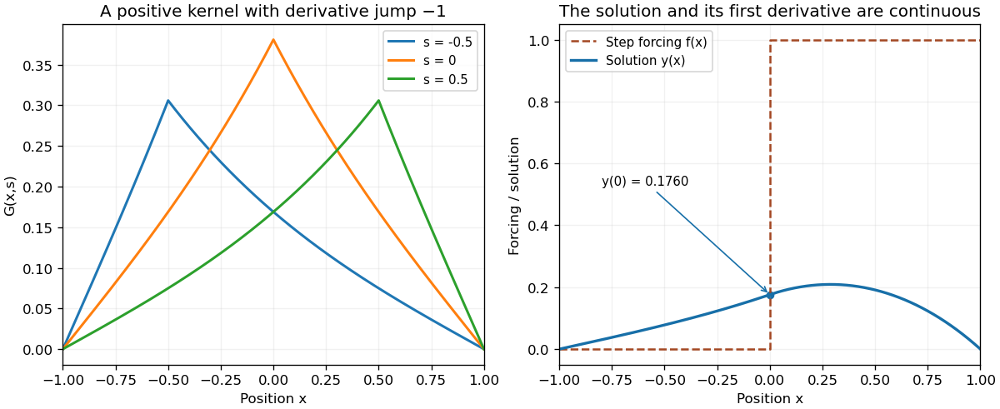

<h1 id="8/solution">Solution</h1>

↑ **Parent:** [8](../8.md)

Write the equation as $Ly=f$ with $L=-d^2/dx^2+1$. Homogeneous solutions vanishing at the left and right endpoints are $u_L(x)=\sinh(1+x)$ and $u_R(x)=\sinh(1-x)$. Their [Wronskian](../../../wronskian.md) is $u_Lu_R'-u_L'u_R=-\sinh2$. The [Dirichlet Green kernel for minus second derivative plus one](../../../dirichlet-green-kernel-for-minus-second-derivative-plus-one.md) is therefore

$$
\boxed{G(x,s)=\frac{\sinh(1+\min(x,s))\sinh(1-\max(x,s))}{\sinh2}.}
$$

It vanishes at $x=\pm1$, is continuous at $x=s$, and its first derivative has jump $-1$. Thus $LG(\cdot,s)=\delta_s$ in the [distributional derivative](../../../distributional-derivative.md) sense, with the sign appropriate to $L=-d^2/dx^2+1$. Integration against $f$ gives the required boundary-value solution. The kernel is positive and symmetric, as is also apparent in the figure.

For the specified step forcing only $0\le s\le1$ contributes at $x=0$, giving

$$
y(0)=\frac{\sinh1}{\sinh2}\int_0^1\sinh(1-s)\,ds
=\frac{\sinh1(\cosh1-1)}{2\sinh1\cosh1}
=\boxed{\frac{\cosh1-1}{2\cosh1}.}
$$

The discontinuity in $f$ gives a piecewise twice-differentiable solution with continuous value and first derivative, rather than a jump in $y$ itself.

**[Figure 1](#8/image-a-positive-dirichlet-green-kernel-smooths-step-forcing). A positive Dirichlet Green kernel smooths step forcing**. Original plots of three kernel sections and the solution for forcing zero on the left half and one on the right half of the interval. The derivative kink in each kernel section supplies its point source; integration produces a continuously differentiable forced solution.

## ↑ Ancestors (11)

1. [8](../8.md)
2. [2006](../../2006-split.md)
3. [Past exam of the algebra, analysis and differential equations 1 course of the University of Oxford](../../split.md)
4. [Algebra, analysis and differential equations 1 course of the University of Oxford](../../../algebra-analysis-and-differential-equations-1-course-of-the-university-of-oxford.md)
5. [Year 2 of the mathematics course of the University of Oxford](../../../year-2-of-the-mathematics-course-of-the-university-of-oxford.md)
6. [Mathematics course of the University of Oxford](../../../mathematics-course-of-the-university-of-oxford.md)
7. [Undergraduate course of the University of Oxford](../../../undergraduate-course-of-the-university-of-oxford.md)
8. [Course of the University of Oxford](../../../course-of-the-university-of-oxford.md)
9. [University of Oxford](../../../university-of-oxford-split.md)
10. [List of universities](../../../list-of-universities.md)
11. [Codex Wiki](../../../split.md)
