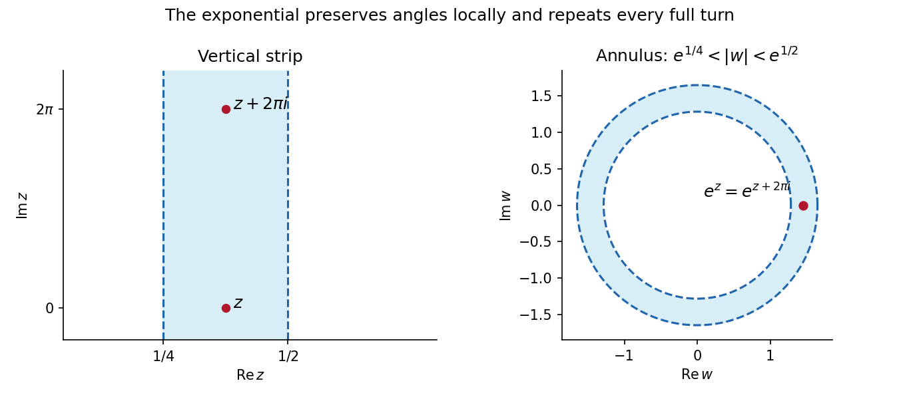
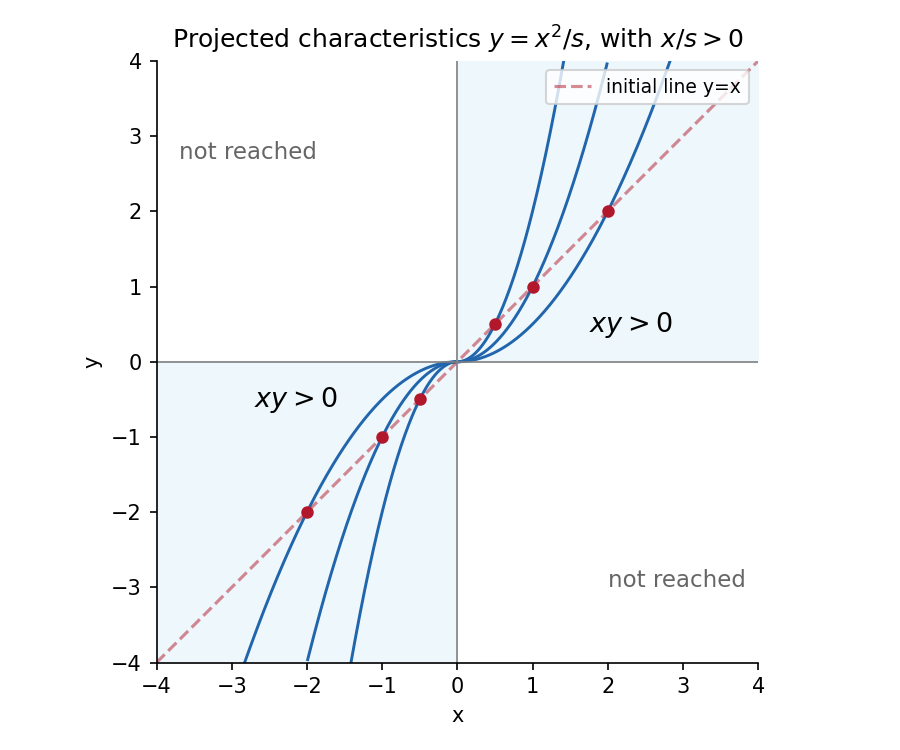

# 2007

↑ **Parent:** [Past exam of the algebra, analysis and differential equations 1 course of the University of Oxford](../past-exam-of-the-algebra-analysis-and-differential-equations-1-course-of-the-university-of-oxford.md)

**Table of contents**

- [1](#1)
  - [Solution](#1/solution)
- [2](#2)
  - [Solution](#2/solution)
- [3](#3)
  - [Solution](#3/solution)
- [4](#4)
  - [a](#4/a)
    - [Solution](#4/a/solution)
  - [b](#4/b)
    - [Solution](#4/b/solution)
  - [c](#4/c)
    - [Solution](#4/c/solution)
  - [d](#4/d)
    - [Solution](#4/d/solution)
- [5](#5)
  - [Solution](#5/solution)
- [6](#6)
  - [a](#6/a)
    - [i](#6/a/i)
      - [Solution](#6/a/i/solution)
    - [ii](#6/a/ii)
      - [Solution](#6/a/ii/solution)
  - [b](#6/b)
    - [Solution](#6/b/solution)
  - [c](#6/c)
    - [Solution](#6/c/solution)
- [7](#7)
  - [Solution](#7/solution)
- [8](#8)
  - [Solution](#8/solution)
- [9](#9)
  - [Solution](#9/solution)

## 1

↑ **Parent:** [2007](2007.md)

<h3 id="1/solution">Solution</h3>

↑ **Parent:** [1](#1)

The weight is strictly positive and all its [polynomial](../polynomial.md) moments are finite. Thus the given integral is a [inner product](../inner-product.md): for a nonzero [polynomial](../polynomial.md), its square is positive on a nonempty interval, so its weighted integral is strictly positive.

In the [finite-dimensional vector space](../vector-space.md#finite-dimensional-vector-space) $V_n$, subtract the [orthogonal projection onto a finite-dimensional subspace](../inner-product.md#orthogonal-projection-onto-a-finite-dimensional-subspace) of $x^n$ onto $V_{n-1}$:

$$
\phi_n=x^n-\operatorname{proj}_{V_{n-1}}x^n.
$$

This is monic, since the subtracted [polynomial](../polynomial.md) has lower degree, and is orthogonal to every lower-degree [polynomial](../polynomial.md). If $\phi_n,\psi_n$ were two such [monic polynomials](../polynomial.md#monic-polynomial), their difference would lie in $V_{n-1}$ and be orthogonal to that space. Taking its [inner product](../inner-product.md) with itself gives zero, hence the difference vanishes. This proves existence and uniqueness for every $n$, with $\phi_0=1$.

Odd moments vanish because the weight is even; the even moments are

$$
\int_{\mathbb R}e^{-|x|}x^{2k}dx
=2\int_0^\infty e^{-x}x^{2k}dx=2(2k)!.
$$

Consequently $\phi_1=x$, while a monic quadratic orthogonal to $x$ has no linear term, and orthogonality to one gives its constant term $-4/2=-2$. Thus

$$
\boxed{\phi_0=1,\qquad\phi_1=x,\qquad\phi_2=x^2-2.}
$$

Finally $(-1)^n\phi_n(-x)$ is also monic and orthogonal to every lower-degree [polynomial](../polynomial.md), by the change of variable $x\mapsto-x$. Uniqueness implies $\phi_n(-x)=(-1)^n\phi_n(x)$. In particular $\phi_{2007}$ is odd and

$$
\boxed{[x^{2000}]\phi_{2007}=0.}
$$

This is [parity of monic orthogonal polynomials for an even weight](../orthogonal-polynomial.md#parity-of-monic-orthogonal-polynomials-for-an-even-weight).

## 2

↑ **Parent:** [2007](2007.md)

<h3 id="2/solution">Solution</h3>

↑ **Parent:** [2](#2)

Use the [monomial basis](../vector-space.md#monomial-basis) $e_k=x^{n-k}y^k$, $0\leq k\leq n$. Direct differentiation gives

$$
Pe_k=k e_{k-1},\qquad Qe_k=(n-k)e_{k+1},
$$

with the endpoint terms zero. Repeated application therefore gives $P^{n+1}=Q^{n+1}=0$, while $P^ne_n=n!e_0\neq0$ and $Q^ne_0=n!e_n\neq0$. Each [nilpotency index](../linear-operator-theory.md#nilpotency-index) is exactly $n+1$, so

$$
\boxed{m_P(t)=m_Q(t)=t^{n+1}.}
$$

Next

$$
PQe_k=(n-k)(k+1)e_k,\qquad
QPe_k=k(n-k+1)e_k,
$$

and hence $(PQ-QP)e_k=(n-2k)e_k$. These $n+1$ real [eigenvalues](../linear-operator-theory.md#eigenvalue) are distinct. A [polynomial](../polynomial.md) annihilates this operator exactly when it vanishes at all of them, giving

$$
\boxed{m_{PQ-QP}(t)=\prod_{k=0}^n(t-(n-2k)).}
$$

The [commutator](../lie-algebra.md#commutator) is diagonal in the displayed [monomial basis](../vector-space.md#monomial-basis). Since $n\geq1$, $P,Q$ are nonzero [nilpotent linear map](../linear-operator-theory.md#nilpotent-linear-map); a [diagonalizable](../linear-operator-theory.md#diagonalizable-matrix) nilpotent map would have a [diagonal matrix](../linear-algebra.md#diagonal-matrix) with all [eigenvalues](../linear-operator-theory.md#eigenvalue) zero and thus be the zero map. Therefore **only $PQ-QP$ is [diagonalizable](../linear-operator-theory.md#diagonalizable-matrix)**. The calculation realizes [raising and lowering on binary homogeneous polynomials](../lie-algebra.md#raising-and-lowering-on-binary-homogeneous-polynomials).

## 3

↑ **Parent:** [2007](2007.md)

<h3 id="3/solution">Solution</h3>

↑ **Parent:** [3](#3)

For $z=a+b\sqrt d$, let $\bar z=a-b\sqrt d$ denote the [algebraic conjugate](../algebra.md#conjugate-element-field-theory), not necessarily ordinary complex conjugation when $d>0$. Conjugation respects multiplication, and $z\bar z=a^2-db^2$. Therefore

$$
N(zz')=|(zz')\overline{zz'}|
=|z\bar z|\,|z'\bar z'|
=\boxed{N(z)N(z')}.
$$

If $z$ is a [unit in a ring](../algebra.md#unit-in-a-ring), choose its inverse $w$ in the same [ring](../commutative-algebra.md#ring). Then $N(z)N(w)=N(1)=1$, and both norms are nonnegative [integers](../integer.md), forcing $N(z)=1$. Conversely, if $N(z)=1$, then $z\bar z=\pm1$, so $z^{-1}=\pm\bar z$ belongs to the [ring](../commutative-algebra.md#ring). Thus **$z$ is a [unit in a ring](../algebra.md#unit-in-a-ring) exactly when $N(z)=1$**.

For negative $d$, the equation becomes $a^2+|d|b^2=1$. If $d=-1$, its [integer](../integer.md) solutions give the four [units](../algebra.md#unit-in-a-ring) $\pm1,\pm i$. If $d<-1$, the term $|d|b^2$ forces $b=0$, leaving $a=\pm1$. Hence

$$
\boxed{\mathbb Z[\sqrt d]^\times=
\begin{cases}\{1,-1,i,-i\},&d=-1,\\
\{1,-1\},&d<-1.\end{cases}}
$$

For $d=2$, the element $u=1+\sqrt2$ has [field norm](../algebraic-number-theory.md#field-norm) $|1-2|=1$. Its powers $u^n$, $n\geq0$, are all [units](../algebra.md#unit-in-a-ring) by [multiplicative function](../arithmetic-function.md#multiplicative-function) and are distinct, since their positive real values strictly increase with $n$. Thus $\mathbb Z[\sqrt2]$ has infinitely many [units](../algebra.md#unit-in-a-ring). This argument concerns the stated integer-coefficient [ring](../commutative-algebra.md#ring); it does not replace it by a larger [ring](../commutative-algebra.md#ring) of algebraic [integers](../integer.md).

## 4

↑ **Parent:** [2007](2007.md)

<h3 id="4/a">a</h3>

↑ **Parent:** [4](#4)

<h4 id="4/a/solution">Solution</h4>

↑ **Parent:** [A](#4/a)

The topology on $A$ is the [subspace topology](../topology.md#subspace-topology) inherited from the [complex plane](../complex-analysis.md#complex-plane). A subset $B$ is open in $A$ if $B=A\cap U$ for some [open subset](../topology.md#open-set) $U\subseteq\mathbb C$. Equivalently, every $b\in B$ has a radius $\epsilon>0$ such that $A\cap\{z:|z-b|<\epsilon\}\subseteq B$.

A subset $B$ is closed in $A$ if $A\setminus B$ is open in $A$, equivalently if $B=A\cap F$ for a [closed subset](../topology.md#closed-set) $F$ of the [complex plane](../complex-analysis.md#complex-plane). These are relative properties: the same subset need not be open or closed in the ambient plane.

<h3 id="4/b">b</h3>

↑ **Parent:** [4](#4)

<h4 id="4/b/solution">Solution</h4>

↑ **Parent:** [B](#4/b)

The set $A$ is [disconnected space](../geometry-and-topology.md#disconnected-space) if it has a [separation of a topological space](../geometry-and-topology.md#separation-of-a-topological-space): two nonempty disjoint subsets $U,V$ open in $A$ with $A=U\cup V$. Each is then also closed in $A$, being the other's complement.

The set $A$ is [connected](../geometry-and-topology.md#connected-space) if no such [separation of a topological space](../geometry-and-topology.md#separation-of-a-topological-space) exists. Equivalently its only subsets that are both open and closed are $\varnothing$ and $A$. A [separation of a topological space](../geometry-and-topology.md#separation-of-a-topological-space) uses openness in $A$ rather than necessarily in the entire [complex plane](../complex-analysis.md#complex-plane).

<h3 id="4/c">c</h3>

↑ **Parent:** [4](#4)

<h4 id="4/c/solution">Solution</h4>

↑ **Parent:** [C](#4/c)

Because the image is integer-valued, the open interval $(n-\tfrac12,n+\tfrac12)$ contains exactly one possible image value, namely $n$. Thus

$$
f^{-1}(\{n\})=f^{-1}\bigl((n-\tfrac12,n+\tfrac12)\bigr).
$$

The right side is open in $A$ by [continuity](../calculus.md#continuous-function), so

$$
\boxed{f^{-1}(\{n\})\text{ is open in }A.}
$$

This includes the possibility of an empty [fiber](../function.md#fiber-of-a-function). The source notation $f^{-1}(n)$ is understood as the [preimage](../set-theory.md#preimage) of the singleton $\{n\}$.

<h3 id="4/d">d</h3>

↑ **Parent:** [4](#4)

<h4 id="4/d/solution">Solution</h4>

↑ **Parent:** [D](#4/d)

Since $A$ is nonempty, choose $a_0\in A$ and put $n_0=f(a_0)$. The [fiber](../function.md#fiber-of-a-function) $U=f^{-1}(\{n_0\})$ is nonempty and open by part (c). Its complement is the union of the other [integer](../integer.md) [fibers](../function.md#fiber-of-a-function) and is therefore also open. If the image contained a second value, that complement would be nonempty, and these two disjoint [open subsets](../topology.md#open-set) would separate $A$. [connectedness](../geometry-and-topology.md#connected-space) excludes this. Hence

$$
\boxed{f(A)=\{n_0\}.}
$$

Equivalently a [continuous function](../calculus.md#continuous-function) from a [connected](../geometry-and-topology.md#connected-space) space to the discrete space of [integers](../integer.md) is constant. The proof uses relative openness and does not require the original subset $A$ to be open in the plane.

## 5

↑ **Parent:** [2007](2007.md)

<h3 id="5/solution">Solution</h3>

↑ **Parent:** [5](#5)

A function on the open set $D$ is [holomorphic](../holomorphic-function.md) if at every $a\in D$ the complex limit

$$
f'(a)=\lim_{\substack{z\to a\\z\neq a}}
\frac{f(z)-f(a)}{z-a}
$$

exists. The limit is independent of the direction of approach.

A [pole](../isolated-singularity.md#pole) of order $n\geq1$ at $a$ means that $f(z)=(z-a)^{-n}h(z)$ in a punctured neighborhood, where $h$ extends holomorphically across $a$ and $h(a)\neq0$. Equivalently $(z-a)^nf(z)$ has a nonzero finite limit at $a$.

For the given quotient, $\cos z=1$ is equivalent, on putting $q=e^{iz}$, to $q+q^{-1}=2$, or $(q-1)^2=0$. Thus all possible [poles](../isolated-singularity.md#pole) are $a=2\pi k$, $k\in\mathbb Z$, with no additional nonreal solutions. At such a point,

$$
\cos z-1=-\tfrac12(z-a)^2+O((z-a)^4).
$$

At $a\neq0$ the numerator does not vanish, so the [pole](../isolated-singularity.md#pole) has order two. At zero the numerator cancels one order:

$$
\frac z{\cos z-1}=-\frac2z-\frac z6+O(z^3).
$$

Therefore

$$
\boxed{z=0\text{ is a simple pole};\quad
z=2\pi k,\ k\neq0,\text{ are double poles}.}
$$

The numerator's cancellation at zero is why not every denominator zero produces the same [pole](../isolated-singularity.md#pole) order.

## 6

↑ **Parent:** [2007](2007.md)

<h3 id="6/a">a</h3>

↑ **Parent:** [6](#6)

<h4 id="6/a/i">i</h4>

↑ **Parent:** [A](#6/a)

<h5 id="6/a/i/solution">Solution</h5>

↑ **Parent:** [I](#6/a/i)

Parametrize the vertical line as $z=a+it$, $t\in\mathbb R$. Then $e^z=e^a(\cos t+i\sin t)$, whose modulus is $e^a$ and whose argument takes every value. The image is

$$
\boxed{\{w:|w|=e^a\}.}
$$

Increasing $t$ traverses the [circle](../topology.md#circle) counterclockwise, repeating with period $2\pi$. There is no injectivity on the full line.

<h4 id="6/a/ii">ii</h4>

↑ **Parent:** [A](#6/a)

<h5 id="6/a/ii/solution">Solution</h5>

↑ **Parent:** [Ii](#6/a/ii)

Parametrize the horizontal line as $z=t+ib$, $t\in\mathbb R$. Then $e^z=e^t e^{ib}$, and $e^t$ takes every positive real value exactly once. The image is

$$
\boxed{\{re^{ib}:r>0\}.}
$$

This is the [ray](../euclidean-geometry.md#ray-geometry) with argument $b$ modulo $2\pi$, excluding its endpoint zero. As $t$ increases, the image moves outward from arbitrarily small to arbitrarily large radius.

<h3 id="6/b">b</h3>

↑ **Parent:** [6](#6)

<h4 id="6/b/solution">Solution</h4>

↑ **Parent:** [B](#6/b)

Let $w=1/(z+1)$ and invert to $z=1/w-1$. The [pole](../isolated-singularity.md#pole) $z=-1$ lies on the excluded boundary, so it is not a point of the original region. For $w\neq0$ the first inequality becomes

$$
|z|>1
\iff|1-w|>|w|
\iff1-2\operatorname{Re}w>0.
$$

The second becomes

$$
|z-1|<2
\iff|1-2w|<2|w|
\iff1-4\operatorname{Re}w<0.
$$

Thus the image is contained in the vertical strip $1/4<\operatorname{Re}w<1/2$. Conversely every point in that strip is nonzero; its inverse satisfies both original inequalities, so no points are missing. Therefore

$$
\boxed{w(\mathcal R_1)=\{w:\tfrac14<\operatorname{Re}w<\tfrac12\}.}
$$

The two circles pass through the [pole](../isolated-singularity.md#pole) of the [Möbius transformation](../group-theory.md#mobius-transformation), which is why their images are straight lines. Direct inequality transformation fixes which side of each line is required.

<h3 id="6/c">c</h3>

↑ **Parent:** [6](#6)

<h4 id="6/c/solution">Solution</h4>

↑ **Parent:** [C](#6/c)

The [complex exponential function](../calculus.md#complex-exponential-function) gives the natural onto map:

$$
\boxed{w=e^z,\qquad e^{1/4}<|w|<e^{1/2}.}
$$

Its derivative is never zero, so it preserves angles locally. Conversely any point in this [annulus](../topology.md#annulus-mathematics) has a logarithm with real part in $(1/4,1/2)$, proving surjectivity.

There is a terminology qualification. This map is not injective, since $e^{z+2\pi i}=e^z$ and the strip contains both points. If “conformal mapping onto” requires a [biholomorphism](../riemann-surfaces.md#biholomorphism), no such map exists: the strip is convex and [simply connected space](../algebraic-topology.md#simply-connected-space), whereas the [annulus](../topology.md#annulus-mathematics) contains a loop of [winding number](../complex-analysis.md#winding-number) one around zero that cannot contract inside it. A [biholomorphism](../riemann-surfaces.md#biholomorphism) would be a [homeomorphism](../topology.md#homeomorphism) and preserve this property.

Thus **the [complex exponential function](../calculus.md#complex-exponential-function) is a locally conformal covering; a [biholomorphism](../riemann-surfaces.md#biholomorphism) is impossible**. It identifies imaginary translates by $2\pi i$. The printed request is satisfied under its local-angle-preserving convention, with the injectivity distinction made explicit. This is [exponential covering of an annulus by a vertical strip](../calculus.md#exponential-covering-of-an-annulus-by-a-vertical-strip).

**[Figure 1](#6/c/image-the-strip-wraps-repeatedly-around-an-annulus-under-the-complex-exponential-function). The strip wraps repeatedly around an annulus under the complex exponential function**.

## 7

↑ **Parent:** [2007](2007.md)

<h3 id="7/solution">Solution</h3>

↑ **Parent:** [7](#7)

For $y=\alpha x+\beta x^2$, the derivatives are $y'=\alpha+2\beta x$ and $y''=2\beta$. Substituting gives $2\beta x^2-2x(\alpha+2\beta x)+2(\alpha x+\beta x^2)=0$. The independent solutions $x,x^2$ have [Wronskian](../linear-ordinary-differential-equation.md#wronskian) $x^2\neq0$ on $[1,2]$, so they form a [fundamental system of solutions](../linear-ordinary-differential-equation.md#fundamental-system-of-solutions).

Divide the [inhomogeneous linear differential equation](../differential-equation.md#inhomogeneous-linear-differential-equation) by $x^2$ and use [variation of parameters](../linear-ordinary-differential-equation.md#variation-of-parameters). Choosing integrals from one gives the particular solution

$$
z_p(x)=-x\int_1^x\frac{f(t)}{t^2}dt
+x^2\int_1^x\frac{f(t)}{t^3}dt.
$$

Thus $z=Ax+Bx^2+z_p$. The first [boundary condition](../differential-equation.md#boundary-condition) gives $A=-B$. The integral endpoint terms cancel when differentiating $z_p$, so the second gives

$$
0=3B-\int_1^2\frac{f(t)}{t^2}dt
+4\int_1^2\frac{f(t)}{t^3}dt.
$$

Consequently

$$
z(x)=\frac{x^2-x}{3}\int_1^2
\left(\frac1{t^2}-\frac4{t^3}\right)f(t)dt
-x\int_1^x\frac{f(t)}{t^2}dt
+x^2\int_1^x\frac{f(t)}{t^3}dt.
$$

Collect the coefficient of $f(t)$ on either side of $t=x$. A suitable [Green function](../green-s-function.md) is

$$
\boxed{G(x,t)=\frac1{3t^3}
\begin{cases}
(x^2-x)(t-4),&x\leq t,\\
(t-1)(x^2-4x),&t\leq x.
\end{cases}}
$$

The two pieces agree at $x=t$, $G(1,t)=0$, and $G_x(2,t)=0$ for $t<2$. For an interior source point its derivative jump is

$$
G_x(t+,t)-G_x(t-,t)=\frac1{t^2}.
$$

Thus multiplication by the leading coefficient $t^2$ gives [unit in a ring](../algebra.md#unit-in-a-ring) source strength. Away from $x=t$, both pieces solve the [homogeneous linear differential equation](../differential-equation.md#homogeneous-linear-differential-equation). With continuous $f$, the integral representation has the required second derivative and solves the equation pointwise in $(1,2)$.

For uniqueness, the difference of two solutions is $Ax+Bx^2$. Its [boundary conditions](../differential-equation.md#boundary-condition) give $A+B=0$ and $A+4B=0$, forcing $A=B=0$. Hence **the solution is unique**. This is the [mixed Green function for an Euler operator with exponents one and two](../green-s-function.md#mixed-green-function-for-an-euler-operator-with-exponents-one-and-two).

## 8

↑ **Parent:** [2007](2007.md)

<h3 id="8/solution">Solution</h3>

↑ **Parent:** [8](#8)

Choose characteristic parameter $t$ with initial value at $t=0$. The characteristic equations are

$$
\dot x=x,\qquad\dot y=2y,\qquad\dot z=xy,
\qquad(x,y,z)(0)=(s,s,s^2).
$$

The first two integrate immediately; substitution into the third gives

$$
\boxed{x=se^t,\qquad y=se^{2t},\qquad
z=\frac{s^2}{3}(2+e^{3t}),\quad t\in\mathbb R.}
$$

Eliminating $t$ gives the projected parabola

$$
\boxed{y=\frac{x^2}{s},\qquad x/s>0.}
$$

The sign restriction selects the half-parabola actually reached from the initial point.

The projection map $(s,t)\mapsto(se^t,se^{2t})$ has [Jacobian determinant](../multivariable-calculus.md#jacobian-determinant) $se^{3t}\neq0$, so the initial curve is noncharacteristic for every allowed $s$. Its global inverse is

$$
s=\frac{x^2}{y},\qquad t=\log(y/x),
$$

defined precisely when $x,y$ have the same nonzero sign. Every such point is reached by exactly one characteristic. Hence the region of unique determination from these initial data projects onto

$$
\boxed{\{(x,y):xy>0\},}
$$

the first and third quadrants. The axes are not reached for finite parameter from $s\neq0$, and the other two quadrants have no [method of characteristics](../transport-equation.md#method-of-characteristics) issued from this initial curve.

As a direct check, substitution of the inverse parameters gives the solution

$$
z(x,y)=\frac{2x^4}{3y^2}+\frac{xy}{3}
\quad(xy>0).
$$

It has $z(s,s)=s^2$, and differentiating gives $xz_x+2yz_y=xy$. This is [quadrant uniqueness for unequal dilation characteristics](../transport-equation.md#quadrant-uniqueness-for-unequal-dilation-characteristics).

**[Figure 2](#8/image-each-initial-point-determines-one-half-parabola-in-the-first-or-third-quadrant). Each initial point determines one half-parabola in the first or third quadrant**.

## 9

↑ **Parent:** [2007](2007.md)

<h3 id="9/solution">Solution</h3>

↑ **Parent:** [9](#9)

The second [equilibrium point](../dynamical-systems.md#equilibrium-point-of-a-dynamical-system) equation gives $y=-(x+1)/2$. Substituting into the first gives $x+e^{(x-1)/2}=0$, so $x<0$. Put $x=-a$, with $a>0$. Then

$$
a=e^{-(a+1)/2}
\iff ae^{(a+1)/2}=1,\qquad y=(a-1)/2.
$$

The function $h(a)=ae^{(a+1)/2}$ is strictly increasing on $a\geq0$, since $h'(a)=e^{(a+1)/2}(1+a/2)>0$. It starts at zero and tends to infinity, so it takes the value one exactly once. Moreover $h(1)=e>1$, so $0<a<1$. This proves uniqueness of the stated [equilibrium point](../dynamical-systems.md#equilibrium-point-of-a-dynamical-system).

At that point $e^{x+y}=a$, and the [Jacobian matrix](../multivariable-calculus.md#jacobian-matrix) is

$$
J=\begin{pmatrix}1+a&a\\1&2\end{pmatrix}.
$$

Its trace is $3+a$ and determinant $2+a$. The characteristic discriminant is $(3+a)^2-4(2+a)=(a+1)^2$, so its two [eigenvalues](../linear-operator-theory.md#eigenvalue) are

$$
\boxed{\lambda_1=1,\qquad\lambda_2=2+a.}
$$

They are distinct and positive, with [eigenvectors](../linear-operator-theory.md#eigenvector) $(1,-1)$ and $(a,1)$ respectively. Thus **the linearized [critical point](../analysis.md#critical-point) is an [unstable node](../dynamical-systems.md#unstable-node)**. It is a [hyperbolic equilibrium](../dynamical-systems.md#hyperbolic-equilibrium-point), so the original nonlinear [equilibrium point](../dynamical-systems.md#equilibrium-point-of-a-dynamical-system) is also locally repelling; this last observation is stronger than the requested linearized classification.

## ↑ Ancestors (9)

1. [Past exam of the algebra, analysis and differential equations 1 course of the University of Oxford](../past-exam-of-the-algebra-analysis-and-differential-equations-1-course-of-the-university-of-oxford.md)
2. [Algebra, analysis and differential equations 1 course of the University of Oxford](../university-of-oxford.md#algebra-analysis-and-differential-equations-1-course-of-the-university-of-oxford)
3. [Year 2 of the mathematics course of the University of Oxford](../university-of-oxford.md#year-2-of-the-mathematics-course-of-the-university-of-oxford)
4. [Mathematics course of the University of Oxford](../university-of-oxford.md#mathematics-course-of-the-university-of-oxford)
5. [Undergraduate course of the University of Oxford](../university-of-oxford.md#undergraduate-course-of-the-university-of-oxford)
6. [Course of the University of Oxford](../university-of-oxford.md#course-of-the-university-of-oxford)
7. [University of Oxford](../university-of-oxford.md)
8. [List of universities](../README.md#list-of-universities)
9. [Codex Wiki](../README.md)
