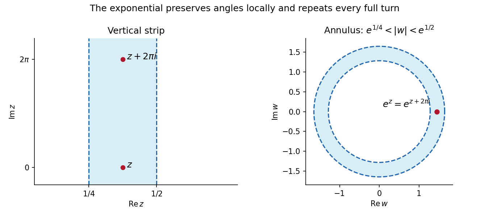

<h1 id="6/c/solution">Solution</h1>

↑ **Parent:** [C](../c.md)

The [complex exponential function](../../../../complex-exponential-function.md) gives the natural onto map:

$$
\boxed{w=e^z,\qquad e^{1/4}<|w|<e^{1/2}.}
$$

Its derivative is never zero, so it preserves angles locally. Conversely any point in this [annulus](../../../../annulus-mathematics.md) has a logarithm with real part in $(1/4,1/2)$, proving surjectivity.

There is a terminology qualification. This map is not injective, since $e^{z+2\pi i}=e^z$ and the strip contains both points. If “conformal mapping onto” requires a [biholomorphism](../../../../biholomorphism.md), no such map exists: the strip is convex and [simply connected space](../../../../simply-connected-space.md), whereas the [annulus](../../../../annulus-mathematics.md) contains a loop of [winding number](../../../../winding-number.md) one around zero that cannot contract inside it. A [biholomorphism](../../../../biholomorphism.md) would be a [homeomorphism](../../../../homeomorphism.md) and preserve this property.

Thus **the [complex exponential function](../../../../complex-exponential-function.md) is a locally conformal covering; a [biholomorphism](../../../../biholomorphism.md) is impossible**. It identifies imaginary translates by $2\pi i$. The printed request is satisfied under its local-angle-preserving convention, with the injectivity distinction made explicit. This is [exponential covering of an annulus by a vertical strip](../../../../exponential-covering-of-an-annulus-by-a-vertical-strip.md).

**[Figure 1](#6/c/image-the-strip-wraps-repeatedly-around-an-annulus-under-the-complex-exponential-function). The strip wraps repeatedly around an annulus under the complex exponential function**.

## ↑ Ancestors (12)

1. [C](../c.md)
2. [6](../../6.md)
3. [2007](../../../2007-split.md)
4. [Past exam of the algebra, analysis and differential equations 1 course of the University of Oxford](../../../split.md)
5. [Algebra, analysis and differential equations 1 course of the University of Oxford](../../../../algebra-analysis-and-differential-equations-1-course-of-the-university-of-oxford.md)
6. [Year 2 of the mathematics course of the University of Oxford](../../../../year-2-of-the-mathematics-course-of-the-university-of-oxford.md)
7. [Mathematics course of the University of Oxford](../../../../mathematics-course-of-the-university-of-oxford.md)
8. [Undergraduate course of the University of Oxford](../../../../undergraduate-course-of-the-university-of-oxford.md)
9. [Course of the University of Oxford](../../../../course-of-the-university-of-oxford.md)
10. [University of Oxford](../../../../university-of-oxford-split.md)
11. [List of universities](../../../../list-of-universities.md)
12. [Codex Wiki](../../../../split.md)
